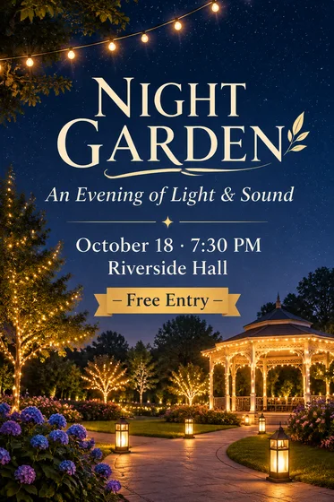

# Promotional Event Poster · Theme Promotional Poster

[中文](../../../README.md) · [English](../../../README.en.md) · [Português](../../../README.pt.md) · [Español](../../../README.es.md) · [Français](../../../README.fr.md) · [Deutsch](../../../README.de.md) · [عربي](../../../README.ar.md) · [русский](../../../README.ru.md) · [日本語](../../../README.ja.md) · [हिंदी](../../../README.hi.md)


Create one event poster from confirmed event facts and optional approved visual material.

Generate promotional posters from themes and copy. For online and offline promotion.

[Copy prompt](#public-prompt) · [ is produced by dearsketch / Try online](https://dearsketch.com/en/intent/i107-create-a-promotional-poster-from-a-topic-and-copy.html?utm_source=github&utm_medium=case&utm_campaign=dearsketch-public-cases&utm_content=i107_cta) · [Return to topic / Collection](../guides/design.md)

## Reference material and result direction

<p><strong>Example of results</strong></p>
<p><a href="https://dearsketch.com/en/intent/i107-create-a-promotional-poster-from-a-topic-and-copy.html?utm_source=github&amp;utm_medium=case&amp;utm_campaign=dearsketch-public-cases&amp;utm_content=i107_image"></a></p>
<p>This example does not include a picture reference, and the input preview is to be completed; see the material requirements below.</p>

The reference materials and results are used to illustrate the visual direction. The public template is not the original generation instruction for the accompanying images, and the same results are not guaranteed to be reproduced.

## What to prepare/Inputs

| Material | Type / Type | Quantity / Quantity | Condition / Requirement |
| --- | --- | --- | --- |
| The original text of the main visual material of the event | Picture/Image | 0–1; multiple materials can be combined into one labeled reference board | Optional/Optional: When the poster uses a specific person, product, work or brand logo |
| Event name, core information, time and location or participation method | Character / Text | 1 serving | Required / Required |

This time a single visual preview is generated. Data calculation, precise typesetting, vector or production files still need to be verified by corresponding tools.

## Retain and change / Editing brief

- **Preserve / 保留：** Keep supplied people, products, artwork, brand marks, and event facts exact.
- **Change / 改变：** Change layout, background, image treatment, hierarchy, and decorative system.

## Public prompt

**Newly edited public template · Newly authored · Not generation-tested.** Replace the square bracket parameters and attach the required materials in the tool that supports image editing; optional and conditional inputs are prepared according to the table above. This template was not used to generate the examples on this page.

```text
Create one promotional poster for [EVENT NAME] using [OPTIONAL APPROVED KEY VISUAL].
Use only these confirmed facts: [CORE MESSAGE], [DATE AND TIME], [LOCATION OR PARTICIPATION METHOD], and [CTA].
Preserve any supplied person, product, artwork, or brand mark without redesigning it.
Build a clear hierarchy for event name, message, logistics, and call to action.
Use [POSTER STYLE], [PALETTE], [IMAGE TREATMENT], and [FORMAT OR ASPECT RATIO].
Do not invent sponsors, speakers, endorsements, prices, availability, or event details.
Keep all exact wording readable and separate from decorative imagery.
Treat generated lettering as a visual draft requiring manual proofreading and final typesetting.
Verify bleed, resolution, color mode, accessibility, and output dimensions in a production tool when printing.
Deliver one poster preview image only.
```

[Make it online with your own materials / Make it online](https://dearsketch.com/en/intent/i107-create-a-promotional-poster-from-a-topic-and-copy.html?utm_source=github&utm_medium=case&utm_campaign=dearsketch-public-cases&utm_content=i107_after-prompt) · [Let Agent help you organize it / Use the Skill](../quickstart.md#agent-skill)

## Check the key points/Review

The time, location, participation method and event name are checked one by one. The generated diagram cannot replace the final layout check.

Proofread every event detail and rebuild precise type or print files separately.

Result direction: event poster. When exact text, transparent files, vectors or print delivery are required, check actual file; available features and fees are subject to website description.

## Related cases / Related tasks

- [Create a YouTube video thumbnail · YouTube video thumbnail ](./i106-create-a-youtube-video-thumbnail.md#public-prompt)
- [Create a Mother's Day, Black Friday, or holiday sale poster · Holiday sale poster](./i112-create-a-mother-s-day-black-friday-or-holiday-sale-poster.md#public-prompt)
- [Create a conference, exhibition, or speaking-event poster · Conference and exhibition poster](./i115-create-a-conference-exhibition-or-speaking-event-poster.md#public-prompt)

## Requirements background reference

- [Cutout.pro](https://www.cutout.pro/)
- [Picsart AI tool](https://picsart.com/ai/)

These links are only to aid in understanding the purpose and are not proof of the source or authorization of the images on this page.

For the scope of use of pictures and materials, see [ content description ](../content-policy.md). [View all 50 templates ](../prompts.md).
