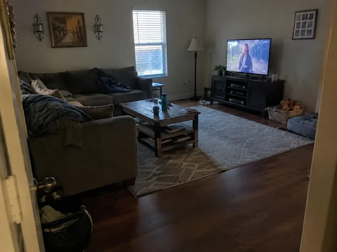
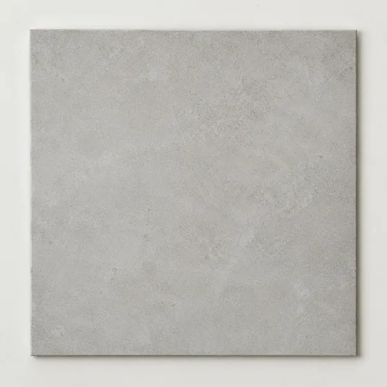
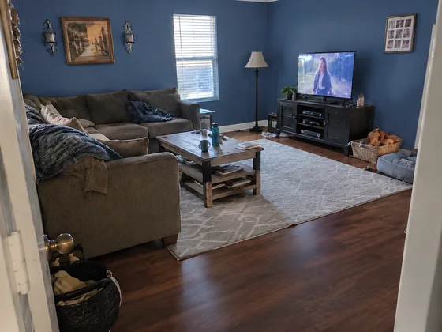

# Paint, Flooring, and Wallpaper Preview · Wall paint and floor material selection preview

[中文](../../../README.md) · [English](../../../README.en.md) · [Português](../../../README.pt.md) · [Español](../../../README.es.md) · [Français](../../../README.fr.md) · [Deutsch](../../../README.de.md) · [عربي](../../../README.ar.md) · [русский](../../../README.ru.md) · [日本語](../../../README.ja.md) · [हिंदी](../../../README.hi.md)


Replace specified room surfaces using either a supplied sample or an accurate color and material description.

Preview wall paint, floor and wallpaper effects. Used for decoration material selection.

[Copy prompt](#public-prompt) · [ is produced by dearsketch / Try online](https://dearsketch.com/en/intent/i171-preview-wall-paint-flooring-and-wallpaper.html?utm_source=github&utm_medium=case&utm_campaign=dearsketch-public-cases&utm_content=i171_cta) · [Return to topic / Collection](../guides/spaces.md)

## Reference material and result direction

<table>
<thead><tr><th width="50%">Reference material</th><th width="50%">Example of results</th></tr></thead>
<tbody><tr><td valign="top"><p><strong>indoor photos</strong><br></p>
<p><strong>Target material template</strong><br></p></td><td valign="top"><a href="https://dearsketch.com/en/intent/i171-preview-wall-paint-flooring-and-wallpaper.html?utm_source=github&amp;utm_medium=case&amp;utm_campaign=dearsketch-public-cases&amp;utm_content=i171_image"></a></td></tr></tbody>
</table>

The reference materials and results are used to illustrate the visual direction. The public template is not the original generation instruction for the accompanying images, and the same results are not guaranteed to be reproduced.

## What to prepare/Inputs

| Material | Type / Type | Quantity / Quantity | Condition / Requirement |
| --- | --- | --- | --- |
| indoor photos | Picture/Image | 1 piece | Required / Required |
| Target material template | Picture/Image | 0–1 image; exact text or color data may also be used | Conditional: When you need to reproduce specific textures or product samples |
| Replace surface with target color/material | Character / Text | 1 serving | Required / Required |

Only one image is generated at a time.

## Retain and change / Editing brief

- **Preserve / 保留：** Keep room structure, lighting logic, object placement, and untargeted surfaces.
- **Change / 改变：** Change only named walls, floor, or wallpaper areas.

## Public prompt

**Newly edited public template · Newly authored · Not generation-tested.** Replace the square bracket parameters and attach the required materials in the tool that supports image editing; optional and conditional inputs are prepared according to the table above. This template was not used to generate the examples on this page.

```text
Create one material preview from [INTERIOR PHOTO].
Choose one target branch: use [TARGET MATERIAL OR COLOR SAMPLE] when matching a specific texture or product, or use [ACCURATE COLOR AND MATERIAL DESCRIPTION] when no sample exists.
Apply the chosen [PAINT / FLOORING / WALLPAPER] only to [EXACT SURFACES TO REPLACE].
Preserve doors, windows, trim, furniture, room geometry, camera angle, and all untargeted surfaces.
When a sample is supplied, retain its dominant color, pattern scale, grain direction, and finish as closely as possible.
Respect corners, occlusion, seams, perspective, reflections, and existing light falloff.
Do not recolor furnishings, skin, artwork, or adjacent surfaces.
Do not invent named-product availability, dimensions, finish, or performance claims.
Treat the preview as an approximation; verify physical samples and measured quantities before purchase or installation.
Deliver one edited material-preview image only.
```

[Make it online with your own materials / Make it online](https://dearsketch.com/en/intent/i171-preview-wall-paint-flooring-and-wallpaper.html?utm_source=github&utm_medium=case&utm_campaign=dearsketch-public-cases&utm_content=i171_after-prompt) · [Let Agent help you organize it / Use the Skill](../quickstart.md#agent-skill)

## Check the key points/Review

Specified products should provide samples or accurate color information; the screen image cannot guarantee the same color difference as the actual product.

Compare with a sample when one exists and warn that screens cannot guarantee real material color.

Result direction: Material effects preview. When exact text, transparent files, vectors or print delivery are required, check actual file; available features and fees are subject to website description.

## Related cases / Related tasks

- [Turn a house photo into a watercolor or line-art keepsake · Residential watercolor commemorative painting ](./i030-turn-a-house-photo-into-a-watercolor-or-line-art-keepsake.md#public-prompt)
- [Preview different interior styles in a room photo · Room decoration style preview](./i169-preview-different-interior-styles-in-a-room-photo.md#public-prompt)
- [Create a landscape makeover concept from a yard photo · Yard landscape renovation ](./i178-create-a-landscape-makeover-concept-from-a-yard-photo.md#public-prompt)

## Requirements background reference

- [LightXAll Tools](https://www.lightxeditor.com/all-tools/all-tools/)
- [Adobe Home Concept](https://www.adobe.com/products/firefly/features/ai-room-design/home-design.html)

These links are only to aid in understanding the purpose and are not proof of the source or authorization of the images on this page.

For the scope of use of pictures and materials, see [ content description ](../content-policy.md). [View all 50 templates ](../prompts.md).
