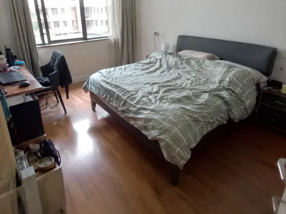
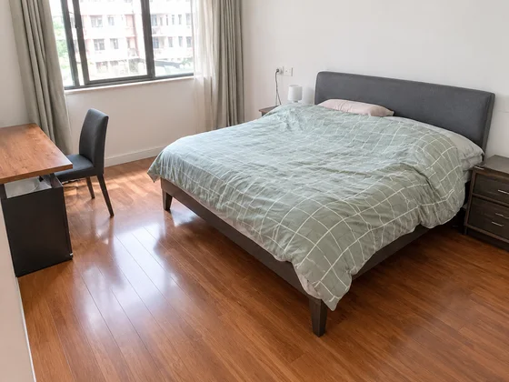

# Decluttered Property Photo · Property photo arrangement

[中文](../../../README.md) · [English](../../../README.en.md) · [Português](../../../README.pt.md) · [Español](../../../README.es.md) · [Français](../../../README.fr.md) · [Deutsch](../../../README.de.md) · [عربي](../../../README.ar.md) · [русский](../../../README.ru.md) · [日本語](../../../README.ja.md) · [हिंदी](../../../README.hi.md)


Clean up visible clutter while preserving the truthful condition and structure of a room.

Organize random room photos into a listing display. Used by real estate agents to sell listings.

[Copy prompt](#public-prompt) · [ is produced by dearsketch / Try online](https://dearsketch.com/en/intent/i176-turn-a-casual-room-photo-into-a-polished-property-listing-image.html?utm_source=github&utm_medium=case&utm_campaign=dearsketch-public-cases&utm_content=i176_cta) · [Return to topic / Collection](../guides/spaces.md)

## Reference material and result direction

<table>
<thead><tr><th width="50%">Reference material</th><th width="50%">Example of results</th></tr></thead>
<tbody><tr><td valign="top"><p><strong>Random photos of rooms with clutter</strong><br></p></td><td valign="top"><a href="https://dearsketch.com/en/intent/i176-turn-a-casual-room-photo-into-a-polished-property-listing-image.html?utm_source=github&amp;utm_medium=case&amp;utm_campaign=dearsketch-public-cases&amp;utm_content=i176_image"></a></td></tr></tbody>
</table>

The reference materials and results are used to illustrate the visual direction. The public template is not the original generation instruction for the accompanying images, and the same results are not guaranteed to be reproduced.

## What to prepare/Inputs

| Material | Type / Type | Quantity / Quantity | Condition / Requirement |
| --- | --- | --- | --- |
| Random photos of rooms with clutter | Picture/Image | 1 sheet; multiple characters or perspectives can be combined into one marked reference board | Required / Required |

Only one image is generated at a time.

## Retain and change / Editing brief

- **Preserve / 保留：** Keep layout, fixed elements, surfaces, lighting, and material defects.
- **Change / 改变：** Remove only listed movable clutter and make restrained presentation corrections.

## Public prompt

**Newly edited public template · Newly authored · Not generation-tested.** Replace the square bracket parameters and attach the required materials in the tool that supports image editing; optional and conditional inputs are prepared according to the table above. This template was not used to generate the examples on this page.

```text
Create one cleaned-up property image from [ROOM PHOTO].
Remove only these movable items: [APPROVED CLUTTER REMOVAL LIST].
Preserve the real room layout, walls, doors, windows, floor, ceiling, built-ins, fixtures, and camera view.
Do not erase cracks, stains, damage, structural issues, utility elements, or permanent features.
Do not enlarge the room, move openings, replace finishes, or add furniture unless explicitly requested.
Correct minor exposure, white balance, and verticals while keeping the scene natural.
Reconstruct exposed background areas consistently after approved objects are removed.
Keep reflections, shadows, edges, and material texture believable.
The result must remain a truthful presentation of the property, not a renovation concept.
Deliver one cleaned property image only.
```

[Make it online with your own materials / Make it online](https://dearsketch.com/en/intent/i176-turn-a-casual-room-photo-into-a-polished-property-listing-image.html?utm_source=github&utm_medium=case&utm_campaign=dearsketch-public-cases&utm_content=i176_after-prompt) · [Let Agent help you organize it / Use the Skill](../quickstart.md#agent-skill)

## Check the key points/Review

Do not cover up the real defects of the house, and do not change the house type and fixed structure.

Ensure no damage or permanent feature is hidden or altered.

What in the direction of result: A neat listing sales presentation. When exact text, transparent files, vectors or print delivery are required, check actual file; available features and fees are subject to website description.

## Related cases / Related tasks

- [Turn a house photo into a watercolor or line-art keepsake · Residential watercolor commemorative painting ](./i030-turn-a-house-photo-into-a-watercolor-or-line-art-keepsake.md#public-prompt)
- [Preview different interior styles in a room photo · Room decoration style preview](./i169-preview-different-interior-styles-in-a-room-photo.md#public-prompt)
- [Create a landscape makeover concept from a yard photo · Yard landscape renovation ](./i178-create-a-landscape-makeover-concept-from-a-yard-photo.md#public-prompt)

## Requirements background reference

- [LightXAll Tools](https://www.lightxeditor.com/all-tools/all-tools/)

These links are only to aid in understanding the purpose and are not proof of the source or authorization of the images on this page.

For the scope of use of pictures and materials, see [ content description ](../content-policy.md). [View all 50 templates ](../prompts.md).
