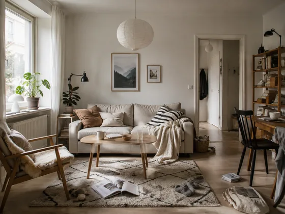
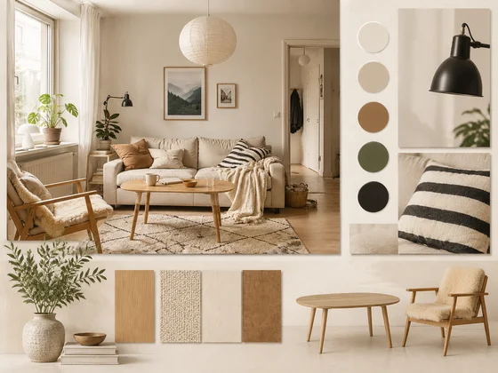

# Interior or Architecture Mood Board · Space Design Mood Board

[中文](../../../README.md) · [English](../../../README.en.md) · [Português](../../../README.pt.md) · [Español](../../../README.es.md) · [Français](../../../README.fr.md) · [Deutsch](../../../README.de.md) · [عربي](../../../README.ar.md) · [русский](../../../README.ru.md) · [日本語](../../../README.ja.md) · [हिंदी](../../../README.hi.md)


Build a design-direction board from optional references or from a project type and keyword brief.

Generate mood boards for architecture or interior projects. For client alignment,proposals.

[Copy prompt](#public-prompt) · [ is produced by dearsketch / Try online](https://dearsketch.com/en/intent/i182-create-a-mood-board-for-an-architecture-or-interior-project.html?utm_source=github&utm_medium=case&utm_campaign=dearsketch-public-cases&utm_content=i182_cta) · [Return to topic / Collection](../guides/spaces.md)

## Reference material and result direction

<table>
<thead><tr><th width="50%">Reference material</th><th width="50%">Example of results</th></tr></thead>
<tbody><tr><td valign="top"><p><strong>Space atmosphere and materials reference board</strong><br></p></td><td valign="top"><a href="https://dearsketch.com/en/intent/i182-create-a-mood-board-for-an-architecture-or-interior-project.html?utm_source=github&amp;utm_medium=case&amp;utm_campaign=dearsketch-public-cases&amp;utm_content=i182_image"></a></td></tr></tbody>
</table>

The reference materials and results are used to illustrate the visual direction. The public template is not the original generation instruction for the accompanying images, and the same results are not guaranteed to be reproduced.

## What to prepare/Inputs

| Material | Type / Type | Quantity / Quantity | Condition / Requirement |
| --- | --- | --- | --- |
| Space atmosphere and materials reference board | Picture/Image | 0 – Multiple pictures; can be combined into a mood board labeled by category for input | Optional/Optional: When the user already has direction material |
| Project type and keywords | Character / Text | 1 serving | Required / Required |

Only one image is generated at a time.

## Retain and change / Editing brief

- **Preserve / 保留：** Keep supplied reference colors and material identities only when references exist.
- **Change / 改变：** Change layout, hierarchy, crops, annotations, and supporting generated swatches.

## Public prompt

**Newly edited public template · Newly authored · Not generation-tested.** Replace the square bracket parameters and attach the required materials in the tool that supports image editing; optional and conditional inputs are prepared according to the table above. This template was not used to generate the examples on this page.

```text
Create one mood board for [PROJECT TYPE] using [DESIGN KEYWORDS].
Choose one branch: organize [OPTIONAL REFERENCE BOARD OR LABELED IMAGES] when supplied, or develop a text-led direction when no references exist.
For the reference branch, preserve recognizable colors, textures, material identities, and atmosphere.
For the text-only branch, use [PALETTE], [MATERIAL DIRECTION], [FORM LANGUAGE], and [LIGHTING MOOD] without implying specific sourced products.
Use a clear [EDITORIAL / MATERIAL-LIBRARY / COLLAGE] hierarchy with clean spacing.
Label only confirmed generic material names or exact product names supplied by the user.
Do not invent manufacturers, product codes, prices, availability, dimensions, or performance claims.
Do not imply that visually similar generated materials are actual specified products.
Treat the board as direction-setting inspiration; procurement and physical samples require separate confirmation.
Deliver one self-contained mood-board image only.
```

[Make it online with your own materials / Make it online](https://dearsketch.com/en/intent/i182-create-a-mood-board-for-an-architecture-or-interior-project.html?utm_source=github&utm_medium=case&utm_campaign=dearsketch-public-cases&utm_content=i182_after-prompt) · [Let Agent help you organize it / Use the Skill](../quickstart.md#agent-skill)

## Check the key points/Review

The mood board is for design communication, not a purchasing list; specific products, sizes and prices need to be confirmed.

Treat the board as inspiration, not a confirmed product or procurement list.

Results in the direction of: Mood Board. When exact text, transparent files, vectors or print delivery are required, check actual file; available features and fees are subject to website description.

## Related cases / Related tasks

- [Turn a house photo into a watercolor or line-art keepsake · Residential watercolor commemorative painting ](./i030-turn-a-house-photo-into-a-watercolor-or-line-art-keepsake.md#public-prompt)
- [Preview different interior styles in a room photo · Room decoration style preview](./i169-preview-different-interior-styles-in-a-room-photo.md#public-prompt)
- [Create a landscape makeover concept from a yard photo · Yard landscape renovation ](./i178-create-a-landscape-makeover-concept-from-a-yard-photo.md#public-prompt)

## Requirements background reference

- [Adobe Firefly features](https://www.adobe.com/products/firefly/features)
- [Adobe building generation ](https://www.adobe.com/products/firefly/features/ai-architecture-generator.html)

These links are only to aid in understanding the purpose and are not proof of the source or authorization of the images on this page.

For the scope of use of pictures and materials, see [ content description ](../content-policy.md). [View all 50 templates ](../prompts.md).
