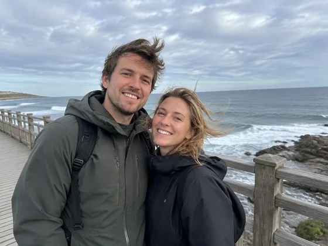

# Personalized Movie Poster · Individual and couple movie posters

[中文](../../../README.md) · [English](../../../README.en.md) · [Português](../../../README.pt.md) · [Español](../../../README.es.md) · [Français](../../../README.fr.md) · [Deutsch](../../../README.de.md) · [عربي](../../../README.ar.md) · [русский](../../../README.ru.md) · [日本語](../../../README.ja.md) · [हिंदी](../../../README.hi.md)


Create an original fictional movie poster around supplied people and a supplied title.

Turn individual or couple photos into movie posters. For weddings, anniversaries, birthdays and gifts.

[Copy prompt](#public-prompt) · [ is produced by dearsketch / Try online](https://dearsketch.com/en/intent/i252-turn-a-personal-or-couple-photo-into-a-movie-poster.html?utm_source=github&utm_medium=case&utm_campaign=dearsketch-public-cases&utm_content=i252_cta) · [Return to topic / Collection](../guides/people.md)

## Reference material and result direction

<table>
<thead><tr><th width="50%">Reference material</th><th width="50%">Example of results</th></tr></thead>
<tbody><tr><td valign="top"><p><strong>Original photos of individuals, couples or groups</strong><br></p></td><td valign="top"><a href="https://dearsketch.com/en/intent/i252-turn-a-personal-or-couple-photo-into-a-movie-poster.html?utm_source=github&amp;utm_medium=case&amp;utm_campaign=dearsketch-public-cases&amp;utm_content=i252_image"></a></td></tr></tbody>
</table>

The reference materials and results are used to illustrate the visual direction. The public template is not the original generation instruction for the accompanying images, and the same results are not guaranteed to be reproduced.

## What to prepare/Inputs

| Material | Type / Type | Quantity / Quantity | Condition / Requirement |
| --- | --- | --- | --- |
| Original photos of individuals, couples or groups | Picture/Image | 1 piece | Required / Required |
| Original poster theme and title | Character / Text | 1 serving | Required / Required |
| Signature and date | Character / Text | 0 or 1 group | Optional / Optional |

Only one image is generated at a time.

## Retain and change / Editing brief

- **Preserve / 保留：** Keep every person’s identity and all confirmed billing text.
- **Change / 改变：** Change cinematic setting, genre treatment, lighting, composition, and typography concept.

## Public prompt

**Newly edited public template · Newly authored · Not generation-tested.** Replace the square bracket parameters and attach the required materials in the tool that supports image editing; optional and conditional inputs are prepared according to the table above. This template was not used to generate the examples on this page.

```text
Create one original fictional movie poster from [PERSON / COUPLE / GROUP PHOTO].
Use the genre and premise [ORIGINAL POSTER CONCEPT] and the exact title “[EXACT MOVIE TITLE]”.
Preserve every supplied person’s identity, count, facial features, skin tone, hair, and relationship.
Compose a cinematic [PORTRAIT / LANDSCAPE] layout with [SETTING], [PALETTE], and [LIGHTING].
If provided, include only the confirmed credit line “[EXACT CREDIT]” and date “[EXACT DATE]”.
Do not invent actors, studios, reviews, awards, ratings, or release claims.
Do not copy an existing movie poster, franchise character, logo, or signature composition.
Keep hands, overlaps, scale, and atmospheric effects coherent.
Treat generated lettering as a draft requiring manual proofreading and final typesetting.
Deliver one poster concept image only, not print-ready production artwork.
```

[Make it online with your own materials / Make it online](https://dearsketch.com/en/intent/i252-turn-a-personal-or-couple-photo-into-a-movie-poster.html?utm_source=github&utm_medium=case&utm_campaign=dearsketch-public-cases&utm_content=i252_after-prompt) · [Let Agent help you organize it / Use the Skill](../quickstart.md#agent-skill)

## Check the key points/Review

Use the film title and signature to confirm the content; check the accuracy of the text and the identity of the characters, and do not pretend to be a real movie promotion.

Proofread all wording and avoid implying a real film release.

Result direction: personalized movie posters. When exact text, transparent files, vectors or print delivery are required, check actual file; available features and fees are subject to website description.

## Related cases / Related tasks

- [Create a professional LinkedIn headshot from a selfie · Selfie to professional headshot ](./i001-create-a-professional-linkedin-headshot-from-a-selfie.md#public-prompt)
- [Replace casual clothing with professional attire · ](./i015-replace-casual-clothing-with-professional-attire.md#public-prompt)
- [Turn yourself into a royal, vintage, or historical portrait · Royal and vintage portrait ](./i052-turn-yourself-into-a-royal-vintage-or-historical-portrait.md#public-prompt)

## Requirements background reference

- [Etsy Family Portrait](https://www.etsy.com/market/ai_family_portrait)

These links are only to aid in understanding the purpose and are not proof of the source or authorization of the images on this page.

For the scope of use of pictures and materials, see [ content description ](../content-policy.md). [View all 50 templates ](../prompts.md).
