# Family, remembrance and emotion

[中文](../../../README.md) · [English](../../../README.en.md) · [Português](../../../README.pt.md) · [Español](../../../README.es.md) · [Français](../../../README.fr.md) · [Deutsch](../../../README.de.md) · [عربي](../../../README.ar.md) · [русский](../../../README.ru.md) · [日本語](../../../README.ja.md) · [हिंदी](../../../README.hi.md)

19 cases outside the featured catalogue. The prompt words are not disclosed here, only the existing reference materials, result directions and minimum material requirements are displayed.

[Return to more case catalogs](./index.md) · [Return to warehouse homepage](../../../README.en.md)

> Reference materials and result images are for visual guidance only; there is no guarantee that the same effect can be reproduced using the same materials.

## I018 · Add relatives who were unable to attend the family photo

<table>
<thead><tr><th width="50%">Reference material</th><th width="50%">Example of results</th></tr></thead>
<tbody><tr><td valign="top">
<strong>Original family photo</strong> 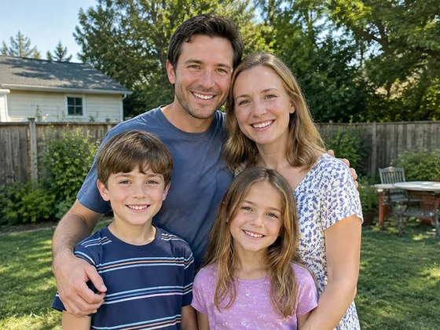

<strong>Clear photos of absent members</strong> 
</td><td valign="top"><a href="https://dearsketch.com/en/intent/i018-add-an-absent-family-member-to-a-group-photo.html?utm_source=github&amp;utm_medium=gallery&amp;utm_campaign=dearsketch-public-cases&amp;utm_content=i018_image">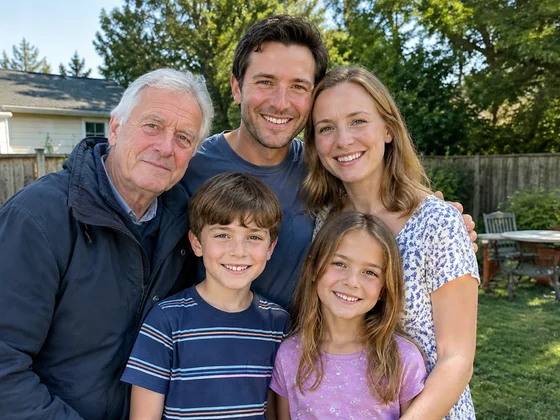</a></td></tr></tbody>
</table>

- **Input type:** Includes reference material preview and result example
- **Material requirements:** 1 original family photo + at least 1 clear photo of the absent member for each absentee
- **Description:** Only one picture is generated at a time.

[ Check the specific requirements in dearsketch and make ](https://dearsketch.com/en/intent/i018-add-an-absent-family-member-to-a-group-photo.html?utm_source=github&utm_medium=gallery&utm_campaign=dearsketch-public-cases&utm_content=i018_cta)

---

## I019 · Add deceased loved ones to memorial portraits

<table>
<thead><tr><th width="50%">Reference material</th><th width="50%">Example of results</th></tr></thead>
<tbody><tr><td valign="top">
<strong>Photos of commemorative objects</strong> 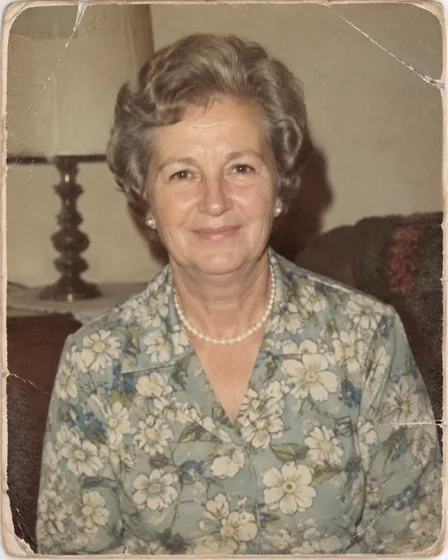

<strong>Photos of other members included in the picture</strong> 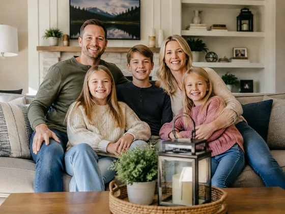
</td><td valign="top"><a href="https://dearsketch.com/en/intent/i019-add-a-deceased-loved-one-to-a-memorial-portrait.html?utm_source=github&amp;utm_medium=gallery&amp;utm_campaign=dearsketch-public-cases&amp;utm_content=i019_image">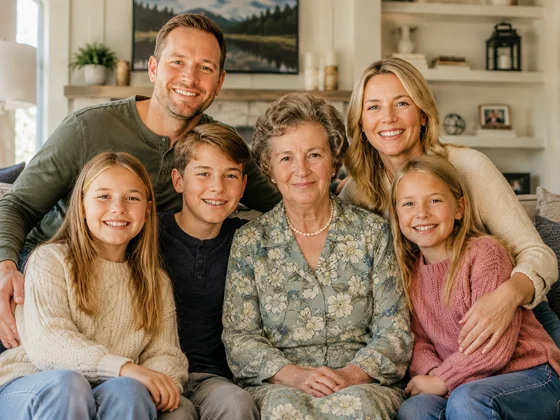</a></td></tr></tbody>
</table>

- **Input type:** Includes reference material preview and result example
- **Material requirements:** At least 1 photo of the commemorative object + at least 1 photo of each other member included in the painting
- **Description:** Only one picture is generated at a time.

[ Check the specific requirements in dearsketch and make ](https://dearsketch.com/en/intent/i019-add-a-deceased-loved-one-to-a-memorial-portrait.html?utm_source=github&utm_medium=gallery&utm_campaign=dearsketch-public-cases&utm_content=i019_cta)

---

## I024 · Simulate future baby image from parents’ photos

<table>
<thead><tr><th width="50%">Reference material</th><th width="50%">Example of results</th></tr></thead>
<tbody><tr><td valign="top">
<strong>Clear positive image of mother</strong> 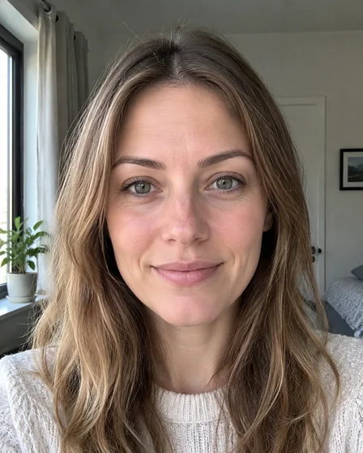

<strong>Clear positive image of father</strong> 
</td><td valign="top"><a href="https://dearsketch.com/en/intent/i024-visualize-a-future-baby-from-photos-of-the-parents.html?utm_source=github&amp;utm_medium=gallery&amp;utm_campaign=dearsketch-public-cases&amp;utm_content=i024_image">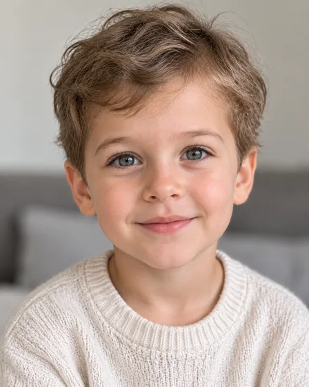</a></td></tr></tbody>
</table>

- **Input type:** Includes reference material preview and result example
- **Material requirements:** 1 picture or a clear frontal image of the father in a legible area in the same frame + 1 picture or a clear frontal image of the mother in a legible area in the same frame
- **Description:** Only one picture is generated at a time.

[ Check the specific requirements in dearsketch and make ](https://dearsketch.com/en/intent/i024-visualize-a-future-baby-from-photos-of-the-parents.html?utm_source=github&utm_medium=gallery&utm_campaign=dearsketch-public-cases&utm_content=i024_cta)

---

## I240 · Organize family members and relationships into a family tree with photos

<strong>Example of results</strong>

<a href="https://dearsketch.com/en/intent/i240-create-a-photo-family-tree-with-names-and-relationships.html?utm_source=github&amp;utm_medium=gallery&amp;utm_campaign=dearsketch-public-cases&amp;utm_content=i240_image">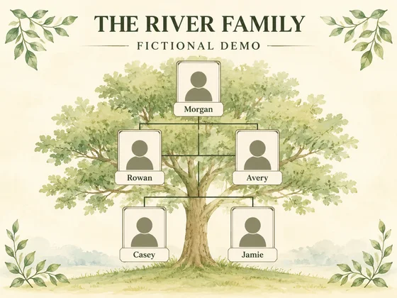</a>

This example does not include a picture reference, and the input preview is to be completed; see the material requirements below.

- **Input type:** This example only shows result examples; image input preview is to be added
- **Material requirements:** Required member and kinship relationship data (1 copy) + Optional member photos (0 or 1 for each member)
- **Description:** This time a single visual preview is generated. Data calculation, precise typesetting, vector or production files still need to be verified by corresponding tools.

[ Check the specific requirements in dearsketch and make ](https://dearsketch.com/en/intent/i240-create-a-photo-family-tree-with-names-and-relationships.html?utm_source=github&utm_medium=gallery&utm_campaign=dearsketch-public-cases&utm_content=i240_cta)

---

## I243 · Create a birth information poster with name, date, weight and height

<table>
<thead><tr><th width="50%">Reference material</th><th width="50%">Example of results</th></tr></thead>
<tbody><tr><td valign="top">
<strong>Baby's photo</strong> 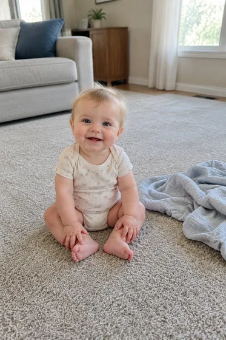
</td><td valign="top"><a href="https://dearsketch.com/en/intent/i243-create-a-birth-statistics-poster-with-a-baby-s-details.html?utm_source=github&amp;utm_medium=gallery&amp;utm_campaign=dearsketch-public-cases&amp;utm_content=i243_image">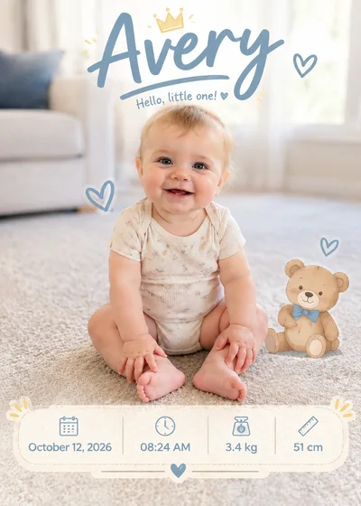</a></td></tr></tbody>
</table>

- **Input type:** Includes reference material preview and result example
- **Material requirements:** Required photo of the baby (1 photo) + Required birth information (1 copy)
- **Description:** This time a single visual preview is generated. Data calculation, precise typesetting, vector or production files still need to be verified by corresponding tools.

[ Check the specific requirements in dearsketch and make ](https://dearsketch.com/en/intent/i243-create-a-birth-statistics-poster-with-a-baby-s-details.html?utm_source=github&utm_medium=gallery&utm_campaign=dearsketch-public-cases&utm_content=i243_cta)

---

## I244 · Save handwritten recipes or letters as commemorative works of art

<table>
<thead><tr><th width="50%">Reference material</th><th width="50%">Example of results</th></tr></thead>
<tbody><tr><td valign="top">
<strong>Scanned copy of handwritten recipe, letter or signature</strong> 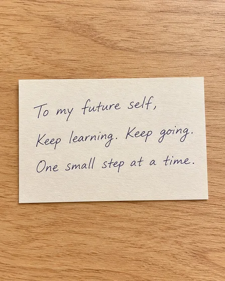
</td><td valign="top"><a href="https://dearsketch.com/en/intent/i244-preserve-a-handwritten-recipe-or-letter-as-keepsake-art.html?utm_source=github&amp;utm_medium=gallery&amp;utm_campaign=dearsketch-public-cases&amp;utm_content=i244_image">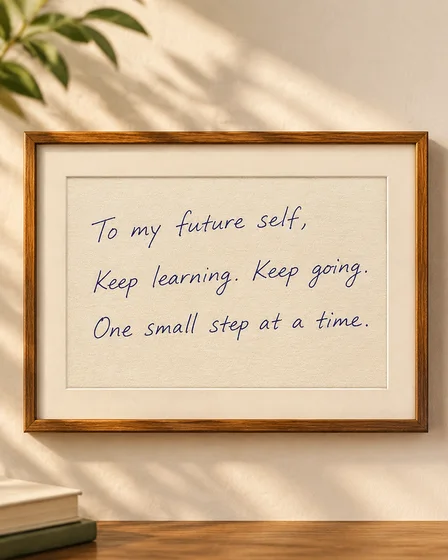</a></td></tr></tbody>
</table>

- **Input type:** Includes reference material preview and result example
- **Material requirements:** Required handwritten recipe, letter or scan of signature (1 piece) + Required commemorative artwork purpose (1 item)
- **Description:** This time a single visual preview is generated. Data calculation, precise typesetting, vector or production files still need to be verified by corresponding tools.

[ Check the specific requirements in dearsketch and make ](https://dearsketch.com/en/intent/i244-preserve-a-handwritten-recipe-or-letter-as-keepsake-art.html?utm_source=github&utm_medium=gallery&utm_campaign=dearsketch-public-cases&utm_content=i244_cta)

---

## I246 · Make the wedding venue into an invitation or commemorative illustration

<table>
<thead><tr><th width="50%">Reference material</th><th width="50%">Example of results</th></tr></thead>
<tbody><tr><td valign="top">
<strong>wedding venue photos</strong> 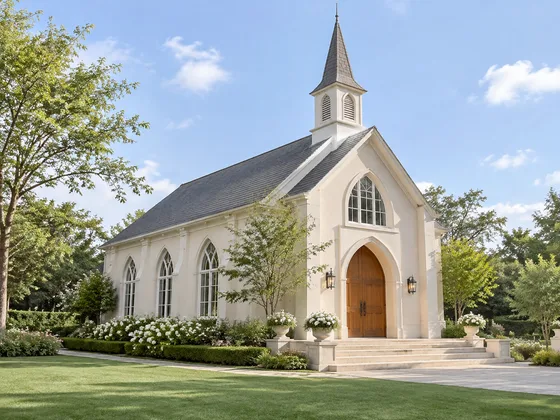
</td><td valign="top"><a href="https://dearsketch.com/en/intent/i246-turn-a-wedding-venue-into-an-invitation-or-keepsake-illustration.html?utm_source=github&amp;utm_medium=gallery&amp;utm_campaign=dearsketch-public-cases&amp;utm_content=i246_image">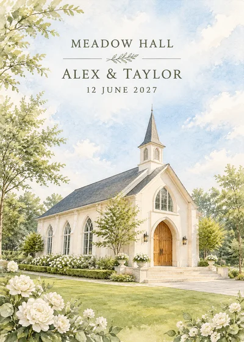</a></td></tr></tbody>
</table>

- **Input type:** Includes reference material preview and result example
- **Material requirements:** Required wedding venue photo (1 photo) + Required delivery type and venue name (1 set) + Optional wedding name, date and address (0 or 1 set)
- **Description:** Only one picture is generated at a time.

[ Check the specific requirements in dearsketch and make ](https://dearsketch.com/en/intent/i246-turn-a-wedding-venue-into-an-invitation-or-keepsake-illustration.html?utm_source=github&utm_medium=gallery&utm_campaign=dearsketch-public-cases&utm_content=i246_cta)

---

## I248 · Create a yearbook with class team or family photos

<table>
<thead><tr><th width="50%">Reference material</th><th width="50%">Example of results</th></tr></thead>
<tbody><tr><td valign="top">
<strong>Original photo of current member F03</strong> 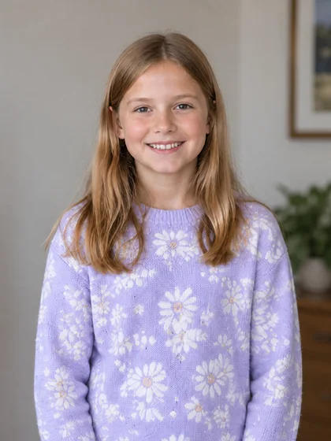
</td><td valign="top"><a href="https://dearsketch.com/en/intent/i248-turn-class-team-or-family-photos-into-a-yearbook.html?utm_source=github&amp;utm_medium=gallery&amp;utm_campaign=dearsketch-public-cases&amp;utm_content=i248_image">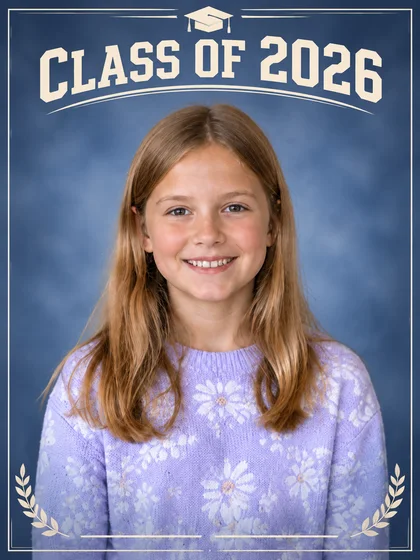</a></td></tr></tbody>
</table>

- **Input type:** Includes reference material preview and result example
- **Material requirements:** Required yearbook original photo of each member (at least 1 for each member) + Required member list and grouping (1 copy) + Required year, chapter and activity information (1 copy)
- **Description:** This time a single visual preview is generated. Data calculation, precise typesetting, vector or production files still need to be verified by corresponding tools.

[ Check the specific requirements in dearsketch and make ](https://dearsketch.com/en/intent/i248-turn-class-team-or-family-photos-into-a-yearbook.html?utm_source=github&utm_medium=gallery&utm_campaign=dearsketch-public-cases&utm_content=i248_cta)

---

## I249 · Use photos and biographical information to create a memorial program

<table>
<thead><tr><th width="50%">Reference material</th><th width="50%">Example of results</th></tr></thead>
<tbody><tr><td valign="top">
<strong>Portraits or commemorative photos of the deceased</strong> 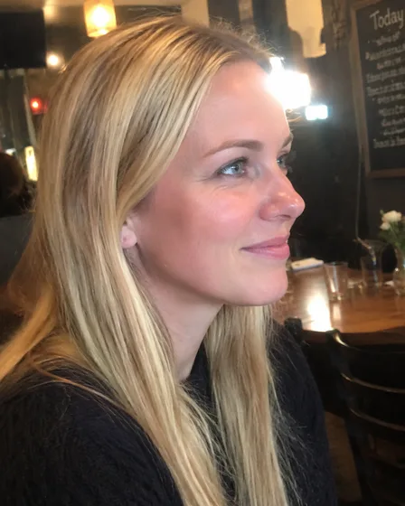
</td><td valign="top"><a href="https://dearsketch.com/en/intent/i249-create-a-memorial-service-program-from-photos-and-biographical-details.html?utm_source=github&amp;utm_medium=gallery&amp;utm_campaign=dearsketch-public-cases&amp;utm_content=i249_image">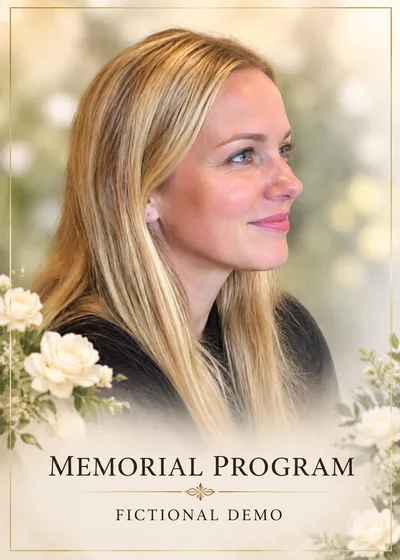</a></td></tr></tbody>
</table>

- **Input type:** Includes reference material preview and result example
- **Material requirements:** Required portrait or commemorative photo of the deceased (1 photo) + Required memorial program content package (1 copy)
- **Description:** This time a single visual preview is generated. Data calculation, precise typesetting, vector or production files still need to be verified by corresponding tools.

[ Check the specific requirements in dearsketch and make ](https://dearsketch.com/en/intent/i249-create-a-memorial-service-program-from-photos-and-biographical-details.html?utm_source=github&utm_medium=gallery&utm_campaign=dearsketch-public-cases&utm_content=i249_cta)

---

## I250 · Create a memory board or commemorative collage from multiple photos

<table>
<thead><tr><th width="50%">Reference material</th><th width="50%">Example of results</th></tr></thead>
<tbody><tr><td valign="top">
<strong>Group photo of traveling people</strong> 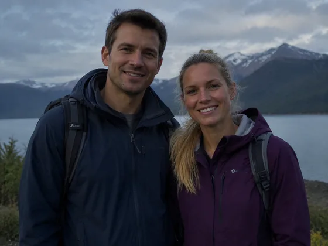

<strong>Travel life photos of the same group</strong> 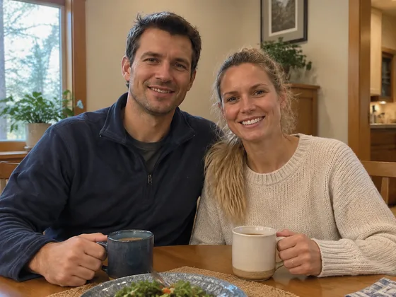

<strong>The same group of mountain and lake environment photos</strong> 

<strong>Photos of the same group of travel items</strong> 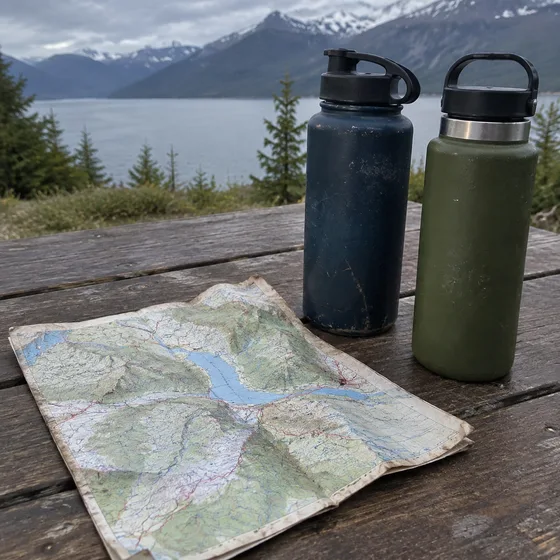
</td><td valign="top"><a href="https://dearsketch.com/en/intent/i250-create-a-memory-board-or-memorial-collage-from-multiple-photos.html?utm_source=github&amp;utm_medium=gallery&amp;utm_campaign=dearsketch-public-cases&amp;utm_content=i250_image">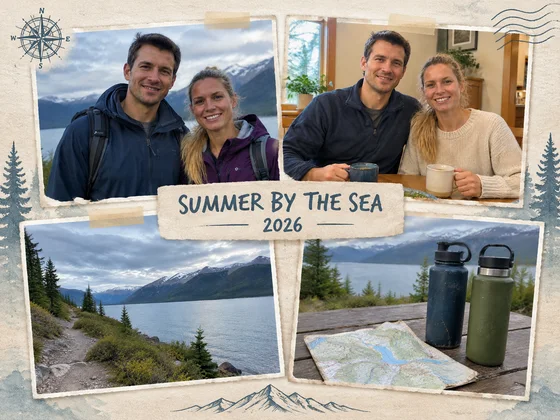</a></td></tr></tbody>
</table>

- **Input type:** Includes reference material preview and result example
- **Material requirements:** Required memory board/commemorative collage original photos (2 or more) + required time/theme sequence (1 copy) + optional title and date (0 or 1 group)
- **Description:** Only one picture is generated at a time.

[ Check the specific requirements in dearsketch and make ](https://dearsketch.com/en/intent/i250-create-a-memory-board-or-memorial-collage-from-multiple-photos.html?utm_source=github&utm_medium=gallery&utm_campaign=dearsketch-public-cases&utm_content=i250_cta)

---

## I251 · Turn personal photos into magazine or newspaper covers

<table>
<thead><tr><th width="50%">Reference material</th><th width="50%">Example of results</th></tr></thead>
<tbody><tr><td valign="top">
<strong>Personal commemorative cover photo</strong> 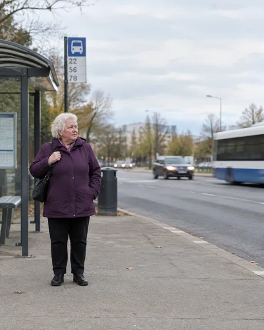
</td><td valign="top"><a href="https://dearsketch.com/en/intent/i251-turn-a-personal-photo-into-a-magazine-or-newspaper-cover.html?utm_source=github&amp;utm_medium=gallery&amp;utm_campaign=dearsketch-public-cases&amp;utm_content=i251_image">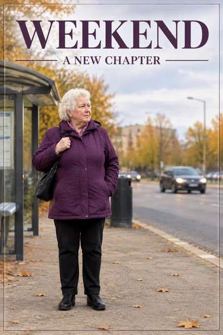</a></td></tr></tbody>
</table>

- **Input type:** Includes reference material preview and result example
- **Material requirements:** Required personal commemorative cover main photo (1 photo) + required commemorative cover copy (1 copy) + optional date and auxiliary short copy (0 or 1 set)
- **Description:** Only one picture is generated at a time.

[ Check the specific requirements in dearsketch and make ](https://dearsketch.com/en/intent/i251-turn-a-personal-photo-into-a-magazine-or-newspaper-cover.html?utm_source=github&utm_medium=gallery&utm_campaign=dearsketch-public-cases&utm_content=i251_cta)

---

## I253 · Turn photos of children or athletes into sports collection cards

<table>
<thead><tr><th width="50%">Reference material</th><th width="50%">Example of results</th></tr></thead>
<tbody><tr><td valign="top">
<strong>Original photo of the character to whom the collection card belongs</strong> 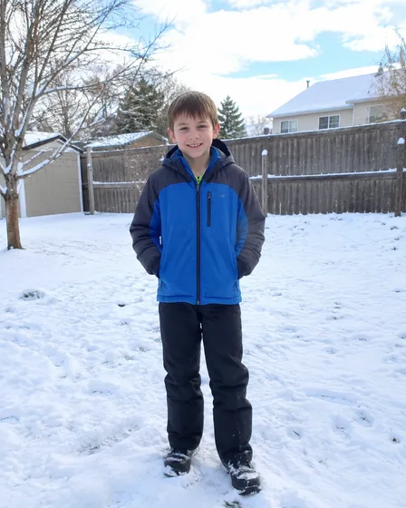
</td><td valign="top"><a href="https://dearsketch.com/en/intent/i253-turn-a-child-or-athlete-photo-into-a-sports-trading-card.html?utm_source=github&amp;utm_medium=gallery&amp;utm_campaign=dearsketch-public-cases&amp;utm_content=i253_image">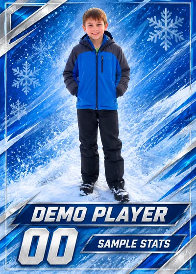</a></td></tr></tbody>
</table>

- **Input type:** Includes reference material preview and result example
- **Material requirements:** Required original photo of the character to whom the collection card belongs (1 photo) + Required athlete name and sport (1 set) + Condition number, team and statistical data (1 copy)
- **Description:** This time a single visual preview is generated. Data calculation, precise typesetting, vector or production files still need to be verified by corresponding tools.

[ Check the specific requirements in dearsketch and make ](https://dearsketch.com/en/intent/i253-turn-a-child-or-athlete-photo-into-a-sports-trading-card.html?utm_source=github&utm_medium=gallery&utm_campaign=dearsketch-public-cases&utm_content=i253_cta)

---

## I254 · Create birth, graduation, moving or obituary announcement cards with photos

<table>
<thead><tr><th width="50%">Reference material</th><th width="50%">Example of results</th></tr></thead>
<tbody><tr><td valign="top">
<strong>Life event announcement main photo</strong> 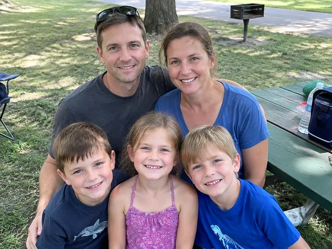
</td><td valign="top"><a href="https://dearsketch.com/en/intent/i254-create-a-photo-announcement-for-a-birth-graduation-move-or-memorial.html?utm_source=github&amp;utm_medium=gallery&amp;utm_campaign=dearsketch-public-cases&amp;utm_content=i254_image">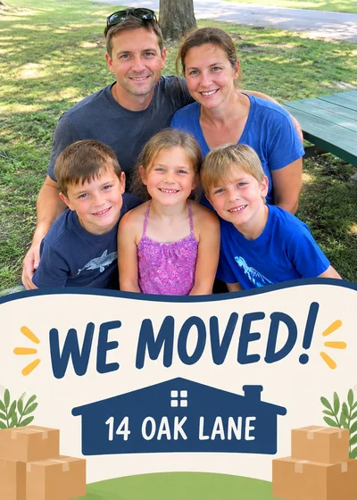</a></td></tr></tbody>
</table>

- **Input type:** Includes reference material preview and result example
- **Material requirements:** Main photo of necessary life event announcement (1 photo) + necessary life event facts (1 copy)
- **Description:** Only one picture is generated at a time.

[ Check the specific requirements in dearsketch and make ](https://dearsketch.com/en/intent/i254-create-a-photo-announcement-for-a-birth-graduation-move-or-memorial.html?utm_source=github&utm_medium=gallery&utm_campaign=dearsketch-public-cases&utm_content=i254_cta)

---

## I289 · Create Quinceañera fifteenth birthday invitation or background with girly photos

<table>
<thead><tr><th width="50%">Reference material</th><th width="50%">Example of results</th></tr></thead>
<tbody><tr><td valign="top">
<strong>Personal photo of the protagonist of the fifteenth birthday ceremony</strong> 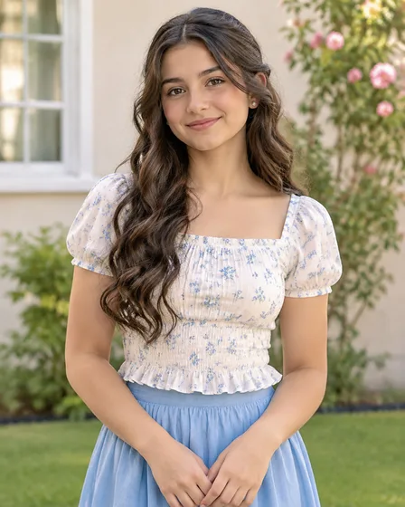
</td><td valign="top"><a href="https://dearsketch.com/en/intent/i289-create-a-quinceanera-invitation-or-backdrop-from-a-portrait.html?utm_source=github&amp;utm_medium=gallery&amp;utm_campaign=dearsketch-public-cases&amp;utm_content=i289_image">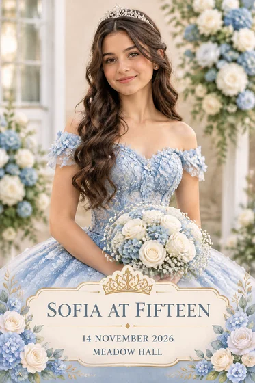</a></td></tr></tbody>
</table>

- **Input type:** Includes reference material preview and result example
- **Material requirements:** Required photo of the fifteenth-year-old gift protagonist (1 photo) + Required name, date, location and event information (1 copy) + Required current delivery type and theme color (1 set) + Conditionally specified celebration layout template (1 copy)
- **Description:** Only one picture is generated at a time.

[ Check the specific requirements in dearsketch and make ](https://dearsketch.com/en/intent/i289-create-a-quinceanera-invitation-or-backdrop-from-a-portrait.html?utm_source=github&utm_medium=gallery&utm_campaign=dearsketch-public-cases&utm_content=i289_cta)

---

## I290 · Use children’s photos to create First Communion or Baptism commemorative cards

<table>
<thead><tr><th width="50%">Reference material</th><th width="50%">Example of results</th></tr></thead>
<tbody><tr><td valign="top">
<strong>Photos of children belonging to ceremony commemorative cards</strong> 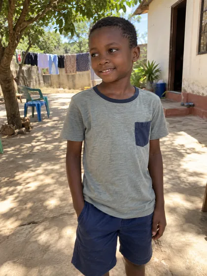
</td><td valign="top"><a href="https://dearsketch.com/en/intent/i290-create-a-first-communion-or-baptism-keepsake-card-from-a-child-s-photo.html?utm_source=github&amp;utm_medium=gallery&amp;utm_campaign=dearsketch-public-cases&amp;utm_content=i290_image">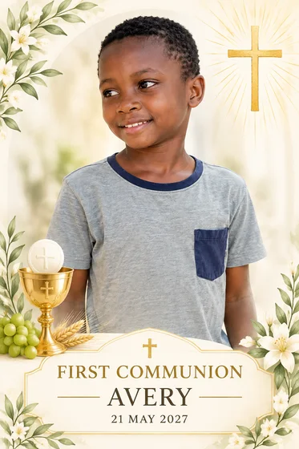</a></td></tr></tbody>
</table>

- **Input type:** Includes reference material preview and result example
- **Material requirements:** Photos of the children belonging to the required ceremony commemorative card (1 copy) + required ceremony, name, date and location (1 copy) + conditional religious graphics or scripture assets (1 copy)
- **Description:** Only one picture is generated at a time.

[ Check the specific requirements in dearsketch and make ](https://dearsketch.com/en/intent/i290-create-a-first-communion-or-baptism-keepsake-card-from-a-child-s-photo.html?utm_source=github&utm_medium=gallery&utm_campaign=dearsketch-public-cases&utm_content=i290_cta)

---

## I291 · Make Aqiqah or Tasmiyah invitations with baby photos

<table>
<thead><tr><th width="50%">Reference material</th><th width="50%">Example of results</th></tr></thead>
<tbody><tr><td valign="top">
<strong>Aqiqah/Tasmiyah protagonist baby photos</strong> 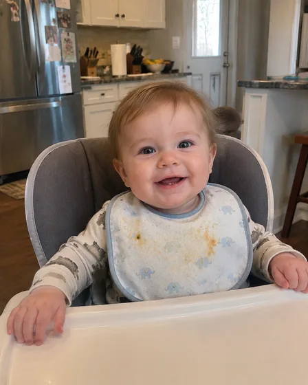
</td><td valign="top"><a href="https://dearsketch.com/en/intent/i291-create-an-aqiqah-or-tasmiyah-invitation-from-a-baby-s-photo.html?utm_source=github&amp;utm_medium=gallery&amp;utm_campaign=dearsketch-public-cases&amp;utm_content=i291_image">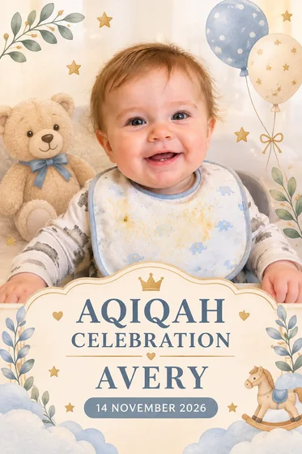</a></td></tr></tbody>
</table>

- **Input type:** Includes reference material preview and result example
- **Material requirements:** Required Aqiqah/Tasmiyah protagonist baby photo (1 photo) + Required ceremony type, baby name and event date and location (1 copy) + Optional birth information, family signature and prayer (0 or 1 copy)
- **Description:** Only one picture is generated at a time.

[ Check the specific requirements in dearsketch and make ](https://dearsketch.com/en/intent/i291-create-an-aqiqah-or-tasmiyah-invitation-from-a-baby-s-photo.html?utm_source=github&utm_medium=gallery&utm_campaign=dearsketch-public-cases&utm_content=i291_cta)

---

## I292 · Create Sünnet or Khitan celebration invitations with children’s photos

<table>
<thead><tr><th width="50%">Reference material</th><th width="50%">Example of results</th></tr></thead>
<tbody><tr><td valign="top">
<strong>Photos of children or families featured in the celebration</strong> 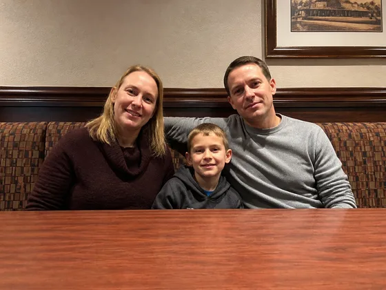
</td><td valign="top"><a href="https://dearsketch.com/en/intent/i292-create-a-sunnet-or-khitan-celebration-invitation-from-a-child-s-photo.html?utm_source=github&amp;utm_medium=gallery&amp;utm_campaign=dearsketch-public-cases&amp;utm_content=i292_image">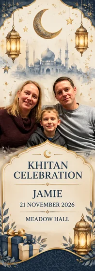</a></td></tr></tbody>
</table>

- **Input type:** Includes reference material preview and result example
- **Material requirements:** Required photos of children or families who are the protagonists of the celebration (1 or more) + Required ceremony tradition and family confirmation text (1 copy) + Required name, date, time and venue (1 copy)
- **Description:** Only one picture is generated at a time.

[ Check the specific requirements in dearsketch and make ](https://dearsketch.com/en/intent/i292-create-a-sunnet-or-khitan-celebration-invitation-from-a-child-s-photo.html?utm_source=github&utm_medium=gallery&utm_campaign=dearsketch-public-cases&utm_content=i292_cta)

---

## I293 · Convert newlywed photos into couple cartoon wedding invitations

<table>
<thead><tr><th width="50%">Reference material</th><th width="50%">Example of results</th></tr></thead>
<tbody><tr><td valign="top">
<strong>Newlyweds' photo</strong> 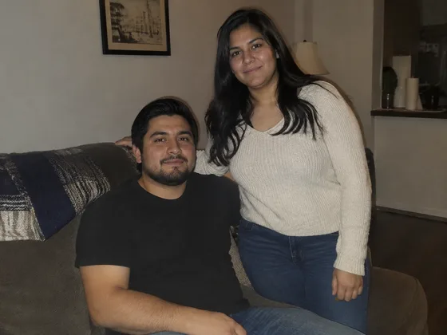
</td><td valign="top"><a href="https://dearsketch.com/en/intent/i293-turn-a-couple-s-photo-into-a-caricature-wedding-invitation.html?utm_source=github&amp;utm_medium=gallery&amp;utm_campaign=dearsketch-public-cases&amp;utm_content=i293_image">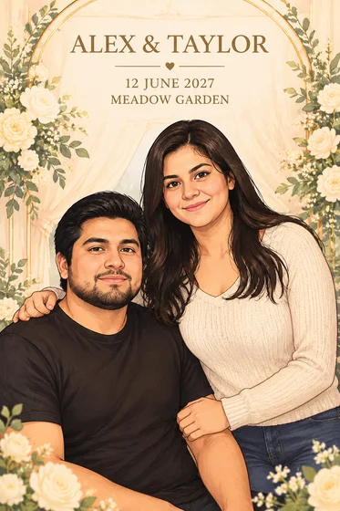</a></td></tr></tbody>
</table>

- **Input type:** Includes reference material preview and result example
- **Material requirements:** A group photo of the conditional couple (1 photo) + Photos of both the conditional parties (2 photos) + Required names, date, location and ceremony theme (1 copy)
- **Description:** Only one picture is generated at a time.

[ Check the specific requirements in dearsketch and make ](https://dearsketch.com/en/intent/i293-turn-a-couple-s-photo-into-a-caricature-wedding-invitation.html?utm_source=github&utm_medium=gallery&utm_campaign=dearsketch-public-cases&utm_content=i293_cta)

---

## I294 · Create Ramadan and Eid al-Fitr blessing pictures with names or photos

<table>
<thead><tr><th width="50%">Reference material</th><th width="50%">Example of results</th></tr></thead>
<tbody><tr><td valign="top">
<strong>Family or personal blessing photos</strong> 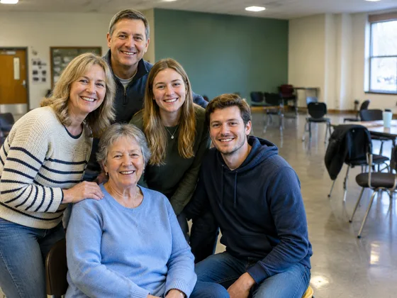
</td><td valign="top"><a href="https://dearsketch.com/en/intent/i294-create-a-personalized-ramadan-or-eid-greeting-with-a-name-or-photo.html?utm_source=github&amp;utm_medium=gallery&amp;utm_campaign=dearsketch-public-cases&amp;utm_content=i294_image">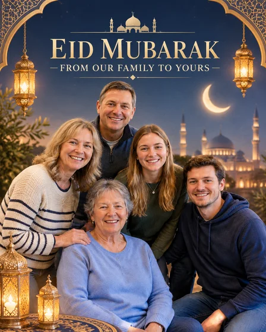</a></td></tr></tbody>
</table>

- **Input type:** Includes reference material preview and result example
- **Material requirements:** Optional family or personal blessing photos (0 or 1 photo) + required festival type, blessing words and language (1 copy) + optional name, organizational signature and decoration preference (0 or 1 set)
- **Description:** Only one picture is generated at a time.

[ Check the specific requirements in dearsketch and make ](https://dearsketch.com/en/intent/i294-create-a-personalized-ramadan-or-eid-greeting-with-a-name-or-photo.html?utm_source=github&utm_medium=gallery&utm_campaign=dearsketch-public-cases&utm_content=i294_cta)
