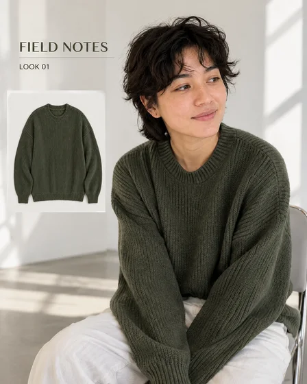

# Marketing, Advertising and Social Media Content

[中文](../../../README.md) · [English](../../../README.en.md) · [Português](../../../README.pt.md) · [Español](../../../README.es.md) · [Français](../../../README.fr.md) · [Deutsch](../../../README.de.md) · [عربي](../../../README.ar.md) · [русский](../../../README.ru.md) · [日本語](../../../README.ja.md) · [हिंदी](../../../README.hi.md)

6 cases outside the featured catalogue. The prompt words are not disclosed here, only the existing reference materials, result directions and minimum material requirements are displayed.

[Return to more case catalogs](./index.md) · [Return to warehouse homepage](../../../README.en.md)

> Reference materials and result images are for visual guidance only; there is no guarantee that the same effect can be reproduced using the same materials.

## I110 · Generate performance creatives from product images

<table>
<thead><tr><th width="50%">Reference material</th><th width="50%">Example of results</th></tr></thead>
<tbody><tr><td valign="top">
<strong>Product images, selling points and audience</strong> 
</td><td valign="top"></td></tr></tbody>
</table>

- **Input type:** Includes reference material preview and result example
- **Material requirements:** Product pictures, selling points and audience + product selling points, target audience → combination of scenes, copywriting and brand elements → current single advertising creative picture
- **Description:** Only one picture is generated at a time.

[ Check the specific requirements in dearsketch and make ](https://dearsketch.com/en/intent/i110-create-performance-ad-creative-from-a-product-image.html?utm_source=github&utm_medium=gallery&utm_campaign=dearsketch-public-cases&utm_content=i110_cta)

---

## I125 · Change the same advertising visual to different language and cultural versions

<table>
<thead><tr><th width="50%">Reference material</th><th width="50%">Example of results</th></tr></thead>
<tbody><tr><td valign="top">
<strong>Full original ad</strong> 
</td><td valign="top"></td></tr></tbody>
</table>

- **Input type:** Includes reference material preview and result example
- **Material requirements:** 1 complete original advertisement + target country or region (specified language, cultural preference or revised translation can be added)
- **Description:** Only one picture is generated at a time.

[ Check the specific requirements in dearsketch and make ](https://dearsketch.com/en/intent/i125-adapt-one-ad-visual-for-different-languages-and-cultures.html?utm_source=github&utm_medium=gallery&utm_campaign=dearsketch-public-cases&utm_content=i125_cta)

---

## I260 · Turn your clothing collection into a lookbook or fashion catalog

<table>
<thead><tr><th width="50%">Reference material</th><th width="50%">Example of results</th></tr></thead>
<tbody><tr><td valign="top">
<strong>L02 model wearing picture</strong> 

<strong>L02 complete front product picture</strong> 
</td><td valign="top"></td></tr></tbody>
</table>

- **Input type:** Includes reference material preview and result example
- **Material requirements:** Required model pictures and product pictures (multiple pictures of the complete series) + required series theme, style number, order and number of pages (1 copy)
- **Description:** This time a single visual preview is generated. Data calculation, precise typesetting, vector or production files still need to be verified by corresponding tools.

[ Check the specific requirements in dearsketch and make ](https://dearsketch.com/en/intent/i260-turn-a-clothing-collection-into-a-lookbook-or-fashion-catalog.html?utm_source=github&utm_medium=gallery&utm_campaign=dearsketch-public-cases&utm_content=i260_cta)

---

## I261 · Create podcast cover art

<table>
<thead><tr><th width="50%">Reference material</th><th width="50%">Example of results</th></tr></thead>
<tbody><tr><td valign="top">
<strong>Host portrait</strong> 
</td><td valign="top"></td></tr></tbody>
</table>

- **Input type:** Includes reference material preview and result example
- **Material requirements:** Optional host portrait (0 or 1) + required program name, theme and target platform (1 copy) + required program name and necessary subtitle (1 set)
- **Description:** Only one picture is generated at a time.

[ Check the specific requirements in dearsketch and make ](https://dearsketch.com/en/intent/i261-create-podcast-cover-art.html?utm_source=github&utm_medium=gallery&utm_campaign=dearsketch-public-cases&utm_content=i261_cta)

---

## I262 · Generate illustrations for annual report white papers or case studies

<strong>Example of results</strong>

This example does not include a picture reference, and the input preview is to be completed; see the material requirements below.

- **Input type:** This example only shows result examples; image input preview is to be added
- **Material requirements:** Optional brand specifications or existing report illustration anchors (0 to multiple) + required chapter list and summary of each chapter (1 copy) + condition verified data (1 copy) + optional brand specifications (0 or 1 copy)
- **Description:** Only the currently selected one is generated at a time; other pictures in the series are executed separately.

[ Check the specific requirements in dearsketch and make ](https://dearsketch.com/en/intent/i262-create-illustrations-for-an-annual-report-white-paper-or-case-study.html?utm_source=github&utm_medium=gallery&utm_campaign=dearsketch-public-cases&utm_content=i262_cta)

---

## I263 · Generate unified concept illustrations and diagrams for pitch decks

<strong>Example of results</strong>

This example does not include a picture reference, and the input preview is to be completed; see the material requirements below.

- **Input type:** This example only shows result examples; image input preview is to be added
- **Material requirements:** Optional brand or roadshow visual anchor (0 or 1 photo) + required page list and core information of each page (1 copy) + required business model or user process (1 copy) + optional brand specifications (0 or 1 copy)
- **Description:** Only the currently selected one is generated at a time; other pictures in the series are executed separately.

[ Check the specific requirements in dearsketch and make ](https://dearsketch.com/en/intent/i263-create-consistent-illustrations-and-diagrams-for-a-pitch-deck.html?utm_source=github&utm_medium=gallery&utm_campaign=dearsketch-public-cases&utm_content=i263_cta)
