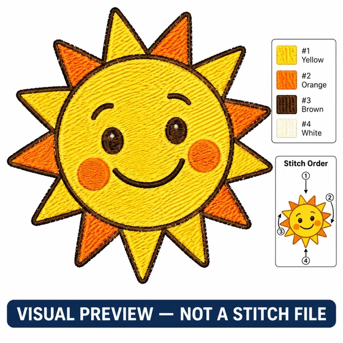
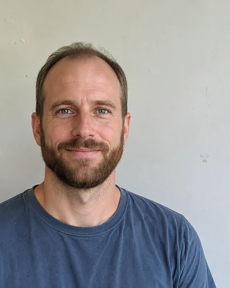

# POD and personalized products

[中文](../../../README.md) · [English](../../../README.en.md) · [Português](../../../README.pt.md) · [Español](../../../README.es.md) · [Français](../../../README.fr.md) · [Deutsch](../../../README.de.md) · [عربي](../../../README.ar.md) · [русский](../../../README.ru.md) · [日本語](../../../README.ja.md) · [हिंदी](../../../README.hi.md)

6 cases outside the featured catalogue. The prompt words are not disclosed here, only the existing reference materials, result directions and minimum material requirements are displayed.

[Return to more case catalogs](./index.md) · [Return to warehouse homepage](../../../README.en.md)

> Reference materials and result images are for visual guidance only; there is no guarantee that the same effect can be reproduced using the same materials.

## I264 · Convert logo or illustration to embroidery machine stitch file

<table>
<thead><tr><th width="50%">Reference material</th><th width="50%">Example of results</th></tr></thead>
<tbody><tr><td valign="top">
<strong>Transparent logo or illustration to be digitized for embroidery</strong> 
</td><td valign="top"></td></tr></tbody>
</table>

- **Input type:** Includes reference material preview and result example
- **Material requirements:** Required transparent logo or illustration to be digitized for embroidery (1) + Required embroidery production specifications (1 copy)
- **Description:** This time a single visual preview is generated. Data calculation, precise typesetting, vector or production files still need to be verified by corresponding tools.

[ Check the specific requirements in dearsketch and make ](https://dearsketch.com/en/intent/i264-convert-a-logo-or-illustration-into-an-embroidery-stitch-file.html?utm_source=github&utm_medium=gallery&utm_campaign=dearsketch-public-cases&utm_content=i264_cta)

---

## I268 · Organize pictures or text into laser engraving and cutting vector files

<table>
<thead><tr><th width="50%">Reference material</th><th width="50%">Example of results</th></tr></thead>
<tbody><tr><td valign="top">
<strong>Picture or logo to be engraved/cut</strong> 
</td><td valign="top"></td></tr></tbody>
</table>

- **Input type:** Includes reference material preview and result example
- **Material requirements:** Optional pictures or logos to be engraved/cut (0 or 1) + required processing methods, materials and machine constraints (1 copy) + conditions requiring processing of text and glyphs (1 copy)
- **Description:** This time a single visual preview is generated. Data calculation, precise typesetting, vector or production files still need to be verified by corresponding tools.

[ Check the specific requirements in dearsketch and make ](https://dearsketch.com/en/intent/i268-prepare-an-image-or-text-as-a-vector-file-for-laser-engraving-or-cutting.html?utm_source=github&utm_medium=gallery&utm_campaign=dearsketch-public-cases&utm_content=i268_cta)

---

## I271 · Convert photos into digital oil painting drawings

<table>
<thead><tr><th width="50%">Reference material</th><th width="50%">Example of results</th></tr></thead>
<tbody><tr><td valign="top">
<strong>Main body photo of the digital oil painting to be converted</strong> 
</td><td valign="top"></td></tr></tbody>
</table>

- **Input type:** Includes reference material preview and result example
- **Material requirements:** Required main body photo of the digital oil painting to be transferred (1 photo) + required range of finished product and number of paint colors (1 set)
- **Description:** This time a single visual preview is generated. Data calculation, precise typesetting, vector or production files still need to be verified by corresponding tools.

[ Check the specific requirements in dearsketch and make ](https://dearsketch.com/en/intent/i271-turn-a-photo-into-a-paint-by-numbers-pattern.html?utm_source=github&utm_medium=gallery&utm_campaign=dearsketch-public-cases&utm_content=i271_cta)

---

## I273 · Convert photos into templates that can be cut or spray-painted

<table>
<thead><tr><th width="50%">Reference material</th><th width="50%">Example of results</th></tr></thead>
<tbody><tr><td valign="top">
<strong>High-contrast photo or logo of the template to be converted</strong> 
</td><td valign="top"></td></tr></tbody>
</table>

- **Input type:** Includes reference material preview and result example
- **Material requirements:** Required high-contrast photo or logo of the template to be transferred (1 photo) + required template purpose, material and minimum connection (1 copy)
- **Description:** This time a single visual preview is generated. Data calculation, precise typesetting, vector or production files still need to be verified by corresponding tools.

[ Check the specific requirements in dearsketch and make ](https://dearsketch.com/en/intent/i273-turn-a-photo-into-a-cuttable-or-paintable-stencil.html?utm_source=github&utm_medium=gallery&utm_campaign=dearsketch-public-cases&utm_content=i273_cta)

---

## I284 · Create a support fan or name board with photos of people and bold text

<table>
<thead><tr><th width="50%">Reference material</th><th width="50%">Example of results</th></tr></thead>
<tbody><tr><td valign="top">
<strong>Photos of people with permission to use</strong> 
</td><td valign="top"></td></tr></tbody>
</table>

- **Input type:** Includes reference material preview and result example
- **Material requirements:** Must have the right to use photos of people (1 photo) + required names or cheering phrases (1 set) + required finished product types and representative colors (1 set)
- **Description:** Only one picture is generated at a time.

[ Check the specific requirements in dearsketch and make ](https://dearsketch.com/en/intent/i284-create-a-fan-support-uchiwa-or-name-board-from-a-portrait.html?utm_source=github&utm_medium=gallery&utm_campaign=dearsketch-public-cases&utm_content=i284_cta)

---

## I287 · Create multiple selfies into four-frame photo strips and theme borders

<table>
<thead><tr><th width="50%">Reference material</th><th width="50%">Example of results</th></tr></thead>
<tbody><tr><td valign="top">
<strong>Historical reference/pre-transformation input</strong> 

<strong>Historical reference/pre-transformation input</strong> 

<strong>Historical reference/pre-transformation input</strong> 

<strong>Historical reference/pre-transformation input</strong> 
</td><td valign="top"></td></tr></tbody>
</table>

- **Input type:** Includes reference material preview and result example
- **Material requirements:** Required continuous shooting/Selfie photos (2 to 4 photos) + required upper and lower frame order of photo strips (1 copy) + optional date, short sentence, logo and theme color (0 or 1 group)
- **Description:** Only one picture is generated at a time.

[ Check the specific requirements in dearsketch and make ](https://dearsketch.com/en/intent/i287-turn-selfies-into-a-four-cut-photo-strip-with-a-themed-frame.html?utm_source=github&utm_medium=gallery&utm_campaign=dearsketch-public-cases&utm_content=i287_cta)
