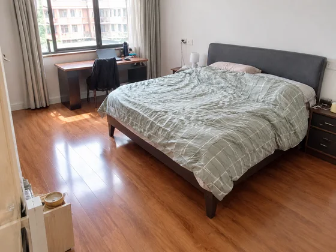

# Space, Architecture and Real Estate

[中文](../../../README.md) · [English](../../../README.en.md) · [Português](../../../README.pt.md) · [Español](../../../README.es.md) · [Français](../../../README.fr.md) · [Deutsch](../../../README.de.md) · [عربي](../../../README.ar.md) · [русский](../../../README.ru.md) · [日本語](../../../README.ja.md) · [हिंदी](../../../README.hi.md)

2 cases outside the featured catalogue. The prompt words are not disclosed here, only the existing reference materials, result directions and minimum material requirements are displayed.

[Return to more case catalogs](./index.md) · [Return to warehouse homepage](../../../README.en.md)

> Reference materials and result images are for visual guidance only; there is no guarantee that the same effect can be reproduced using the same materials.

## I170 · Try different furniture placements and combinations

<table>
<thead><tr><th width="50%">Reference material</th><th width="50%">Example of results</th></tr></thead>
<tbody><tr><td valign="top">
<strong>Photos of available or existing rooms</strong> 
</td><td valign="top"></td></tr></tbody>
</table>

- **Input type:** Includes reference material preview and result example
- **Material requirements:** Photos of vacant or existing rooms → Only adjust the placement of existing home elements in the original image → Preview of the current single furniture layout
- **Description:** Only one picture is generated at a time.

[ Check the specific requirements in dearsketch and make ](https://dearsketch.com/en/intent/i170-try-different-furniture-arrangements-and-combinations.html?utm_source=github&utm_medium=gallery&utm_campaign=dearsketch-public-cases&utm_content=i170_cta)

---

## I180 · Generate multiple materials and light directions in the same space

<table>
<thead><tr><th width="50%">Reference material</th><th width="50%">Example of results</th></tr></thead>
<tbody><tr><td valign="top">
<strong>datum space map</strong> 
</td><td valign="top"></td></tr></tbody>
</table>

- **Input type:** Includes reference material preview and result example
- **Material requirements:** 1 reference space drawing + target design direction, surface material and lighting requirements
- **Description:** Only one picture is generated at a time.

[ Check the specific requirements in dearsketch and make ](https://dearsketch.com/en/intent/i180-create-material-and-lighting-variations-for-the-same-space.html?utm_source=github&utm_medium=gallery&utm_campaign=dearsketch-public-cases&utm_content=i180_cta)
