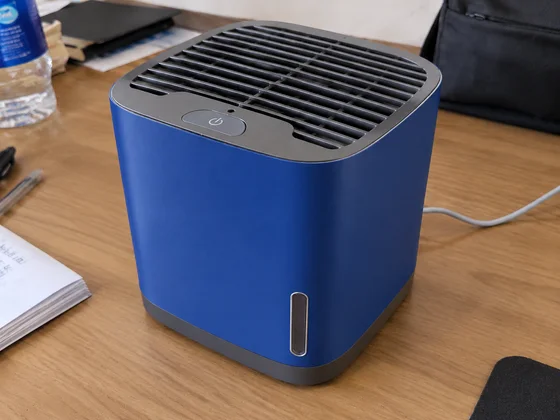

# Product Concept and Industrial Design

[中文](../../../README.md) · [English](../../../README.en.md) · [Português](../../../README.pt.md) · [Español](../../../README.es.md) · [Français](../../../README.fr.md) · [Deutsch](../../../README.de.md) · [عربي](../../../README.ar.md) · [русский](../../../README.ru.md) · [日本語](../../../README.ja.md) · [हिंदी](../../../README.hi.md)

4 cases outside the featured catalogue. The prompt words are not disclosed here, only the existing reference materials, result directions and minimum material requirements are displayed.

[Return to more case catalogs](./index.md) · [Return to warehouse homepage](../../../README.en.md)

> Reference materials and result images are for visual guidance only; there is no guarantee that the same effect can be reproduced using the same materials.

## I184 · Convert product sketches into realistic product renderings

<table>
<thead><tr><th width="50%">Reference material</th><th width="50%">Example of results</th></tr></thead>
<tbody><tr><td valign="top">
<strong>Hand drawn product sketches</strong> 
</td><td valign="top"></td></tr></tbody>
</table>

- **Input type:** Includes reference material preview and result example
- **Material requirements:** Hand-drawn product sketch + product usage, immutable features in the sketch → retain the form and generate materials, light and shadow and background → current single product rendering
- **Description:** Only one picture is generated at a time.

[ Check the specific requirements in dearsketch and make ](https://dearsketch.com/en/intent/i184-turn-a-product-sketch-into-a-realistic-product-render.html?utm_source=github&utm_medium=gallery&utm_campaign=dearsketch-public-cases&utm_content=i184_cta)

---

## I186 · Preview product in different colors, materials and surface treatments

<table>
<thead><tr><th width="50%">Reference material</th><th width="50%">Example of results</th></tr></thead>
<tbody><tr><td valign="top">
<strong>Product images or 3D renderings</strong> 
</td><td valign="top"></td></tr></tbody>
</table>

- **Input type:** Includes reference material preview and result example
- **Material requirements:** Product drawing or 3D rendering + target color or material → Replace color, material and texture → Current single CMF plan drawing
- **Description:** Only one picture is generated at a time.

[ Check the specific requirements in dearsketch and make ](https://dearsketch.com/en/intent/i186-preview-product-colors-materials-and-finishes.html?utm_source=github&utm_medium=gallery&utm_campaign=dearsketch-public-cases&utm_content=i186_cta)

---

## I188 · Generate furniture product renderings from sketches

<table>
<thead><tr><th width="50%">Reference material</th><th width="50%">Example of results</th></tr></thead>
<tbody><tr><td valign="top">
<strong>furniture sketches</strong> 
</td><td valign="top"></td></tr></tbody>
</table>

- **Input type:** Includes reference material preview and result example
- **Material requirements:** Furniture sketch + furniture use, structure that must be retained → Generate wood, fabric and usage scenes → Current single furniture product rendering
- **Description:** Only one picture is generated at a time.

[ Check the specific requirements in dearsketch and make ](https://dearsketch.com/en/intent/i188-turn-a-furniture-sketch-into-a-product-render.html?utm_source=github&utm_medium=gallery&utm_campaign=dearsketch-public-cases&utm_content=i188_cta)

---

## I192 · Convert interface sketches into more complete UI Mockups

<table>
<thead><tr><th width="50%">Reference material</th><th width="50%">Example of results</th></tr></thead>
<tbody><tr><td valign="top">
<strong>Wireframes or screenshots of existing interfaces</strong> 
</td><td valign="top"></td></tr></tbody>
</table>

- **Input type:** Includes reference material preview and result example
- **Material requirements:** Wireframes or screenshots of existing interfaces + product type and immutable information architecture → Supplementary visual style, components and device scenarios → Current single UI concept map
- **Description:** Only one picture is generated at a time.

[ Check the specific requirements in dearsketch and make ](https://dearsketch.com/en/intent/i192-turn-a-ui-sketch-into-a-polished-interface-mockup.html?utm_source=github&utm_medium=gallery&utm_campaign=dearsketch-public-cases&utm_content=i192_cta)
