# Games and virtual assets

[中文](../../../README.md) · [English](../../../README.en.md) · [Português](../../../README.pt.md) · [Español](../../../README.es.md) · [Français](../../../README.fr.md) · [Deutsch](../../../README.de.md) · [عربي](../../../README.ar.md) · [русский](../../../README.ru.md) · [日本語](../../../README.ja.md) · [हिंदी](../../../README.hi.md)

11 cases outside the featured catalogue. The prompt words are not disclosed here, only the existing reference materials, result directions and minimum material requirements are displayed.

[Return to more case catalogs](./index.md) · [Return to warehouse homepage](../../../README.en.md)

> Reference materials and result images are for visual guidance only; there is no guarantee that the same effect can be reproduced using the same materials.

## I194 · Generate 2D game sprites from text or reference images

<strong>Example of results</strong>

<a href="https://dearsketch.com/en/intent/i194-create-a-2d-game-sprite-from-text-or-a-reference-image.html?utm_source=github&amp;utm_medium=gallery&amp;utm_campaign=dearsketch-public-cases&amp;utm_content=i194_image">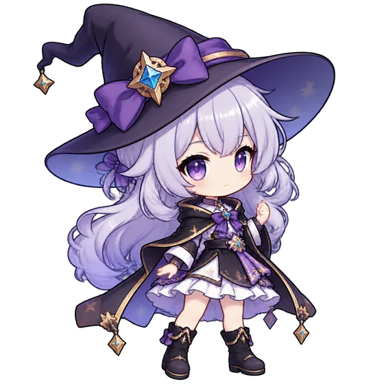</a>

This example does not include a picture reference, and the input preview is to be completed; see the material requirements below.

- **Input type:** This example only shows result examples; image input preview is to be added
- **Material requirements:** Character or object setting manuscript + character or object description, art style → Generate transparent background 2D assets → Current single game Sprite
- **Description:** Only one picture is generated at a time.

[ Check the specific requirements in dearsketch and make ](https://dearsketch.com/en/intent/i194-create-a-2d-game-sprite-from-text-or-a-reference-image.html?utm_source=github&utm_medium=gallery&utm_campaign=dearsketch-public-cases&utm_content=i194_cta)

---

## I196 · Convert images or descriptions into pixel style game assets

<strong>Example of results</strong>

<a href="https://dearsketch.com/en/intent/i196-turn-an-image-or-description-into-pixel-art-game-assets.html?utm_source=github&amp;utm_medium=gallery&amp;utm_campaign=dearsketch-public-cases&amp;utm_content=i196_image">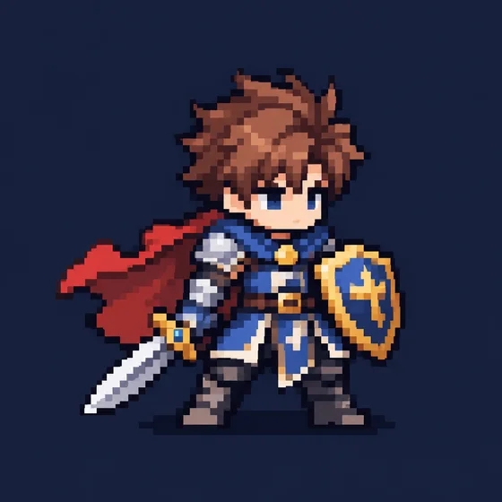</a>

This example does not include a picture reference, and the input preview is to be completed; see the material requirements below.

- **Input type:** This example only shows result examples; image input preview is to be added
- **Material requirements:** Original image of the subject to be pixelated + asset type, game perspective → Pixelate and control the color palette → Current single Pixel Art asset
- **Description:** Only one picture is generated at a time.

[ Check the specific requirements in dearsketch and make ](https://dearsketch.com/en/intent/i196-turn-an-image-or-description-into-pixel-art-game-assets.html?utm_source=github&utm_medium=gallery&utm_campaign=dearsketch-public-cases&utm_content=i196_cta)

---

## I197 · Generating game character concepts and costume directions

<strong>Example of results</strong>

<a href="https://dearsketch.com/en/intent/i197-create-game-character-concepts-and-outfit-directions.html?utm_source=github&amp;utm_medium=gallery&amp;utm_campaign=dearsketch-public-cases&amp;utm_content=i197_image">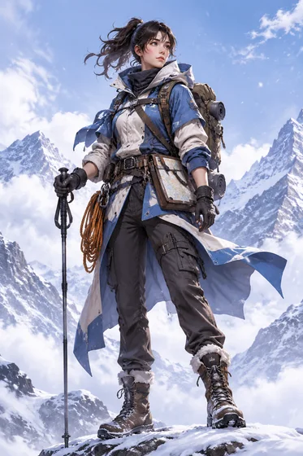</a>

This example does not include a picture reference, and the input preview is to be completed; see the material requirements below.

- **Input type:** This example only shows result examples; image input preview is to be added
- **Material requirements:** Existing character or equipment setting manuscript + character background, gameplay positioning, world view, clothing function → Generate character modeling and concept drawings → Current single character concept drawing
- **Description:** Only one picture is generated at a time.

[ Check the specific requirements in dearsketch and make ](https://dearsketch.com/en/intent/i197-create-game-character-concepts-and-outfit-directions.html?utm_source=github&utm_medium=gallery&utm_campaign=dearsketch-public-cases&utm_content=i197_cta)

---

## I198 · Generate DND or board game character portraits

<strong>Example of results</strong>

<a href="https://dearsketch.com/en/intent/i198-create-a-d-and-d-or-tabletop-character-portrait.html?utm_source=github&amp;utm_medium=gallery&amp;utm_campaign=dearsketch-public-cases&amp;utm_content=i198_image">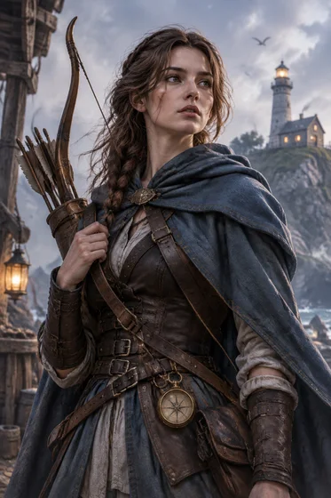</a>

This example does not include a picture reference, and the input preview is to be completed; see the material requirements below.

- **Input type:** This example only shows result examples; image input preview is to be added
- **Material requirements:** Existing running team character image original draft + character race or species, occupation, background story, equipment and temperament → Generate character portrait or full body picture → Current single DND character picture
- **Description:** Only one picture is generated at a time.

[ Check the specific requirements in dearsketch and make ](https://dearsketch.com/en/intent/i198-create-a-d-and-d-or-tabletop-character-portrait.html?utm_source=github&utm_medium=gallery&utm_campaign=dearsketch-public-cases&utm_content=i198_cta)

---

## I199 · Generate fantasy world or DND battle map

<strong>Example of results</strong>

<a href="https://dearsketch.com/en/intent/i199-create-a-fantasy-world-or-d-and-d-battle-map.html?utm_source=github&amp;utm_medium=gallery&amp;utm_campaign=dearsketch-public-cases&amp;utm_content=i199_image">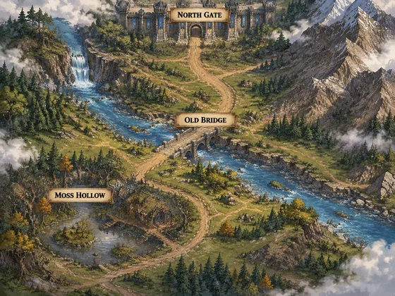</a>

This example does not include a picture reference, and the input preview is to be completed; see the material requirements below.

- **Input type:** This example only shows result examples; image input preview is to be added
- **Material requirements:** Terrain, location and route list + Map visual reference + Current map scale → Generate regional map, city or battle scene → Current single Fantasy Map
- **Description:** This time a single visual preview is generated. Data calculation, precise typesetting, vector or production files still need to be verified by corresponding tools.

[ Check the specific requirements in dearsketch and make ](https://dearsketch.com/en/intent/i199-create-a-fantasy-world-or-d-and-d-battle-map.html?utm_source=github&utm_medium=gallery&utm_campaign=dearsketch-public-cases&utm_content=i199_cta)

---

## I200 · Generate game icons, buttons and HUD elements

<strong>Example of results</strong>

<a href="https://dearsketch.com/en/intent/i200-create-game-icons-buttons-and-hud-elements.html?utm_source=github&amp;utm_medium=gallery&amp;utm_campaign=dearsketch-public-cases&amp;utm_content=i200_image">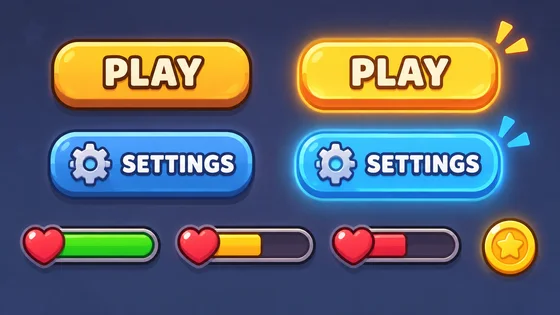</a>

This example does not include a picture reference, and the input preview is to be completed; see the material requirements below.

- **Input type:** This example only shows result examples; image input preview is to be added
- **Material requirements:** Component and status list + Game UI visual specifications → Generate unified style interface assets → Current single game UI icon
- **Description:** This time a single visual preview is generated. Data calculation, precise typesetting, vector or production files still need to be verified by corresponding tools.

[ Check the specific requirements in dearsketch and make ](https://dearsketch.com/en/intent/i200-create-game-icons-buttons-and-hud-elements.html?utm_source=github&utm_medium=gallery&utm_campaign=dearsketch-public-cases&utm_content=i200_cta)

---

## I201 · Generating weapons, props and pickup concepts

<strong>Example of results</strong>

<a href="https://dearsketch.com/en/intent/i201-create-concepts-for-weapons-props-and-pickups.html?utm_source=github&amp;utm_medium=gallery&amp;utm_campaign=dearsketch-public-cases&amp;utm_content=i201_image">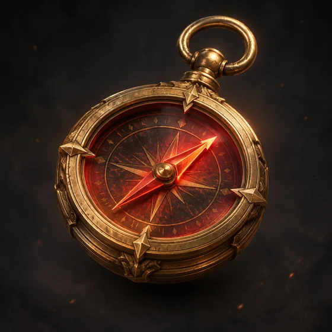</a>

This example does not include a picture reference, and the input preview is to be completed; see the material requirements below.

- **Input type:** This example only shows result examples; image input preview is to be added
- **Material requirements:** Optional camp or prop style reference (0 or 1) + required prop definition (1 copy)
- **Description:** Only one picture is generated at a time.

[ Check the specific requirements in dearsketch and make ](https://dearsketch.com/en/intent/i201-create-concepts-for-weapons-props-and-pickups.html?utm_source=github&utm_medium=gallery&utm_campaign=dearsketch-public-cases&utm_content=i201_cta)

---

## I202 · Generate game background, scene and landmark concepts

<strong>Example of results</strong>

<a href="https://dearsketch.com/en/intent/i202-create-concepts-for-game-backgrounds-scenes-and-landmarks.html?utm_source=github&amp;utm_medium=gallery&amp;utm_campaign=dearsketch-public-cases&amp;utm_content=i202_image">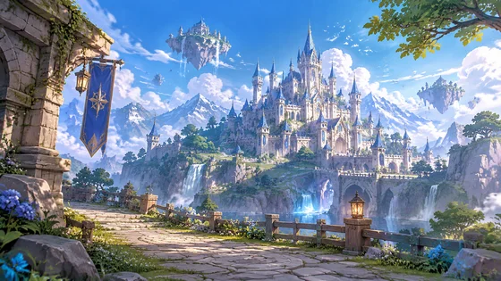</a>

This example does not include a picture reference, and the input preview is to be completed; see the material requirements below.

- **Input type:** This example only shows result examples; image input preview is to be added
- **Material requirements:** Optional landmarks, buildings or world view references (0 or 1) + required scene usage and narrative settings (1 copy)
- **Description:** Only one picture is generated at a time.

[ Check the specific requirements in dearsketch and make ](https://dearsketch.com/en/intent/i202-create-concepts-for-game-backgrounds-scenes-and-landmarks.html?utm_source=github&utm_medium=gallery&utm_campaign=dearsketch-public-cases&utm_content=i202_cta)

---

## I203 · Generate character and scene illustrations for card games

<strong>Example of results</strong>

<a href="https://dearsketch.com/en/intent/i203-create-character-and-scene-artwork-for-a-card-game.html?utm_source=github&amp;utm_medium=gallery&amp;utm_campaign=dearsketch-public-cases&amp;utm_content=i203_image">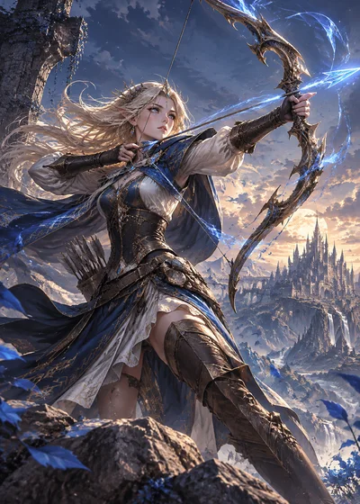</a>

This example does not include a picture reference, and the input preview is to be completed; see the material requirements below.

- **Input type:** This example only shows result examples; image input preview is to be added
- **Material requirements:** Optional existing card deck or character style anchor point (0 or 1) + required current card setting (1 copy)
- **Description:** Only the currently selected one is generated at a time; other pictures in the series are executed separately.

[ Check the specific requirements in dearsketch and make ](https://dearsketch.com/en/intent/i203-create-character-and-scene-artwork-for-a-card-game.html?utm_source=github&utm_medium=gallery&utm_campaign=dearsketch-public-cases&utm_content=i203_cta)

---

## I204 · Generate board game board, components and cover visuals

<strong>Example of results</strong>

<a href="https://dearsketch.com/en/intent/i204-create-visuals-for-a-board-components-and-box-cover.html?utm_source=github&amp;utm_medium=gallery&amp;utm_campaign=dearsketch-public-cases&amp;utm_content=i204_image">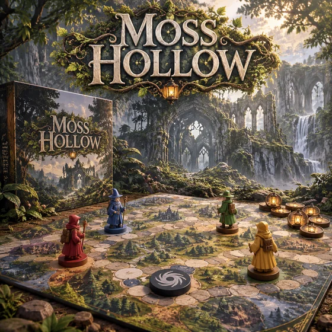</a>

This example does not include a picture reference, and the input preview is to be completed; see the material requirements below.

- **Input type:** This example only shows result examples; image input preview is to be added
- **Material requirements:** Optional existing chessboard or component visual reference (0 or 1) + required board game rules and component list (1 copy) + required delivery type and theme (1 set)
- **Description:** This time a single visual preview is generated. Data calculation, precise typesetting, vector or production files still need to be verified by corresponding tools.

[ Check the specific requirements in dearsketch and make ](https://dearsketch.com/en/intent/i204-create-visuals-for-a-board-components-and-box-cover.html?utm_source=github&utm_medium=gallery&utm_campaign=dearsketch-public-cases&utm_content=i204_cta)

---

## I205 · Generate game store cover and Key Art

<strong>Example of results</strong>

<a href="https://dearsketch.com/en/intent/i205-create-game-store-cover-art-and-key-art.html?utm_source=github&amp;utm_medium=gallery&amp;utm_campaign=dearsketch-public-cases&amp;utm_content=i205_image">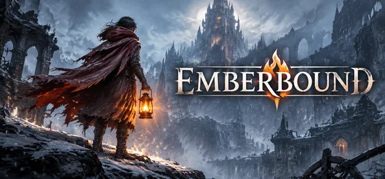</a>

This example does not include a picture reference, and the input preview is to be completed; see the material requirements below.

- **Input type:** This example only shows result examples; image input preview is to be added
- **Material requirements:** Optional confirmed characters, logos or game art assets (0 to multiple) + necessary store resource slots and game selling points (1 copy)
- **Description:** Only the currently selected one is generated at a time; other pictures in the series are executed separately.

[ Check the specific requirements in dearsketch and make ](https://dearsketch.com/en/intent/i205-create-game-store-cover-art-and-key-art.html?utm_source=github&utm_medium=gallery&utm_campaign=dearsketch-public-cases&utm_content=i205_cta)
