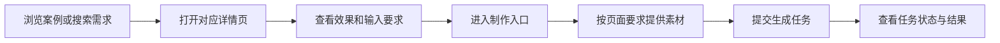
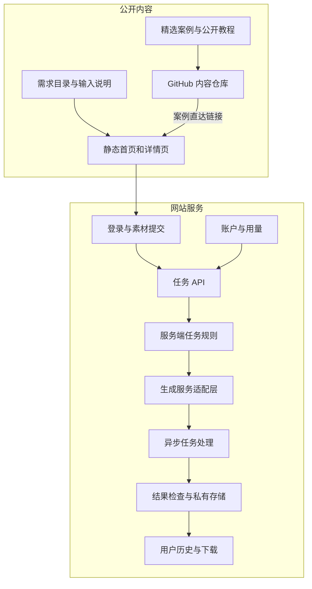

# Arquitectura del producto dearsketch

[中文](../../README.md) · [English](../../README.en.md) · [Português](../../README.pt.md) · [Español](../../README.es.md) · [Français](../../README.fr.md) · [Deutsch](../../README.de.md) · [عربي](../../README.ar.md) · [русский](../../README.ru.md) · [日本語](../../README.ja.md) · [हिंदी](../../README.hi.md)


dearsketch organiza "¿Qué imágenes quiero completar?" en un directorio navegable de requisitos. Cada requisito tiene una página independiente que explica el propósito, los materiales requeridos y los requisitos de resultado; los usuarios ingresan al proceso de producción desde la página correspondiente.

Esta descripción describe las responsabilidades del módulo y el flujo de datos. La biblioteca de contenidos públicos, los servicios del sitio web y los modelos generados realizan cada uno de ellas diferentes tareas; este almacén proporciona casos públicos, 50 plantillas recién editadas y Agent Skill, y la producción en línea se realiza en el sitio web.

## Ruta de usuario



Diferentes tareas pueden requerir fotografías, manuscritos de diseño designados, redacción precisa o recursos de múltiples personajes. Los dibujos en serie y los planos múltiples se producen por separado sobre una base única; cuando se requiere texto preciso, vectores o archivos de producción, se requieren las herramientas correspondientes después de la vista previa visual.

## Capas de contenido y generación.



Las páginas de contenido estático son responsables del descubrimiento, la interpretación y la inclusión en la búsqueda. La tarea API es responsable de validar la entrada del usuario y crear tareas. La capa de adaptación de generación y reglas del lado del servidor es responsable de ejecutar los requisitos seleccionados. La capa de historial y almacenamiento se encarga de devolver los resultados a los usuarios correspondientes.

Los módulos en la figura reflejan la división de responsabilidades en el código fuente actual y no son un compromiso con todas las funciones en línea, estados de pago o niveles de servicio; al utilizarlos prevalecerán la entrada real y las instrucciones proporcionadas por el sitio web.

## Responsabilidades del módulo

| módulo | Problema resuelto |
| --- | --- |
| Catálogo de requisitos | Organizar tareas de imágenes con propósitos, entradas, salidas y escenarios. |
| Construcción de página | Genere direcciones estables, contenido de páginas y metadatos de búsqueda para sus necesidades |
| Introduzca el contrato | Explique qué materiales son necesarios, cuáles son opcionales y cuáles son las relaciones entre los materiales. |
| Cuentas y tareas API | Verificar la identidad, la integridad de la entrada y solicitar la duplicación |
| Reglas de tareas servidor | Organizar el contenido de ejecución según las necesidades y los aportes actuales. |
| Generar capa de adaptación | Conéctese a servicios de compilación externos y maneje tareas asincrónicas |
| Resultados e historia | Verifique resultados, ahorre recursos y proporcione acceso a los usuarios apropiados |
| Cuenta y uso | Manejar las calificaciones de uso, los puntos y el estado relacionado con los pedidos. |

## Método de implementación

| capa | El método en el código fuente actual. |
| --- | --- |
| Construcción de contenido | El script Node.js genera HTML, página de detalles y metadatos de búsqueda a partir de requisitos estructurados |
| Interacción del navegador | JavaScript maneja el filtrado, la entrada de materiales y el estado de las tareas; algunas interacciones usan React y están empaquetadas por Vite |
| Servidor | Los módulos de Node.js manejan la autenticación, las cargas, las tareas de compilación, el historial y el uso. |
| datos | La base de datos relacional registra cuentas, propiedad de recursos y estado de tareas. |
| documento | Almacenamiento de objetos privados separado de los datos comerciales, al que se accede a través de direcciones controladas |
| generar | El servidor se adapta a servicios generados externamente y procesa tareas y resultados asincrónicos. |

Estas opciones técnicas pueden explicar cómo el sistema divide el trabajo sin exponer números de cuentas de producción, ID de proyectos, nombres de depósitos o valores de variables de entorno.

## Ejemplo de datos públicos

```json
{
  "id": "I026",
  "title": "宠物定制肖像",
  "input": "1张宠物照片",
  "output": "宠物肖像图片",
  "roles": [
    { "kind": "image", "label": "宠物照片", "requirement": "required", "quantity": "1张" }
  ]
}
```

Estos campos explican las tareas del usuario y no contienen instrucciones completas de generación del lado del servidor. Consulte [cases.json](../../data/cases.json) para obtener datos de casos seleccionados, consulte [gallery.json](../../data/gallery.json) para ver otros ejemplos de resultados y consulte [public-prompts.json](../../data/public-prompts.json) para conocer la nueva plantilla pública. Las habilidades públicas solo son responsables de preparar listas de entrada y palabras clave, y no tienen acceso a reglas de generación internas.

## Límites de acceso y contenido

Las imágenes de casos públicos y los recursos subidos por los usuarios son dos tipos de contenido. Los casos se utilizan para ilustrar la dirección visual; Las imágenes de usuario originales, los resultados de las tareas y los registros de cuentas no pertenecen a la biblioteca de casos pública. El servicio de generación necesita verificar el tipo, tamaño y propiedad del material, y la entrada del usuario no puede anular las restricciones de ejecución del servidor.

Se pueden exponer diagramas de módulos, responsabilidades, estructuras de datos abstractas, especificaciones de entrada y principios generales de confiabilidad. Exponer una parte de la implementación del lado del servidor o un conjunto de estructuras de bases de datos es un área de código abierto que se puede decidir de forma independiente; no son automáticamente secretos sólo porque están en el lado del servidor.

El alcance de este almacén son casos, tutoriales básicos y descripciones de arquitectura de productos, y no incluye el código fuente del servicio de producción, habilidades internas completas ni recursos de implementación. Las credenciales, sesiones, registros de usuarios reales y direcciones de recursos privados no son contenido público.

## Cómo conectar GitHub al sitio web

Cada imagen destacada y enlace "hacer lo mismo" conduce a la página de demanda correspondiente. Los enlaces utilizan parámetros de origen para distinguir el archivo README, los detalles del caso y las entradas del tutorial; Estos parámetros sólo expresan la fuente y no pueden probar por sí solos que se ha implementado un sistema estadístico.

El sitio web no tiene cuadros de entrada de palabras para los visitantes. Los tutoriales básicos se hacen públicos para que los usuarios prueben las herramientas que elijan; el sitio web proporciona las entradas de material correspondientes según las necesidades seleccionadas.
