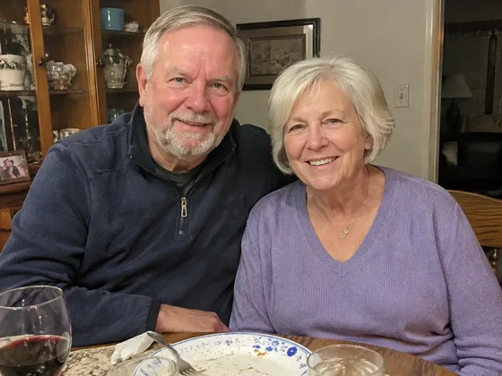
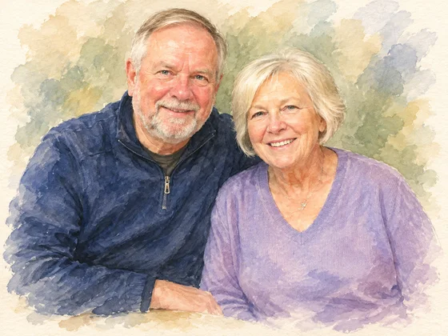

# Obra de arte de pareja de aniversario · Pintura de arte de aniversario de pareja

[中文](../../../README.md) · [English](../../../README.en.md) · [Português](../../../README.pt.md) · [Español](../../../README.es.md) · [Français](../../../README.fr.md) · [Deutsch](../../../README.de.md) · [عربي](../../../README.ar.md) · [русский](../../../README.ru.md) · [日本語](../../../README.ja.md) · [हिंदी](../../../README.hi.md)


Transforma una foto de pareja en una obra de arte conmemorativa.

Convierte fotos de pareja en arte de aniversario. Para regalos de aniversario, cuadros murales.

[Solicitud de copia](#public-prompt) · [ es producido por dearsketch / Pruebe en línea](https://dearsketch.com/es/intent/i022-turn-a-couple-s-photo-into-anniversary-artwork.html?utm_source=github&utm_medium=case&utm_campaign=dearsketch-public-cases&utm_content=i022_cta) · [Volver al tema / Colección](../guides/pets-family.md)

## Material de referencia y dirección de resultados.

<table>
<thead><tr><th width="50%">Material de referencia</th><th width="50%">Ejemplo de resultados</th></tr></thead>
<tbody><tr><td valign="top"><p><strong>fotos de pareja</strong><br></p></td><td valign="top"><a href="https://dearsketch.com/es/intent/i022-turn-a-couple-s-photo-into-anniversary-artwork.html?utm_source=github&amp;utm_medium=case&amp;utm_campaign=dearsketch-public-cases&amp;utm_content=i022_image"></a></td></tr></tbody>
</table>

Los materiales de referencia y los resultados se utilizan para ilustrar la dirección visual. La plantilla pública no es la instrucción de generación original de las imágenes adjuntas y no se garantiza la reproducción de los mismos resultados.

## Qué preparar/Insumos

| Material | Tipo / Tipo | Cantidad / Cantidad | Condición / Requisito |
| --- | --- | --- | --- |
| fotos de pareja | Imagen/Imagen | 1 pieza | Requerido / Requerido |

Sólo se genera una imagen a la vez.

## Conservar y cambiar / Editar resumen

- **Preservar / 保留：** Mantenga ambas identidades, relaciones, lógica de pose y nombres o fechas confirmados.
- **Cambiar / 改变：** Cambia el medio artístico, el fondo, la paleta y los detalles de celebración.

## Public prompt

**Plantilla pública recién editada · Creación reciente · No probada en generación.** Reemplace los parámetros de corchetes y adjunte los materiales necesarios en la herramienta que admite la edición de imágenes; Las entradas opcionales y condicionales se preparan de acuerdo con la tabla anterior. Esta plantilla no se utilizó para generar los ejemplos de esta página.

```text
Create one anniversary artwork from [COUPLE PHOTO].
Preserve both people’s identities, facial proportions, skin tones, hair, and natural relationship.
Keep the pose recognizable unless [POSE CHANGE] is explicitly requested.
Render the scene in [ART MEDIUM OR STYLE] with [PALETTE] and [BACKGROUND].
Add only restrained [FLORAL / SYMBOLIC / DECORATIVE DETAILS] that support the couple.
If provided, use the exact names “[CONFIRMED NAMES]” and date “[CONFIRMED DATE]”.
Do not guess an anniversary number, relationship status, venue, or date.
Avoid replacing either person with a generic idealized face.
Make the composition suitable for [WALL ART / CARD / DIGITAL GIFT].
Deliver one finished image only and mark any rendered text for manual proofreading.
```

[Hazlo en línea con tus propios materiales / Hazlo en línea](https://dearsketch.com/es/intent/i022-turn-a-couple-s-photo-into-anniversary-artwork.html?utm_source=github&utm_medium=case&utm_campaign=dearsketch-public-cases&utm_content=i022_after-prompt) · [Deja que el agente te ayude a organizarlo / Usa la habilidad](../quickstart.md#agent-skill)

## Consulta los puntos clave/Revisión

Primero verifique la identidad y postura de ambas partes, y luego verifique la expresión artística; utilice únicamente información confirmada para nombres y fechas de aniversario.

Primero verifique ambas caras y luego revise la información del aniversario.

Dirección del resultado: retrato de aniversario. Cuando se requiera texto exacto, archivos transparentes, vectores o entrega impresa, verifique el archivo real; Las funciones y tarifas disponibles están sujetas a la descripción del sitio web.

## Casos relacionados / Tareas relacionadas

- [Convertir una foto de mascota en un retrato personalizado · Retrato personalizado de mascota ](./i026-turn-a-pet-photo-into-a-custom-portrait.md#public-prompt)
- [Convertir una mascota en un retrato real o histórico · Retrato real de mascota](./i028-turn-a-pet-into-a-royal-or-historical-portrait.md#public-prompt)
- [Coloca una mascota en una divertida escena de baño o cocina · Pintura de escena interesante para mascotas ](./i029-place-a-pet-in-a-playful-bathroom-or-kitchen-scene.md#public-prompt)

## Referencia de antecedentes de requisitos

- [Retrato de familia etsy](https://www.etsy.com/market/ai_family_portrait)

Estos enlaces son solo para ayudar a comprender el propósito y no son prueba de la fuente o autorización de las imágenes en esta página.

Para conocer el alcance de uso de imágenes y materiales, consulte la descripción del contenido [ ](../content-policy.md). [Ver las 50 plantillas ](../prompts.md).
