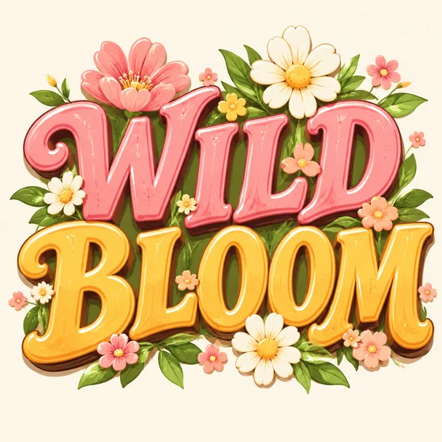

# Efecto de visualización de letras · Arte de palabras y efectos de título

[中文](../../../README.md) · [English](../../../README.en.md) · [Português](../../../README.pt.md) · [Español](../../../README.es.md) · [Français](../../../README.fr.md) · [Deutsch](../../../README.de.md) · [عربي](../../../README.ar.md) · [русский](../../../README.ru.md) · [日本語](../../../README.ja.md) · [हिंदी](../../../README.hi.md)


Represente el texto exacto suministrado como un tratamiento de título decorativo.

Genere textos legibles y efectos de títulos. Utilizado para carteles, embalajes, redes sociales.

[Solicitud de copia](#public-prompt) · [ es producido por dearsketch / Pruebe en línea](https://dearsketch.com/es/intent/i133-create-readable-display-lettering-and-title-effects.html?utm_source=github&utm_medium=case&utm_campaign=dearsketch-public-cases&utm_content=i133_cta) · [Volver al tema / Colección](../guides/design.md)

## Material de referencia y dirección de resultados.

<p><strong>Ejemplo de resultados</strong></p>
<p><a href="https://dearsketch.com/es/intent/i133-create-readable-display-lettering-and-title-effects.html?utm_source=github&amp;utm_medium=case&amp;utm_campaign=dearsketch-public-cases&amp;utm_content=i133_image"></a></p>
<p>Este ejemplo no incluye una referencia de imagen y la vista previa de entrada debe completarse; consulte los requisitos de materiales a continuación.</p>

Los materiales de referencia y los resultados se utilizan para ilustrar la dirección visual. La plantilla pública no es la instrucción de generación original de las imágenes adjuntas y no se garantiza la reproducción de los mismos resultados.

## Qué preparar/Insumos

| Material | Tipo / Tipo | Cantidad / Cantidad | Condición / Requisito |
| --- | --- | --- | --- |
| Especificar fuente o plantilla de efecto de fuente de material | Imagen/Imagen | 0–1; Se pueden combinar varios materiales en un tablero de referencia etiquetado. | Opcional/Opcional: Cuando la fuente artística debe seguir el lenguaje de glifos o el efecto material existente |
| Texto y propósito precisos | Carácter / Texto | 1 porción | Requerido / Requerido |

Sólo se genera una imagen a la vez.

## Conservar y cambiar / Editar resumen

- **Preserve / 保留：** Mantenga precisos todos los caracteres, la ortografía, el orden y la referencia de las letras proporcionadas.
- **Cambiar / 改变：** Cambiar el efecto del material, la profundidad, la iluminación, el fondo y el tratamiento ornamental.

## Public prompt

**Plantilla pública recién editada · Creación reciente · No probada en generación.** Reemplace los parámetros de corchetes y adjunte los materiales necesarios en la herramienta que admite la edición de imágenes; Las entradas opcionales y condicionales se preparan de acuerdo con la tabla anterior. Esta plantilla no se utilizó para generar los ejemplos de esta página.

```text
Create one display-lettering image for the exact text “[EXACT TEXT]”.
The intended use is [POSTER / PACKAGING / SOCIAL / OTHER] and the language is [LANGUAGE].
If [LETTERFORM OR MATERIAL REFERENCE] is supplied, follow its general shape or material direction without copying unrelated branding.
Apply [MATERIAL EFFECT], [DEPTH], [LIGHTING], [PALETTE], and [BACKGROUND].
Keep every character, accent, punctuation mark, word order, and capitalization exactly as supplied.
Prioritize readability before decorative effects; avoid merged, missing, or invented characters.
Do not add slogans, logos, symbols, or extra words.
Use an original treatment rather than imitating a protected title design or living artist.
Treat the rendered lettering as a visual concept; proofread it and rebuild editable vector/type files for production.
Deliver one title-effect image only.
```

[Hazlo en línea con tus propios materiales / Hazlo en línea](https://dearsketch.com/es/intent/i133-create-readable-display-lettering-and-title-effects.html?utm_source=github&utm_medium=case&utm_campaign=dearsketch-public-cases&utm_content=i133_after-prompt) · [Deja que el agente te ayude a organizarlo / Usa la habilidad](../quickstart.md#agent-skill)

## Consulta los puntos clave/Revisión

Revise la ortografía, el orden y la legibilidad palabra por palabra; Los glifos de la imagen no son archivos de fuentes editables.

Corrija carácter por carácter y reconstruya el tipo editable por separado.

Dirección del resultado: WordArt. Cuando se requiera texto exacto, archivos transparentes, vectores o entrega impresa, verifique el archivo real; Las funciones y tarifas disponibles están sujetas a la descripción del sitio web.

## Casos relacionados / Tareas relacionadas

- [Crear una miniatura de vídeo de YouTube · Miniatura de vídeo de YouTube ](./i106-create-a-youtube-video-thumbnail.md#public-prompt)
- [Crear un cartel promocional a partir de un tema y copiarlo · Cartel promocional del tema ](./i107-create-a-promotional-poster-from-a-topic-and-copy.md#public-prompt)
- [Crear un póster de rebajas para el Día de la Madre, el Black Friday o las fiestas navideñas · Póster de rebajas navideñas](./i112-create-a-mother-s-day-black-friday-or-holiday-sale-poster.md#public-prompt)

## Referencia de antecedentes de requisitos

- [Herramienta de IA Picsart](https://picsart.com/ai/)
- [Freepik AI](https://www.freepik.com/ai)

Estos enlaces son solo para ayudar a comprender el propósito y no son prueba de la fuente o autorización de las imágenes en esta página.

Para conocer el alcance de uso de imágenes y materiales, consulte la descripción del contenido [ ](../content-policy.md). [Ver las 50 plantillas ](../prompts.md).
