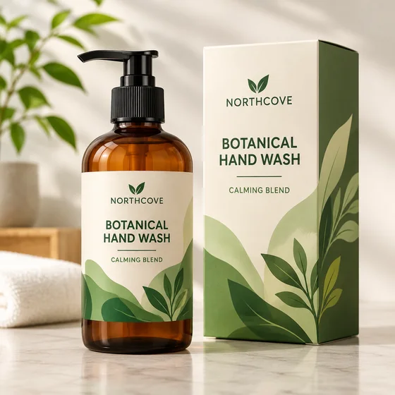

# Concepto de diseño de packaging·Nuevo concepto visual de packaging

[中文](../../../README.md) · [English](../../../README.en.md) · [Português](../../../README.pt.md) · [Español](../../../README.es.md) · [Français](../../../README.fr.md) · [Deutsch](../../../README.de.md) · [عربي](../../../README.ar.md) · [русский](../../../README.ru.md) · [日本語](../../../README.ja.md) · [हिंदी](../../../README.hi.md)


Cree un nuevo concepto visual de empaque para su resumen específico solo a partir de texto.

Genere conceptos visuales para etiquetas de embalaje y formas de cajas. Se utiliza para propuestas y pruebas de nuevos productos.

[Solicitud de copia](#public-prompt) · [ es producido por dearsketch / Pruebe en línea](https://dearsketch.com/es/intent/i134-create-packaging-label-and-box-concepts.html?utm_source=github&utm_medium=case&utm_campaign=dearsketch-public-cases&utm_content=i134_cta) · [Volver al tema / Colección](../guides/text-only.md)

## Material de referencia y dirección de resultados.

<p><strong>Ejemplo de resultados</strong></p>
<p><a href="https://dearsketch.com/es/intent/i134-create-packaging-label-and-box-concepts.html?utm_source=github&amp;utm_medium=case&amp;utm_campaign=dearsketch-public-cases&amp;utm_content=i134_image"></a></p>
<p>Este ejemplo es entrada de texto, no se adjunta ninguna referencia de imagen.</p>

Los materiales de referencia y los resultados se utilizan para ilustrar la dirección visual. La plantilla pública no es la instrucción de generación original de las imágenes adjuntas y no se garantiza la reproducción de los mismos resultados.

## Qué preparar/Insumos

| Material | Tipo / Tipo | Cantidad / Cantidad | Condición / Requisito |
| --- | --- | --- | --- |
| Resumen de creación de texto: complete el tema, el propósito y los parámetros fácticos en las palabras clave | Carácter / Texto | 1 porción | Requerido / Requerido |

**Generación de texto puro/Solo texto: no se requiere imagen, logotipo, boceto u otro archivo adjunto.** Utilice solo el resumen de texto a continuación para crear nuevos conceptos.

Solo se genera una imagen a la vez, no es necesario cargar imágenes.

## Conservar y cambiar / Editar resumen

- **Preservar / 保留：** Respete los hechos escritos proporcionados, la redacción exacta y las limitaciones.
- **Cambiar / 改变：** Utilice [CONTAINER OR BOX TYPE], [MATERIAL DIRECTION] y [PALETTE]. Coloque solo “[NEW BRAND NAME]” y “[EXACT APPROVED COPY]” en las caras visibles con una jerarquía legible.

## Public prompt

**Plantilla pública recién compilada · De nueva creación · No probada en generación.** Simplemente reemplace los parámetros de corchetes, no es necesario cargar imágenes de referencia. Esta plantilla no se utilizó para generar los ejemplos de esta página.

```text
Create one new packaging visual concept for [PRODUCT CATEGORY] from the following written brief only. No reference image or other attachment is needed.
Use [CONTAINER OR BOX TYPE], [MATERIAL DIRECTION] and [PALETTE]. Place only “[NEW BRAND NAME]” and “[EXACT APPROVED COPY]” on the visible faces with a readable hierarchy.
Do not infer certification, ingredients or performance; this is not a dieline or manufacturing file.
Use an original design. Do not imply fidelity to any existing person, product, property or artwork that has not been supplied.
Return one finished image only. Replace every bracketed field with your own details before generating.
```

[Hazlo en línea con tus propios materiales / Hazlo en línea](https://dearsketch.com/es/intent/i134-create-packaging-label-and-box-concepts.html?utm_source=github&utm_medium=case&utm_campaign=dearsketch-public-cases&utm_content=i134_after-prompt) · [Deja que el agente te ayude a organizarlo / Usa la habilidad](../quickstart.md#agent-skill)

## Consulta los puntos clave/Revisión

No infiera certificación, ingredientes o desempeño; Este no es un archivo dieline o de fabricación.

No infiera certificación, ingredientes o desempeño; Este no es un archivo dieline o de fabricación.

Dirección del resultado: Concepto de diseño de packaging. Cuando se requiera texto exacto, archivos transparentes, vectores o entrega impresa, verifique el archivo real; Las funciones y tarifas disponibles están sujetas a la descripción del sitio web.

## Casos relacionados / Tareas relacionadas

- [Crear una imagen de perfil para YouTube o streaming · Avatar de canal generado por texto ](./i054-create-a-profile-picture-for-youtube-or-streaming.md#public-prompt)
- [Crear un emoji personalizado a partir de texto · Emoji personalizado](./i057-create-a-custom-emoji-from-text.md#public-prompt)
- [Crea estampados y patrones de telas sin costuras para ropa · ](./i100-create-seamless-prints-and-fabric-patterns-for-clothing.md#public-prompt)

## Referencia de antecedentes de requisitos

- [Freepik AI](https://www.freepik.com/ai)
- [Recraft](https://www.recraft.ai/Generate)

Estos enlaces son solo para ayudar a comprender el propósito y no son prueba de la fuente o autorización de las imágenes en esta página.

Para conocer el alcance de uso de imágenes y materiales, consulte la descripción del contenido [ ](../content-policy.md). [Ver las 100 plantillas ](../prompts.md).
