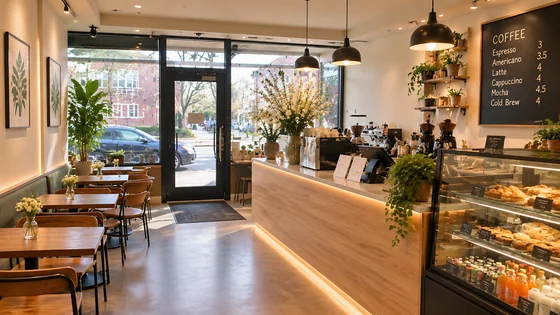

# Concepto de diseño de espacios comerciales · Nueva dirección de diseño para espacios comerciales

[中文](../../../README.md) · [English](../../../README.en.md) · [Português](../../../README.pt.md) · [Español](../../../README.es.md) · [Français](../../../README.fr.md) · [Deutsch](../../../README.de.md) · [عربي](../../../README.ar.md) · [русский](../../../README.ru.md) · [日本語](../../../README.ja.md) · [हिंदी](../../../README.hi.md)


Cree un nuevo concepto de interior breve específico solo a partir de texto.

Genere instrucciones de diseño para restaurantes, tiendas o salas de exposición. Para apertura, renovación y propuestas de tienda.

[Solicitud de copia](#public-prompt) · [ es producido por dearsketch / Pruebe en línea](https://dearsketch.com/es/intent/i173-create-design-directions-for-a-restaurant-shop-or-showroom.html?utm_source=github&utm_medium=case&utm_campaign=dearsketch-public-cases&utm_content=i173_cta) · [Volver al tema / Colección](../guides/text-only.md)

## Material de referencia y dirección de resultados.

<table>
<thead><tr><th width="50%">Material de referencia</th><th width="50%">Ejemplo de resultados</th></tr></thead>
<tbody><tr><td valign="top"><p><strong>Imagen original de la escena del espacio comercial.</strong><br></p></td><td valign="top"><a href="https://dearsketch.com/es/intent/i173-create-design-directions-for-a-restaurant-shop-or-showroom.html?utm_source=github&amp;utm_medium=case&amp;utm_campaign=dearsketch-public-cases&amp;utm_content=i173_image"></a></td></tr></tbody>
</table>

Los materiales de referencia y los resultados se utilizan para ilustrar la dirección visual. La plantilla pública no es la instrucción de generación original de las imágenes adjuntas y no se garantiza la reproducción de los mismos resultados.

## Qué preparar/Insumos

| Material | Tipo / Tipo | Cantidad / Cantidad | Condición / Requisito |
| --- | --- | --- | --- |
| Resumen de creación de texto: complete el tema, el propósito y los parámetros fácticos en las palabras clave | Carácter / Texto | 1 porción | Requerido / Requerido |

**Generación de texto puro/Solo texto: no se requiere imagen, logotipo, boceto u otro archivo adjunto.** Utilice solo el resumen de texto a continuación para crear nuevos conceptos.

Solo se genera una imagen a la vez, no es necesario cargar imágenes.

## Conservar y cambiar / Editar resumen

- **Preservar / 保留：** Respete los hechos escritos proporcionados, la redacción exacta y las limitaciones.
- **Cambiar / 改变：** El resumen es [CUSTOMER TYPE], [FUNCTIONAL ZONES], [CIRCULATION REQUIREMENTS] y [DESIGN DIRECTION]. Diseñar muebles, expositores, mamparas, materiales e iluminación como un nuevo esquema coherente.

## Public prompt

**Plantilla pública recién compilada · De nueva creación · No probada en generación.** Simplemente reemplace los parámetros de corchetes, no es necesario cargar imágenes de referencia. Esta plantilla no se utilizó para generar los ejemplos de esta página.

```text
Create one new [RESTAURANT OR SHOP OR SHOWROOM] interior concept from the following written brief only. No reference image or other attachment is needed.
The brief is [CUSTOMER TYPE], [FUNCTIONAL ZONES], [CIRCULATION REQUIREMENTS] and [DESIGN DIRECTION]. Design furniture, display fixtures, partitions, materials and lighting as a coherent new scheme.
With no site photo this is a fictional space concept, not an alteration of an actual property or a construction plan.
Use an original design. Do not imply fidelity to any existing person, product, property or artwork that has not been supplied.
Return one finished image only. Replace every bracketed field with your own details before generating.
```

[Hazlo en línea con tus propios materiales / Hazlo en línea](https://dearsketch.com/es/intent/i173-create-design-directions-for-a-restaurant-shop-or-showroom.html?utm_source=github&utm_medium=case&utm_campaign=dearsketch-public-cases&utm_content=i173_after-prompt) · [Deja que el agente te ayude a organizarlo / Usa la habilidad](../quickstart.md#agent-skill)

## Consulta los puntos clave/Revisión

Sin fotografía del sitio, este es un concepto de espacio ficticio, no una alteración de una propiedad real o un plan de construcción.

Sin fotografía del sitio, este es un concepto de espacio ficticio, no una alteración de una propiedad real o un plan de construcción.

Dirección del resultado: Dibujo del concepto de espacio comercial. Cuando se requiera texto exacto, archivos transparentes, vectores o entrega impresa, verifique el archivo real; Las funciones y tarifas disponibles están sujetas a la descripción del sitio web.

## Casos relacionados / Tareas relacionadas

- [Crear una imagen de perfil para YouTube o streaming · Avatar de canal generado por texto ](./i054-create-a-profile-picture-for-youtube-or-streaming.md#public-prompt)
- [Crear un emoji personalizado a partir de texto · Emoji personalizado](./i057-create-a-custom-emoji-from-text.md#public-prompt)
- [Crea estampados y patrones de telas sin costuras para ropa · ](./i100-create-seamless-prints-and-fabric-patterns-for-clothing.md#public-prompt)

## Referencia de antecedentes de requisitos

- [Diseño de habitación Adobe](https://www.adobe.com/products/firefly/features/ai-room-design.html)

Estos enlaces son solo para ayudar a comprender el propósito y no son prueba de la fuente o autorización de las imágenes en esta página.

Para conocer el alcance de uso de imágenes y materiales, consulte la descripción del contenido [ ](../content-policy.md). [Ver las 100 plantillas ](../prompts.md).
