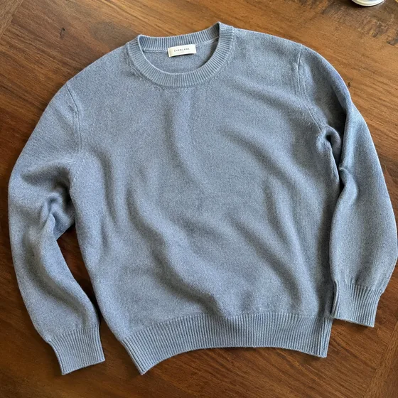

# Contenido de marketing, publicidad y redes sociales

[中文](../../../README.md) · [English](../../../README.en.md) · [Português](../../../README.pt.md) · [Español](../../../README.es.md) · [Français](../../../README.fr.md) · [Deutsch](../../../README.de.md) · [عربي](../../../README.ar.md) · [русский](../../../README.ru.md) · [日本語](../../../README.ja.md) · [हिंदी](../../../README.hi.md)

6 casos fuera del catálogo destacado. Las palabras clave no se divulgan aquí, solo se muestran los materiales de referencia existentes, las instrucciones de resultados y los requisitos mínimos de materiales.

[Volver a más catálogos de casos](./index.md) · [Volver a la página de inicio del almacén](../../../README.es.md)

> Los materiales de referencia y las imágenes de resultados son únicamente como guía visual; No hay garantía de que se pueda reproducir el mismo efecto utilizando los mismos materiales.

## I110 · Generar creatividades de rendimiento a partir de imágenes de productos

<table>
<thead><tr><th width="50%">Material de referencia</th><th width="50%">Ejemplo de resultados</th></tr></thead>
<tbody><tr><td valign="top">
<strong>Imágenes de productos, puntos de venta y audiencia.</strong> 
</td><td valign="top"></td></tr></tbody>
</table>

- **Tipo de entrada:** Incluye vista previa del material de referencia y ejemplo de resultados.
- **Requisitos de material:** Imágenes de productos, puntos de venta y audiencia + puntos de venta de productos, público objetivo → combinación de escenas, redacción publicitaria y elementos de marca → imagen creativa publicitaria única actual
- **Descripción:** Solo se genera una imagen a la vez.

[ Verifique los requisitos específicos en dearsketch y haga ](https://dearsketch.com/es/intent/i110-create-performance-ad-creative-from-a-product-image.html?utm_source=github&utm_medium=gallery&utm_campaign=dearsketch-public-cases&utm_content=i110_cta)

---

## I125 · Cambiar el mismo visual publicitario a diferentes idiomas y versiones culturales

<table>
<thead><tr><th width="50%">Material de referencia</th><th width="50%">Ejemplo de resultados</th></tr></thead>
<tbody><tr><td valign="top">
<strong>anuncio original completo</strong> 
</td><td valign="top"></td></tr></tbody>
</table>

- **Tipo de entrada:** Incluye vista previa del material de referencia y ejemplo de resultados.
- **Requisitos de material:** 1 anuncio original completo + país o región de destino (se puede agregar idioma específico, preferencia cultural o traducción revisada)
- **Descripción:** Solo se genera una imagen a la vez.

[ Verifique los requisitos específicos en dearsketch y haga ](https://dearsketch.com/es/intent/i125-adapt-one-ad-visual-for-different-languages-and-cultures.html?utm_source=github&utm_medium=gallery&utm_campaign=dearsketch-public-cases&utm_content=i125_cta)

---

## I260 · Convierte tu colección de ropa en un lookbook o catálogo de moda

<table>
<thead><tr><th width="50%">Material de referencia</th><th width="50%">Ejemplo de resultados</th></tr></thead>
<tbody><tr><td valign="top">
<strong>Modelo L02 con foto</strong> 

<strong>L02 imagen frontal completa del producto</strong> 
</td><td valign="top"></td></tr></tbody>
</table>

- **Tipo de entrada:** Incluye vista previa del material de referencia y ejemplo de resultados.
- **Requisitos de material:** Imágenes del modelo e imágenes del producto requeridas (varias imágenes de la serie completa) + tema de la serie requerido, número de estilo, orden y número de páginas (1 copia)
- **Descripción:** Esta vez se genera una única vista previa visual. Los cálculos de datos, la composición tipográfica precisa, los archivos vectoriales o de producción aún deben ser verificados por las herramientas correspondientes.

[ Verifique los requisitos específicos en dearsketch y haga ](https://dearsketch.com/es/intent/i260-turn-a-clothing-collection-into-a-lookbook-or-fashion-catalog.html?utm_source=github&utm_medium=gallery&utm_campaign=dearsketch-public-cases&utm_content=i260_cta)

---

## I261 · Crear portada de podcast

<table>
<thead><tr><th width="50%">Material de referencia</th><th width="50%">Ejemplo de resultados</th></tr></thead>
<tbody><tr><td valign="top">
<strong>Retrato del anfitrión</strong> 
</td><td valign="top"></td></tr></tbody>
</table>

- **Tipo de entrada:** Incluye vista previa del material de referencia y ejemplo de resultados.
- **Requisitos de material:** Retrato del anfitrión opcional (0 o 1) + nombre del programa requerido, tema y plataforma de destino (1 copia) + nombre del programa requerido y subtítulo necesario (1 juego)
- **Descripción:** Solo se genera una imagen a la vez.

[ Verifique los requisitos específicos en dearsketch y haga ](https://dearsketch.com/es/intent/i261-create-podcast-cover-art.html?utm_source=github&utm_medium=gallery&utm_campaign=dearsketch-public-cases&utm_content=i261_cta)

---

## I262 · Generar ilustraciones para informes anuales, informes técnicos o estudios de casos

<strong>Ejemplo de resultados</strong>

Este ejemplo no incluye una referencia de imagen y la vista previa de entrada debe completarse; consulte los requisitos de materiales a continuación.

- **Tipo de entrada:** Este ejemplo solo muestra ejemplos de resultados; se agregará la vista previa de entrada de imagen
- **Requisitos de material:** Especificaciones de marca opcionales o anclajes de ilustraciones de informes existentes (0 a múltiples) + lista de capítulos requeridos y resumen de cada capítulo (1 copia) + datos de condición verificada (1 copia) + especificaciones de marca opcionales (0 o 1 copia)
- **Descripción:** Solo se genera el seleccionado actualmente a la vez; Otras imágenes de la serie están ejecutadas por separado.

[ Verifique los requisitos específicos en dearsketch y haga ](https://dearsketch.com/es/intent/i262-create-illustrations-for-an-annual-report-white-paper-or-case-study.html?utm_source=github&utm_medium=gallery&utm_campaign=dearsketch-public-cases&utm_content=i262_cta)

---

## I263 · Genera ilustraciones y diagramas de conceptos unificados para presentaciones

<strong>Ejemplo de resultados</strong>

Este ejemplo no incluye una referencia de imagen y la vista previa de entrada debe completarse; consulte los requisitos de materiales a continuación.

- **Tipo de entrada:** Este ejemplo solo muestra ejemplos de resultados; se agregará la vista previa de entrada de imagen
- **Requisitos de material:** Marca opcional o anclaje visual del roadshow (0 o 1 foto) + lista de páginas requerida e información principal de cada página (1 copia) + modelo de negocio o proceso de usuario requerido (1 copia) + especificaciones de marca opcionales (0 o 1 copia)
- **Descripción:** Solo se genera el seleccionado actualmente a la vez; Otras imágenes de la serie están ejecutadas por separado.

[ Verifique los requisitos específicos en dearsketch y haga ](https://dearsketch.com/es/intent/i263-create-consistent-illustrations-and-diagrams-for-a-pitch-deck.html?utm_source=github&utm_medium=gallery&utm_campaign=dearsketch-public-cases&utm_content=i263_cta)
