# Activos de marca y diseño gráfico

[中文](../../../README.md) · [English](../../../README.en.md) · [Português](../../../README.pt.md) · [Español](../../../README.es.md) · [Français](../../../README.fr.md) · [Deutsch](../../../README.de.md) · [عربي](../../../README.ar.md) · [русский](../../../README.ru.md) · [日本語](../../../README.ja.md) · [हिंदी](../../../README.hi.md)

12 casos fuera del catálogo destacado. Las palabras clave no se divulgan aquí, solo se muestran los materiales de referencia existentes, las instrucciones de resultados y los requisitos mínimos de materiales.

[Volver a más catálogos de casos](./index.md) · [Volver a la página de inicio del almacén](../../../README.es.md)

> Los materiales de referencia y las imágenes de resultados son únicamente como guía visual; No hay garantía de que se pueda reproducir el mismo efecto utilizando los mismos materiales.

## I127 · Generar icono de producto o interfaz

<strong>Ejemplo de resultados</strong>

Este ejemplo no incluye una referencia de imagen y la vista previa de entrada debe completarse; consulte los requisitos de materiales a continuación.

- **Tipo de entrada:** Este ejemplo solo muestra ejemplos de resultados; se agregará la vista previa de entrada de imagen
- **Requisitos de material:** Plantilla de sistema de íconos existente + lista de funciones → Generar una colección de íconos consistente → Activo de ícono único actual
- **Descripción:** Esta vez se genera una única vista previa visual. Los cálculos de datos, la composición tipográfica precisa, los archivos vectoriales o de producción aún deben ser verificados por las herramientas correspondientes.

[ Verifique los requisitos específicos en dearsketch y haga ](https://dearsketch.com/es/intent/i127-create-product-or-interface-icons.html?utm_source=github&utm_medium=gallery&utm_campaign=dearsketch-public-cases&utm_content=i127_cta)

---

## I128 · Genera ilustraciones vectoriales editables a partir de texto

<strong>Ejemplo de resultados</strong>

<a href="https://dearsketch.com/es/intent/i128-create-an-editable-vector-illustration-from-text.html?utm_source=github&amp;utm_medium=gallery&amp;utm_campaign=dearsketch-public-cases&amp;utm_content=i128_image">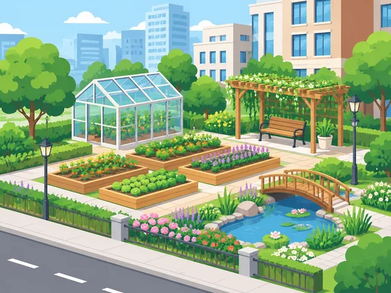</a>

Este ejemplo es entrada de texto, no se adjunta ninguna referencia de imagen.

- **Tipo de entrada:** Entrada de texto; este ejemplo solo muestra ejemplos de resultados
- **Requisitos de material:** Tema y propósito de la ilustración → Generar SVG y geometría en capas → Ilustración vectorial única actual
- **Descripción:** Esta vez se genera una única vista previa visual. Los cálculos de datos, la composición tipográfica precisa, los archivos vectoriales o de producción aún deben ser verificados por las herramientas correspondientes.

[ Verifique los requisitos específicos en dearsketch y haga ](https://dearsketch.com/es/intent/i128-create-an-editable-vector-illustration-from-text.html?utm_source=github&utm_medium=gallery&utm_campaign=dearsketch-public-cases&utm_content=i128_cta)

---

## I129 · Genera imágenes de galería personalizadas específicas del tema

<strong>Ejemplo de resultados</strong>

Este ejemplo no incluye una referencia de imagen y la vista previa de entrada debe completarse; consulte los requisitos de materiales a continuación.

- **Tipo de entrada:** Este ejemplo solo muestra ejemplos de resultados; se agregará la vista previa de entrada de imagen
- **Requisitos de material:** Imágenes originales de productos o personajes que deben integrarse en escenas + escenas específicas y contexto de uso → Genere imágenes sin restricciones de biblioteca listas para usar → Personalice la imagen de archivo única actual
- **Descripción:** Solo se genera una imagen a la vez.

[ Verifique los requisitos específicos en dearsketch y haga ](https://dearsketch.com/es/intent/i129-create-custom-stock-imagery-for-a-specific-theme.html?utm_source=github&utm_medium=gallery&utm_campaign=dearsketch-public-cases&utm_content=i129_cta)

---

## I130 · Crear diseño visual VI de marca de mascota reutilizable

<table>
<thead><tr><th width="50%">Material de referencia</th><th width="50%">Ejemplo de resultados</th></tr></thead>
<tbody><tr><td valign="top">
<strong>Logotipo de una marca y especificaciones visuales.</strong> 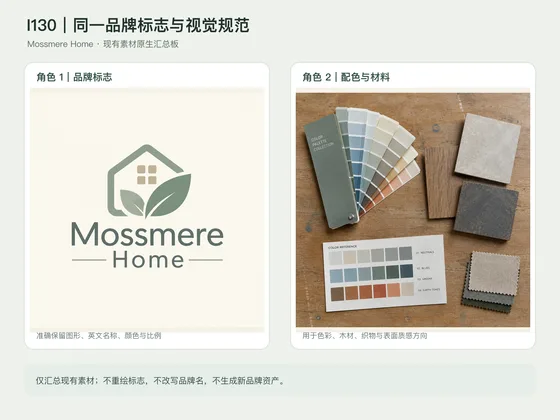

<strong>Prototipo de mascota o mapa de dirección.</strong> 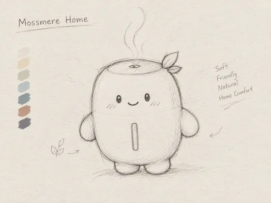
</td><td valign="top"><a href="https://dearsketch.com/es/intent/i130-create-reusable-brand-identity-visuals-for-a-mascot.html?utm_source=github&amp;utm_medium=gallery&amp;utm_campaign=dearsketch-public-cases&amp;utm_content=i130_image">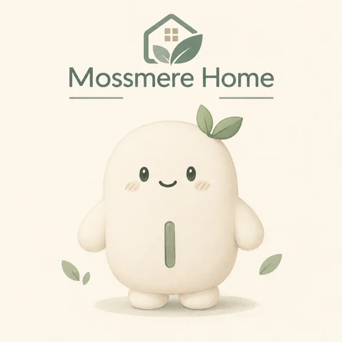</a></td></tr></tbody>
</table>

- **Tipo de entrada:** Incluye vista previa del material de referencia y ejemplo de resultados.
- **Requisitos de materiales:** El mismo logotipo de marca y especificaciones visuales + prototipo de mascota o mapa de dirección + personalidad de la marca, audiencia y escenarios de aplicación → Defina la apariencia del personaje y manténgala consistente en todos los escenarios → Mascota de marca única actual
- **Descripción:** Solo se genera el seleccionado actualmente a la vez; Otras imágenes de la serie están ejecutadas por separado.

[ Verifique los requisitos específicos en dearsketch y haga ](https://dearsketch.com/es/intent/i130-create-reusable-brand-identity-visuals-for-a-mascot.html?utm_source=github&utm_medium=gallery&utm_campaign=dearsketch-public-cases&utm_content=i130_cta)

---

## I131 · Mantener un grupo de imágenes coherentes con el estilo de la marca.

<table>
<thead><tr><th width="50%">Material de referencia</th><th width="50%">Ejemplo de resultados</th></tr></thead>
<tbody><tr><td valign="top">
<strong>Figura A: Puntos de referencia visuales de la marca</strong> 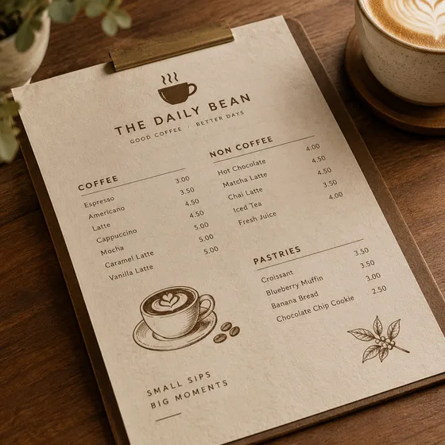

<strong>Figura B: El mapa de contenido actual que se unificará</strong> 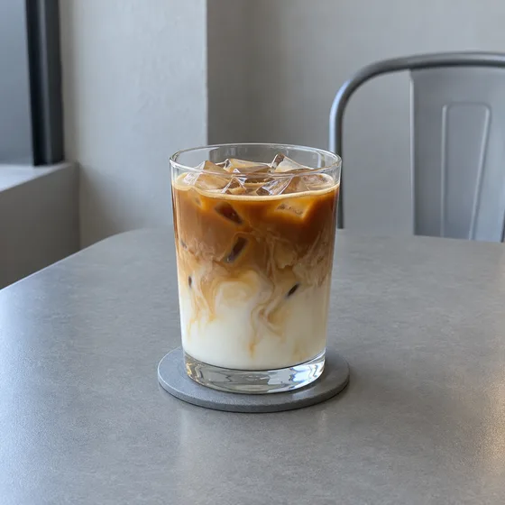
</td><td valign="top"><a href="https://dearsketch.com/es/intent/i131-keep-a-set-of-images-consistent-with-one-brand-style.html?utm_source=github&amp;utm_medium=gallery&amp;utm_campaign=dearsketch-public-cases&amp;utm_content=i131_image">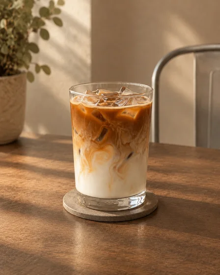</a></td></tr></tbody>
</table>

- **Tipo de entrada:** Incluye vista previa del material de referencia y ejemplo de resultados.
- **Requisitos de material:** Imagen A: Línea base visual de la marca + Imagen B: Imagen del contenido actual que se unificará + lista de series y reglas inmutables → Aplicar solo las reglas visuales de la Imagen A a la Imagen B → Imagen de marca única y consistente actual
- **Descripción:** Solo se genera el seleccionado actualmente a la vez; Otras imágenes de la serie están ejecutadas por separado.

[ Verifique los requisitos específicos en dearsketch y haga ](https://dearsketch.com/es/intent/i131-keep-a-set-of-images-consistent-with-one-brand-style.html?utm_source=github&utm_medium=gallery&utm_campaign=dearsketch-public-cases&utm_content=i131_cta)

---

## I134 · Generar conceptos visuales de cajas y etiquetas de embalaje

<strong>Ejemplo de resultados</strong>

<a href="https://dearsketch.com/es/intent/i134-create-packaging-label-and-box-concepts.html?utm_source=github&amp;utm_medium=gallery&amp;utm_campaign=dearsketch-public-cases&amp;utm_content=i134_image">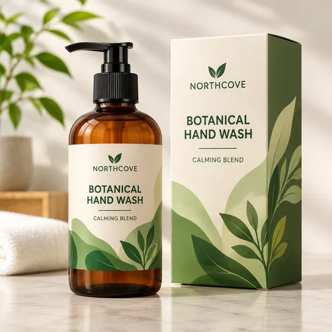</a>

Este ejemplo no incluye una referencia de imagen y la vista previa de entrada debe completarse; consulte los requisitos de materiales a continuación.

- **Tipo de entrada:** Este ejemplo solo muestra ejemplos de resultados; se agregará la vista previa de entrada de imagen
- **Requisitos de material:** Marca y estructura de empaque, tablero original + tipo de producto, nombre de marca, copia de empaque, tipo de contenedor o caja → Generar dirección de empaque con texto legible → Concepto actual de diseño de empaque de una sola hoja
- **Descripción:** Solo se genera una imagen a la vez.

[ Verifique los requisitos específicos en dearsketch y haga ](https://dearsketch.com/es/intent/i134-create-packaging-label-and-box-concepts.html?utm_source=github&utm_medium=gallery&utm_campaign=dearsketch-public-cases&utm_content=i134_cta)

---

## I135 · Genera fondos, texturas y patrones de marca repetibles

<strong>Ejemplo de resultados</strong>

<a href="https://dearsketch.com/es/intent/i135-create-repeatable-backgrounds-textures-and-brand-patterns.html?utm_source=github&amp;utm_medium=gallery&amp;utm_campaign=dearsketch-public-cases&amp;utm_content=i135_image">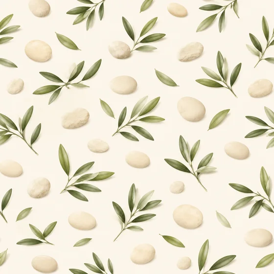</a>

Este ejemplo no incluye una referencia de imagen y la vista previa de entrada debe completarse; consulte los requisitos de materiales a continuación.

- **Tipo de entrada:** Este ejemplo solo muestra ejemplos de resultados; se agregará la vista previa de entrada de imagen
- **Requisitos de material:** Unidad gráfica de marca original + tema, escenario de aplicación → Generar patrón transparente → Patrón y textura únicos actuales
- **Descripción:** Solo se genera una imagen a la vez.

[ Verifique los requisitos específicos en dearsketch y haga ](https://dearsketch.com/es/intent/i135-create-repeatable-backgrounds-textures-and-brand-patterns.html?utm_source=github&utm_medium=gallery&utm_campaign=dearsketch-public-cases&utm_content=i135_cta)

---

## I136 · Aplicar diseño a maquetas de equipos, vallas publicitarias, indumentaria y embalajes

<table>
<thead><tr><th width="50%">Material de referencia</th><th width="50%">Ejemplo de resultados</th></tr></thead>
<tbody><tr><td valign="top">
<strong>Manuscrito de diseño gráfico independiente.</strong> 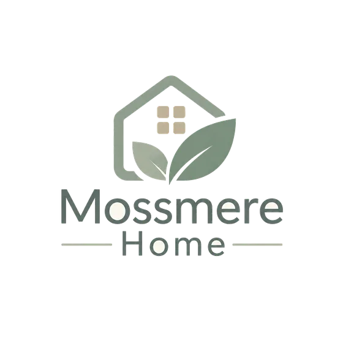

<strong>Foto o plantilla vectorial de destino actual</strong> 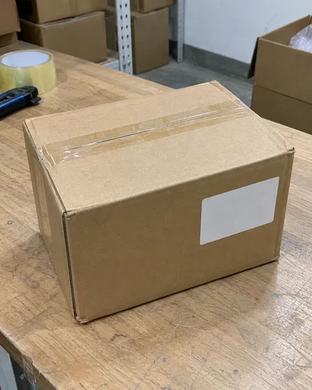
</td><td valign="top"><a href="https://dearsketch.com/es/intent/i136-apply-a-design-to-device-billboard-apparel-and-packaging-mockups.html?utm_source=github&amp;utm_medium=gallery&amp;utm_campaign=dearsketch-public-cases&amp;utm_content=i136_image">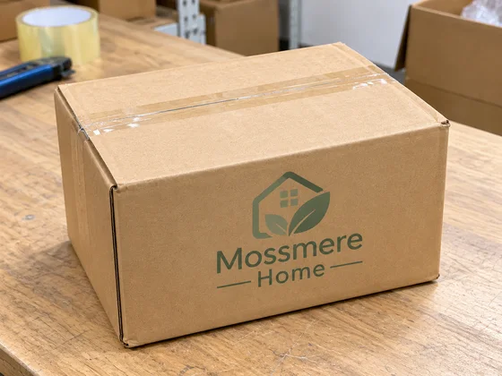</a></td></tr></tbody>
</table>

- **Tipo de entrada:** Incluye vista previa del material de referencia y ejemplo de resultados.
- **Requisitos de material:** Manuscrito de diseño gráfico independiente + foto o plantilla del portador de destino actual (al especificar el objeto físico) + portador actual y escena de visualización → Generar el prototipo real único actual
- **Descripción:** Esta vez se genera una única vista previa visual. Los cálculos de datos, la composición tipográfica precisa, los archivos vectoriales o de producción aún deben ser verificados por las herramientas correspondientes.

[ Verifique los requisitos específicos en dearsketch y haga ](https://dearsketch.com/es/intent/i136-apply-a-design-to-device-billboard-apparel-and-packaging-mockups.html?utm_source=github&utm_medium=gallery&utm_campaign=dearsketch-public-cases&utm_content=i136_cta)

---

## I137 · Genera variaciones de tamaño y composición a partir de un diseño

<table>
<thead><tr><th width="50%">Material de referencia</th><th width="50%">Ejemplo de resultados</th></tr></thead>
<tbody><tr><td valign="top">
<strong>Maestro visual clave</strong> 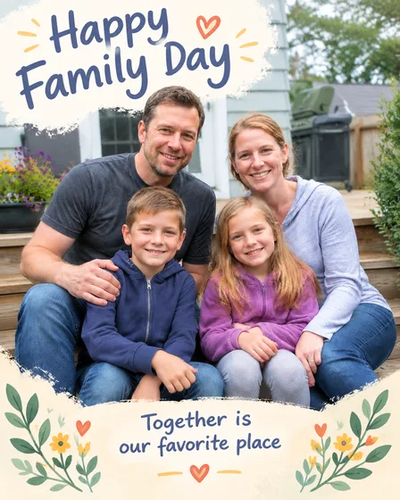
</td><td valign="top"><a href="https://dearsketch.com/es/intent/i137-create-size-and-composition-variations-from-one-design.html?utm_source=github&amp;utm_medium=gallery&amp;utm_campaign=dearsketch-public-cases&amp;utm_content=i137_image">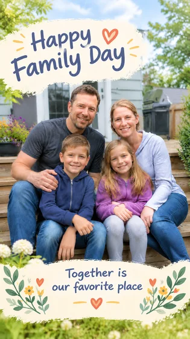</a></td></tr></tbody>
</table>

- **Tipo de entrada:** Incluye vista previa del material de referencia y ejemplo de resultados.
- **Requisitos de material:** Maestro visual principal + lista de canales de destino y elementos inmutables → Ampliar diferentes proporciones, diseños y fondos → Variantes de activos multicanal de la hoja única actual
- **Descripción:** Solo se genera el seleccionado actualmente a la vez; Otras imágenes de la serie están ejecutadas por separado.

[ Verifique los requisitos específicos en dearsketch y haga ](https://dearsketch.com/es/intent/i137-create-size-and-composition-variations-from-one-design.html?utm_source=github&utm_medium=gallery&utm_campaign=dearsketch-public-cases&utm_content=i137_cta)

---

## I138 · Convierte fotos en dibujos lineales, contornos o siluetas

<table>
<thead><tr><th width="50%">Material de referencia</th><th width="50%">Ejemplo de resultados</th></tr></thead>
<tbody><tr><td valign="top">
<strong>foto</strong> 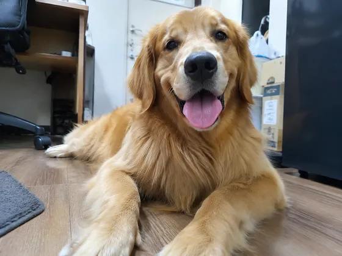
</td><td valign="top"><a href="https://dearsketch.com/es/intent/i138-turn-a-photo-into-line-art-an-outline-or-a-silhouette.html?utm_source=github&amp;utm_medium=gallery&amp;utm_campaign=dearsketch-public-cases&amp;utm_content=i138_image">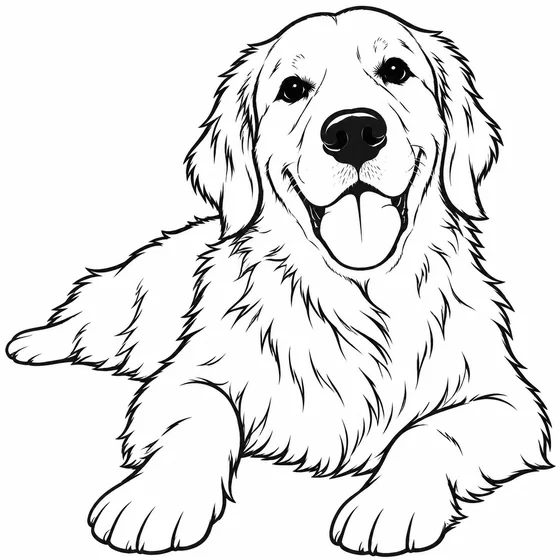</a></td></tr></tbody>
</table>

- **Tipo de entrada:** Incluye vista previa del material de referencia y ejemplo de resultados.
- **Requisitos de material:** Foto + tipo de salida: dibujo lineal, contorno o silueta, propósito → Extraer estructura y simplificarla en líneas → Dibujo o silueta actual de una sola línea
- **Descripción:** Solo se genera una imagen a la vez.

[ Verifique los requisitos específicos en dearsketch y haga ](https://dearsketch.com/es/intent/i138-turn-a-photo-into-line-art-an-outline-or-a-silhouette.html?utm_source=github&utm_medium=gallery&utm_campaign=dearsketch-public-cases&utm_content=i138_cta)

---

## I139 · Convertir logotipos o ilustraciones de mapas de bits en vectores escalables

<table>
<thead><tr><th width="50%">Material de referencia</th><th width="50%">Ejemplo de resultados</th></tr></thead>
<tbody><tr><td valign="top">
<strong>mapa de bits de baja definición</strong> 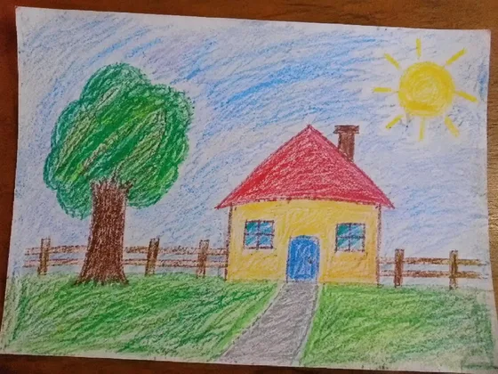
</td><td valign="top"><a href="https://dearsketch.com/es/intent/i139-convert-a-bitmap-logo-or-illustration-into-a-scalable-vector.html?utm_source=github&amp;utm_medium=gallery&amp;utm_campaign=dearsketch-public-cases&amp;utm_content=i139_image">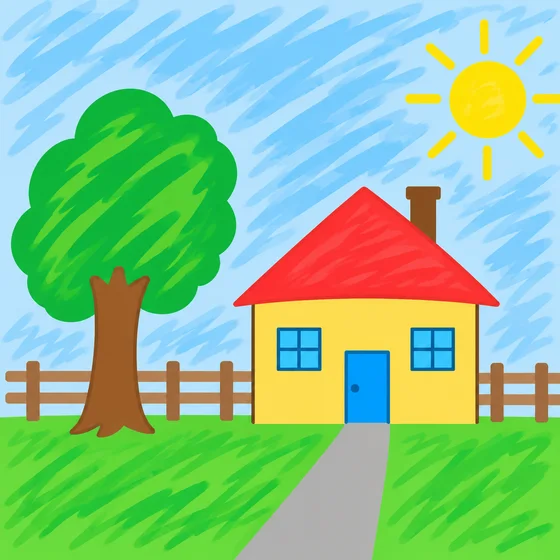</a></td></tr></tbody>
</table>

- **Tipo de entrada:** Incluye vista previa del material de referencia y ejemplo de resultados.
- **Requisitos de material:** Mapa de bits de baja definición + uso previsto → trazar bordes y generar SVG → archivo vectorial único actual
- **Descripción:** Esta vez se genera una única vista previa visual. Los cálculos de datos, la composición tipográfica precisa, los archivos vectoriales o de producción aún deben ser verificados por las herramientas correspondientes.

[ Verifique los requisitos específicos en dearsketch y haga ](https://dearsketch.com/es/intent/i139-convert-a-bitmap-logo-or-illustration-into-a-scalable-vector.html?utm_source=github&utm_medium=gallery&utm_campaign=dearsketch-public-cases&utm_content=i139_cta)

---

## I140 · Aplicar el estilo visual de una imagen de referencia a otra imagen

<table>
<thead><tr><th width="50%">Material de referencia</th><th width="50%">Ejemplo de resultados</th></tr></thead>
<tbody><tr><td valign="top">
<strong>Figura A: Imagen del contenido original</strong> 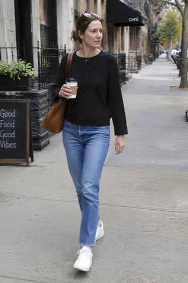

<strong>Figura B: Tabla de referencia de estilo</strong> 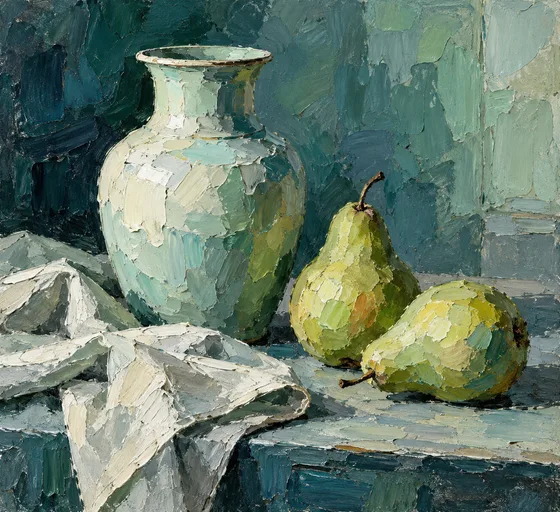
</td><td valign="top"><a href="https://dearsketch.com/es/intent/i140-apply-the-visual-style-of-a-reference-image-to-another-image.html?utm_source=github&amp;utm_medium=gallery&amp;utm_campaign=dearsketch-public-cases&amp;utm_content=i140_image">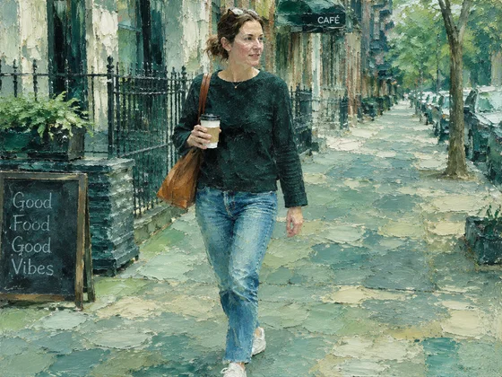</a></td></tr></tbody>
</table>

- **Tipo de entrada:** Incluye vista previa del material de referencia y ejemplo de resultados.
- **Requisitos de material:** Imagen A: imagen del contenido original + Imagen B: imagen de referencia de estilo + dimensión de migración opcional → aplique solo el estilo de la Imagen B a la Imagen A → la imagen de estilo unificado único actual
- **Descripción:** Solo se genera una imagen a la vez.

[ Verifique los requisitos específicos en dearsketch y haga ](https://dearsketch.com/es/intent/i140-apply-the-visual-style-of-a-reference-image-to-another-image.html?utm_source=github&utm_medium=gallery&utm_campaign=dearsketch-public-cases&utm_content=i140_cta)
