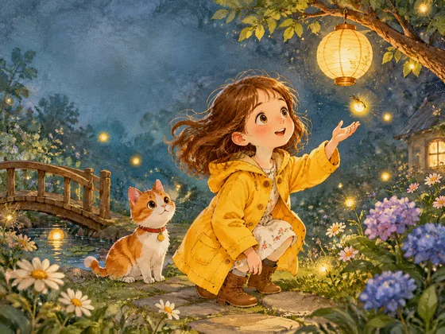
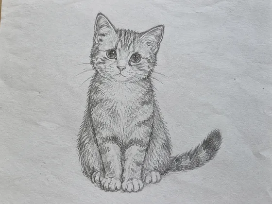
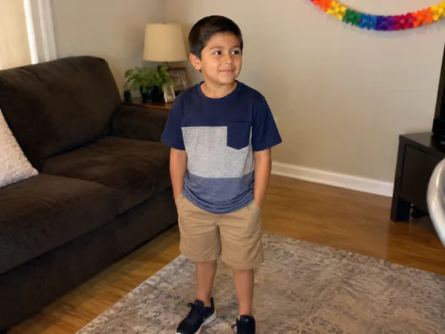

# Ilustraciones, Editoriales y Cuentos

[中文](../../../README.md) · [English](../../../README.en.md) · [Português](../../../README.pt.md) · [Español](../../../README.es.md) · [Français](../../../README.fr.md) · [Deutsch](../../../README.de.md) · [عربي](../../../README.ar.md) · [русский](../../../README.ru.md) · [日本語](../../../README.ja.md) · [हिंदी](../../../README.hi.md)

6 casos fuera del catálogo destacado. Las palabras clave no se divulgan aquí, solo se muestran los materiales de referencia existentes, las instrucciones de resultados y los requisitos mínimos de materiales.

[Volver a más catálogos de casos](./index.md) · [Volver a la página de inicio del almacén](../../../README.es.md)

> Los materiales de referencia y las imágenes de resultados son únicamente como guía visual; No hay garantía de que se pueda reproducir el mismo efecto utilizando los mismos materiales.

## I141 · Un libro ilustrado para niños que genera personajes consistentes a partir del texto de la historia.

<strong>Ejemplo de resultados</strong>

Este ejemplo no incluye una referencia de imagen y la vista previa de entrada debe completarse; consulte los requisitos de materiales a continuación.

- **Tipo de entrada:** Este ejemplo solo muestra ejemplos de resultados; se agregará la vista previa de entrada de imagen
- **Requisitos de material:** Reglas completas de historia y paginación + tablero manuscrito de configuración de personajes de libros ilustrados + plantilla de estilo de ilustración de libros ilustrados + número de página actual o extensión → dividir páginas y generar ilustraciones de personajes consistentes → libro ilustrado para niños único y completo actual
- **Descripción:** Solo se genera el seleccionado actualmente a la vez; Otras imágenes de la serie están ejecutadas por separado.

[ Verifique los requisitos específicos en dearsketch y haga ](https://dearsketch.com/es/intent/i141-create-a-children-s-picture-book-with-consistent-characters-from-a-story.html?utm_source=github&utm_medium=gallery&utm_campaign=dearsketch-public-cases&utm_content=i141_cta)

---

## I144 · Genera guiones gráficos o paneles de cómics que mantengan la coherencia de los personajes.

<strong>Ejemplo de resultados</strong>

Este ejemplo no incluye una referencia de imagen y la vista previa de entrada debe completarse; consulte los requisitos de materiales a continuación.

- **Tipo de entrada:** Este ejemplo solo muestra ejemplos de resultados; se agregará la vista previa de entrada de imagen
- **Requisitos de material:** Guión y diálogo del guión gráfico + tablero de configuración de personajes y escenas + página de cómic actual → generar escenas y composición continuas → panel de cómic único actual
- **Descripción:** Esta vez se genera una única vista previa visual. Los cálculos de datos, la composición tipográfica precisa, los archivos vectoriales o de producción aún deben ser verificados por las herramientas correspondientes.

[ Verifique los requisitos específicos en dearsketch y haga ](https://dearsketch.com/es/intent/i144-create-comic-panels-with-consistent-characters.html?utm_source=github&utm_medium=gallery&utm_campaign=dearsketch-public-cases&utm_content=i144_cta)

---

## I145 · Generar guiones o ideas en guiones gráficos de cine y televisión.

<strong>Ejemplo de resultados</strong>

Este ejemplo no incluye una referencia de imagen y la vista previa de entrada debe completarse; consulte los requisitos de materiales a continuación.

- **Tipo de entrada:** Este ejemplo solo muestra ejemplos de resultados; se agregará la vista previa de entrada de imagen
- **Requisitos de material:** Guión o lista de tomas + Tablero manuscrito de escenario y personajes + Página del guión gráfico actual → Generar boceto de secuencia → Guión gráfico único actual
- **Descripción:** Esta vez se genera una única vista previa visual. Los cálculos de datos, la composición tipográfica precisa, los archivos vectoriales o de producción aún deben ser verificados por las herramientas correspondientes.

[ Verifique los requisitos específicos en dearsketch y haga ](https://dearsketch.com/es/intent/i145-turn-a-script-or-idea-into-a-film-storyboard.html?utm_source=github&utm_medium=gallery&utm_campaign=dearsketch-public-cases&utm_content=i145_cta)

---

## I148 · Convierte bocetos en ilustraciones completamente terminadas

<table>
<thead><tr><th width="50%">Material de referencia</th><th width="50%">Ejemplo de resultados</th></tr></thead>
<tbody><tr><td valign="top">
<strong>Boceto dibujado a mano o digital.</strong> 
</td><td valign="top"></td></tr></tbody>
</table>

- **Tipo de entrada:** Incluye vista previa del material de referencia y ejemplo de resultados.
- **Requisitos de material:** Boceto dibujado a mano o digital + rango de modificación permitido → Mantenga la composición y agregue colores y detalles → Complete la ilustración en la imagen única actual
- **Descripción:** Solo se genera una imagen a la vez.

[ Verifique los requisitos específicos en dearsketch y haga ](https://dearsketch.com/es/intent/i148-turn-a-rough-sketch-into-a-polished-illustration.html?utm_source=github&utm_medium=gallery&utm_campaign=dearsketch-public-cases&utm_content=i148_cta)

---

## I149 · Genera páginas para colorear para niños a partir de fotos o texto

<table>
<thead><tr><th width="50%">Material de referencia</th><th width="50%">Ejemplo de resultados</th></tr></thead>
<tbody><tr><td valign="top">
<strong>Foto original para convertir</strong> 
</td><td valign="top"></td></tr></tbody>
</table>

- **Tipo de entrada:** Incluye vista previa del material de referencia y ejemplo de resultados.
- **Requisitos de material:** Foto original que se convertirá → Simplificada en un claro dibujo lineal en blanco y negro → Página para colorear única y actual para niños
- **Descripción:** Solo se genera una imagen a la vez.

[ Verifique los requisitos específicos en dearsketch y haga ](https://dearsketch.com/es/intent/i149-create-a-children-s-coloring-page-from-a-photo-or-text.html?utm_source=github&utm_medium=gallery&utm_campaign=dearsketch-public-cases&utm_content=i149_cta)

---

## I153 · Genera ilustraciones de tarot, juegos de mesa o cartas coleccionables

<strong>Ejemplo de resultados</strong>

Este ejemplo no incluye una referencia de imagen y la vista previa de entrada debe completarse; consulte los requisitos de materiales a continuación.

- **Tipo de entrada:** Este ejemplo solo muestra ejemplos de resultados; se agregará la vista previa de entrada de imagen
- **Requisitos de material:** Tabla de datos de la tarjeta + Plantilla de especificación de bordes y cosmovisión de la tarjeta + Tarjeta actual → Generar una serie de ilustraciones y bordes unificados → Ilustración de una sola tarjeta actual
- **Descripción:** Solo se genera el seleccionado actualmente a la vez; Otras imágenes de la serie están ejecutadas por separado.

[ Verifique los requisitos específicos en dearsketch y haga ](https://dearsketch.com/es/intent/i153-create-artwork-for-tarot-board-game-or-collectible-cards.html?utm_source=github&utm_medium=gallery&utm_campaign=dearsketch-public-cases&utm_content=i153_cta)
