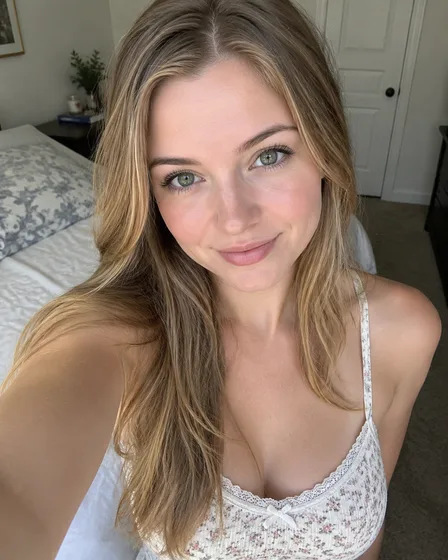

# POD y productos personalizados

[中文](../../../README.md) · [English](../../../README.en.md) · [Português](../../../README.pt.md) · [Español](../../../README.es.md) · [Français](../../../README.fr.md) · [Deutsch](../../../README.de.md) · [عربي](../../../README.ar.md) · [русский](../../../README.ru.md) · [日本語](../../../README.ja.md) · [हिंदी](../../../README.hi.md)

6 casos fuera del catálogo destacado. Las palabras clave no se divulgan aquí, solo se muestran los materiales de referencia existentes, las instrucciones de resultados y los requisitos mínimos de materiales.

[Volver a más catálogos de casos](./index.md) · [Volver a la página de inicio del almacén](../../../README.es.md)

> Los materiales de referencia y las imágenes de resultados son únicamente como guía visual; No hay garantía de que se pueda reproducir el mismo efecto utilizando los mismos materiales.

## I264 · Convertir logotipo o ilustración en un archivo de puntada de máquina de bordar

<table>
<thead><tr><th width="50%">Material de referencia</th><th width="50%">Ejemplo de resultados</th></tr></thead>
<tbody><tr><td valign="top">
<strong>Logotipo o ilustración transparente para digitalizar para bordar.</strong> 
</td><td valign="top"></td></tr></tbody>
</table>

- **Tipo de entrada:** Incluye vista previa del material de referencia y ejemplo de resultados.
- **Requisitos de material:** Logotipo o ilustración transparente requerido a digitalizar para bordado (1) + Especificaciones de producción de bordado requeridas (1 copia)
- **Descripción:** Esta vez se genera una única vista previa visual. Los cálculos de datos, la composición tipográfica precisa, los archivos vectoriales o de producción aún deben ser verificados por las herramientas correspondientes.

[ Verifique los requisitos específicos en dearsketch y haga ](https://dearsketch.com/es/intent/i264-convert-a-logo-or-illustration-into-an-embroidery-stitch-file.html?utm_source=github&utm_medium=gallery&utm_campaign=dearsketch-public-cases&utm_content=i264_cta)

---

## I268 · Organiza imágenes o texto en archivos vectoriales de corte y grabado láser

<table>
<thead><tr><th width="50%">Material de referencia</th><th width="50%">Ejemplo de resultados</th></tr></thead>
<tbody><tr><td valign="top">
<strong>Imagen o logotipo para grabar/cortar</strong> 
</td><td valign="top"></td></tr></tbody>
</table>

- **Tipo de entrada:** Incluye vista previa del material de referencia y ejemplo de resultados.
- **Requisitos de materiales:** Imágenes o logotipos opcionales para grabar/cortar (0 o 1) + métodos de procesamiento requeridos, materiales y limitaciones de la máquina (1 copia) + condiciones que requieren procesamiento de texto y glifos (1 copia)
- **Descripción:** Esta vez se genera una única vista previa visual. Los cálculos de datos, la composición tipográfica precisa, los archivos vectoriales o de producción aún deben ser verificados por las herramientas correspondientes.

[ Verifique los requisitos específicos en dearsketch y haga ](https://dearsketch.com/es/intent/i268-prepare-an-image-or-text-as-a-vector-file-for-laser-engraving-or-cutting.html?utm_source=github&utm_medium=gallery&utm_campaign=dearsketch-public-cases&utm_content=i268_cta)

---

## I271 · Convertir fotos en dibujos de pintura al óleo digitales

<table>
<thead><tr><th width="50%">Material de referencia</th><th width="50%">Ejemplo de resultados</th></tr></thead>
<tbody><tr><td valign="top">
<strong>Foto del cuerpo principal de la pintura al óleo digital que se va a convertir.</strong> 
</td><td valign="top"></td></tr></tbody>
</table>

- **Tipo de entrada:** Incluye vista previa del material de referencia y ejemplo de resultados.
- **Requisitos de materiales:** Foto del cuerpo principal requerida de la pintura al óleo digital que se transferirá (1 foto) + gama requerida de producto terminado y cantidad de colores de pintura (1 juego)
- **Descripción:** Esta vez se genera una única vista previa visual. Los cálculos de datos, la composición tipográfica precisa, los archivos vectoriales o de producción aún deben ser verificados por las herramientas correspondientes.

[ Verifique los requisitos específicos en dearsketch y haga ](https://dearsketch.com/es/intent/i271-turn-a-photo-into-a-paint-by-numbers-pattern.html?utm_source=github&utm_medium=gallery&utm_campaign=dearsketch-public-cases&utm_content=i271_cta)

---

## I273 · Convierte fotos en plantillas que se pueden cortar o pintar con aerosol

<table>
<thead><tr><th width="50%">Material de referencia</th><th width="50%">Ejemplo de resultados</th></tr></thead>
<tbody><tr><td valign="top">
<strong>Foto o logotipo de alto contraste de la plantilla a convertir</strong> 
</td><td valign="top"></td></tr></tbody>
</table>

- **Tipo de entrada:** Incluye vista previa del material de referencia y ejemplo de resultados.
- **Requisitos de material:** Foto o logotipo de alto contraste requerido de la plantilla a transferir (1 foto) + propósito, material y conexión mínima de la plantilla requerida (1 copia)
- **Descripción:** Esta vez se genera una única vista previa visual. Los cálculos de datos, la composición tipográfica precisa, los archivos vectoriales o de producción aún deben ser verificados por las herramientas correspondientes.

[ Verifique los requisitos específicos en dearsketch y haga ](https://dearsketch.com/es/intent/i273-turn-a-photo-into-a-cuttable-or-paintable-stencil.html?utm_source=github&utm_medium=gallery&utm_campaign=dearsketch-public-cases&utm_content=i273_cta)

---

## I284 · Crea un fan de soporte o un tablero de nombres con fotos de personas y texto en negrita

<table>
<thead><tr><th width="50%">Material de referencia</th><th width="50%">Ejemplo de resultados</th></tr></thead>
<tbody><tr><td valign="top">
<strong>Fotos de personas con permiso de uso.</strong> 
</td><td valign="top"></td></tr></tbody>
</table>

- **Tipo de entrada:** Incluye vista previa del material de referencia y ejemplo de resultados.
- **Requisitos de materiales:** Debe tener derecho a utilizar fotografías de personas (1 foto) + nombres requeridos o frases de aliento (1 juego) + tipos de productos terminados requeridos y colores representativos (1 juego)
- **Descripción:** Solo se genera una imagen a la vez.

[ Verifique los requisitos específicos en dearsketch y haga ](https://dearsketch.com/es/intent/i284-create-a-fan-support-uchiwa-or-name-board-from-a-portrait.html?utm_source=github&utm_medium=gallery&utm_campaign=dearsketch-public-cases&utm_content=i284_cta)

---

## I287 · Crea múltiples selfies en tiras de fotos de cuatro fotogramas y bordes temáticos

<table>
<thead><tr><th width="50%">Material de referencia</th><th width="50%">Ejemplo de resultados</th></tr></thead>
<tbody><tr><td valign="top">
<strong>Referencia histórica/entrada previa a la transformación</strong> 

<strong>Referencia histórica/entrada previa a la transformación</strong> 

<strong>Referencia histórica/entrada previa a la transformación</strong> 

<strong>Referencia histórica/entrada previa a la transformación</strong> 
</td><td valign="top"></td></tr></tbody>
</table>

- **Tipo de entrada:** Incluye vista previa del material de referencia y ejemplo de resultados.
- **Requisitos de material:** Se requieren disparos continuos/Fotos selfies (2 a 4 fotos) + orden requerido de los marcos superior e inferior de las tiras de fotos (1 copia) + fecha, oración corta, logotipo y color del tema opcionales (0 o 1 grupo)
- **Descripción:** Solo se genera una imagen a la vez.

[ Verifique los requisitos específicos en dearsketch y haga ](https://dearsketch.com/es/intent/i287-turn-selfies-into-a-four-cut-photo-strip-with-a-themed-frame.html?utm_source=github&utm_medium=gallery&utm_campaign=dearsketch-public-cases&utm_content=i287_cta)
