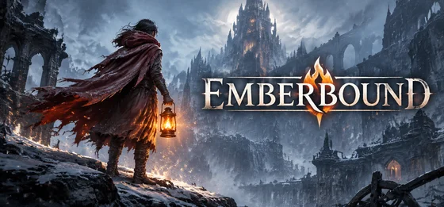

# Juegos y activos virtuales

[中文](../../../README.md) · [English](../../../README.en.md) · [Português](../../../README.pt.md) · [Español](../../../README.es.md) · [Français](../../../README.fr.md) · [Deutsch](../../../README.de.md) · [عربي](../../../README.ar.md) · [русский](../../../README.ru.md) · [日本語](../../../README.ja.md) · [हिंदी](../../../README.hi.md)

4 casos fuera del catálogo destacado. Las palabras clave no se divulgan aquí, solo se muestran los materiales de referencia existentes, las instrucciones de resultados y los requisitos mínimos de materiales.

[Volver a más catálogos de casos](./index.md) · [Volver a la página de inicio del almacén](../../../README.es.md)

> Los materiales de referencia y las imágenes de resultados son únicamente como guía visual; No hay garantía de que se pueda reproducir el mismo efecto utilizando los mismos materiales.

## I199 · Generar mundo de fantasía o mapa de batalla DND

<strong>Ejemplo de resultados</strong>

Este ejemplo no incluye una referencia de imagen y la vista previa de entrada debe completarse; consulte los requisitos de materiales a continuación.

- **Tipo de entrada:** Este ejemplo solo muestra ejemplos de resultados; se agregará la vista previa de entrada de imagen
- **Requisitos de materiales:** Terreno, ubicación y lista de rutas + Referencia visual del mapa + Escala del mapa actual → Generar mapa regional, ciudad o escena de batalla → Mapa de fantasía único actual
- **Descripción:** Esta vez se genera una única vista previa visual. Los cálculos de datos, la composición tipográfica precisa, los archivos vectoriales o de producción aún deben ser verificados por las herramientas correspondientes.

[ Verifique los requisitos específicos en dearsketch y haga ](https://dearsketch.com/es/intent/i199-create-a-fantasy-world-or-d-and-d-battle-map.html?utm_source=github&utm_medium=gallery&utm_campaign=dearsketch-public-cases&utm_content=i199_cta)

---

## I200 · Genera iconos de juegos, botones y elementos HUD

<strong>Ejemplo de resultados</strong>

Este ejemplo no incluye una referencia de imagen y la vista previa de entrada debe completarse; consulte los requisitos de materiales a continuación.

- **Tipo de entrada:** Este ejemplo solo muestra ejemplos de resultados; se agregará la vista previa de entrada de imagen
- **Requisitos de material:** Lista de componentes y estado + Especificaciones visuales de la interfaz de usuario del juego → Generar activos de interfaz de estilo unificado → Icono de interfaz de usuario de un solo juego actual
- **Descripción:** Esta vez se genera una única vista previa visual. Los cálculos de datos, la composición tipográfica precisa, los archivos vectoriales o de producción aún deben ser verificados por las herramientas correspondientes.

[ Verifique los requisitos específicos en dearsketch y haga ](https://dearsketch.com/es/intent/i200-create-game-icons-buttons-and-hud-elements.html?utm_source=github&utm_medium=gallery&utm_campaign=dearsketch-public-cases&utm_content=i200_cta)

---

## I204 · Generar tablero de juego, componentes y portadas visuales

<strong>Ejemplo de resultados</strong>

Este ejemplo no incluye una referencia de imagen y la vista previa de entrada debe completarse; consulte los requisitos de materiales a continuación.

- **Tipo de entrada:** Este ejemplo solo muestra ejemplos de resultados; se agregará la vista previa de entrada de imagen
- **Requisitos de material:** Tablero de ajedrez existente opcional o referencia visual de componentes (0 o 1) + reglas del juego de mesa requeridas y lista de componentes (1 copia) + tipo de entrega y tema requeridos (1 juego)
- **Descripción:** Esta vez se genera una única vista previa visual. Los cálculos de datos, la composición tipográfica precisa, los archivos vectoriales o de producción aún deben ser verificados por las herramientas correspondientes.

[ Verifique los requisitos específicos en dearsketch y haga ](https://dearsketch.com/es/intent/i204-create-visuals-for-a-board-components-and-box-cover.html?utm_source=github&utm_medium=gallery&utm_campaign=dearsketch-public-cases&utm_content=i204_cta)

---

## I205 · Generar portada de tienda de juegos y arte clave

<strong>Ejemplo de resultados</strong>

Este ejemplo no incluye una referencia de imagen y la vista previa de entrada debe completarse; consulte los requisitos de materiales a continuación.

- **Tipo de entrada:** Este ejemplo solo muestra ejemplos de resultados; se agregará la vista previa de entrada de imagen
- **Requisitos de materiales:** Personajes, logotipos o recursos artísticos del juego confirmados opcionales (de 0 a varios) + espacios necesarios para recursos de la tienda y puntos de venta del juego (1 copia)
- **Descripción:** Solo se genera el seleccionado actualmente a la vez; Otras imágenes de la serie están ejecutadas por separado.

[ Verifique los requisitos específicos en dearsketch y haga ](https://dearsketch.com/es/intent/i205-create-game-store-cover-art-and-key-art.html?utm_source=github&utm_medium=gallery&utm_campaign=dearsketch-public-cases&utm_content=i205_cta)
