# Educación y expresión de la información.

[中文](../../../README.md) · [English](../../../README.en.md) · [Português](../../../README.pt.md) · [Español](../../../README.es.md) · [Français](../../../README.fr.md) · [Deutsch](../../../README.de.md) · [عربي](../../../README.ar.md) · [русский](../../../README.ru.md) · [日本語](../../../README.ja.md) · [हिंदी](../../../README.hi.md)

12 casos fuera del catálogo destacado. Las palabras clave no se divulgan aquí, solo se muestran los materiales de referencia existentes, las instrucciones de resultados y los requisitos mínimos de materiales.

[Volver a más catálogos de casos](./index.md) · [Volver a la página de inicio del almacén](../../../README.es.md)

> Los materiales de referencia y las imágenes de resultados son únicamente como guía visual; No hay garantía de que se pueda reproducir el mismo efecto utilizando los mismos materiales.

## I207 · Genera gráficos temáticos para proyectos escolares

<strong>Ejemplo de resultados</strong>

<a href="https://dearsketch.com/es/intent/i207-create-themed-visuals-for-a-school-project.html?utm_source=github&amp;utm_medium=gallery&amp;utm_campaign=dearsketch-public-cases&amp;utm_content=i207_image">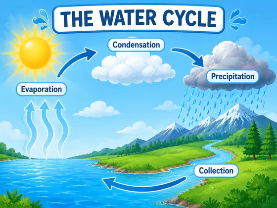</a>

Este ejemplo no incluye una referencia de imagen y la vista previa de entrada debe completarse; consulte los requisitos de materiales a continuación.

- **Tipo de entrada:** Este ejemplo solo muestra ejemplos de resultados; se agregará la vista previa de entrada de imagen
- **Requisitos de materiales:** Objetos de la materia opcionales o imágenes de información especificadas por el maestro (0 o 1) + temas requeridos, etapas del alumno y objetivos de aprendizaje (1 copia)
- **Descripción:** Solo se genera una imagen a la vez.

[ Verifique los requisitos específicos en dearsketch y haga ](https://dearsketch.com/es/intent/i207-create-themed-visuals-for-a-school-project.html?utm_source=github&utm_medium=gallery&utm_campaign=dearsketch-public-cases&utm_content=i207_cta)

---

## I208 · Generar diagramas explicativos para presentaciones

<strong>Ejemplo de resultados</strong>

<a href="https://dearsketch.com/es/intent/i208-create-explanatory-diagrams-for-a-presentation.html?utm_source=github&amp;utm_medium=gallery&amp;utm_campaign=dearsketch-public-cases&amp;utm_content=i208_image">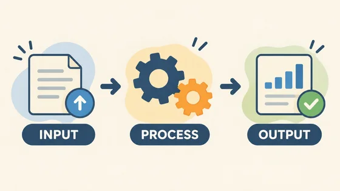</a>

Este ejemplo no incluye una referencia de imagen y la vista previa de entrada debe completarse; consulte los requisitos de materiales a continuación.

- **Tipo de entrada:** Este ejemplo solo muestra ejemplos de resultados; se agregará la vista previa de entrada de imagen
- **Requisitos de material:** Estilo visual de presentación opcional (0 o 1) + elementos conceptuales requeridos y estructura de relaciones (1 copia)
- **Descripción:** Solo se genera una imagen a la vez.

[ Verifique los requisitos específicos en dearsketch y haga ](https://dearsketch.com/es/intent/i208-create-explanatory-diagrams-for-a-presentation.html?utm_source=github&utm_medium=gallery&utm_campaign=dearsketch-public-cases&utm_content=i208_cta)

---

## I209 · Generar imágenes de carteles académicos o de investigación

<strong>Ejemplo de resultados</strong>

<a href="https://dearsketch.com/es/intent/i209-create-visuals-for-a-research-or-academic-poster.html?utm_source=github&amp;utm_medium=gallery&amp;utm_campaign=dearsketch-public-cases&amp;utm_content=i209_image">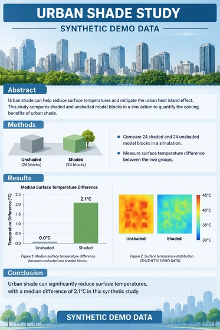</a>

Este ejemplo no incluye una referencia de imagen y la vista previa de entrada debe completarse; consulte los requisitos de materiales a continuación.

- **Tipo de entrada:** Este ejemplo solo muestra ejemplos de resultados; se agregará la vista previa de entrada de imagen
- **Requisitos de material:** Activos de marca institucional o visual clave de investigación opcionales (de 0 a varias imágenes) + paquete de contenido de investigación verificado requerido (1 copia) + autor condicional y firma institucional (1 juego)
- **Descripción:** Esta vez se genera una única vista previa visual. Los cálculos de datos, la composición tipográfica precisa, los archivos vectoriales o de producción aún deben ser verificados por las herramientas correspondientes.

[ Verifique los requisitos específicos en dearsketch y haga ](https://dearsketch.com/es/intent/i209-create-visuals-for-a-research-or-academic-poster.html?utm_source=github&utm_medium=gallery&utm_campaign=dearsketch-public-cases&utm_content=i209_cta)

---

## I210 · Generar ilustraciones de conceptos científicos y procedimientos experimentales.

<strong>Ejemplo de resultados</strong>

<a href="https://dearsketch.com/es/intent/i210-create-illustrations-of-scientific-concepts-and-experiments.html?utm_source=github&amp;utm_medium=gallery&amp;utm_campaign=dearsketch-public-cases&amp;utm_content=i210_image">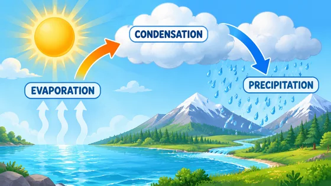</a>

Este ejemplo no incluye una referencia de imagen y la vista previa de entrada debe completarse; consulte los requisitos de materiales a continuación.

- **Tipo de entrada:** Este ejemplo solo muestra ejemplos de resultados; se agregará la vista previa de entrada de imagen
- **Requisitos de material:** Estructura científica verificada opcional o imágenes de referencia experimentales (de 0 a varias imágenes) + estructura científica verificada/procedimientos experimentales requeridos (1 copia) + público objetivo requerido y escala esquemática (1 juego)
- **Descripción:** Solo se genera una imagen a la vez.

[ Verifique los requisitos específicos en dearsketch y haga ](https://dearsketch.com/es/intent/i210-create-illustrations-of-scientific-concepts-and-experiments.html?utm_source=github&utm_medium=gallery&utm_campaign=dearsketch-public-cases&utm_content=i210_cta)

---

## I211 · Generar mapa de restauración de escena basado en descripción histórica

<strong>Ejemplo de resultados</strong>

<a href="https://dearsketch.com/es/intent/i211-reconstruct-a-historical-scene-from-a-description.html?utm_source=github&amp;utm_medium=gallery&amp;utm_campaign=dearsketch-public-cases&amp;utm_content=i211_image">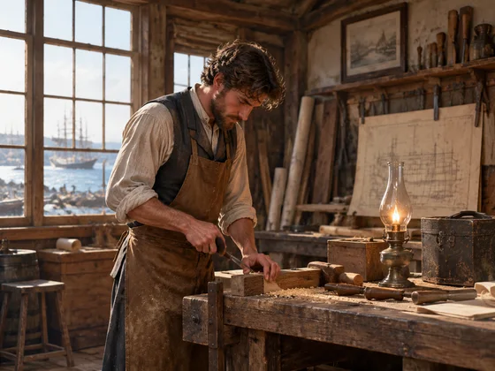</a>

Este ejemplo no incluye una referencia de imagen y la vista previa de entrada debe completarse; consulte los requisitos de materiales a continuación.

- **Tipo de entrada:** Este ejemplo solo muestra ejemplos de resultados; se agregará la vista previa de entrada de imagen
- **Requisitos de materiales:** Imágenes opcionales de edificios, trajes o artefactos históricos (0 a más imágenes) + descripción requerida de la época, ubicación y escena (1 copia) + materiales históricos requeridos y asuntos ciertos/inciertos (1 copia)
- **Descripción:** Solo se genera una imagen a la vez.

[ Verifique los requisitos específicos en dearsketch y haga ](https://dearsketch.com/es/intent/i211-reconstruct-a-historical-scene-from-a-description.html?utm_source=github&utm_medium=gallery&utm_campaign=dearsketch-public-cases&utm_content=i211_cta)

---

## I212 · Genera tarjetas de vocabulario e imágenes de aprendizaje situacional

<strong>Ejemplo de resultados</strong>

<a href="https://dearsketch.com/es/intent/i212-create-vocabulary-cards-and-contextual-learning-images.html?utm_source=github&amp;utm_medium=gallery&amp;utm_campaign=dearsketch-public-cases&amp;utm_content=i212_image">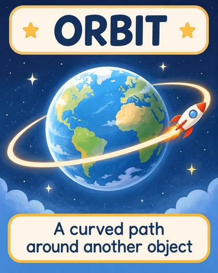</a>

Este ejemplo no incluye una referencia de imagen y la vista previa de entrada debe completarse; consulte los requisitos de materiales a continuación.

- **Tipo de entrada:** Este ejemplo solo muestra ejemplos de resultados; se agregará la vista previa de entrada de imagen
- **Requisitos de material:** Tipo de mapa de aprendizaje requerido (1) + Campos de vocabulario, definición e idioma requeridos (1) + Etapa de aprendizaje requerida (1)
- **Descripción:** Solo se genera una imagen a la vez.

[ Verifique los requisitos específicos en dearsketch y haga ](https://dearsketch.com/es/intent/i212-create-vocabulary-cards-and-contextual-learning-images.html?utm_source=github&utm_medium=gallery&utm_campaign=dearsketch-public-cases&utm_content=i212_cta)

---

## I213 · Genera hojas de trabajo para niños y páginas de actividades en el aula

<strong>Ejemplo de resultados</strong>

<a href="https://dearsketch.com/es/intent/i213-create-children-s-worksheets-and-classroom-activity-pages.html?utm_source=github&amp;utm_medium=gallery&amp;utm_campaign=dearsketch-public-cases&amp;utm_content=i213_image">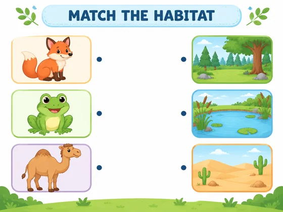</a>

Este ejemplo no incluye una referencia de imagen y la vista previa de entrada debe completarse; consulte los requisitos de materiales a continuación.

- **Tipo de entrada:** Este ejemplo solo muestra ejemplos de resultados; se agregará la vista previa de entrada de imagen
- **Requisitos de materiales:** Puntos de conocimiento y etapas de aprendizaje requeridos (1 conjunto) + Preguntas requeridas/contenido y respuestas de la actividad (1 copia)
- **Descripción:** Esta vez se genera una única vista previa visual. Los cálculos de datos, la composición tipográfica precisa, los archivos vectoriales o de producción aún deben ser verificados por las herramientas correspondientes.

[ Verifique los requisitos específicos en dearsketch y haga ](https://dearsketch.com/es/intent/i213-create-children-s-worksheets-and-classroom-activity-pages.html?utm_source=github&utm_medium=gallery&utm_campaign=dearsketch-public-cases&utm_content=i213_cta)

---

## I214 · Generar por lotes tarjetas didácticas de aprendizaje de estilo unificado

<strong>Ejemplo de resultados</strong>

<a href="https://dearsketch.com/es/intent/i214-create-a-consistent-set-of-learning-flashcards.html?utm_source=github&amp;utm_medium=gallery&amp;utm_campaign=dearsketch-public-cases&amp;utm_content=i214_image">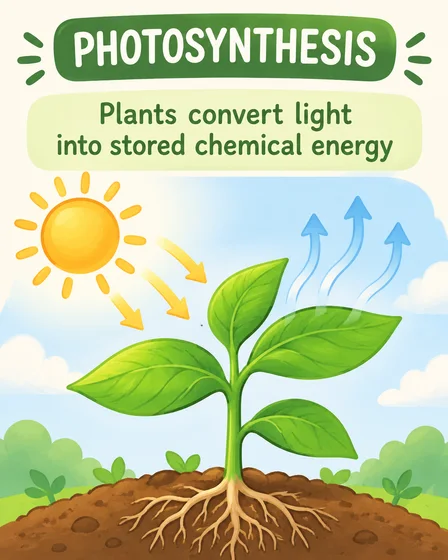</a>

Este ejemplo no incluye una referencia de imagen y la vista previa de entrada debe completarse; consulte los requisitos de materiales a continuación.

- **Tipo de entrada:** Este ejemplo solo muestra ejemplos de resultados; se agregará la vista previa de entrada de imagen
- **Requisitos de material:** Ancla de estilo de tarjeta didáctica de aprendizaje opcional (0 o 1) + terminología requerida y tabla de definición (1 copia) + edad requerida del alumno y entrada actual (1 juego)
- **Descripción:** Esta vez se genera una única vista previa visual. Los cálculos de datos, la composición tipográfica precisa, los archivos vectoriales o de producción aún deben ser verificados por las herramientas correspondientes.

[ Verifique los requisitos específicos en dearsketch y haga ](https://dearsketch.com/es/intent/i214-create-a-consistent-set-of-learning-flashcards.html?utm_source=github&utm_medium=gallery&utm_campaign=dearsketch-public-cases&utm_content=i214_cta)

---

## I215 · Genera páginas para colorear educativas temáticas

<strong>Ejemplo de resultados</strong>

Este ejemplo no incluye una referencia de imagen y la vista previa de entrada debe completarse; consulte los requisitos de materiales a continuación.

- **Tipo de entrada:** Este ejemplo solo muestra ejemplos de resultados; se agregará la vista previa de entrada de imagen
- **Requisitos de materiales:** Objetos educativos opcionales o imágenes de referencia de puntos de conocimiento (0 o 1) + temas educativos, edades y objetivos de aprendizaje requeridos (1 copia)
- **Descripción:** Solo se genera una imagen a la vez.

[ Verifique los requisitos específicos en dearsketch y haga ](https://dearsketch.com/es/intent/i215-create-themed-educational-coloring-pages.html?utm_source=github&utm_medium=gallery&utm_campaign=dearsketch-public-cases&utm_content=i215_cta)

---

## I216 · Generar mapas educativos urbanos, geográficos o de fantasía

<strong>Ejemplo de resultados</strong>

<a href="https://dearsketch.com/es/intent/i216-create-city-geography-or-fantasy-maps-for-teaching.html?utm_source=github&amp;utm_medium=gallery&amp;utm_campaign=dearsketch-public-cases&amp;utm_content=i216_image">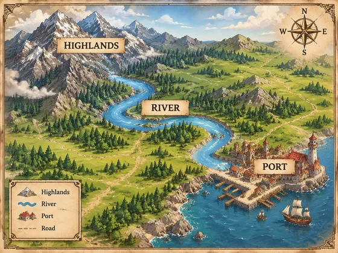</a>

Este ejemplo no incluye una referencia de imagen y la vista previa de entrada debe completarse; consulte los requisitos de materiales a continuación.

- **Tipo de entrada:** Este ejemplo solo muestra ejemplos de resultados; se agregará la vista previa de entrada de imagen
- **Requisitos de material:** Mapa base opcional, límite regional o boceto de espacio de fantasía (0 a múltiple) + tipo de mapa requerido y objetivos de enseñanza (1 conjunto) + datos geográficos reales condicionales (1 copia) + configuración de espacio de fantasía condicional (1 copia) + lista de etiquetas requeridas para mostrar (1 copia)
- **Descripción:** Solo se genera una imagen a la vez.

[ Verifique los requisitos específicos en dearsketch y haga ](https://dearsketch.com/es/intent/i216-create-city-geography-or-fantasy-maps-for-teaching.html?utm_source=github&utm_medium=gallery&utm_campaign=dearsketch-public-cases&utm_content=i216_cta)

---

## I279 · Crear un resumen gráfico de los hallazgos principales del artículo.

<strong>Ejemplo de resultados</strong>

<a href="https://dearsketch.com/es/intent/i279-turn-a-paper-s-key-findings-into-a-graphical-abstract.html?utm_source=github&amp;utm_medium=gallery&amp;utm_campaign=dearsketch-public-cases&amp;utm_content=i279_image">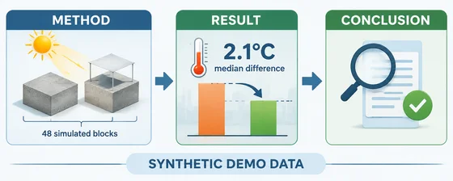</a>

Este ejemplo no incluye una referencia de imagen y la vista previa de entrada debe completarse; consulte los requisitos de materiales a continuación.

- **Tipo de entrada:** Este ejemplo solo muestra ejemplos de resultados; se agregará la vista previa de entrada de imagen
- **Requisitos de material:** Especificaciones visuales de la revista opcionales o recursos esquemáticos de investigación (de 0 a varias imágenes) + preguntas de investigación, métodos, resultados y conclusiones requeridos (1 copia) + requisitos de la revista objetivo condicional y del resumen gráfico (1 conjunto)
- **Descripción:** Esta vez se genera una única vista previa visual. Los cálculos de datos, la composición tipográfica precisa, los archivos vectoriales o de producción aún deben ser verificados por las herramientas correspondientes.

[ Verifique los requisitos específicos en dearsketch y haga ](https://dearsketch.com/es/intent/i279-turn-a-paper-s-key-findings-into-a-graphical-abstract.html?utm_source=github&utm_medium=gallery&utm_campaign=dearsketch-public-cases&utm_content=i279_cta)

---

## I280 · Producir diagramas de investigación y diagramas de flujo en artículos

<strong>Ejemplo de resultados</strong>

<a href="https://dearsketch.com/es/intent/i280-create-research-figures-and-flowcharts-for-a-paper.html?utm_source=github&amp;utm_medium=gallery&amp;utm_campaign=dearsketch-public-cases&amp;utm_content=i280_image">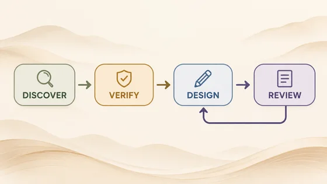</a>

Este ejemplo no incluye una referencia de imagen y la vista previa de entrada debe completarse; consulte los requisitos de materiales a continuación.

- **Tipo de entrada:** Este ejemplo solo muestra ejemplos de resultados; se agregará la vista previa de entrada de imagen
- **Requisitos de material:** Mapa de investigación requerido en la rama entregada actualmente (1 copia) + condición, datos originales y descripción estadística (1 copia) + condiciones confirmadas, pasos, nodos y relaciones (1 copia) + proceso de mapa de investigación/boceto de diseño opcional (0 o 1)
- **Descripción:** Esta vez se genera una única vista previa visual. Los cálculos de datos, la composición tipográfica precisa, los archivos vectoriales o de producción aún deben ser verificados por las herramientas correspondientes.

[ Verifique los requisitos específicos en dearsketch y haga ](https://dearsketch.com/es/intent/i280-create-research-figures-and-flowcharts-for-a-paper.html?utm_source=github&utm_medium=gallery&utm_campaign=dearsketch-public-cases&utm_content=i280_cta)
