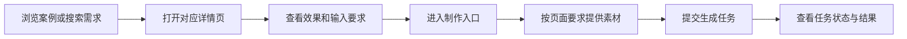
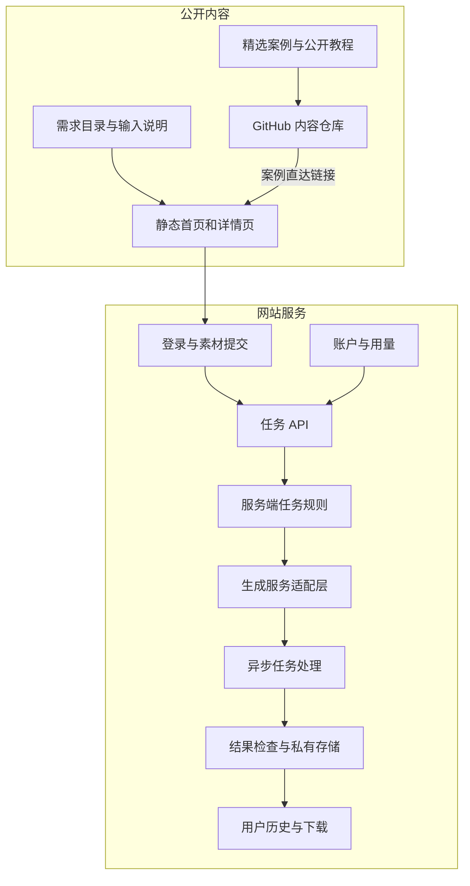

# Architecture du produit dearsketch

[中文](../../README.md) · [English](../../README.en.md) · [Português](../../README.pt.md) · [Español](../../README.es.md) · [Français](../../README.fr.md) · [Deutsch](../../README.de.md) · [عربي](../../README.ar.md) · [русский](../../README.ru.md) · [日本語](../../README.ja.md) · [हिंदी](../../README.hi.md)


dearsketch organise « Quelles images est-ce que je souhaite réaliser » dans un répertoire d'exigences consultable. Chaque exigence comporte une page indépendante qui explique le but, les matériaux requis et les exigences de résultat ; les utilisateurs entrent dans le processus de production à partir de la page correspondante.

Cette description décrit les responsabilités du module et le flux de données. La bibliothèque de contenu public, les services du site Web et les modèles générés accomplissent chacun des tâches différentes ; cet entrepôt fournit des cas publics, 50 modèles nouvellement édités et Agent Skill, et la production en ligne est effectuée sur le site Web.

## Chemin utilisateur



Différentes missions peuvent nécessiter des photos, des manuscrits de conception désignés, une rédaction précise ou plusieurs éléments de personnages. Les dessins en série et les plans multiples sont produits séparément sur une seule base ; lorsqu'un texte précis, des vecteurs ou des fichiers de production sont requis, les outils correspondants sont requis après un aperçu visuel.

## Superposition de contenu et de génération



Les pages de contenu statique sont responsables de la découverte, de l’interprétation et de l’inclusion de la recherche. La tâche API est responsable de la validation des entrées utilisateur et de la création de tâches. La couche d’adaptation des règles et de la génération côté serveur est responsable de l’exécution des exigences sélectionnées. La couche historique et stockage est chargée de renvoyer les résultats aux utilisateurs correspondants.

Les modules de la figure reflètent la répartition des responsabilités dans le code source actuel et ne constituent pas un engagement envers toutes les fonctions en ligne, le statut de paiement ou les niveaux de service ; lors de leur utilisation, l'entrée réelle et les instructions fournies par le site Web prévaudront.

## Responsabilités du module

| module | Problème résolu |
| --- | --- |
| Catalogue des exigences | Organisez des tâches d'image avec des objectifs, des entrées, des sorties et des scénarios |
| Construction de pages | Générez des adresses stables, du contenu de page et des métadonnées de recherche pour vos besoins |
| Entrez le contrat | Expliquez quels matériaux sont requis, lesquels sont facultatifs et quelles sont les relations entre les matériaux. |
| Comptes et tâches API | Vérifier l'identité, l'intégrité des entrées et la duplication des demandes |
| Règles des tâches du serveur | Organiser le contenu d'exécution en fonction des besoins et des apports actuels |
| Générer une couche d'adaptation | Connectez-vous à des services de build externes et gérez des tâches asynchrones |
| Résultats et historique | Vérifiez les résultats, enregistrez les ressources et donnez accès aux utilisateurs appropriés |
| Compte et utilisation | Gérer les qualifications d'utilisation, les points et le statut lié à la commande |

## Méthode de mise en œuvre

| couche | La méthode dans le code source actuel |
| --- | --- |
| Construction de contenu | Le script Node.js génère HTML, une page de détail et des métadonnées de recherche à partir d'exigences structurées |
| Interaction avec le navigateur | JavaScript gère le filtrage, la saisie du matériel et l'état des tâches ; certaines interactions utilisent React et sont packagées par Vite |
| Serveur | Les modules Node.js gèrent l'authentification, les téléchargements, les tâches de construction, l'historique et l'utilisation |
| données | La base de données relationnelle enregistre les comptes, la propriété des ressources et l'état des tâches |
| document | Stockage d'objets privés séparé des données professionnelles, accessible via des adresses contrôlées |
| générer | Le serveur s'adapte aux services générés en externe et traite les tâches et les résultats asynchrones. |

Ces choix techniques peuvent expliquer comment le système divise le travail sans exposer les numéros de compte de production, les ID de projet, les noms de compartiment ou les valeurs des variables d'environnement.

## Exemple de données publiques

```json
{
  "id": "I026",
  "title": "宠物定制肖像",
  "input": "1张宠物照片",
  "output": "宠物肖像图片",
  "roles": [
    { "kind": "image", "label": "宠物照片", "requirement": "required", "quantity": "1张" }
  ]
}
```

Ces champs expliquent les tâches utilisateur et ne contiennent pas d'instructions complètes de génération côté serveur. Voir [cases.json](../../data/cases.json) pour les données de cas sélectionnées, voir [gallery.json](../../data/gallery.json) pour d'autres exemples de résultats et voir [public-prompts.json](../../data/public-prompts.json) pour le nouveau modèle public. Les compétences publiques sont uniquement responsables de la préparation des listes de saisie et des mots d'invite, et n'ont pas accès aux règles de génération internes.

## Limites d’accès et de contenu

Les images de cas publics et les ressources téléchargées par les utilisateurs sont deux types de contenu. Des cas sont utilisés pour illustrer la direction visuelle ; les images utilisateur originales, les résultats des tâches et les enregistrements de compte n'appartiennent pas à la bibliothèque de cas publique. Le service de génération doit vérifier le type, la taille et la propriété du matériel, et la saisie de l'utilisateur ne peut pas outrepasser les contraintes d'exécution du serveur.

Les diagrammes de modules, les responsabilités, les structures de données abstraites, les spécifications d'entrée et les principes généraux de fiabilité peuvent être exposés. Exposer un élément d'implémentation côté serveur ou un ensemble de structures de base de données est un domaine de l'open source qui peut être décidé indépendamment ; ils ne sont pas automatiquement secrets simplement parce qu'ils se trouvent côté serveur.

La portée de cet entrepôt concerne les cas, les didacticiels de base et les descriptions de l'architecture du produit, et n'inclut pas le code source du service de production, les compétences internes complètes ou les ressources de déploiement. Les informations d'identification, les sessions, les enregistrements d'utilisateurs réels et les adresses de ressources privées ne sont pas du contenu public.

## Comment connecter GitHub au site Web

Chaque image présentée et chaque lien « faire la même chose » mènent à la page de demande correspondante. Les liens utilisent des paramètres source pour distinguer le README, les détails du cas et les entrées du didacticiel ; ces paramètres n'expriment que la source et ne peuvent à eux seuls prouver qu'un système statistique a été déployé.

Le site Web ne dispose pas de zones de saisie de mots invitant les visiteurs. Des didacticiels de base sont rendus publics pour que les utilisateurs puissent essayer les outils de leur choix ; le site Web propose des entrées matérielles correspondantes en fonction des besoins sélectionnés.
