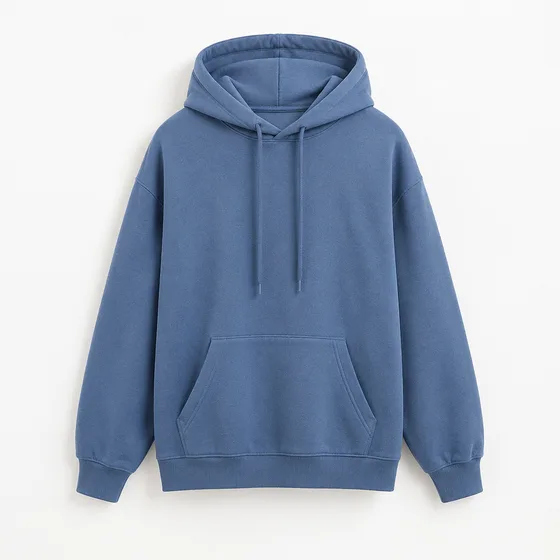
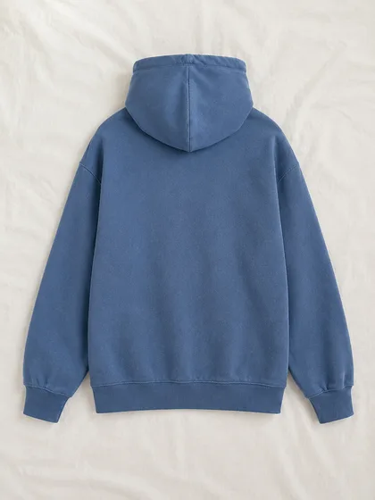
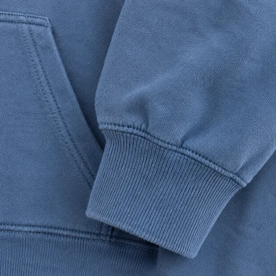
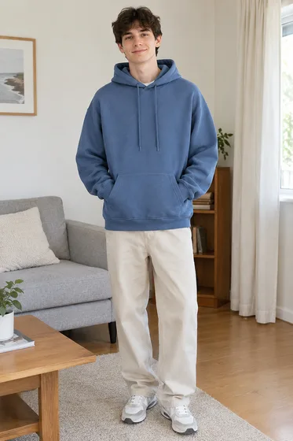
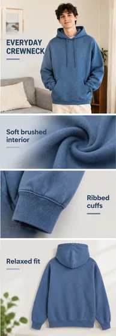

# Brouillon visuel de la page de détail du commerce électronique · Brouillon visuel de la page de détail du commerce électronique

[中文](../../../README.md) · [English](../../../README.en.md) · [Português](../../../README.pt.md) · [Español](../../../README.es.md) · [Français](../../../README.fr.md) · [Deutsch](../../../README.de.md) · [عربي](../../../README.ar.md) · [русский](../../../README.ru.md) · [日本語](../../../README.ja.md) · [हिंदी](../../../README.hi.md)


Organisez plusieurs vues de produits réels et copies approuvées en un seul concept visuel détaillé.

Générez une longue image de la page de détails du commerce électronique à partir des informations sur le produit. Pour le e-commerce chinois.

[Copier l'invite](#public-prompt) · [ est produit par dearsketch / Essayez en ligne](https://dearsketch.com/fr/intent/i077-create-a-long-form-e-commerce-detail-image-from-product-information.html?utm_source=github&utm_medium=case&utm_campaign=dearsketch-public-cases&utm_content=i077_cta) · [RRetour au sujet / Collection](../guides/products.md)

## Matériel de référence et orientation des résultats

<table>
<thead><tr><th width="50%">Matériel de référence</th><th width="50%">Exemple de résultats</th></tr></thead>
<tbody><tr><td valign="top"><p><strong>Devant de sweat-shirt du même style</strong><br></p>
<p><strong>Le dos du même sweat</strong><br></p>
<p><strong>Détails du même sweat-shirt</strong><br></p>
<p><strong>Photos portant le même sweat-shirt</strong><br></p></td><td valign="top"><a href="https://dearsketch.com/fr/intent/i077-create-a-long-form-e-commerce-detail-image-from-product-information.html?utm_source=github&amp;utm_medium=case&amp;utm_campaign=dearsketch-public-cases&amp;utm_content=i077_image"></a></td></tr></tbody>
</table>

Les matériaux de référence et les résultats sont utilisés pour illustrer la direction visuelle. Le modèle public ne constitue pas l'instruction de génération originale pour les images qui l'accompagnent, et la reproduction des mêmes résultats n'est pas garantie.

## Que préparer/Intrants

| Matériel | Type / Type | Quantité / Quantité | Condition / Exigence |
| --- | --- | --- | --- |
| Même groupe d'images de produit | Photo/Image | Plusieurs images | Obligatoire / Obligatoire |
| Points de vente et rédaction précise | Caractère / Texte | 1 groupe | Obligatoire / Obligatoire |

Cette fois, un seul aperçu visuel est généré. Le calcul des données, la composition précise, les fichiers vectoriels ou de production doivent encore être vérifiés par les outils correspondants.

## Conserver et modifier / Brief d'édition

- **Préserver / 保留：** Gardez toutes les vues du produit cohérentes et toutes les allégations et formulations fournies exactes.
- **Modifier / 改变：** Modifiez l'ordre des sections, la hiérarchie graphique, les arrière-plans, les légendes et le contexte du style de vie.

## Public prompt

**Modèle public récemment modifié · Nouvellement rédigé · Non testé par génération.** Remplacez les paramètres entre crochets et joignez les matériaux requis dans l'outil qui prend en charge l'édition d'images ; les entrées facultatives et conditionnelles sont préparées selon le tableau ci-dessus. Ce modèle n'a pas été utilisé pour générer les exemples sur cette page.

```text
Create one long-form e-commerce detail-page visual draft from [LABELED PRODUCT IMAGE SET] and [APPROVED COPY].
Preserve the same product model, shape, color, labels, materials, and components across every section.
Organize the page into [SECTION ORDER] for [TARGET CHANNEL AND AUDIENCE].
Use [BRAND PALETTE], [GRAPHIC STYLE], and a consistent spacing system.
Reproduce supplied headlines, dimensions, claims, and qualifiers exactly; do not invent missing copy.
Use lifestyle or detail panels only where supported by the provided product images and facts.
Keep callouts connected to the correct features and avoid contradictory product views.
Do not invent certifications, comparisons, warranties, prices, or performance results.
Treat this as a visual preview; rebuild and proofread precise text, vectors, dimensions, and channel specs in a layout tool.
Deliver one long-page concept image only.
```

[Mettez-le en ligne avec votre propre matériel / Mettez-le en ligne](https://dearsketch.com/fr/intent/i077-create-a-long-form-e-commerce-detail-image-from-product-information.html?utm_source=github&utm_medium=case&utm_campaign=dearsketch-public-cases&utm_content=i077_after-prompt) · [Laissez l'agent vous aider à l'organiser / Utilisez la compétence](../quickstart.md#agent-skill)

## Vérifier les points clés/Revue

Une rédaction précise et des documents multi-angles doivent être complets. La livraison actuelle est un aperçu visuel et la composition précise doit être vérifiée séparément.

Vérifiez la copie, les dimensions, les règles de canal et la disposition finale dans un outil de production.

Direction du résultat : page de détails du produit. Lorsque du texte exact, des fichiers transparents, des vecteurs ou une livraison imprimée sont requis, vérifiez le fichier réel ; les fonctionnalités disponibles et les frais sont sujets à la description du site Web.

## Cas connexes / Tâches connexes

- [Transformez une photo de produit ordinaire en une image de liste sur fond blanc · Image principale du produit sur fond blanc ](./i065-turn-an-ordinary-product-photo-into-a-white-background-listing-image.md#public-prompt)
- [Créer un produit réutilisable PNG avec un fond transparent · Matériau du produit inférieur transparent ](./i066-create-a-reusable-product-png-with-a-transparent-background.md#public-prompt)
- [Placer un produit dans une scène de style de vie réaliste · Scène de style de vie du produit](./i067-place-a-product-in-a-realistic-lifestyle-scene.md#public-prompt)

## Référence de base des exigences

- [ Meitu Design Studio](https://www.designkit.cn/help/143)
- [Duyou E-commerce](https://d.design/ecommerce)

Ces liens sont uniquement destinés à aider à comprendre le but et ne constituent pas une preuve de la source ou de l'autorisation des images présentes sur cette page.

Pour connaître le champ d'utilisation des images et du matériel, voir la description du contenu de [ ](../content-policy.md). [Voir les 50 modèles ](../prompts.md).
