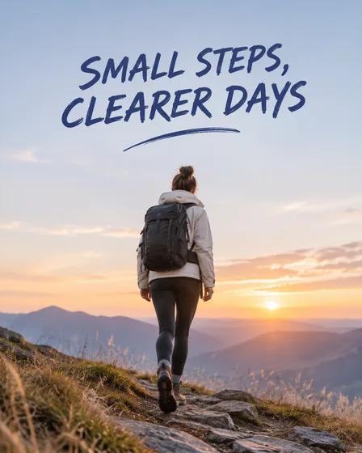

# Visuel de publication sociale · Visuel principal de publication sociale

[中文](../../../README.md) · [English](../../../README.en.md) · [Português](../../../README.pt.md) · [Español](../../../README.es.md) · [Français](../../../README.fr.md) · [Deutsch](../../../README.de.md) · [عربي](../../../README.ar.md) · [русский](../../../README.ru.md) · [日本語](../../../README.ja.md) · [हिंदी](../../../README.hi.md)


Créez une publication sociale basée sur du texte sur votre brief spécifié pour votre brief spécifié à partir du texte uniquement.

Générez des visuels de publication quotidiens adaptés aux plateformes sociales. Pour Instagram, Facebook, Xiaohongshu.

[Copier l'invite](#public-prompt) · [ est produit par dearsketch / Essayez en ligne](https://dearsketch.com/fr/intent/i104-create-everyday-social-media-post-visuals.html?utm_source=github&utm_medium=case&utm_campaign=dearsketch-public-cases&utm_content=i104_cta) · [RRetour au sujet / Collection](../guides/text-only.md)

## Matériel de référence et orientation des résultats

<p><strong>Exemple de résultats</strong></p>
<p><a href="https://dearsketch.com/fr/intent/i104-create-everyday-social-media-post-visuals.html?utm_source=github&amp;utm_medium=case&amp;utm_campaign=dearsketch-public-cases&amp;utm_content=i104_image"></a></p>
<p>Cet exemple est une saisie de texte, aucune référence d'image n'est jointe.</p>

Les matériaux de référence et les résultats sont utilisés pour illustrer la direction visuelle. Le modèle public ne constitue pas l'instruction de génération originale pour les images qui l'accompagnent, et la reproduction des mêmes résultats n'est pas garantie.

## Que préparer/Intrants

| Matériel | Type / Type | Quantité / Quantité | Condition / Exigence |
| --- | --- | --- | --- |
| Brief de création de texte : remplissez le thème, l'objectif et les paramètres factuels dans les mots d'invite | Caractère / Texte | 1 portion | Obligatoire / Obligatoire |

**Génération de texte pur / Texte uniquement : aucune image, logo, croquis ou autre pièce jointe requis.** Utilisez uniquement le texte succinct ci-dessous pour créer de nouveaux concepts.

Une seule image est générée à la fois, pas besoin de télécharger d'images.

## Conserver et modifier / Brief d'édition

- **Préserver / 保留：** Honorez les faits écrits fournis, la formulation exacte et les contraintes.
- **Change / 改变：** Utilisez [ORIGINAL VISUAL METAPHOR] comme point focal, [PALETTE] et [ASPECT RATIO]. Définissez le titre exact « [HEADLINE] » avec une hiérarchie claire et des marges généreuses.

## Public prompt

**Modèle public nouvellement compilé · Nouvellement rédigé · Non testé par génération.** Remplacez simplement les paramètres entre crochets, pas besoin de télécharger des images de référence. Ce modèle n'a pas été utilisé pour générer les exemples sur cette page.

```text
Create one text-led social post about [TOPIC] for [PLATFORM] from the following written brief only. No reference image or other attachment is needed.
Use [ORIGINAL VISUAL METAPHOR] as the focal point, [PALETTE] and [ASPECT RATIO]. Set the exact headline “[HEADLINE]” with clear hierarchy and generous margins.
Do not invent a real product, testimonial or news event; proofread the headline.
Use an original design. Do not imply fidelity to any existing person, product, property or artwork that has not been supplied.
Return one finished image only. Replace every bracketed field with your own details before generating.
```

[Mettez-le en ligne avec votre propre matériel / Mettez-le en ligne](https://dearsketch.com/fr/intent/i104-create-everyday-social-media-post-visuals.html?utm_source=github&utm_medium=case&utm_campaign=dearsketch-public-cases&utm_content=i104_after-prompt) · [Laissez l'agent vous aider à l'organiser / Utilisez la compétence](../quickstart.md#agent-skill)

## Vérifier les points clés/Revue

N’inventez pas un vrai produit, un témoignage ou un événement d’actualité ; relisez le titre.

N’inventez pas un vrai produit, un témoignage ou un événement d’actualité ; relisez le titre.

Orientation des résultats : publications sur les réseaux sociaux. Lorsque du texte exact, des fichiers transparents, des vecteurs ou une livraison imprimée sont requis, vérifiez le fichier réel ; les fonctionnalités disponibles et les frais sont sujets à la description du site Web.

## Cas connexes / Tâches connexes

- [Créer une photo de profil pour YouTube ou le streaming · Avatar de chaîne généré par texte ](./i054-create-a-profile-picture-for-youtube-or-streaming.md#public-prompt)
- [Créer un emoji personnalisé à partir du texte · Emoji personnalisé](./i057-create-a-custom-emoji-from-text.md#public-prompt)
- [Créez des imprimés et des motifs de tissus sans couture pour les vêtements · ](./i100-create-seamless-prints-and-fabric-patterns-for-clothing.md#public-prompt)

## Référence de base des exigences

- [Outil IA Picsart](https://picsart.com/ai/)

Ces liens sont uniquement destinés à aider à comprendre le but et ne constituent pas une preuve de la source ou de l'autorisation des images présentes sur cette page.

Pour connaître le champ d'utilisation des images et du matériel, voir la description du contenu de [ ](../content-policy.md). [Afficher les 100 modèles ](../prompts.md).
