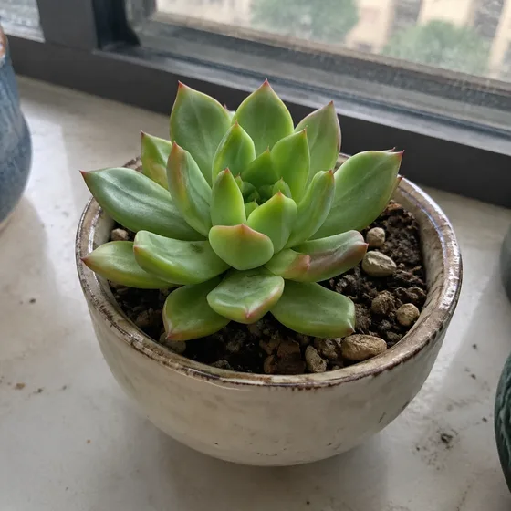
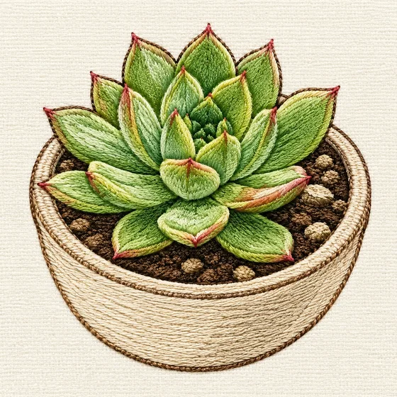

# Concept de motif de broderie · Concept de motif de style de broderie

[中文](../../../README.md) · [English](../../../README.en.md) · [Português](../../../README.pt.md) · [Español](../../../README.es.md) · [Français](../../../README.fr.md) · [Deutsch](../../../README.de.md) · [عربي](../../../README.ar.md) · [русский](../../../README.ru.md) · [日本語](../../../README.ja.md) · [हिंदी](../../../README.hi.md)


Créez un concept de motif de broderie de votre brief spécifié à partir du texte seul.

Convertissez du texte ou des images en directions de motif de broderie. Utilisé pour les vêtements, les badges, l'artisanat.

[Copier l'invite](#public-prompt) · [ est produit par dearsketch / Essayez en ligne](https://dearsketch.com/fr/intent/i160-turn-text-or-an-image-into-an-embroidery-design-direction.html?utm_source=github&utm_medium=case&utm_campaign=dearsketch-public-cases&utm_content=i160_cta) · [RRetour au sujet / Collection](../guides/text-only.md)

## Matériel de référence et orientation des résultats

<table>
<thead><tr><th width="50%">Matériel de référence</th><th width="50%">Exemple de résultats</th></tr></thead>
<tbody><tr><td valign="top"><p><strong>Photo ou logo original</strong><br></p></td><td valign="top"><a href="https://dearsketch.com/fr/intent/i160-turn-text-or-an-image-into-an-embroidery-design-direction.html?utm_source=github&amp;utm_medium=case&amp;utm_campaign=dearsketch-public-cases&amp;utm_content=i160_image"></a></td></tr></tbody>
</table>

Les matériaux de référence et les résultats sont utilisés pour illustrer la direction visuelle. Le modèle public ne constitue pas l'instruction de génération originale pour les images qui l'accompagnent, et la reproduction des mêmes résultats n'est pas garantie.

## Que préparer/Intrants

| Matériel | Type / Type | Quantité / Quantité | Condition / Exigence |
| --- | --- | --- | --- |
| Brief de création de texte : remplissez le thème, l'objectif et les paramètres factuels dans les mots d'invite | Caractère / Texte | 1 portion | Obligatoire / Obligatoire |

**Génération de texte pur / Texte uniquement : aucune image, logo, croquis ou autre pièce jointe requis.** Utilisez uniquement le texte succinct ci-dessous pour créer de nouveaux concepts.

Une seule image est générée à la fois, pas besoin de télécharger d'images. Choisissez la branche thématique texte uniquement pour le site Web.

## Conserver et modifier / Brief d'édition

- **Préserver / 保留：** Honorez les faits écrits fournis, la formulation exacte et les contraintes.
- **Change / 改变：** Utilisez [THREAD COLORS], des formes fermées larges et [LINE WEIGHT] adaptées à [FINISHED SIZE AND PLACEMENT]. Évitez les dégradés, les petits îlots et les détails excessifs qui se chevauchent.

## Public prompt

**Modèle public nouvellement compilé · Nouvellement rédigé · Non testé par génération.** Remplacez simplement les paramètres entre crochets, pas besoin de télécharger des images de référence. Ce modèle n'a pas été utilisé pour générer les exemples sur cette page.

```text
Create one embroidery-design concept of [TEXT-DESCRIBED MOTIF] from the following written brief only. No reference image or other attachment is needed.
Use [THREAD COLORS], broad closed shapes and [LINE WEIGHT] suited to [FINISHED SIZE AND PLACEMENT]. Avoid gradients, tiny islands and excessive overlapping detail.
This is a visual motif, not digitized stitch instructions; stitch count, density and machine files need separate work.
Use an original design. Do not imply fidelity to any existing person, product, property or artwork that has not been supplied.
Return one finished image only. Replace every bracketed field with your own details before generating.
```

[Mettez-le en ligne avec votre propre matériel / Mettez-le en ligne](https://dearsketch.com/fr/intent/i160-turn-text-or-an-image-into-an-embroidery-design-direction.html?utm_source=github&utm_medium=case&utm_campaign=dearsketch-public-cases&utm_content=i160_after-prompt) · [Laissez l'agent vous aider à l'organiser / Utilisez la compétence](../quickstart.md#agent-skill)

## Vérifier les points clés/Revue

Il s’agit d’un motif visuel et non d’instructions de points numérisées ; Le nombre de points, la densité et les fichiers machine nécessitent un travail séparé.

Il s’agit d’un motif visuel et non d’instructions de points numérisées ; Le nombre de points, la densité et les fichiers machine nécessitent un travail séparé.

Résultats dans le sens de : motifs de broderie. Lorsque du texte exact, des fichiers transparents, des vecteurs ou une livraison imprimée sont requis, vérifiez le fichier réel ; les fonctionnalités disponibles et les frais sont sujets à la description du site Web.

## Cas connexes / Tâches connexes

- [Créer une photo de profil pour YouTube ou le streaming · Avatar de chaîne généré par texte ](./i054-create-a-profile-picture-for-youtube-or-streaming.md#public-prompt)
- [Créer un emoji personnalisé à partir du texte · Emoji personnalisé](./i057-create-a-custom-emoji-from-text.md#public-prompt)
- [Créez des imprimés et des motifs de tissus sans couture pour les vêtements · ](./i100-create-seamless-prints-and-fabric-patterns-for-clothing.md#public-prompt)

## Référence de base des exigences

- [Cutout.pro](https://www.cutout.pro/)
- [LightXTous les outils](https://www.lightxeditor.com/all-tools/all-tools/)

Ces liens sont uniquement destinés à aider à comprendre le but et ne constituent pas une preuve de la source ou de l'autorisation des images présentes sur cette page.

Pour connaître le champ d'utilisation des images et du matériel, voir la description du contenu de [ ](../content-policy.md). [Afficher les 100 modèles ](../prompts.md).
