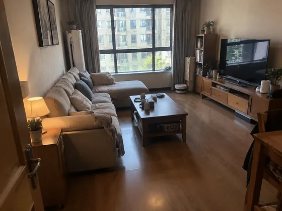
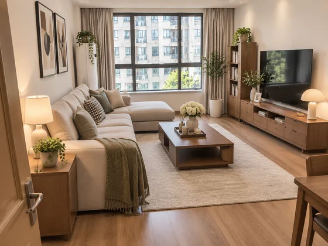

# Aperçu du style de la pièce · Aperçu du style de la décoration de la pièce

[中文](../../../README.md) · [English](../../../README.en.md) · [Português](../../../README.pt.md) · [Español](../../../README.es.md) · [Français](../../../README.fr.md) · [Deutsch](../../../README.de.md) · [عربي](../../../README.ar.md) · [русский](../../../README.ru.md) · [日本語](../../../README.ja.md) · [हिंदी](../../../README.hi.md)


Prévisualisez un nouveau style d’intérieur tout en conservant la structure de la pièce photographiée.

Téléchargez des photos de la pièce pour prévisualiser différents styles de décoration. Utilisé pour les décisions de décoration et les propositions des clients.

[Copier l'invite](#public-prompt) · [ est produit par dearsketch / Essayez en ligne](https://dearsketch.com/fr/intent/i169-preview-different-interior-styles-in-a-room-photo.html?utm_source=github&utm_medium=case&utm_campaign=dearsketch-public-cases&utm_content=i169_cta) · [RRetour au sujet / Collection](../guides/spaces.md)

## Matériel de référence et orientation des résultats

<table>
<thead><tr><th width="50%">Matériel de référence</th><th width="50%">Exemple de résultats</th></tr></thead>
<tbody><tr><td valign="top"><p><strong>Photos des pièces existantes</strong><br></p></td><td valign="top"><a href="https://dearsketch.com/fr/intent/i169-preview-different-interior-styles-in-a-room-photo.html?utm_source=github&amp;utm_medium=case&amp;utm_campaign=dearsketch-public-cases&amp;utm_content=i169_image"></a></td></tr></tbody>
</table>

Les matériaux de référence et les résultats sont utilisés pour illustrer la direction visuelle. Le modèle public ne constitue pas l'instruction de génération originale pour les images qui l'accompagnent, et la reproduction des mêmes résultats n'est pas garantie.

## Que préparer/Intrants

| Matériel | Type / Type | Quantité / Quantité | Condition / Exigence |
| --- | --- | --- | --- |
| Photos des pièces existantes | Photo/Image | 1 feuille ; plusieurs personnages ou perspectives peuvent être combinés dans un seul tableau de référence marqué | Obligatoire / Obligatoire |

Une seule image est générée à la fois.

## Conserver et modifier / Brief d'édition

- **Préserver / 保留：** Conserver les murs, les portes, les fenêtres, le plafond, les ouvertures fixes et le point de vue de la caméra.
- **Changer / 改变：** Changez les meubles, les finitions, la décoration, la palette et l'ambiance lumineuse.

## Public prompt

**Modèle public récemment modifié · Nouvellement rédigé · Non testé par génération.** Remplacez les paramètres entre crochets et joignez les matériaux requis dans l'outil qui prend en charge l'édition d'images ; les entrées facultatives et conditionnelles sont préparées selon le tableau ci-dessus. Ce modèle n'a pas été utilisé pour générer les exemples sur cette page.

```text
Create one interior style preview from [ROOM PHOTO].
Preserve the room geometry, walls, doors, windows, ceiling height, fixed openings, and camera viewpoint.
Apply [TARGET INTERIOR STYLE] with [PALETTE], [MATERIAL DIRECTION], and [LIGHTING MOOD].
Replace or add only the furniture and decor described in [CHANGE LIST].
Keep circulation paths, perspective, furniture scale, shadows, and floor contact believable.
Do not move structural elements or enlarge the room unless [EXPLICIT STRUCTURAL CHANGE] is supplied.
Retain items listed in [KEEP LIST] and remove only items in [REMOVE LIST].
Treat materials and colors as a visual concept, not a guaranteed product match.
Do not claim measured dimensions, budget accuracy, code compliance, or construction feasibility.
Deliver one single-view room concept image only.
```

[Mettez-le en ligne avec votre propre matériel / Mettez-le en ligne](https://dearsketch.com/fr/intent/i169-preview-different-interior-styles-in-a-room-photo.html?utm_source=github&utm_medium=case&utm_campaign=dearsketch-public-cases&utm_content=i169_after-prompt) · [Laissez l'agent vous aider à l'organiser / Utilisez la compétence](../quickstart.md#agent-skill)

## Vérifier les points clés/Revue

Vérifiez les portes, les fenêtres et la structure de l'espace. Les rendus ne peuvent pas remplacer la vérification de la taille, du budget et de la faisabilité de la construction.

Vérifiez la structure et indiquez que les dimensions, le coût et la constructibilité ne sont pas vérifiés.

Sens du résultat : Rendus de décoration. Lorsque du texte exact, des fichiers transparents, des vecteurs ou une livraison imprimée sont requis, vérifiez le fichier réel ; les fonctionnalités disponibles et les frais sont sujets à la description du site Web.

## Cas connexes / Tâches connexes

- [Transformez une photo de maison en un souvenir d'aquarelle ou de dessin au trait · Peinture commémorative à l'aquarelle résidentielle ](./i030-turn-a-house-photo-into-a-watercolor-or-line-art-keepsake.md#public-prompt)
- [Créez un concept de relooking paysager à partir d'une photo de cour · Rénovation paysagère de cour ](./i178-create-a-landscape-makeover-concept-from-a-yard-photo.md#public-prompt)
- [Aperçu de la peinture murale, du revêtement de sol et du papier peint · Aperçu de la peinture murale et de la sélection des matériaux de sol ](./i171-preview-wall-paint-flooring-and-wallpaper.md#public-prompt)

## Référence de base des exigences

- [Adobe Room Design](https://www.adobe.com/products/firefly/features/ai-room-design.html)
- [Adobe Home Concept](https://www.adobe.com/products/firefly/features/ai-room-design/home-design.html)

Ces liens sont uniquement destinés à aider à comprendre le but et ne constituent pas une preuve de la source ou de l'autorisation des images présentes sur cette page.

Pour connaître le champ d'utilisation des images et du matériel, voir la description du contenu de [ ](../content-policy.md). [Voir les 50 modèles ](../prompts.md).
