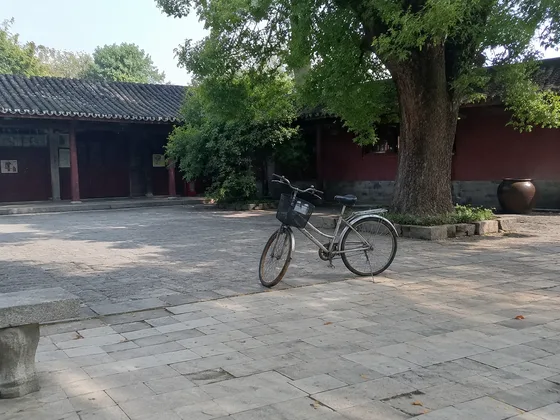
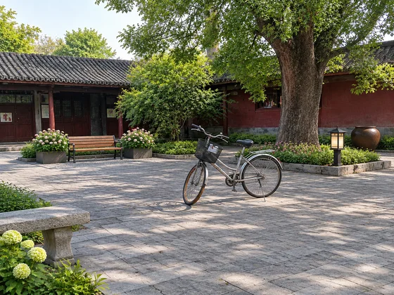

# Concept d'aménagement paysager · Rénovation d'aménagement paysager de cour

[中文](../../../README.md) · [English](../../../README.en.md) · [Português](../../../README.pt.md) · [Español](../../../README.es.md) · [Français](../../../README.fr.md) · [Deutsch](../../../README.de.md) · [عربي](../../../README.ar.md) · [русский](../../../README.ru.md) · [日本語](../../../README.ja.md) · [हिंदी](../../../README.hi.md)


Visualisez une métamorphose paysagère pour un espace extérieur photographié.

Téléchargez des photos de votre cour pour générer un plan de rénovation paysagère. Utilisé pour les rénovations et les propositions de jardins.

[Copier l'invite](#public-prompt) · [ est produit par dearsketch / Essayez en ligne](https://dearsketch.com/fr/intent/i178-create-a-landscape-makeover-concept-from-a-yard-photo.html?utm_source=github&utm_medium=case&utm_campaign=dearsketch-public-cases&utm_content=i178_cta) · [RRetour au sujet / Collection](../guides/spaces.md)

## Matériel de référence et orientation des résultats

<table>
<thead><tr><th width="50%">Matériel de référence</th><th width="50%">Exemple de résultats</th></tr></thead>
<tbody><tr><td valign="top"><p><strong>Photos de votre cour ou espace extérieur</strong><br></p></td><td valign="top"><a href="https://dearsketch.com/fr/intent/i178-create-a-landscape-makeover-concept-from-a-yard-photo.html?utm_source=github&amp;utm_medium=case&amp;utm_campaign=dearsketch-public-cases&amp;utm_content=i178_image"></a></td></tr></tbody>
</table>

Les matériaux de référence et les résultats sont utilisés pour illustrer la direction visuelle. Le modèle public ne constitue pas l'instruction de génération originale pour les images qui l'accompagnent, et la reproduction des mêmes résultats n'est pas garantie.

## Que préparer/Intrants

| Matériel | Type / Type | Quantité / Quantité | Condition / Exigence |
| --- | --- | --- | --- |
| Photos de votre cour ou espace extérieur | Photo/Image | 1 feuille ; plusieurs personnages ou perspectives peuvent être combinés dans un seul tableau de référence marqué | Obligatoire / Obligatoire |
| Exigences d'utilisation, climat ou emplacement | Caractère / Texte | 1 portion | Obligatoire / Obligatoire |

Une seule image est générée à la fois.

## Conserver et modifier / Brief d'édition

- **Préserver / 保留：** Conserver les limites des lots, les bâtiments, les niveaux, les accès et les structures fixes.
- **Changement / 改变：** Changez les concepts de plantation, de pavage, de mobilier, d'éclairage et d'aménagement.

## Public prompt

**Modèle public récemment modifié · Nouvellement rédigé · Non testé par génération.** Remplacez les paramètres entre crochets et joignez les matériaux requis dans l'outil qui prend en charge l'édition d'images ; les entrées facultatives et conditionnelles sont préparées selon le tableau ci-dessus. Ce modèle n'a pas été utilisé pour générer les exemples sur cette page.

```text
Create one landscape makeover concept from [YARD OR EXTERIOR PHOTO].
Preserve property boundaries, building facade, grade cues, gates, paths, utilities, and fixed structures.
Design for [USE NEEDS] in [CLIMATE OR LOCATION] using [LANDSCAPE STYLE].
Add [PLANTING DIRECTION], [PAVING], [FURNITURE], and [REQUESTED AMENITIES].
Keep scale, perspective, access routes, shadows, and transitions physically plausible.
Do not hide drainage points, exits, hazards, or existing constraints visible in the photo.
Use plants appropriate in appearance to [CLIMATE], but do not claim horticultural suitability without review.
Treat the result as concept visualization, not a planting plan or construction document.
Flag grading, drainage, structural, utility, and local-code questions for professionals.
Deliver one finished exterior concept image only.
```

[Mettez-le en ligne avec votre propre matériel / Mettez-le en ligne](https://dearsketch.com/fr/intent/i178-create-a-landscape-makeover-concept-from-a-yard-photo.html?utm_source=github&utm_medium=case&utm_campaign=dearsketch-public-cases&utm_content=i178_after-prompt) · [Laissez l'agent vous aider à l'organiser / Utilisez la compétence](../quickstart.md#agent-skill)

## Vérifier les points clés/Revue

La faisabilité pratique du maintien des limites de la cour et des structures fixes, des plantes, du pavage et du drainage doit être étudiée séparément.

Examinez séparément l’adéquation climatique, le drainage, les dimensions et la construction.

Sens du résultat : Rendus de paysages. Lorsque du texte exact, des fichiers transparents, des vecteurs ou une livraison imprimée sont requis, vérifiez le fichier réel ; les fonctionnalités disponibles et les frais sont sujets à la description du site Web.

## Cas connexes / Tâches connexes

- [Transformez une photo de maison en un souvenir d'aquarelle ou de dessin au trait · Peinture commémorative à l'aquarelle résidentielle ](./i030-turn-a-house-photo-into-a-watercolor-or-line-art-keepsake.md#public-prompt)
- [Aperçu des différents styles d'intérieur dans une photo de pièce · Aperçu du style de décoration de la pièce](./i169-preview-different-interior-styles-in-a-room-photo.md#public-prompt)
- [Aperçu de la peinture murale, du revêtement de sol et du papier peint · Aperçu de la peinture murale et de la sélection des matériaux de sol ](./i171-preview-wall-paint-flooring-and-wallpaper.md#public-prompt)

Pour connaître le champ d'utilisation des images et du matériel, voir la description du contenu de [ ](../content-policy.md). [Voir les 50 modèles ](../prompts.md).
