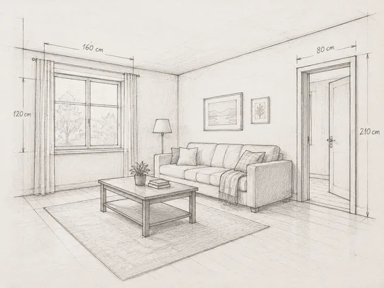
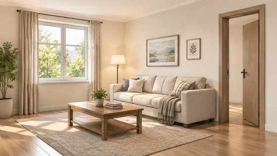

# Rendu d'esquisse en espace réaliste · Conversion d'esquisses architecturales en effets réalistes

[中文](../../../README.md) · [English](../../../README.en.md) · [Português](../../../README.pt.md) · [Español](../../../README.es.md) · [Français](../../../README.fr.md) · [Deutsch](../../../README.de.md) · [عربي](../../../README.ar.md) · [русский](../../../README.ru.md) · [日本語](../../../README.ja.md) · [हिंदी](../../../README.hi.md)


Effectuez le rendu d'un dessin de ligne architectural ou intérieur fourni sans modifier sa structure prévue.

Transformez des croquis intérieurs ou architecturaux en rendus réalistes. Utilisé pour la communication avec les clients et l'examen du programme.

[Copier l'invite](#public-prompt) · [ est produit par dearsketch / Essayez en ligne](https://dearsketch.com/fr/intent/i179-turn-an-interior-or-architectural-sketch-into-a-realistic-render.html?utm_source=github&utm_medium=case&utm_campaign=dearsketch-public-cases&utm_content=i179_cta) · [RRetour au sujet / Collection](../guides/spaces.md)

## Matériel de référence et orientation des résultats

<table>
<thead><tr><th width="50%">Matériel de référence</th><th width="50%">Exemple de résultats</th></tr></thead>
<tbody><tr><td valign="top"><p><strong>Croquis d'intérieur ou d'architecture/wireframes CAO</strong><br></p></td><td valign="top"><a href="https://dearsketch.com/fr/intent/i179-turn-an-interior-or-architectural-sketch-into-a-realistic-render.html?utm_source=github&amp;utm_medium=case&amp;utm_campaign=dearsketch-public-cases&amp;utm_content=i179_image"></a></td></tr></tbody>
</table>

Les matériaux de référence et les résultats sont utilisés pour illustrer la direction visuelle. Le modèle public ne constitue pas l'instruction de génération originale pour les images qui l'accompagnent, et la reproduction des mêmes résultats n'est pas garantie.

## Que préparer/Intrants

| Matériel | Type / Type | Quantité / Quantité | Condition / Exigence |
| --- | --- | --- | --- |
| Croquis d'intérieur ou d'architecture/wireframes CAO | Photo/Image | 1 pièce | Obligatoire / Obligatoire |
| Utilisation de l'espace et signification du croquis | Caractère / Texte | 1 portion | Obligatoire / Obligatoire |

Une seule image est générée à la fois.

## Conserver et modifier / Brief d'édition

- **Préserver / 保留：** Conserver les ouvertures, la géométrie, les relations de disposition et le cadrage de la caméra.
- **Changement / 改变：** Changez les matériaux, l'éclairage, le mobilier, le paysage et l'atmosphère.

## Public prompt

**Modèle public récemment modifié · Nouvellement rédigé · Non testé par génération.** Remplacez les paramètres entre crochets et joignez les matériaux requis dans l'outil qui prend en charge l'édition d'images ; les entrées facultatives et conditionnelles sont préparées selon le tableau ci-dessus. Ce modèle n'a pas été utilisé pour générer les exemples sur cette page.

```text
Create one realistic rendering from [ARCHITECTURAL OR INTERIOR SKETCH / CAD VIEW].
Interpret the space as [SPACE USE] according to [SKETCH LEGEND OR EXPLANATION].
Preserve all indicated walls, openings, levels, roof lines, built forms, and camera framing.
Apply [MATERIALS], [COLOR PALETTE], [LIGHTING], and [ENVIRONMENT].
Add only the furniture, fixtures, landscape, or people listed in [ADD LIST].
Keep perspective, scale, structural relationships, shadows, and material transitions coherent.
Do not erase ambiguous source lines; resolve uncertainty conservatively or flag it.
Do not claim engineering accuracy, measured dimensions, buildability, or code compliance.
The source drawing remains authoritative when the rendering conflicts with it.
Deliver one realistic concept rendering only.
```

[Mettez-le en ligne avec votre propre matériel / Mettez-le en ligne](https://dearsketch.com/fr/intent/i179-turn-an-interior-or-architectural-sketch-into-a-realistic-render.html?utm_source=github&utm_medium=case&utm_campaign=dearsketch-public-cases&utm_content=i179_after-prompt) · [Laissez l'agent vous aider à l'organiser / Utilisez la compétence](../quickstart.md#agent-skill)

## Vérifier les points clés/Revue

Vérifiez la relation entre les ouvertures et les structures dans l'esquisse et ne considérez pas le rendu visuel comme une vérification technique.

Comparez le rendu aux lignes source et ne le traitez pas comme une validation technique.

Sens du résultat : rendu spatial réaliste. Lorsque du texte exact, des fichiers transparents, des vecteurs ou une livraison imprimée sont requis, vérifiez le fichier réel ; les fonctionnalités disponibles et les frais sont sujets à la description du site Web.

## Cas connexes / Tâches connexes

- [Transformez une photo de maison en un souvenir d'aquarelle ou de dessin au trait · Peinture commémorative à l'aquarelle résidentielle ](./i030-turn-a-house-photo-into-a-watercolor-or-line-art-keepsake.md#public-prompt)
- [Aperçu des différents styles d'intérieur dans une photo de pièce · Aperçu du style de décoration de la pièce](./i169-preview-different-interior-styles-in-a-room-photo.md#public-prompt)
- [Créez un concept de relooking paysager à partir d'une photo de cour · Rénovation paysagère de cour ](./i178-create-a-landscape-makeover-concept-from-a-yard-photo.md#public-prompt)

## Référence de base des exigences

- [OpenArt esquisse vers l'image ](https://openart.ai/generator/sketch/)
- [Adobe génération de bâtiments ](https://www.adobe.com/products/firefly/features/ai-architecture-generator.html)

Ces liens sont uniquement destinés à aider à comprendre le but et ne constituent pas une preuve de la source ou de l'autorisation des images présentes sur cette page.

Pour connaître le champ d'utilisation des images et du matériel, voir la description du contenu de [ ](../content-policy.md). [Voir les 50 modèles ](../prompts.md).
