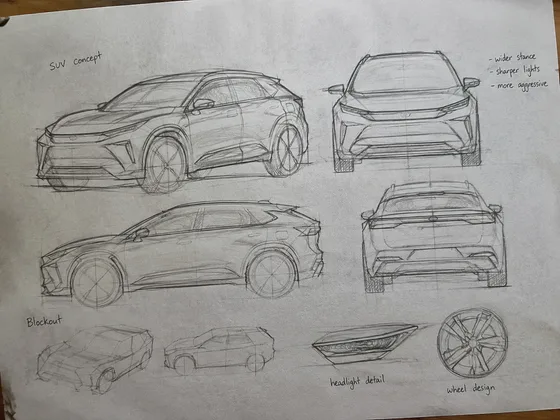
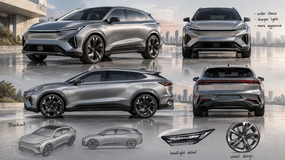

# Concept de style de véhicule · Style de voiture de texte

[中文](../../../README.md) · [English](../../../README.en.md) · [Português](../../../README.pt.md) · [Español](../../../README.es.md) · [Français](../../../README.fr.md) · [Deutsch](../../../README.de.md) · [عربي](../../../README.ar.md) · [русский](../../../README.ru.md) · [日本語](../../../README.ja.md) · [हिंदी](../../../README.hi.md)


Créez un original selon votre bref concept de style spécifié à partir du texte seul.

Générez des concepts de style automobile à partir de texte ou de croquis. Pour l'exploration du design, le contenu.

[Copier l'invite](#public-prompt) · [ est produit par dearsketch / Essayez en ligne](https://dearsketch.com/fr/intent/i187-create-a-car-design-concept-from-text-or-a-sketch.html?utm_source=github&utm_medium=case&utm_campaign=dearsketch-public-cases&utm_content=i187_cta) · [RRetour au sujet / Collection](../guides/text-only.md)

## Matériel de référence et orientation des résultats

<table>
<thead><tr><th width="50%">Matériel de référence</th><th width="50%">Exemple de résultats</th></tr></thead>
<tbody><tr><td valign="top"><p><strong>Croquis de voiture ou dessin original de référence de carrosserie</strong><br></p></td><td valign="top"><a href="https://dearsketch.com/fr/intent/i187-create-a-car-design-concept-from-text-or-a-sketch.html?utm_source=github&amp;utm_medium=case&amp;utm_campaign=dearsketch-public-cases&amp;utm_content=i187_image"></a></td></tr></tbody>
</table>

Les matériaux de référence et les résultats sont utilisés pour illustrer la direction visuelle. Le modèle public ne constitue pas l'instruction de génération originale pour les images qui l'accompagnent, et la reproduction des mêmes résultats n'est pas garantie.

## Que préparer/Intrants

| Matériel | Type / Type | Quantité / Quantité | Condition / Exigence |
| --- | --- | --- | --- |
| Brief de création de texte : remplissez le thème, l'objectif et les paramètres factuels dans les mots d'invite | Caractère / Texte | 1 portion | Obligatoire / Obligatoire |

**Génération de texte pur / Texte uniquement : aucune image, logo, croquis ou autre pièce jointe requis.** Utilisez uniquement le texte succinct ci-dessous pour créer de nouveaux concepts.

Une seule image est générée à la fois, pas besoin de télécharger d'images.

## Conserver et modifier / Brief d'édition

- **Préserver / 保留：** Honorez les faits écrits fournis, la formulation exacte et les contraintes.
- **Modifier / 改变：** Utilisez [PROPORTIONS], [BODY LANGUAGE], [MATERIALS] et [COLOR] pour [USE CASE]. Affichez une vue de trois quarts cohérente avec un alignement des roues crédible et une géométrie de panneau cohérente.

## Public prompt

**Modèle public nouvellement compilé · Nouvellement rédigé · Non testé par génération.** Remplacez simplement les paramètres entre crochets, pas besoin de télécharger des images de référence. Ce modèle n'a pas été utilisé pour générer les exemples sur cette page.

```text
Create one original [VEHICLE TYPE] styling concept from the following written brief only. No reference image or other attachment is needed.
Use [PROPORTIONS], [BODY LANGUAGE], [MATERIALS] and [COLOR] for [USE CASE]. Show a coherent three-quarter view with believable wheel alignment and consistent panel geometry.
This is an exterior concept, not validated aerodynamics, engineering or a redesign of an unseen real model.
Use an original design. Do not imply fidelity to any existing person, product, property or artwork that has not been supplied.
Return one finished image only. Replace every bracketed field with your own details before generating.
```

[Mettez-le en ligne avec votre propre matériel / Mettez-le en ligne](https://dearsketch.com/fr/intent/i187-create-a-car-design-concept-from-text-or-a-sketch.html?utm_source=github&utm_medium=case&utm_campaign=dearsketch-public-cases&utm_content=i187_after-prompt) · [Laissez l'agent vous aider à l'organiser / Utilisez la compétence](../quickstart.md#agent-skill)

## Vérifier les points clés/Revue

Il s'agit d'un concept extérieur, non d'une aérodynamique validée, d'une ingénierie ou d'une refonte d'un modèle réel inédit.

Il s'agit d'un concept extérieur, non d'une aérodynamique validée, d'une ingénierie ou d'une refonte d'un modèle réel inédit.

Direction du résultat : dessins de concept de voiture. Lorsque du texte exact, des fichiers transparents, des vecteurs ou une livraison imprimée sont requis, vérifiez le fichier réel ; les fonctionnalités disponibles et les frais sont sujets à la description du site Web.

## Cas connexes / Tâches connexes

- [Créer une photo de profil pour YouTube ou le streaming · Avatar de chaîne généré par texte ](./i054-create-a-profile-picture-for-youtube-or-streaming.md#public-prompt)
- [Créer un emoji personnalisé à partir du texte · Emoji personnalisé](./i057-create-a-custom-emoji-from-text.md#public-prompt)
- [Créez des imprimés et des motifs de tissus sans couture pour les vêtements · ](./i100-create-seamless-prints-and-fabric-patterns-for-clothing.md#public-prompt)

## Référence de base des exigences

- [LightXTous les outils](https://www.lightxeditor.com/all-tools/all-tools/)
- [OpenArt esquisse vers l'image ](https://openart.ai/generator/sketch/)

Ces liens sont uniquement destinés à aider à comprendre le but et ne constituent pas une preuve de la source ou de l'autorisation des images présentes sur cette page.

Pour connaître le champ d'utilisation des images et du matériel, voir la description du contenu de [ ](../content-policy.md). [Afficher les 100 modèles ](../prompts.md).
