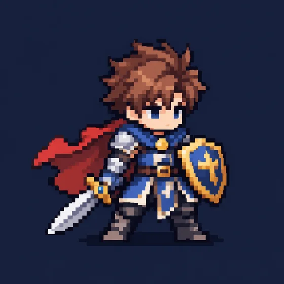

# Actif Pixel Art · Actif pixel de texte

[中文](../../../README.md) · [English](../../../README.en.md) · [Português](../../../README.pt.md) · [Español](../../../README.es.md) · [Français](../../../README.fr.md) · [Deutsch](../../../README.de.md) · [عربي](../../../README.ar.md) · [русский](../../../README.ru.md) · [日本語](../../../README.ja.md) · [हिंदी](../../../README.hi.md)


Créez un pixel-art original que votre brief spécifié décrit comme votre brief spécifié à partir du texte seul.

Convertissez des images ou des descriptions en ressources de jeu pixélisées. Pour les jeux rétro, le prototypage.

[Copier l'invite](#public-prompt) · [ est produit par dearsketch / Essayez en ligne](https://dearsketch.com/fr/intent/i196-turn-an-image-or-description-into-pixel-art-game-assets.html?utm_source=github&utm_medium=case&utm_campaign=dearsketch-public-cases&utm_content=i196_cta) · [RRetour au sujet / Collection](../guides/text-only.md)

## Matériel de référence et orientation des résultats

<p><strong>Exemple de résultats</strong></p>
<p><a href="https://dearsketch.com/fr/intent/i196-turn-an-image-or-description-into-pixel-art-game-assets.html?utm_source=github&amp;utm_medium=case&amp;utm_campaign=dearsketch-public-cases&amp;utm_content=i196_image"></a></p>
<p>Cet exemple est une saisie de texte, aucune référence d'image n'est jointe.</p>

Les matériaux de référence et les résultats sont utilisés pour illustrer la direction visuelle. Le modèle public ne constitue pas l'instruction de génération originale pour les images qui l'accompagnent, et la reproduction des mêmes résultats n'est pas garantie.

## Que préparer/Intrants

| Matériel | Type / Type | Quantité / Quantité | Condition / Exigence |
| --- | --- | --- | --- |
| Brief de création de texte : remplissez le thème, l'objectif et les paramètres factuels dans les mots d'invite | Caractère / Texte | 1 portion | Obligatoire / Obligatoire |

**Génération de texte pur / Texte uniquement : aucune image, logo, croquis ou autre pièce jointe requis.** Utilisez uniquement le texte succinct ci-dessous pour créer de nouveaux concepts.

Une seule image est générée à la fois, pas besoin de télécharger d'images.

## Conserver et modifier / Brief d'édition

- **Préserver / 保留：** Honorez les faits écrits fournis, la formulation exacte et les contraintes.
- **Change / 改变：** Utilisez [GAME VIEW], une palette de couleurs [PALETTE SIZE], des clusters de pixels délibérés et [CANVAS SIZE]. Évitez les dégradés lisses, l'anticrénelage et l'échelle de pixels incohérente.

## Public prompt

**Modèle public nouvellement compilé · Nouvellement rédigé · Non testé par génération.** Remplacez simplement les paramètres entre crochets, pas besoin de télécharger des images de référence. Ce modèle n'a pas été utilisé pour générer les exemples sur cette page.

```text
Create one original pixel-art [ASSET TYPE] described as [SUBJECT] from the following written brief only. No reference image or other attachment is needed.
Use [GAME VIEW], a [PALETTE SIZE]-color palette, deliberate pixel clusters and [CANVAS SIZE]. Avoid smooth gradients, antialiasing and inconsistent pixel scale.
Do not convert or imitate an unseen photo; check the actual pixel grid at native size before game use.
Use an original design. Do not imply fidelity to any existing person, product, property or artwork that has not been supplied.
Return one finished image only. Replace every bracketed field with your own details before generating.
```

[Mettez-le en ligne avec votre propre matériel / Mettez-le en ligne](https://dearsketch.com/fr/intent/i196-turn-an-image-or-description-into-pixel-art-game-assets.html?utm_source=github&utm_medium=case&utm_campaign=dearsketch-public-cases&utm_content=i196_after-prompt) · [Laissez l'agent vous aider à l'organiser / Utilisez la compétence](../quickstart.md#agent-skill)

## Vérifier les points clés/Revue

Ne convertissez pas et n'imitez pas une photo invisible ; vérifiez la grille de pixels réelle à sa taille native avant d'utiliser le jeu.

Ne convertissez pas et n'imitez pas une photo invisible ; vérifiez la grille de pixels réelle à sa taille native avant d'utiliser le jeu.

Direction du résultat : ressources Pixel Art. Lorsque du texte exact, des fichiers transparents, des vecteurs ou une livraison imprimée sont requis, vérifiez le fichier réel ; les fonctionnalités disponibles et les frais sont sujets à la description du site Web.

## Cas connexes / Tâches connexes

- [Créer une photo de profil pour YouTube ou le streaming · Avatar de chaîne généré par texte ](./i054-create-a-profile-picture-for-youtube-or-streaming.md#public-prompt)
- [Créer un emoji personnalisé à partir du texte · Emoji personnalisé](./i057-create-a-custom-emoji-from-text.md#public-prompt)
- [Créez des imprimés et des motifs de tissus sans couture pour les vêtements · ](./i100-create-seamless-prints-and-fabric-patterns-for-clothing.md#public-prompt)

## Référence de base des exigences

- [Unity Sprite](https://unity.com/blog/unity-ai-sprite-generator)

Ces liens sont uniquement destinés à aider à comprendre le but et ne constituent pas une preuve de la source ou de l'autorisation des images présentes sur cette page.

Pour connaître le champ d'utilisation des images et du matériel, voir la description du contenu de [ ](../content-policy.md). [Afficher les 100 modèles ](../prompts.md).
