# Vision produit e-commerce

[中文](../../../README.md) · [English](../../../README.en.md) · [Português](../../../README.pt.md) · [Español](../../../README.es.md) · [Français](../../../README.fr.md) · [Deutsch](../../../README.de.md) · [عربي](../../../README.ar.md) · [русский](../../../README.ru.md) · [日本語](../../../README.ja.md) · [हिंदी](../../../README.hi.md)

14 caisses hors catalogue présenté. Les mots d'invite ne sont pas divulgués ici, seuls les matériaux de référence existants, les instructions de résultat et les exigences minimales en matière de matériaux sont affichés.

[Retourner à d'autres catalogues de caisses](./index.md) · [Retourner à la page d'accueil de l'entrepôt](../../../README.fr.md)

> Les documents de référence et les images des résultats sont uniquement à titre indicatif ; il n'y a aucune garantie que le même effet puisse être reproduit en utilisant les mêmes matériaux.

## I070 · Ajouter des ombres ou des reflets naturels aux éléments

<table>
<thead><tr><th width="50%">Matériel de référence</th><th width="50%">Exemple de résultats</th></tr></thead>
<tbody><tr><td valign="top">
<strong>Produits découpés</strong> 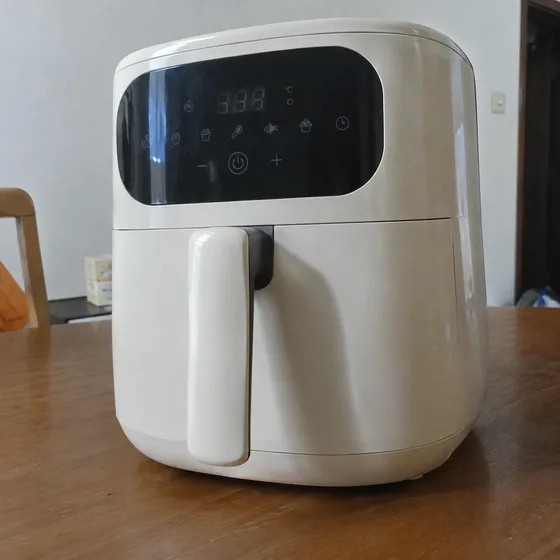
</td><td valign="top"><a href="https://dearsketch.com/fr/intent/i070-add-a-natural-shadow-or-reflection-to-a-product.html?utm_source=github&amp;utm_medium=gallery&amp;utm_campaign=dearsketch-public-cases&amp;utm_content=i070_image">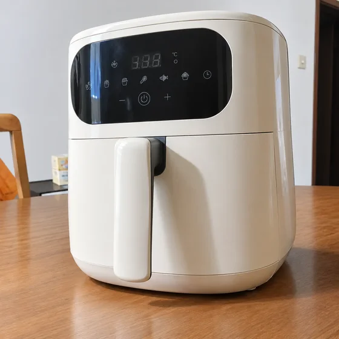</a></td></tr></tbody>
</table>

- **Type d'entrée :** Comprend un aperçu du matériau de référence et un exemple de résultat
- **Exigences matérielles :** 1 produit découpé
- **Description :** Une seule image est générée à la fois.

[ Vérifiez les exigences spécifiques dans dearsketch et créez ](https://dearsketch.com/fr/intent/i070-add-a-natural-shadow-or-reflection-to-a-product.html?utm_source=github&utm_medium=gallery&utm_campaign=dearsketch-public-cases&utm_content=i070_cta)

---

## I072 · Générez différents angles de prise de vue à partir d'une seule image de produit

<table>
<thead><tr><th width="50%">Matériel de référence</th><th width="50%">Exemple de résultats</th></tr></thead>
<tbody><tr><td valign="top">
<strong>Photo du produit à angle unique</strong> 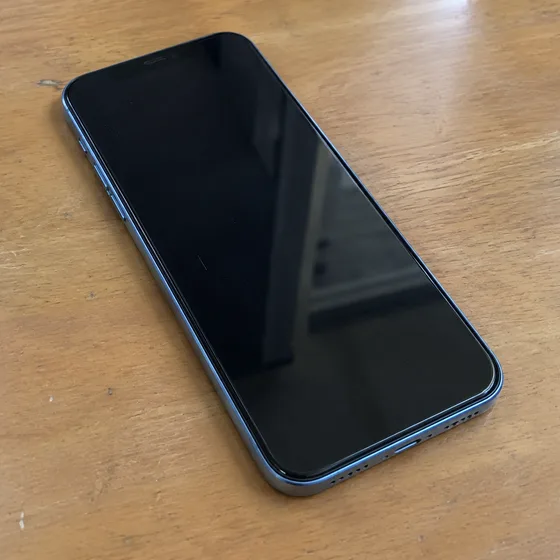
</td><td valign="top"><a href="https://dearsketch.com/fr/intent/i072-create-multiple-camera-angles-from-one-product-photo.html?utm_source=github&amp;utm_medium=gallery&amp;utm_campaign=dearsketch-public-cases&amp;utm_content=i072_image">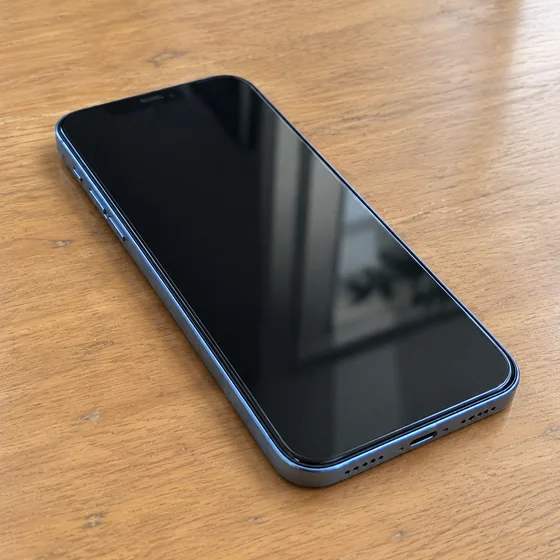</a></td></tr></tbody>
</table>

- **Type d'entrée :** Comprend un aperçu du matériau de référence et un exemple de résultat
- **Exigences matérielles :** 1 photo de produit à angle unique + 1 angle d'observation cible pour cette fois
- **Description :** Seul celui actuellement sélectionné est généré à la fois ; les autres images de la série sont exécutées séparément.

[ Vérifiez les exigences spécifiques dans dearsketch et créez ](https://dearsketch.com/fr/intent/i072-create-multiple-camera-angles-from-one-product-photo.html?utm_source=github&utm_medium=gallery&utm_campaign=dearsketch-public-cases&utm_content=i072_cta)

---

## I074 · Unifiez l'arrière-plan et la taille de l'ensemble du catalogue de produits par lots

<table>
<thead><tr><th width="50%">Matériel de référence</th><th width="50%">Exemple de résultats</th></tr></thead>
<tbody><tr><td valign="top">
<strong>Cette référence de style ou l'image actuelle du produit</strong> 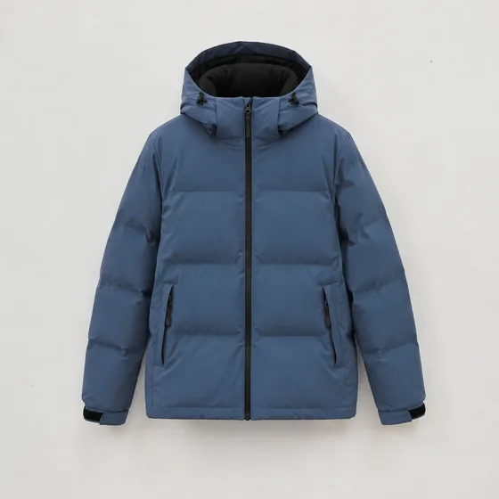
</td><td valign="top"><a href="https://dearsketch.com/fr/intent/i074-standardize-backgrounds-and-dimensions-across-a-product-catalog.html?utm_source=github&amp;utm_medium=gallery&amp;utm_campaign=dearsketch-public-cases&amp;utm_content=i074_image">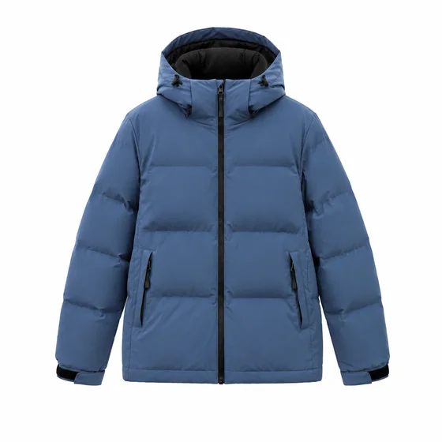</a></td></tr></tbody>
</table>

- **Type d'entrée :** Comprend un aperçu du matériau de référence et un exemple de résultat
- **Exigences matérielles :** 1 photo de l'ensemble du lot de produits + 1 photo de ce référentiel de style ou du produit actuel
- **Description :** Seul celui actuellement sélectionné est généré à la fois ; les autres images de la série sont exécutées séparément.

[ Vérifiez les exigences spécifiques dans dearsketch et créez ](https://dearsketch.com/fr/intent/i074-standardize-backgrounds-and-dimensions-across-a-product-catalog.html?utm_source=github&utm_medium=gallery&utm_campaign=dearsketch-public-cases&utm_content=i074_cta)

---

## I078 · Générer une image principale, une image de scène et un ensemble de matériaux détaillés en même temps

<table>
<thead><tr><th width="50%">Matériel de référence</th><th width="50%">Exemple de résultats</th></tr></thead>
<tbody><tr><td valign="top">
<strong>Référence du produit</strong> 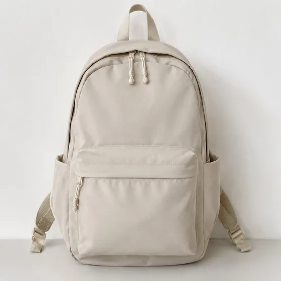
</td><td valign="top"><a href="https://dearsketch.com/fr/intent/i078-create-a-set-of-listing-lifestyle-and-detail-images.html?utm_source=github&amp;utm_medium=gallery&amp;utm_campaign=dearsketch-public-cases&amp;utm_content=i078_image">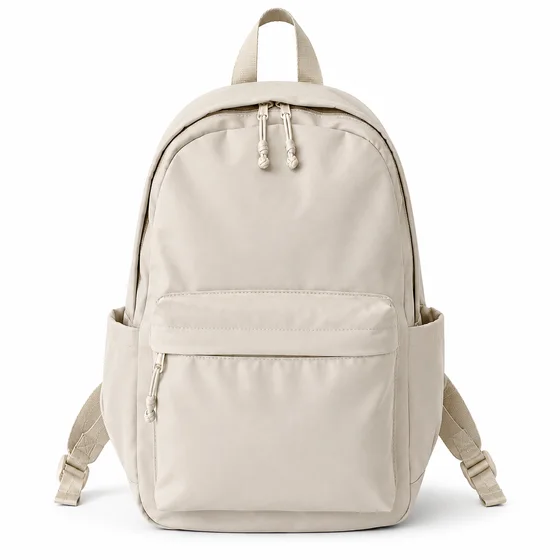</a></td></tr></tbody>
</table>

- **Type d'entrée :** Comprend un aperçu du matériau de référence et un exemple de résultat
- **Exigences matérielles :** Au moins 1 référence principale de produit + 1 type d'actif de cette période
- **Description :** Seul celui actuellement sélectionné est généré à la fois ; les autres images de la série sont exécutées séparément.

[ Vérifiez les exigences spécifiques dans dearsketch et créez ](https://dearsketch.com/fr/intent/i078-create-a-set-of-listing-lifestyle-and-detail-images.html?utm_source=github&utm_medium=gallery&utm_campaign=dearsketch-public-cases&utm_content=i078_cta)

---

## I079 · Générer une couverture de catalogue et une page d'affichage du produit

<table>
<thead><tr><th width="50%">Matériel de référence</th><th width="50%">Exemple de résultats</th></tr></thead>
<tbody><tr><td valign="top">
<strong>Image originale du produit actuel</strong> 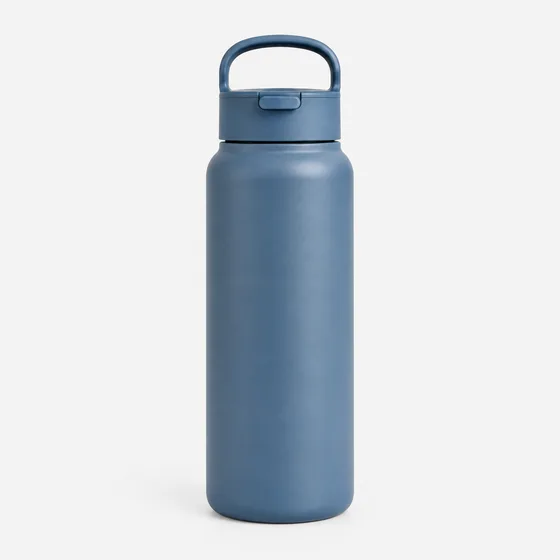
</td><td valign="top"><a href="https://dearsketch.com/fr/intent/i079-create-a-product-catalog-cover-and-showcase-page.html?utm_source=github&amp;utm_medium=gallery&amp;utm_campaign=dearsketch-public-cases&amp;utm_content=i079_image">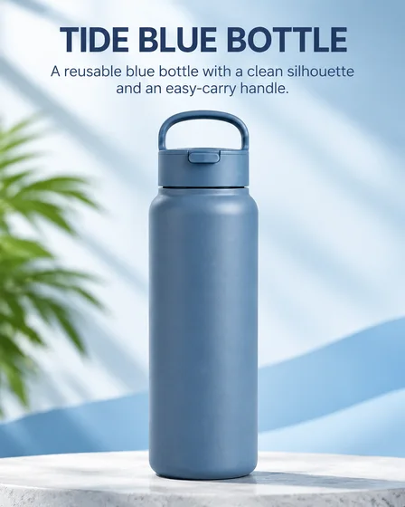</a></td></tr></tbody>
</table>

- **Type d'entrée :** Comprend un aperçu du matériau de référence et un exemple de résultat
- **Exigences matérielles :** 1 photo du produit actuel + nom et description du produit → Organiser le visuel et le texte du produit unique → 1 page d'affichage du catalogue du produit
- **Description :** Une seule image est générée à la fois.

[ Vérifiez les exigences spécifiques dans dearsketch et créez ](https://dearsketch.com/fr/intent/i079-create-a-product-catalog-cover-and-showcase-page.html?utm_source=github&utm_medium=gallery&utm_campaign=dearsketch-public-cases&utm_content=i079_cta)

---

## I081 · Générer des photographies commerciales de bijoux et de bagues

<table>
<thead><tr><th width="50%">Matériel de référence</th><th width="50%">Exemple de résultats</th></tr></thead>
<tbody><tr><td valign="top">
<strong>Photos de produits de bijoux</strong> 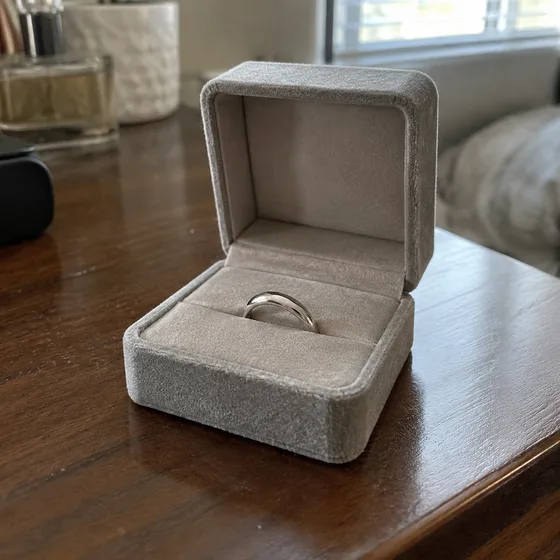
</td><td valign="top"><a href="https://dearsketch.com/fr/intent/i081-create-commercial-photography-for-jewelry-and-rings.html?utm_source=github&amp;utm_medium=gallery&amp;utm_campaign=dearsketch-public-cases&amp;utm_content=i081_image">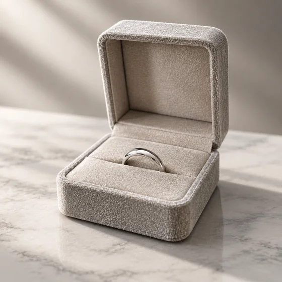</a></td></tr></tbody>
</table>

- **Type d'entrée :** Comprend un aperçu du matériau de référence et un exemple de résultat
- **Exigences matérielles :** 1 photo de produits de bijouterie
- **Description :** Une seule image est générée à la fois.

[ Vérifiez les exigences spécifiques dans dearsketch et créez ](https://dearsketch.com/fr/intent/i081-create-commercial-photography-for-jewelry-and-rings.html?utm_source=github&utm_medium=gallery&utm_campaign=dearsketch-public-cases&utm_content=i081_cta)

---

## I082 · Générer des graphiques de scènes de produits de soins de la peau et de cosmétiques

<table>
<thead><tr><th width="50%">Matériel de référence</th><th width="50%">Exemple de résultats</th></tr></thead>
<tbody><tr><td valign="top">
<strong>Photos de produits emballés</strong> 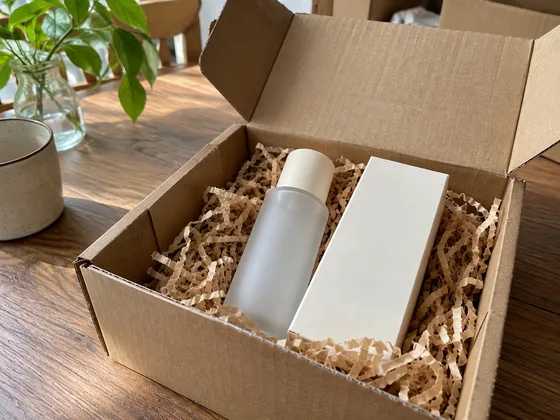
</td><td valign="top"><a href="https://dearsketch.com/fr/intent/i082-create-lifestyle-imagery-for-skincare-and-cosmetics.html?utm_source=github&amp;utm_medium=gallery&amp;utm_campaign=dearsketch-public-cases&amp;utm_content=i082_image">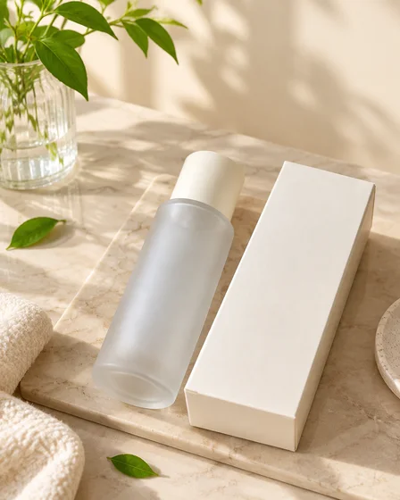</a></td></tr></tbody>
</table>

- **Type d'entrée :** Comprend un aperçu du matériau de référence et un exemple de résultat
- **Exigences matérielles :** 1 photo des produits d'emballage
- **Description :** Une seule image est générée à la fois.

[ Vérifiez les exigences spécifiques dans dearsketch et créez ](https://dearsketch.com/fr/intent/i082-create-lifestyle-imagery-for-skincare-and-cosmetics.html?utm_source=github&utm_medium=gallery&utm_campaign=dearsketch-public-cases&utm_content=i082_cta)

---

## I083 · Générer des images de produits de scènes de meubles et de canapés

<table>
<thead><tr><th width="50%">Matériel de référence</th><th width="50%">Exemple de résultats</th></tr></thead>
<tbody><tr><td valign="top">
<strong>photos de meubles</strong> 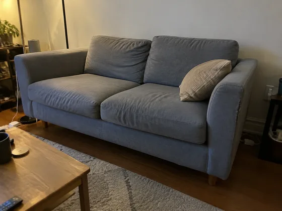
</td><td valign="top"><a href="https://dearsketch.com/fr/intent/i083-create-lifestyle-product-imagery-for-furniture-and-sofas.html?utm_source=github&amp;utm_medium=gallery&amp;utm_campaign=dearsketch-public-cases&amp;utm_content=i083_image">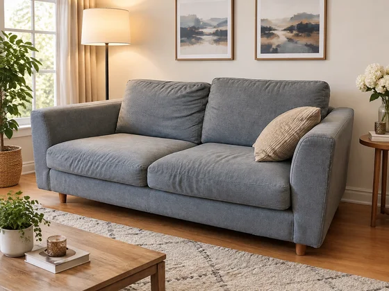</a></td></tr></tbody>
</table>

- **Type d'entrée :** Comprend un aperçu du matériau de référence et un exemple de résultat
- **Exigences matérielles :** 1 photo de meuble
- **Description :** Une seule image est générée à la fois.

[ Vérifiez les exigences spécifiques dans dearsketch et créez ](https://dearsketch.com/fr/intent/i083-create-lifestyle-product-imagery-for-furniture-and-sofas.html?utm_source=github&utm_medium=gallery&utm_campaign=dearsketch-public-cases&utm_content=i083_cta)

---

## I084 · Générer des rendus de promotion et de modification de voiture

<table>
<thead><tr><th width="50%">Matériel de référence</th><th width="50%">Exemple de résultats</th></tr></thead>
<tbody><tr><td valign="top">
<strong>photo de voiture</strong> 
</td><td valign="top"></td></tr></tbody>
</table>

- **Type d'entrée :** Comprend un aperçu du matériau de référence et un exemple de résultat
- **Exigences matérielles :** 1 photo de voiture
- **Description :** Une seule image est générée à la fois.

[ Vérifiez les exigences spécifiques dans dearsketch et créez ](https://dearsketch.com/fr/intent/i084-create-automotive-promotional-or-customization-visuals.html?utm_source=github&utm_medium=gallery&utm_campaign=dearsketch-public-cases&utm_content=i084_cta)

---

## I086 · Prévisualiser les couleurs et les scènes du produit avant la production

<table>
<thead><tr><th width="50%">Matériel de référence</th><th width="50%">Exemple de résultats</th></tr></thead>
<tbody><tr><td valign="top">
<strong>Croquis de produits ou dessins de référence</strong> 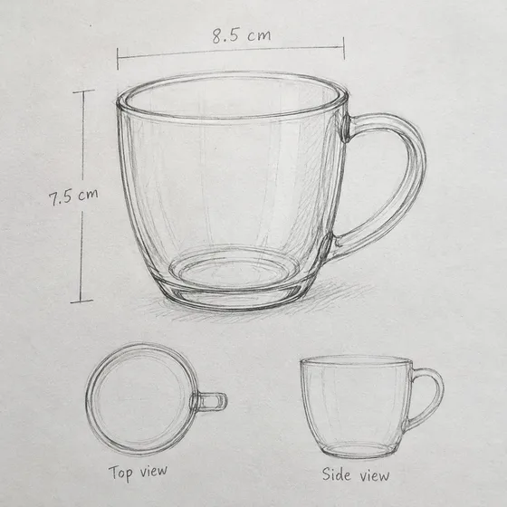
</td><td valign="top"><a href="https://dearsketch.com/fr/intent/i086-preview-product-colors-and-scenes-before-production.html?utm_source=github&amp;utm_medium=gallery&amp;utm_campaign=dearsketch-public-cases&amp;utm_content=i086_image">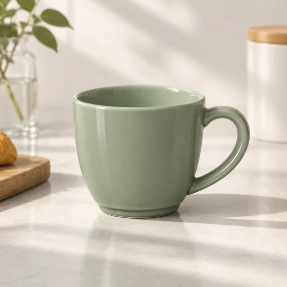</a></td></tr></tbody>
</table>

- **Type d'entrée :** Comprend un aperçu du matériau de référence et un exemple de résultat
- **Exigences matérielles :** 1 croquis du produit ou image de référence + 1 couleur ou matériau cible + 0 ou 1 scénario d'utilisation
- **Description :** Seul celui actuellement sélectionné est généré à la fois ; les autres images de la série sont exécutées séparément.

[ Vérifiez les exigences spécifiques dans dearsketch et créez ](https://dearsketch.com/fr/intent/i086-preview-product-colors-and-scenes-before-production.html?utm_source=github&utm_medium=gallery&utm_campaign=dearsketch-public-cases&utm_content=i086_cta)

---

## I087 · Adaptez automatiquement la même image de produit à différentes tailles de plate-forme

<table>
<thead><tr><th width="50%">Matériel de référence</th><th width="50%">Exemple de résultats</th></tr></thead>
<tbody><tr><td valign="top">
<strong>Photos du produit fini</strong> 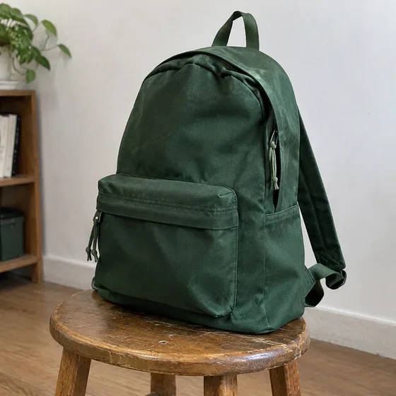
</td><td valign="top"><a href="https://dearsketch.com/fr/intent/i087-adapt-one-product-image-to-different-platform-sizes.html?utm_source=github&amp;utm_medium=gallery&amp;utm_campaign=dearsketch-public-cases&amp;utm_content=i087_image">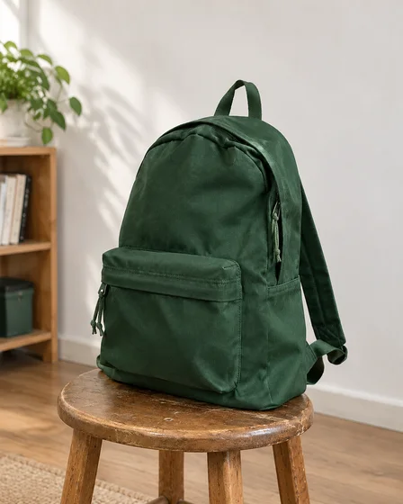</a></td></tr></tbody>
</table>

- **Type d'entrée :** Comprend un aperçu du matériau de référence et un exemple de résultat
- **Exigences matérielles :** 1 photo du produit fini + 1 article de cette plateforme et ressources spécifiques
- **Description :** Seul celui actuellement sélectionné est généré à la fois ; les autres images de la série sont exécutées séparément.

[ Vérifiez les exigences spécifiques dans dearsketch et créez ](https://dearsketch.com/fr/intent/i087-adapt-one-product-image-to-different-platform-sizes.html?utm_source=github&utm_medium=gallery&utm_campaign=dearsketch-public-cases&utm_content=i087_cta)

---

## I088 · Traduire et réorganiser le texte dans les images de produits transfrontaliers

<table>
<thead><tr><th width="50%">Matériel de référence</th><th width="50%">Exemple de résultats</th></tr></thead>
<tbody><tr><td valign="top">
<strong>Image du produit avec texte source</strong> 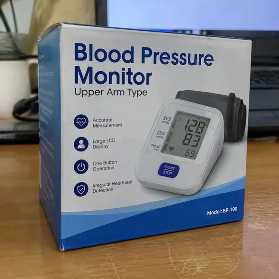
</td><td valign="top"><a href="https://dearsketch.com/fr/intent/i088-translate-and-reformat-text-in-cross-border-product-images.html?utm_source=github&amp;utm_medium=gallery&amp;utm_campaign=dearsketch-public-cases&amp;utm_content=i088_image">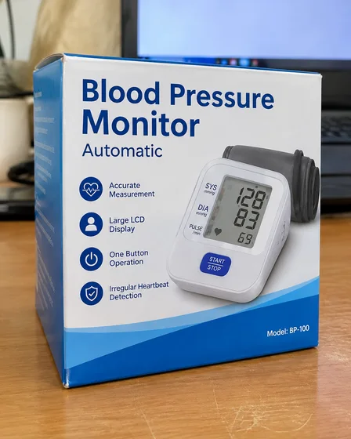</a></td></tr></tbody>
</table>

- **Type d'entrée :** Comprend un aperçu du matériau de référence et un exemple de résultat
- **Exigences matérielles :** 1 photo du produit avec texte source + 1 jeu de traductions confirmées ou glossaire + 1 jeu de langue source, langue cible et région
- **Description :** Cette fois, un seul aperçu visuel est généré. Le calcul des données, la composition précise, les fichiers vectoriels ou de production doivent encore être vérifiés par les outils correspondants.

[ Vérifiez les exigences spécifiques dans dearsketch et créez ](https://dearsketch.com/fr/intent/i088-translate-and-reformat-text-in-cross-border-product-images.html?utm_source=github&utm_medium=gallery&utm_campaign=dearsketch-public-cases&utm_content=i088_cta)

---

## I256 · Créer un tableau de comparaison de fonctions pour plusieurs produits ou packages

<strong>Exemple de résultats</strong>

Cet exemple n'inclut pas de référence d'image et l'aperçu d'entrée doit être complété ; voir les exigences matérielles ci-dessous.

- **Type d'entrée :** Cet exemple montre uniquement des exemples de résultats ; L'aperçu de l'entrée d'image doit être ajouté
- **Exigences matérielles :** Données de comparaison produit/emballage structurées requises (1 copie) + séquence de prise de décision facultative et objectif actuel (0 ou 1 groupe)
- **Description :** Cette fois, un seul aperçu visuel est généré. Le calcul des données, la composition précise, les fichiers vectoriels ou de production doivent encore être vérifiés par les outils correspondants.

[ Vérifiez les exigences spécifiques dans dearsketch et créez ](https://dearsketch.com/fr/intent/i256-create-a-feature-comparison-chart-for-products-or-bundles.html?utm_source=github&utm_medium=gallery&utm_campaign=dearsketch-public-cases&utm_content=i256_cta)

---

## I257 · Transformez les dimensions et les proportions du produit en diagrammes de tailles

<table>
<thead><tr><th width="50%">Matériel de référence</th><th width="50%">Exemple de résultats</th></tr></thead>
<tbody><tr><td valign="top">
<strong>Image du produit à ajouter avec les lignes de cote</strong> 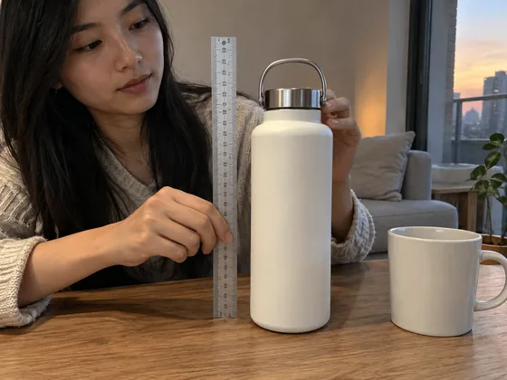
</td><td valign="top"><a href="https://dearsketch.com/fr/intent/i257-turn-product-measurements-into-a-dimension-diagram.html?utm_source=github&amp;utm_medium=gallery&amp;utm_campaign=dearsketch-public-cases&amp;utm_content=i257_image">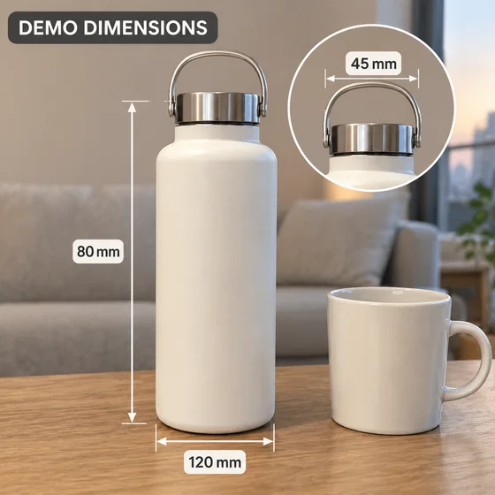</a></td></tr></tbody>
</table>

- **Type d'entrée :** Comprend un aperçu du matériau de référence et un exemple de résultat
- **Exigences matérielles :** L'image du produit requise doit être ajoutée avec les lignes de dimension (1 image) + Taille réelle requise et sens de mesure (1 copie)
- **Description :** Cette fois, un seul aperçu visuel est généré. Le calcul des données, la composition précise, les fichiers vectoriels ou de production doivent encore être vérifiés par les outils correspondants.

[ Vérifiez les exigences spécifiques dans dearsketch et créez ](https://dearsketch.com/fr/intent/i257-turn-product-measurements-into-a-dimension-diagram.html?utm_source=github&utm_medium=gallery&utm_campaign=dearsketch-public-cases&utm_content=i257_cta)
