# Illustrations, éditions et histoires

[中文](../../../README.md) · [English](../../../README.en.md) · [Português](../../../README.pt.md) · [Español](../../../README.es.md) · [Français](../../../README.fr.md) · [Deutsch](../../../README.de.md) · [عربي](../../../README.ar.md) · [русский](../../../README.ru.md) · [日本語](../../../README.ja.md) · [हिंदी](../../../README.hi.md)

14 caisses hors catalogue présenté. Les mots d'invite ne sont pas divulgués ici, seuls les matériaux de référence existants, les instructions de résultat et les exigences minimales en matière de matériaux sont affichés.

[Retourner à d'autres catalogues de caisses](./index.md) · [Retourner à la page d'accueil de l'entrepôt](../../../README.fr.md)

> Les documents de référence et les images des résultats sont uniquement à titre indicatif ; il n'y a aucune garantie que le même effet puisse être reproduit en utilisant les mêmes matériaux.

## I141 · Un livre d'images pour enfants qui génère des personnages cohérents à partir du texte d'une histoire

<strong>Exemple de résultats</strong>

<a href="https://dearsketch.com/fr/intent/i141-create-a-children-s-picture-book-with-consistent-characters-from-a-story.html?utm_source=github&amp;utm_medium=gallery&amp;utm_campaign=dearsketch-public-cases&amp;utm_content=i141_image">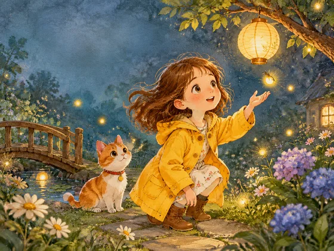</a>

Cet exemple n'inclut pas de référence d'image et l'aperçu d'entrée doit être complété ; voir les exigences matérielles ci-dessous.

- **Type d'entrée :** Cet exemple montre uniquement des exemples de résultats ; L'aperçu de l'entrée d'image doit être ajouté
- **Exigences matérielles :** Règles complètes de l'histoire et de la pagination + tableau manuscrit de définition des personnages du livre d'images + modèle de style d'illustration du livre d'images + numéro de page actuel ou planche → diviser les pages et générer des illustrations de personnages cohérentes → livre d'images pour enfants complet et unique actuel
- **Description :** Seul celui actuellement sélectionné est généré à la fois ; les autres images de la série sont exécutées séparément.

[ Vérifiez les exigences spécifiques dans dearsketch et créez ](https://dearsketch.com/fr/intent/i141-create-a-children-s-picture-book-with-consistent-characters-from-a-story.html?utm_source=github&utm_medium=gallery&utm_campaign=dearsketch-public-cases&utm_content=i141_cta)

---

## I143 · Générer une couverture de livre en fonction du titre et du contenu du livre

<strong>Exemple de résultats</strong>

<a href="https://dearsketch.com/fr/intent/i143-create-a-book-cover-from-its-title-and-content.html?utm_source=github&amp;utm_medium=gallery&amp;utm_campaign=dearsketch-public-cases&amp;utm_content=i143_image">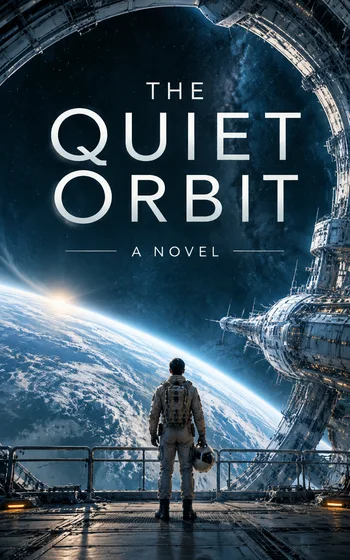</a>

Cet exemple n'inclut pas de référence d'image et l'aperçu d'entrée doit être complété ; voir les exigences matérielles ci-dessous.

- **Type d'entrée :** Cet exemple montre uniquement des exemples de résultats ; L'aperçu de l'entrée d'image doit être ajouté
- **Exigences matérielles :** Marque de la série ou manuscrit de personnage existant + titre du livre, type de livre, introduction du contenu → Générer une illustration de couverture et une direction de mise en page → Couverture actuelle du livre unique
- **Description :** Une seule image est générée à la fois.

[ Vérifiez les exigences spécifiques dans dearsketch et créez ](https://dearsketch.com/fr/intent/i143-create-a-book-cover-from-its-title-and-content.html?utm_source=github&utm_medium=gallery&utm_campaign=dearsketch-public-cases&utm_content=i143_cta)

---

## I144 · Générer des storyboards ou des panneaux de bandes dessinées qui maintiennent la cohérence des personnages

<strong>Exemple de résultats</strong>

<a href="https://dearsketch.com/fr/intent/i144-create-comic-panels-with-consistent-characters.html?utm_source=github&amp;utm_medium=gallery&amp;utm_campaign=dearsketch-public-cases&amp;utm_content=i144_image">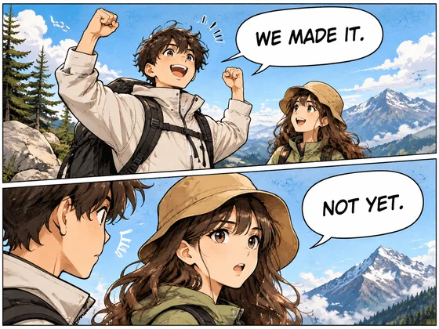</a>

Cet exemple n'inclut pas de référence d'image et l'aperçu d'entrée doit être complété ; voir les exigences matérielles ci-dessous.

- **Type d'entrée :** Cet exemple montre uniquement des exemples de résultats ; L'aperçu de l'entrée d'image doit être ajouté
- **Exigences matérielles :** Script et dialogue du storyboard + tableau de configuration des personnages et des scènes + page de bande dessinée actuelle → générer des scènes et une composition continues → panneau de bande dessinée unique actuel
- **Description :** Cette fois, un seul aperçu visuel est généré. Le calcul des données, la composition précise, les fichiers vectoriels ou de production doivent encore être vérifiés par les outils correspondants.

[ Vérifiez les exigences spécifiques dans dearsketch et créez ](https://dearsketch.com/fr/intent/i144-create-comic-panels-with-consistent-characters.html?utm_source=github&utm_medium=gallery&utm_campaign=dearsketch-public-cases&utm_content=i144_cta)

---

## I145 · Générer des scripts ou des idées dans des storyboards de films et de télévision

<strong>Exemple de résultats</strong>

<a href="https://dearsketch.com/fr/intent/i145-turn-a-script-or-idea-into-a-film-storyboard.html?utm_source=github&amp;utm_medium=gallery&amp;utm_campaign=dearsketch-public-cases&amp;utm_content=i145_image">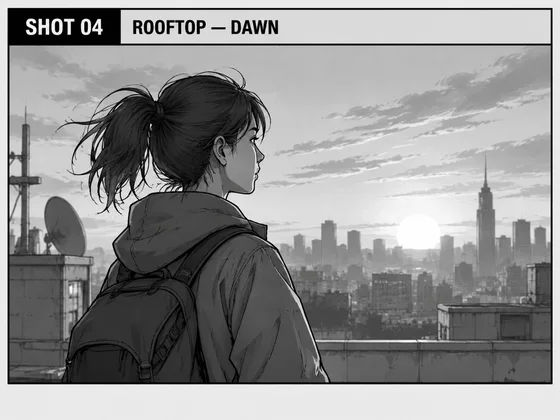</a>

Cet exemple n'inclut pas de référence d'image et l'aperçu d'entrée doit être complété ; voir les exigences matérielles ci-dessous.

- **Type d'entrée :** Cet exemple montre uniquement des exemples de résultats ; L'aperçu de l'entrée d'image doit être ajouté
- **Matériel requis :** Script ou liste de plans + Tableau manuscrit des paramètres de personnages et de scènes + Page de storyboard actuelle → Générer une esquisse de séquence → Storyboard unique actuel
- **Description :** Cette fois, un seul aperçu visuel est généré. Le calcul des données, la composition précise, les fichiers vectoriels ou de production doivent encore être vérifiés par les outils correspondants.

[ Vérifiez les exigences spécifiques dans dearsketch et créez ](https://dearsketch.com/fr/intent/i145-turn-a-script-or-idea-into-a-film-storyboard.html?utm_source=github&utm_medium=gallery&utm_campaign=dearsketch-public-cases&utm_content=i145_cta)

---

## I146 · Générer une feuille de personnage et des vues multi-angles

<strong>Exemple de résultats</strong>

<a href="https://dearsketch.com/fr/intent/i146-create-a-character-sheet-with-multiple-views.html?utm_source=github&amp;utm_medium=gallery&amp;utm_campaign=dearsketch-public-cases&amp;utm_content=i146_image">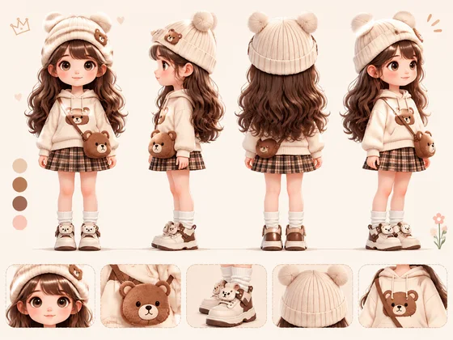</a>

Cet exemple n'inclut pas de référence d'image et l'aperçu d'entrée doit être complété ; voir les exigences matérielles ci-dessous.

- **Type d'entrée :** Cet exemple montre uniquement des exemples de résultats ; L'aperçu de l'entrée d'image doit être ajouté
- **Exigences matérielles :** Manuscrit de référence de personnage existant + description du personnage, objectif et perspective d'affichage requise → Générer le recto et le verso d'une apparence unifiée → Feuille de personnage unique actuelle
- **Description :** Une seule image est générée à la fois.

[ Vérifiez les exigences spécifiques dans dearsketch et créez ](https://dearsketch.com/fr/intent/i146-create-a-character-sheet-with-multiple-views.html?utm_source=github&utm_medium=gallery&utm_campaign=dearsketch-public-cases&utm_content=i146_cta)

---

## I147 · Générer des concepts artistiques de films, de jeux ou de publicités à partir de texte

<strong>Exemple de résultats</strong>

<a href="https://dearsketch.com/fr/intent/i147-create-concept-art-for-film-games-or-advertising-from-text.html?utm_source=github&amp;utm_medium=gallery&amp;utm_campaign=dearsketch-public-cases&amp;utm_content=i147_image">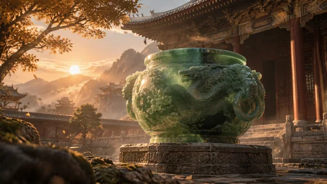</a>

Cet exemple n'inclut pas de référence d'image et l'aperçu d'entrée doit être complété ; voir les exigences matérielles ci-dessous.

- **Type d'entrée :** Cet exemple montre uniquement des exemples de résultats ; L'aperçu de l'entrée d'image doit être ajouté
- **Exigences matérielles :** Ébauche originale du personnage, du lieu ou du produit + type de projet, vision du monde ou créativité du produit, ambiance et objectif → Générer une atmosphère, une composition et une vision du monde → Art conceptuel unique actuel
- **Description :** Une seule image est générée à la fois.

[ Vérifiez les exigences spécifiques dans dearsketch et créez ](https://dearsketch.com/fr/intent/i147-create-concept-art-for-film-games-or-advertising-from-text.html?utm_source=github&utm_medium=gallery&utm_campaign=dearsketch-public-cases&utm_content=i147_cta)

---

## I148 · Convertissez des esquisses en illustrations entièrement terminées

<table>
<thead><tr><th width="50%">Matériel de référence</th><th width="50%">Exemple de résultats</th></tr></thead>
<tbody><tr><td valign="top">
<strong>Croquis dessiné à la main ou numérique</strong> 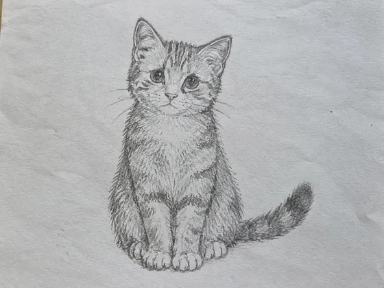
</td><td valign="top"><a href="https://dearsketch.com/fr/intent/i148-turn-a-rough-sketch-into-a-polished-illustration.html?utm_source=github&amp;utm_medium=gallery&amp;utm_campaign=dearsketch-public-cases&amp;utm_content=i148_image">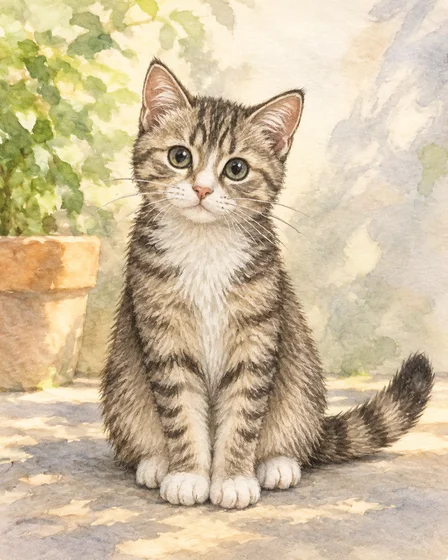</a></td></tr></tbody>
</table>

- **Type d'entrée :** Comprend un aperçu du matériau de référence et un exemple de résultat
- **Exigences matérielles :** Croquis dessiné à la main ou numérique + plage de modification autorisée → Conserver la composition et ajouter des couleurs et des détails → Compléter l'illustration dans l'image unique actuelle
- **Description :** Une seule image est générée à la fois.

[ Vérifiez les exigences spécifiques dans dearsketch et créez ](https://dearsketch.com/fr/intent/i148-turn-a-rough-sketch-into-a-polished-illustration.html?utm_source=github&utm_medium=gallery&utm_campaign=dearsketch-public-cases&utm_content=i148_cta)

---

## I149 · Générez des pages à colorier pour enfants à partir de photos ou de texte

<table>
<thead><tr><th width="50%">Matériel de référence</th><th width="50%">Exemple de résultats</th></tr></thead>
<tbody><tr><td valign="top">
<strong>Photo originale à convertir</strong> 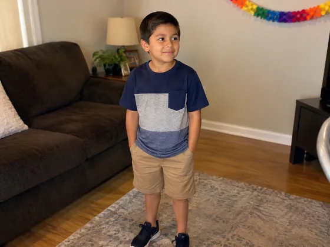
</td><td valign="top"><a href="https://dearsketch.com/fr/intent/i149-create-a-children-s-coloring-page-from-a-photo-or-text.html?utm_source=github&amp;utm_medium=gallery&amp;utm_campaign=dearsketch-public-cases&amp;utm_content=i149_image">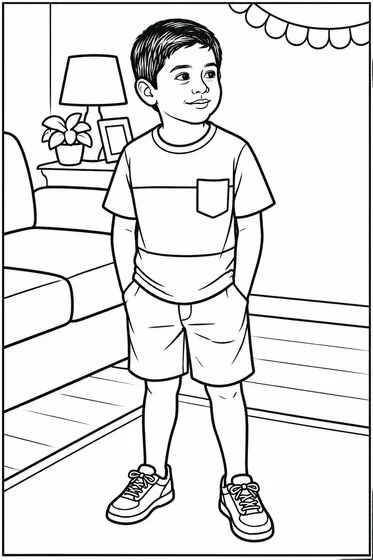</a></td></tr></tbody>
</table>

- **Type d'entrée :** Comprend un aperçu du matériau de référence et un exemple de résultat
- **Exigences matérielles :** Photo originale à convertir → Simplifiée en dessin au trait noir et blanc clair → Page de coloriage actuelle pour enfant unique
- **Description :** Une seule image est générée à la fois.

[ Vérifiez les exigences spécifiques dans dearsketch et créez ](https://dearsketch.com/fr/intent/i149-create-a-children-s-coloring-page-from-a-photo-or-text.html?utm_source=github&utm_medium=gallery&utm_campaign=dearsketch-public-cases&utm_content=i149_cta)

---

## I150 · Génération par lots de pages de livres de coloriage pour adultes

<strong>Exemple de résultats</strong>

<a href="https://dearsketch.com/fr/intent/i150-create-adult-coloring-book-pages-in-batches.html?utm_source=github&amp;utm_medium=gallery&amp;utm_campaign=dearsketch-public-cases&amp;utm_content=i150_image">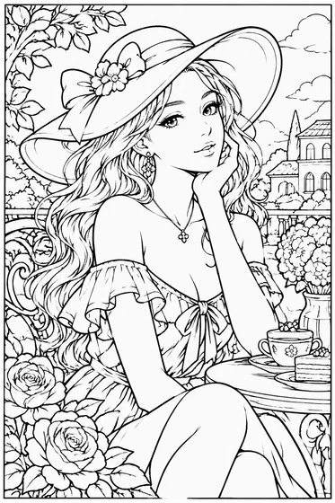</a>

Cet exemple est une saisie de texte, aucune référence d'image n'est jointe.

- **Type de saisie :** Saisie de texte ; cet exemple ne montre que des exemples de résultats
- **Exigences matérielles :** Thème du livre complet, nombre de pages → Générer une série de dessins au trait cohérente → Livre de coloriage actuel pour adulte unique
- **Description :** Seul celui actuellement sélectionné est généré à la fois ; les autres images de la série sont exécutées séparément.

[ Vérifiez les exigences spécifiques dans dearsketch et créez ](https://dearsketch.com/fr/intent/i150-create-adult-coloring-book-pages-in-batches.html?utm_source=github&utm_medium=gallery&utm_campaign=dearsketch-public-cases&utm_content=i150_cta)

---

## I151 · Générez des illustrations adaptées à l'âge pour les manuels ou les feuilles de travail

<strong>Exemple de résultats</strong>

<a href="https://dearsketch.com/fr/intent/i151-create-age-appropriate-illustrations-for-textbooks-or-worksheets.html?utm_source=github&amp;utm_medium=gallery&amp;utm_campaign=dearsketch-public-cases&amp;utm_content=i151_image">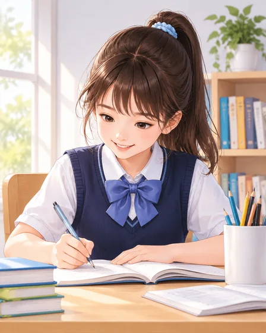</a>

Cet exemple n'inclut pas de référence d'image et l'aperçu d'entrée doit être complété ; voir les exigences matérielles ci-dessous.

- **Type d'entrée :** Cet exemple montre uniquement des exemples de résultats ; L'aperçu de l'entrée d'image doit être ajouté
- **Exigences matérielles :** Esquisse des faits du matériel pédagogique + thème pédagogique, objectifs d'apprentissage, âge de l'élève → Générer des illustrations claires et conviviales → Illustrations pédagogiques du dépliant actuel
- **Description :** Une seule image est générée à la fois.

[ Vérifiez les exigences spécifiques dans dearsketch et créez ](https://dearsketch.com/fr/intent/i151-create-age-appropriate-illustrations-for-textbooks-or-worksheets.html?utm_source=github&utm_medium=gallery&utm_campaign=dearsketch-public-cases&utm_content=i151_cta)

---

## I152 · Générer des histoires religieuses, des illustrations à thème historique ou culturel

<strong>Exemple de résultats</strong>

<a href="https://dearsketch.com/fr/intent/i152-create-religious-historical-or-cultural-illustrations.html?utm_source=github&amp;utm_medium=gallery&amp;utm_campaign=dearsketch-public-cases&amp;utm_content=i152_image">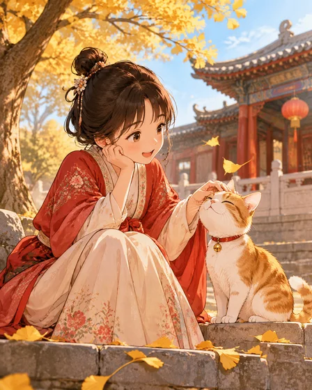</a>

Cet exemple n'inclut pas de référence d'image et l'aperçu d'entrée doit être complété ; voir les exigences matérielles ci-dessous.

- **Type d'entrée :** Cet exemple montre uniquement des exemples de résultats ; L'aperçu de l'entrée d'image doit être ajouté
- **Exigences matérielles :** Images de référence d'une époque, d'une religion ou d'objets culturels + histoires ou événements spécifiques, contexte culturel et de l'époque, public → Générer des illustrations narratives qui respectent le contexte → Illustration narrative culturelle unique actuelle
- **Description :** Une seule image est générée à la fois.

[ Vérifiez les exigences spécifiques dans dearsketch et créez ](https://dearsketch.com/fr/intent/i152-create-religious-historical-or-cultural-illustrations.html?utm_source=github&utm_medium=gallery&utm_campaign=dearsketch-public-cases&utm_content=i152_cta)

---

## I153 · Générer des illustrations de tarot, de jeux de société ou de cartes à collectionner

<strong>Exemple de résultats</strong>

<a href="https://dearsketch.com/fr/intent/i153-create-artwork-for-tarot-board-game-or-collectible-cards.html?utm_source=github&amp;utm_medium=gallery&amp;utm_campaign=dearsketch-public-cases&amp;utm_content=i153_image">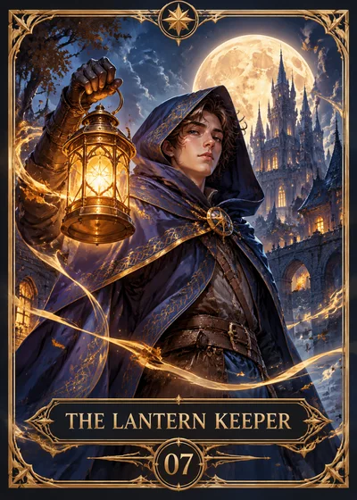</a>

Cet exemple n'inclut pas de référence d'image et l'aperçu d'entrée doit être complété ; voir les exigences matérielles ci-dessous.

- **Type d'entrée :** Cet exemple montre uniquement des exemples de résultats ; L'aperçu de l'entrée d'image doit être ajouté
- **Exigences matérielles :** Tableau de données de la carte + Modèle de vision du monde et de spécification de bordure de la carte + Carte actuelle → Générer une série de bordures et d'illustrations unifiées → Illustration actuelle d'une seule carte
- **Description :** Seul celui actuellement sélectionné est généré à la fois ; les autres images de la série sont exécutées séparément.

[ Vérifiez les exigences spécifiques dans dearsketch et créez ](https://dearsketch.com/fr/intent/i153-create-artwork-for-tarot-board-game-or-collectible-cards.html?utm_source=github&utm_medium=gallery&utm_campaign=dearsketch-public-cases&utm_content=i153_cta)

---

## I154 · Générer des illustrations conceptuelles pour des articles, des magazines et des rapports

<strong>Exemple de résultats</strong>

<a href="https://dearsketch.com/fr/intent/i154-create-editorial-illustrations-for-articles-magazines-and-reports.html?utm_source=github&amp;utm_medium=gallery&amp;utm_campaign=dearsketch-public-cases&amp;utm_content=i154_image">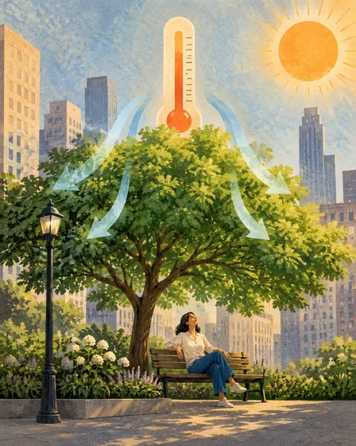</a>

Cet exemple n'inclut pas de référence d'image et l'aperçu d'entrée doit être complété ; voir les exigences matérielles ci-dessous.

- **Type d'entrée :** Cet exemple montre uniquement des exemples de résultats ; L'aperçu de l'entrée d'image doit être ajouté
- **Exigences matérielles :** Images originales des personnages factuels ou des objets impliqués dans l'article + le point de vue principal de l'article, le ton et le contexte de publication → Générer des illustrations abstraites ou narratives → Dépliant actuel Illustration éditoriale
- **Description :** Une seule image est générée à la fois.

[ Vérifiez les exigences spécifiques dans dearsketch et créez ](https://dearsketch.com/fr/intent/i154-create-editorial-illustrations-for-articles-magazines-and-reports.html?utm_source=github&utm_medium=gallery&utm_campaign=dearsketch-public-cases&utm_content=i154_cta)

---

## I155 · Générer des pochettes d'album et des visuels de sorties musicales

<table>
<thead><tr><th width="50%">Matériel de référence</th><th width="50%">Exemple de résultats</th></tr></thead>
<tbody><tr><td valign="top">
<strong>Photo originale de l'artiste</strong> 
</td><td valign="top"><a href="https://dearsketch.com/fr/intent/i155-create-album-cover-art-and-music-release-visuals.html?utm_source=github&amp;utm_medium=gallery&amp;utm_campaign=dearsketch-public-cases&amp;utm_content=i155_image">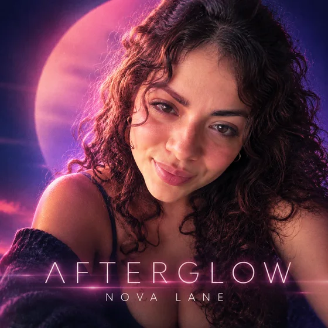</a></td></tr></tbody>
</table>

- **Type d'entrée :** Comprend un aperçu du matériau de référence et un exemple de résultat
- **Matériel requis :** Photo originale de l'artiste + ambiance musicale → Générer les principaux éléments visuels et de la série de la couverture → Couverture de l'album unique actuel
- **Description :** Une seule image est générée à la fois.

[ Vérifiez les exigences spécifiques dans dearsketch et créez ](https://dearsketch.com/fr/intent/i155-create-album-cover-art-and-music-release-visuals.html?utm_source=github&utm_medium=gallery&utm_campaign=dearsketch-public-cases&utm_content=i155_cta)
