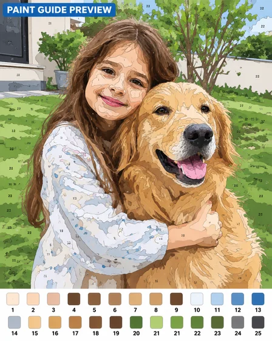

# POD et produits personnalisés

[中文](../../../README.md) · [English](../../../README.en.md) · [Português](../../../README.pt.md) · [Español](../../../README.es.md) · [Français](../../../README.fr.md) · [Deutsch](../../../README.de.md) · [عربي](../../../README.ar.md) · [русский](../../../README.ru.md) · [日本語](../../../README.ja.md) · [हिंदी](../../../README.hi.md)

6 caisses hors catalogue présenté. Les mots d'invite ne sont pas divulgués ici, seuls les matériaux de référence existants, les instructions de résultat et les exigences minimales en matière de matériaux sont affichés.

[Retourner à d'autres catalogues de caisses](./index.md) · [Retourner à la page d'accueil de l'entrepôt](../../../README.fr.md)

> Les documents de référence et les images des résultats sont uniquement à titre indicatif ; il n'y a aucune garantie que le même effet puisse être reproduit en utilisant les mêmes matériaux.

## I264 · Convertir le logo ou l'illustration en fichier de point de machine à broder

<table>
<thead><tr><th width="50%">Matériel de référence</th><th width="50%">Exemple de résultats</th></tr></thead>
<tbody><tr><td valign="top">
<strong>Logo ou illustration transparent à numériser pour broderie</strong> 
</td><td valign="top"></td></tr></tbody>
</table>

- **Type d'entrée :** Comprend un aperçu du matériau de référence et un exemple de résultat
- **Exigences matérielles :** Logo ou illustration transparent requis à numériser pour la broderie (1) + Spécifications de production de broderie requises (1 exemplaire)
- **Description :** Cette fois, un seul aperçu visuel est généré. Le calcul des données, la composition précise, les fichiers vectoriels ou de production doivent encore être vérifiés par les outils correspondants.

[ Vérifiez les exigences spécifiques dans dearsketch et créez ](https://dearsketch.com/fr/intent/i264-convert-a-logo-or-illustration-into-an-embroidery-stitch-file.html?utm_source=github&utm_medium=gallery&utm_campaign=dearsketch-public-cases&utm_content=i264_cta)

---

## I268 · Organisez des images ou du texte dans des fichiers vectoriels de gravure et de découpe au laser

<table>
<thead><tr><th width="50%">Matériel de référence</th><th width="50%">Exemple de résultats</th></tr></thead>
<tbody><tr><td valign="top">
<strong>Image ou logo à graver/découper</strong> 
</td><td valign="top"></td></tr></tbody>
</table>

- **Type d'entrée :** Comprend un aperçu du matériau de référence et un exemple de résultat
- **Exigences matérielles :** Images ou logos optionnels à graver/découper (0 ou 1) + méthodes de traitement requises, matériaux et contraintes machine (1 exemplaire) + conditions nécessitant un traitement du texte et des glyphes (1 exemplaire)
- **Description :** Cette fois, un seul aperçu visuel est généré. Le calcul des données, la composition précise, les fichiers vectoriels ou de production doivent encore être vérifiés par les outils correspondants.

[ Vérifiez les exigences spécifiques dans dearsketch et créez ](https://dearsketch.com/fr/intent/i268-prepare-an-image-or-text-as-a-vector-file-for-laser-engraving-or-cutting.html?utm_source=github&utm_medium=gallery&utm_campaign=dearsketch-public-cases&utm_content=i268_cta)

---

## I271 · Convertir des photos en dessins de peinture à l'huile numérique

<table>
<thead><tr><th width="50%">Matériel de référence</th><th width="50%">Exemple de résultats</th></tr></thead>
<tbody><tr><td valign="top">
<strong>Photo du corps principal de la peinture à l'huile numérique à convertir</strong> 
</td><td valign="top"></td></tr></tbody>
</table>

- **Type d'entrée :** Comprend un aperçu du matériau de référence et un exemple de résultat
- **Exigences matérielles :** Photo du corps principal requise de la peinture à l'huile numérique à transférer (1 photo) + gamme requise de produit fini et nombre de couleurs de peinture (1 jeu)
- **Description :** Cette fois, un seul aperçu visuel est généré. Le calcul des données, la composition précise, les fichiers vectoriels ou de production doivent encore être vérifiés par les outils correspondants.

[ Vérifiez les exigences spécifiques dans dearsketch et créez ](https://dearsketch.com/fr/intent/i271-turn-a-photo-into-a-paint-by-numbers-pattern.html?utm_source=github&utm_medium=gallery&utm_campaign=dearsketch-public-cases&utm_content=i271_cta)

---

## I273 · Convertissez des photos en modèles pouvant être découpés ou peints à la bombe

<table>
<thead><tr><th width="50%">Matériel de référence</th><th width="50%">Exemple de résultats</th></tr></thead>
<tbody><tr><td valign="top">
<strong>Photo ou logo très contrasté du modèle à convertir</strong> 
</td><td valign="top"></td></tr></tbody>
</table>

- **Type d'entrée :** Comprend un aperçu du matériau de référence et un exemple de résultat
- **Exigences matérielles :** Photo ou logo à contraste élevé requis du modèle à transférer (1 photo) + objectif du modèle requis, matériel et connexion minimale (1 copie)
- **Description :** Cette fois, un seul aperçu visuel est généré. Le calcul des données, la composition précise, les fichiers vectoriels ou de production doivent encore être vérifiés par les outils correspondants.

[ Vérifiez les exigences spécifiques dans dearsketch et créez ](https://dearsketch.com/fr/intent/i273-turn-a-photo-into-a-cuttable-or-paintable-stencil.html?utm_source=github&utm_medium=gallery&utm_campaign=dearsketch-public-cases&utm_content=i273_cta)

---

## I284 · Créez un fan de support ou un tableau de noms avec des photos de personnes et du texte en gras

<table>
<thead><tr><th width="50%">Matériel de référence</th><th width="50%">Exemple de résultats</th></tr></thead>
<tbody><tr><td valign="top">
<strong>Photos de personnes autorisées à utiliser</strong> 
</td><td valign="top"></td></tr></tbody>
</table>

- **Type d'entrée :** Comprend un aperçu du matériau de référence et un exemple de résultat
- **Exigences matérielles :** Doit avoir le droit d'utiliser des photos de personnes (1 photo) + noms ou phrases d'encouragement requis (1 jeu) + types de produits finis requis et couleurs représentatives (1 jeu)
- **Description :** Une seule image est générée à la fois.

[ Vérifiez les exigences spécifiques dans dearsketch et créez ](https://dearsketch.com/fr/intent/i284-create-a-fan-support-uchiwa-or-name-board-from-a-portrait.html?utm_source=github&utm_medium=gallery&utm_campaign=dearsketch-public-cases&utm_content=i284_cta)

---

## I287 · Créez plusieurs selfies dans des bandes photo à quatre images et des bordures thématiques

<table>
<thead><tr><th width="50%">Matériel de référence</th><th width="50%">Exemple de résultats</th></tr></thead>
<tbody><tr><td valign="top">
<strong>Référence historique/entrée avant transformation</strong> 

<strong>Référence historique/entrée avant transformation</strong> 

<strong>Référence historique/entrée avant transformation</strong> 

<strong>Référence historique/entrée avant transformation</strong> 
</td><td valign="top"></td></tr></tbody>
</table>

- **Type d'entrée :** Comprend un aperçu du matériau de référence et un exemple de résultat
- **Exigences matérielles :** Photos de prise de vue en continu/selfies requises (2 à 4 photos) + ordre des cadres supérieur et inférieur requis des bandes de photos (1 copie) + date facultative, phrase courte, logo et couleur du thème (0 ou 1 groupe)
- **Description :** Une seule image est générée à la fois.

[ Vérifiez les exigences spécifiques dans dearsketch et créez ](https://dearsketch.com/fr/intent/i287-turn-selfies-into-a-four-cut-photo-strip-with-a-themed-frame.html?utm_source=github&utm_medium=gallery&utm_campaign=dearsketch-public-cases&utm_content=i287_cta)
