# Concept produit et design industriel

[中文](../../../README.md) · [English](../../../README.en.md) · [Português](../../../README.pt.md) · [Español](../../../README.es.md) · [Français](../../../README.fr.md) · [Deutsch](../../../README.de.md) · [عربي](../../../README.ar.md) · [русский](../../../README.ru.md) · [日本語](../../../README.ja.md) · [हिंदी](../../../README.hi.md)

10 caisses hors catalogue présenté. Les mots d'invite ne sont pas divulgués ici, seuls les matériaux de référence existants, les instructions de résultat et les exigences minimales en matière de matériaux sont affichés.

[Retourner à d'autres catalogues de caisses](./index.md) · [Retourner à la page d'accueil de l'entrepôt](../../../README.fr.md)

> Les documents de référence et les images des résultats sont uniquement à titre indicatif ; il n'y a aucune garantie que le même effet puisse être reproduit en utilisant les mêmes matériaux.

## I184 · Convertir les croquis de produits en rendus de produits réalistes

<table>
<thead><tr><th width="50%">Matériel de référence</th><th width="50%">Exemple de résultats</th></tr></thead>
<tbody><tr><td valign="top">
<strong>Croquis de produits dessinés à la main</strong> 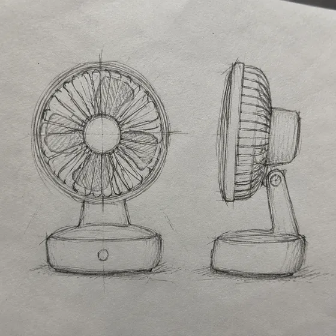
</td><td valign="top"><a href="https://dearsketch.com/fr/intent/i184-turn-a-product-sketch-into-a-realistic-product-render.html?utm_source=github&amp;utm_medium=gallery&amp;utm_campaign=dearsketch-public-cases&amp;utm_content=i184_image">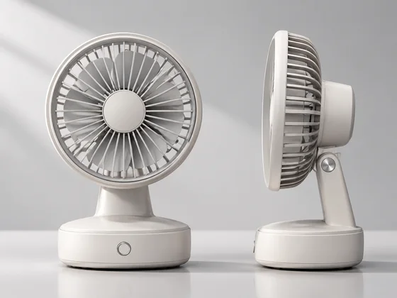</a></td></tr></tbody>
</table>

- **Type d'entrée :** Comprend un aperçu du matériau de référence et un exemple de résultat
- **Exigences matérielles :** Croquis de produit dessiné à la main + utilisation du produit, caractéristiques immuables dans le croquis → conserver la forme et générer des matériaux, de la lumière, des ombres et de l'arrière-plan → rendu actuel du produit unique
- **Description :** Une seule image est générée à la fois.

[ Vérifiez les exigences spécifiques dans dearsketch et créez ](https://dearsketch.com/fr/intent/i184-turn-a-product-sketch-into-a-realistic-product-render.html?utm_source=github&utm_medium=gallery&utm_campaign=dearsketch-public-cases&utm_content=i184_cta)

---

## I185 · Générer plusieurs instructions de style de produit à partir des descriptions de demande

<strong>Exemple de résultats</strong>

<a href="https://dearsketch.com/fr/intent/i185-create-multiple-product-form-directions-from-a-brief.html?utm_source=github&amp;utm_medium=gallery&amp;utm_campaign=dearsketch-public-cases&amp;utm_content=i185_image">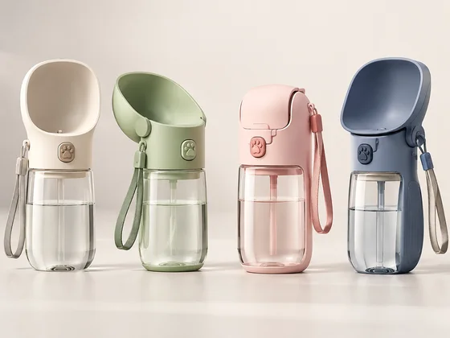</a>

Cet exemple n'inclut pas de référence d'image et l'aperçu d'entrée doit être complété ; voir les exigences matérielles ci-dessous.

- **Type d'entrée :** Cet exemple montre uniquement des exemples de résultats ; L'aperçu de l'entrée d'image doit être ajouté
- **Exigences matérielles :** Croquis de produits existants ou références structurelles + utilisation du produit, utilisateurs et scénarios, contraintes strictes → Générer différentes solutions structurelles et de style → Groupe de concepts de produit unique actuel
- **Description :** Seul celui actuellement sélectionné est généré à la fois ; les autres images de la série sont exécutées séparément.

[ Vérifiez les exigences spécifiques dans dearsketch et créez ](https://dearsketch.com/fr/intent/i185-create-multiple-product-form-directions-from-a-brief.html?utm_source=github&utm_medium=gallery&utm_campaign=dearsketch-public-cases&utm_content=i185_cta)

---

## I186 · Aperçu du produit dans différentes couleurs, matériaux et traitements de surface

<table>
<thead><tr><th width="50%">Matériel de référence</th><th width="50%">Exemple de résultats</th></tr></thead>
<tbody><tr><td valign="top">
<strong>Images de produits ou rendus 3D</strong> 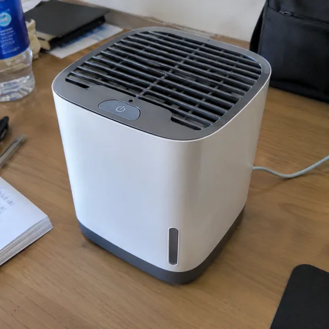
</td><td valign="top"><a href="https://dearsketch.com/fr/intent/i186-preview-product-colors-materials-and-finishes.html?utm_source=github&amp;utm_medium=gallery&amp;utm_campaign=dearsketch-public-cases&amp;utm_content=i186_image">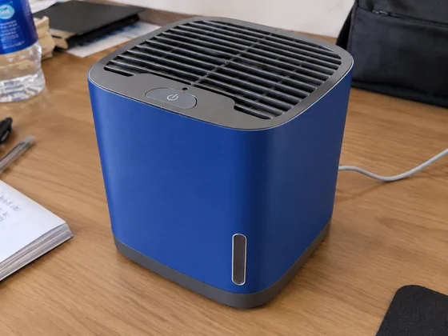</a></td></tr></tbody>
</table>

- **Type d'entrée :** Comprend un aperçu du matériau de référence et un exemple de résultat
- **Exigences matérielles :** Dessin du produit ou rendu 3D + couleur ou matériau cible → Remplacer la couleur, le matériau et la texture → Dessin du plan CMF unique actuel
- **Description :** Une seule image est générée à la fois.

[ Vérifiez les exigences spécifiques dans dearsketch et créez ](https://dearsketch.com/fr/intent/i186-preview-product-colors-materials-and-finishes.html?utm_source=github&utm_medium=gallery&utm_campaign=dearsketch-public-cases&utm_content=i186_cta)

---

## I187 · Générer des concepts de style de voiture à partir de texte ou de croquis

<table>
<thead><tr><th width="50%">Matériel de référence</th><th width="50%">Exemple de résultats</th></tr></thead>
<tbody><tr><td valign="top">
<strong>Croquis de voiture ou dessin original de référence de carrosserie</strong> 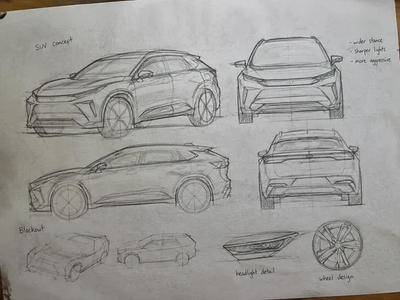
</td><td valign="top"><a href="https://dearsketch.com/fr/intent/i187-create-a-car-design-concept-from-text-or-a-sketch.html?utm_source=github&amp;utm_medium=gallery&amp;utm_campaign=dearsketch-public-cases&amp;utm_content=i187_image">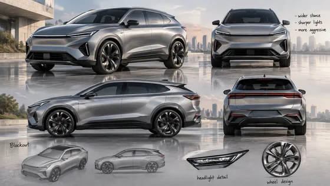</a></td></tr></tbody>
</table>

- **Type d'entrée :** Comprend un aperçu du matériau de référence et un exemple de résultat
- **Exigences matérielles :** Croquis de voiture ou dessin de référence de carrosserie original + type de véhicule, thème de conception, objectif et contraintes clés → Générer la forme de la carrosserie et le rendu de la scène → Dessin conceptuel actuel d'une seule voiture
- **Description :** Une seule image est générée à la fois.

[ Vérifiez les exigences spécifiques dans dearsketch et créez ](https://dearsketch.com/fr/intent/i187-create-a-car-design-concept-from-text-or-a-sketch.html?utm_source=github&utm_medium=gallery&utm_campaign=dearsketch-public-cases&utm_content=i187_cta)

---

## I188 · Générer des rendus de produits d'ameublement à partir de croquis

<table>
<thead><tr><th width="50%">Matériel de référence</th><th width="50%">Exemple de résultats</th></tr></thead>
<tbody><tr><td valign="top">
<strong>croquis de meubles</strong> 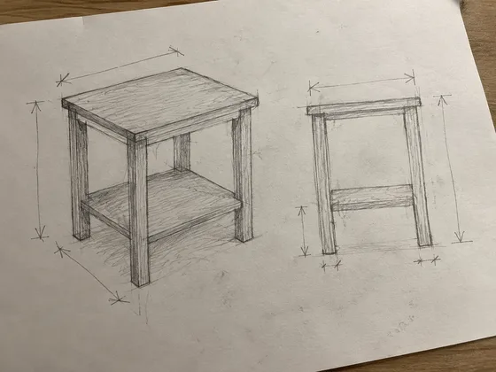
</td><td valign="top"><a href="https://dearsketch.com/fr/intent/i188-turn-a-furniture-sketch-into-a-product-render.html?utm_source=github&amp;utm_medium=gallery&amp;utm_campaign=dearsketch-public-cases&amp;utm_content=i188_image">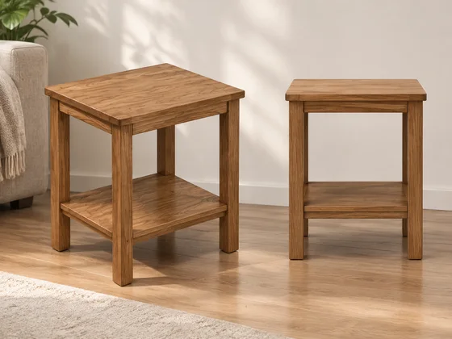</a></td></tr></tbody>
</table>

- **Type d'entrée :** Comprend un aperçu du matériau de référence et un exemple de résultat
- **Exigences matérielles :** Croquis du meuble + utilisation du meuble, structure à conserver → Générer des scènes de bois, de tissu et d'utilisation → Rendu actuel du produit de mobilier unique
- **Description :** Une seule image est générée à la fois.

[ Vérifiez les exigences spécifiques dans dearsketch et créez ](https://dearsketch.com/fr/intent/i188-turn-a-furniture-sketch-into-a-product-render.html?utm_source=github&utm_medium=gallery&utm_campaign=dearsketch-public-cases&utm_content=i188_cta)

---

## I189 · Générer des concepts de conception de chaussures, de sacs et d'accessoires

<table>
<thead><tr><th width="50%">Matériel de référence</th><th width="50%">Exemple de résultats</th></tr></thead>
<tbody><tr><td valign="top">
<strong>Croquis original d'accessoires de chaussures et de sacs</strong> 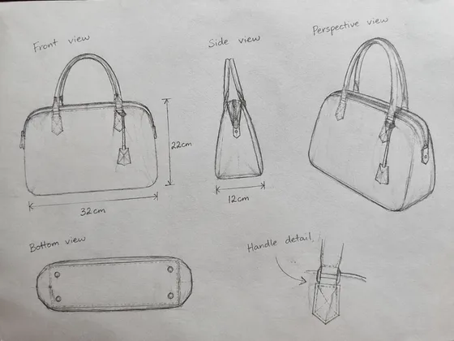
</td><td valign="top"><a href="https://dearsketch.com/fr/intent/i189-create-design-concepts-for-shoes-bags-and-accessories.html?utm_source=github&amp;utm_medium=gallery&amp;utm_campaign=dearsketch-public-cases&amp;utm_content=i189_image">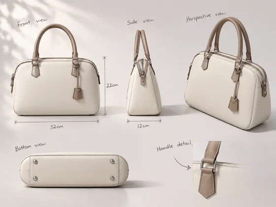</a></td></tr></tbody>
</table>

- **Type d'entrée :** Comprend un aperçu du matériau de référence et un exemple de résultat
- **Exigences matérielles :** Croquis original des accessoires pour chaussures et sacs + catégorie de produit, utilisateurs cibles, exigences fonctionnelles → Générer la forme, le matériau et la couleur → Dessin conceptuel actuel d'un seul accessoire
- **Description :** Une seule image est générée à la fois.

[ Vérifiez les exigences spécifiques dans dearsketch et créez ](https://dearsketch.com/fr/intent/i189-create-design-concepts-for-shoes-bags-and-accessories.html?utm_source=github&utm_medium=gallery&utm_campaign=dearsketch-public-cases&utm_content=i189_cta)

---

## I190 · Explorez rapidement différentes structures d'emballage et effets de rayonnage

<table>
<thead><tr><th width="50%">Matériel de référence</th><th width="50%">Exemple de résultats</th></tr></thead>
<tbody><tr><td valign="top">
<strong>Rédaction de produits, de logos et d'emballages réels</strong> 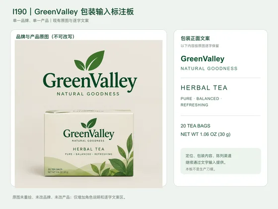
</td><td valign="top"><a href="https://dearsketch.com/fr/intent/i190-explore-packaging-structures-and-shelf-presence.html?utm_source=github&amp;utm_medium=gallery&amp;utm_campaign=dearsketch-public-cases&amp;utm_content=i190_image">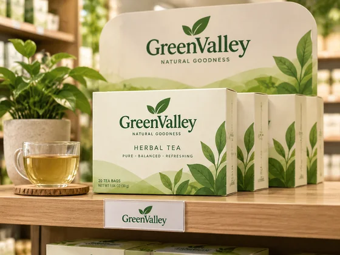</a></td></tr></tbody>
</table>

- **Type d'entrée :** Comprend un aperçu du matériau de référence et un exemple de résultat
- **Exigences matérielles :** Copie du produit, du logo et de l'emballage réel + positionnement, contenu de l'emballage et canaux d'affichage → Générer le type de boîte, l'étiquette et la scène d'étagère → Carte conceptuelle actuelle de l'emballage unique
- **Description :** Une seule image est générée à la fois.

[ Vérifiez les exigences spécifiques dans dearsketch et créez ](https://dearsketch.com/fr/intent/i190-explore-packaging-structures-and-shelf-presence.html?utm_source=github&utm_medium=gallery&utm_campaign=dearsketch-public-cases&utm_content=i190_cta)

---

## I191 · Générer des prototypes de produits affichables avant de créer des objets physiques

<table>
<thead><tr><th width="50%">Matériel de référence</th><th width="50%">Exemple de résultats</th></tr></thead>
<tbody><tr><td valign="top">
<strong>Croquis de produit ou manuscrit structurel</strong> 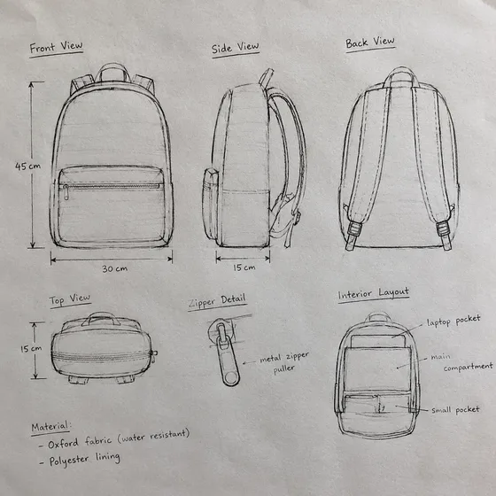
</td><td valign="top"><a href="https://dearsketch.com/fr/intent/i191-create-a-presentation-ready-product-prototype-image-before-production.html?utm_source=github&amp;utm_medium=gallery&amp;utm_campaign=dearsketch-public-cases&amp;utm_content=i191_image">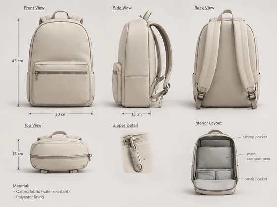</a></td></tr></tbody>
</table>

- **Type d'entrée :** Comprend un aperçu du matériau de référence et un exemple de résultat
- **Exigences matérielles :** Croquis du produit ou manuscrit de structure + utilisation du produit, description du croquis ou de la structure, scénarios d'utilisation → Générer une apparence et des scénarios d'utilisation crédibles → Prototype de produit virtuel unique actuel
- **Description :** Une seule image est générée à la fois.

[ Vérifiez les exigences spécifiques dans dearsketch et créez ](https://dearsketch.com/fr/intent/i191-create-a-presentation-ready-product-prototype-image-before-production.html?utm_source=github&utm_medium=gallery&utm_campaign=dearsketch-public-cases&utm_content=i191_cta)

---

## I192 · Convertir les croquis d'interface en maquettes d'interface utilisateur plus complètes

<table>
<thead><tr><th width="50%">Matériel de référence</th><th width="50%">Exemple de résultats</th></tr></thead>
<tbody><tr><td valign="top">
<strong>Wireframes ou captures d'écran d'interfaces existantes</strong> 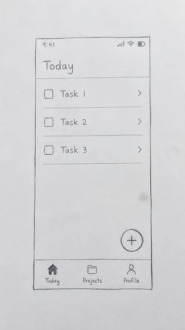
</td><td valign="top"><a href="https://dearsketch.com/fr/intent/i192-turn-a-ui-sketch-into-a-polished-interface-mockup.html?utm_source=github&amp;utm_medium=gallery&amp;utm_campaign=dearsketch-public-cases&amp;utm_content=i192_image">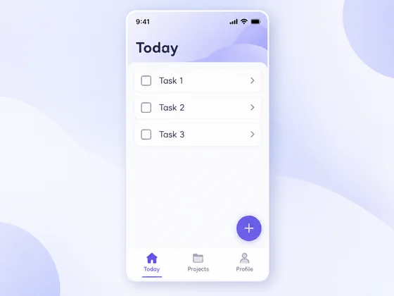</a></td></tr></tbody>
</table>

- **Type d'entrée :** Comprend un aperçu du matériau de référence et un exemple de résultat
- **Exigences matérielles :** Wireframes ou captures d'écran d'interfaces existantes + type de produit et architecture d'informations immuable → Style visuel supplémentaire, composants et scénarios de périphérique → Carte conceptuelle actuelle de l'interface utilisateur unique
- **Description :** Une seule image est générée à la fois.

[ Vérifiez les exigences spécifiques dans dearsketch et créez ](https://dearsketch.com/fr/intent/i192-turn-a-ui-sketch-into-a-polished-interface-mockup.html?utm_source=github&utm_medium=gallery&utm_campaign=dearsketch-public-cases&utm_content=i192_cta)

---

## I193 · Générer un rendu 3D et un visuel statique du produit

<strong>Exemple de résultats</strong>

<a href="https://dearsketch.com/fr/intent/i193-create-a-3d-render-style-product-visual.html?utm_source=github&amp;utm_medium=gallery&amp;utm_campaign=dearsketch-public-cases&amp;utm_content=i193_image">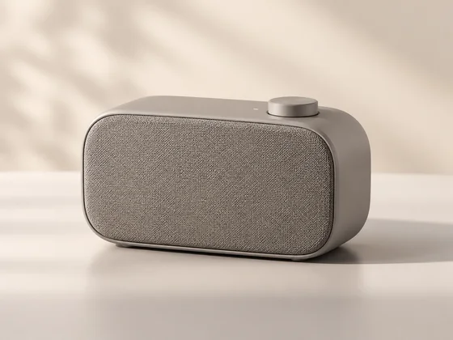</a>

Cet exemple n'inclut pas de référence d'image et l'aperçu d'entrée doit être complété ; voir les exigences matérielles ci-dessous.

- **Type d'entrée :** Cet exemple montre uniquement des exemples de résultats ; L'aperçu de l'entrée d'image doit être ajouté
- **Exigences matérielles :** Image originale de référence du produit cible + description du produit → Générer du matériel, de la perspective et de l'éclairage 3D → Image actuelle du produit de style 3D unique
- **Description :** Une seule image est générée à la fois.

[ Vérifiez les exigences spécifiques dans dearsketch et créez ](https://dearsketch.com/fr/intent/i193-create-a-3d-render-style-product-visual.html?utm_source=github&utm_medium=gallery&utm_campaign=dearsketch-public-cases&utm_content=i193_cta)
