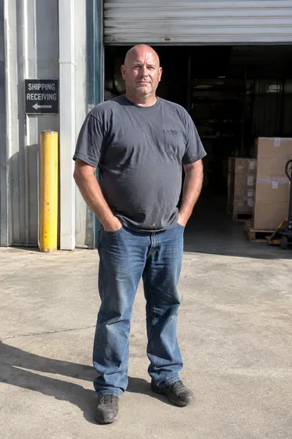
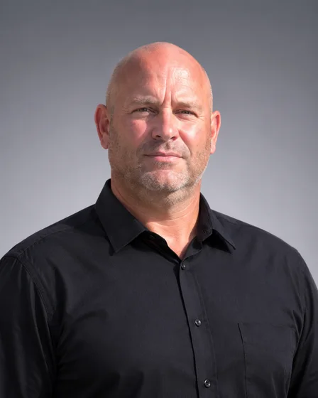
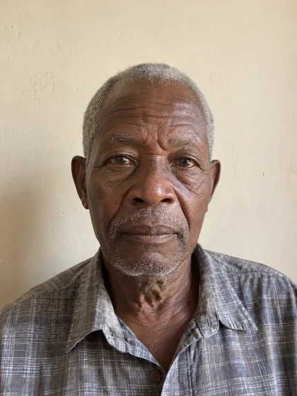
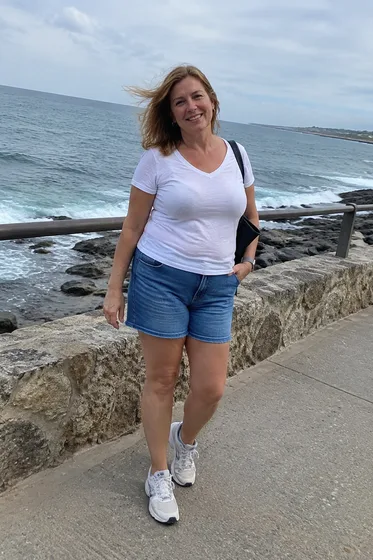
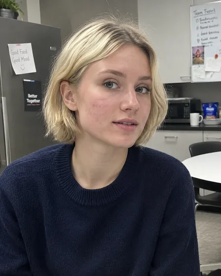
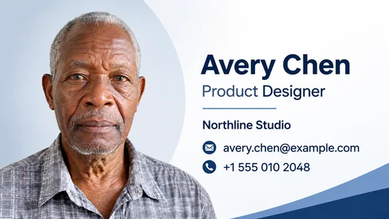
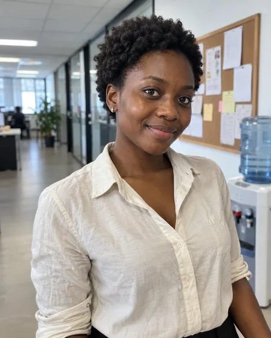
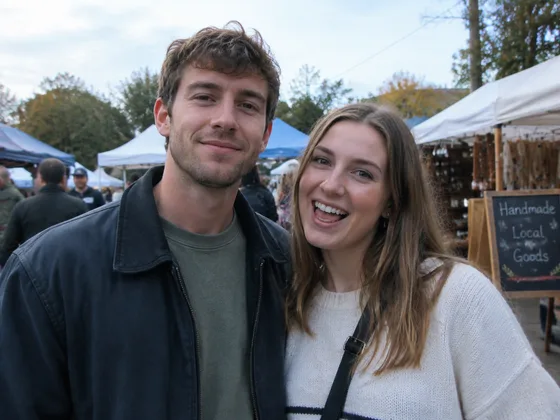
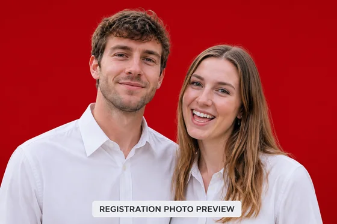

# 职业与正式身份

精选目录之外的 13 个案例。这里不公开提示词，只展示现有参考素材、结果方向与最少素材要求。

[返回更多案例目录](index.md) · [返回仓库首页](../../README.md)

> 参考素材和结果图仅作视觉指引；不保证使用相同素材能复现相同效果。

## I002 · 为简历或CV生成正式职业照

<table>
<thead><tr><th width="50%">参考素材</th><th width="50%">结果示例</th></tr></thead>
<tbody><tr><td valign="top">
<strong>本人清楚原照</strong> 
</td><td valign="top"></td></tr></tbody>
</table>

- **输入类型：** 含参考素材预览与结果示例
- **素材要求：** 1张本人清楚原照
- **说明：** 每次只生成一张图片。

[在 dearsketch 查看具体要求并制作](https://dearsketch.com/intent/i002-create-a-professional-headshot-for-a-resume-or-cv.html?utm_source=github&utm_medium=gallery&utm_campaign=dearsketch-public-cases&utm_content=i002_cta)

---

## I003 · 为公司团队统一生成员工头像

<table>
<thead><tr><th width="50%">参考素材</th><th width="50%">结果示例</th></tr></thead>
<tbody><tr><td valign="top">
<strong>统一头像样板</strong> 

<strong>员工本人原照</strong> 
</td><td valign="top"></td></tr></tbody>
</table>

- **输入类型：** 含参考素材预览与结果示例
- **素材要求：** 恰好1张统一头像样板＋恰好1张员工本人原照
- **说明：** 每次只生成一张图片。

[在 dearsketch 查看具体要求并制作](https://dearsketch.com/intent/i003-create-consistent-employee-headshots-for-a-company-team.html?utm_source=github&utm_medium=gallery&utm_campaign=dearsketch-public-cases&utm_content=i003_cta)

---

## I004 · 生成企业高管或创始人形象照

<table>
<thead><tr><th width="50%">参考素材</th><th width="50%">结果示例</th></tr></thead>
<tbody><tr><td valign="top">
<strong>个人照片</strong> 
</td><td valign="top"></td></tr></tbody>
</table>

- **输入类型：** 含参考素材预览与结果示例
- **素材要求：** 1张个人照片
- **说明：** 每次只生成一张图片。

[在 dearsketch 查看具体要求并制作](https://dearsketch.com/intent/i004-create-an-executive-or-founder-portrait.html?utm_source=github&utm_medium=gallery&utm_campaign=dearsketch-public-cases&utm_content=i004_cta)

---

## I005 · 生成房地产经纪人宣传头像

<table>
<thead><tr><th width="50%">参考素材</th><th width="50%">结果示例</th></tr></thead>
<tbody><tr><td valign="top">
<strong>本人清楚原照</strong> 
</td><td valign="top"></td></tr></tbody>
</table>

- **输入类型：** 含参考素材预览与结果示例
- **素材要求：** 1张本人清楚原照
- **说明：** 每次只生成一张图片。

[在 dearsketch 查看具体要求并制作](https://dearsketch.com/intent/i005-create-a-promotional-headshot-for-a-real-estate-agent.html?utm_source=github&utm_medium=gallery&utm_campaign=dearsketch-public-cases&utm_content=i005_cta)

---

## I007 · 生成讲者、作者或专家简介头像

<table>
<thead><tr><th width="50%">参考素材</th><th width="50%">结果示例</th></tr></thead>
<tbody><tr><td valign="top">
<strong>个人照片</strong> 
</td><td valign="top"></td></tr></tbody>
</table>

- **输入类型：** 含参考素材预览与结果示例
- **素材要求：** 1张个人照片
- **说明：** 每次只生成一张图片。

[在 dearsketch 查看具体要求并制作](https://dearsketch.com/intent/i007-create-a-bio-headshot-for-a-speaker-author-or-expert.html?utm_source=github&utm_medium=gallery&utm_campaign=dearsketch-public-cases&utm_content=i007_cta)

---

## I008 · 把普通照片制作成护照照片

<table>
<thead><tr><th width="50%">参考素材</th><th width="50%">结果示例</th></tr></thead>
<tbody><tr><td valign="top">
<strong>本人正面照片</strong> 
</td><td valign="top"></td></tr></tbody>
</table>

- **输入类型：** 含参考素材预览与结果示例
- **素材要求：** 1张本人正面照片＋1项申请国家或地区＋1项证件类型
- **说明：** 每次只生成一张图片。

[在 dearsketch 查看具体要求并制作](https://dearsketch.com/intent/i008-turn-an-ordinary-photo-into-a-passport-photo.html?utm_source=github&utm_medium=gallery&utm_campaign=dearsketch-public-cases&utm_content=i008_cta)

---

## I010 · 替换证件照背景颜色

<table>
<thead><tr><th width="50%">参考素材</th><th width="50%">结果示例</th></tr></thead>
<tbody><tr><td valign="top">
<strong>现有证件照原图</strong> 
</td><td valign="top"></td></tr></tbody>
</table>

- **输入类型：** 含参考素材预览与结果示例
- **素材要求：** 恰好1张现有证件照原图＋1个明确颜色目标背景颜色
- **说明：** 每次只生成一张图片。

[在 dearsketch 查看具体要求并制作](https://dearsketch.com/intent/i010-change-the-background-color-of-an-id-photo.html?utm_source=github&utm_medium=gallery&utm_campaign=dearsketch-public-cases&utm_content=i010_cta)

---

## I011 · 生成毕业典礼写真

<table>
<thead><tr><th width="50%">参考素材</th><th width="50%">结果示例</th></tr></thead>
<tbody><tr><td valign="top">
<strong>本人清楚原照</strong> 
</td><td valign="top"></td></tr></tbody>
</table>

- **输入类型：** 含参考素材预览与结果示例
- **素材要求：** 1张本人清楚原照
- **说明：** 每次只生成一张图片。

[在 dearsketch 查看具体要求并制作](https://dearsketch.com/intent/i011-create-graduation-portraits.html?utm_source=github&utm_medium=gallery&utm_campaign=dearsketch-public-cases&utm_content=i011_cta)

---

## I012 · 制作带头像的商务名片视觉

<table>
<thead><tr><th width="50%">参考素材</th><th width="50%">结果示例</th></tr></thead>
<tbody><tr><td valign="top">
<strong>本人头像原图</strong> 
</td><td valign="top"></td></tr></tbody>
</table>

- **输入类型：** 含参考素材预览与结果示例
- **素材要求：** 1张本人头像原图＋1组准确名片信息＋0或1张名片版式样板
- **说明：** 本次生成单张视觉预览。数据计算、精确排版、矢量或生产文件仍需对应工具校验。

[在 dearsketch 查看具体要求并制作](https://dearsketch.com/intent/i012-create-a-business-card-visual-with-a-headshot.html?utm_source=github&utm_medium=gallery&utm_campaign=dearsketch-public-cases&utm_content=i012_cta)

---

## I013 · 制作邮件签名头像

<table>
<thead><tr><th width="50%">参考素材</th><th width="50%">结果示例</th></tr></thead>
<tbody><tr><td valign="top">
<strong>个人照片</strong> 
</td><td valign="top"></td></tr></tbody>
</table>

- **输入类型：** 含参考素材预览与结果示例
- **素材要求：** 1张个人照片
- **说明：** 每次只生成一张图片。

[在 dearsketch 查看具体要求并制作](https://dearsketch.com/intent/i013-create-an-email-signature-headshot.html?utm_source=github&utm_medium=gallery&utm_campaign=dearsketch-public-cases&utm_content=i013_cta)

---

## I014 · 生成企业工牌或内部目录照片

<table>
<thead><tr><th width="50%">参考素材</th><th width="50%">结果示例</th></tr></thead>
<tbody><tr><td valign="top">
<strong>生活照</strong> 
</td><td valign="top"></td></tr></tbody>
</table>

- **输入类型：** 含参考素材预览与结果示例
- **素材要求：** 1张生活照
- **说明：** 每次只生成一张图片。

[在 dearsketch 查看具体要求并制作](https://dearsketch.com/intent/i014-create-photos-for-employee-badges-or-staff-directories.html?utm_source=github&utm_medium=gallery&utm_campaign=dearsketch-public-cases&utm_content=i014_cta)

---

## I016 · 调整职业照中的姿势和表情

<table>
<thead><tr><th width="50%">参考素材</th><th width="50%">结果示例</th></tr></thead>
<tbody><tr><td valign="top">
<strong>现有人像</strong> 
</td><td valign="top"></td></tr></tbody>
</table>

- **输入类型：** 含参考素材预览与结果示例
- **素材要求：** 1张现有人像
- **说明：** 每次只生成一张图片。

[在 dearsketch 查看具体要求并制作](https://dearsketch.com/intent/i016-adjust-the-pose-and-expression-in-a-professional-headshot.html?utm_source=github&utm_medium=gallery&utm_campaign=dearsketch-public-cases&utm_content=i016_cta)

---

## I283 · 把双人照片制作成中国结婚登记照

<table>
<thead><tr><th width="50%">参考素材</th><th width="50%">结果示例</th></tr></thead>
<tbody><tr><td valign="top">
<strong>双方清楚原照</strong> 
</td><td valign="top"></td></tr></tbody>
</table>

- **输入类型：** 含参考素材预览与结果示例
- **素材要求：** 必需双方清楚原照(1张同框照或2张分别照)＋必需办理地区与当期要求(1份)
- **说明：** 每次只生成一张图片。

[在 dearsketch 查看具体要求并制作](https://dearsketch.com/intent/i283-turn-a-couple-s-photo-into-a-chinese-marriage-registration-photo.html?utm_source=github&utm_medium=gallery&utm_campaign=dearsketch-public-cases&utm_content=i283_cta)
