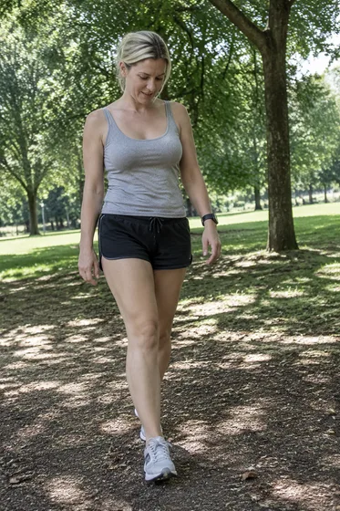
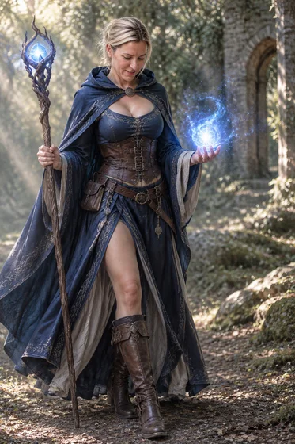
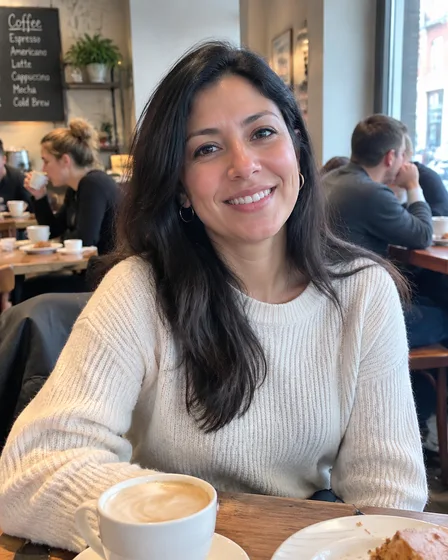
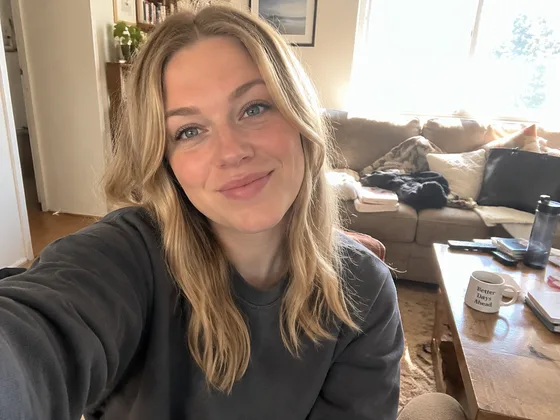
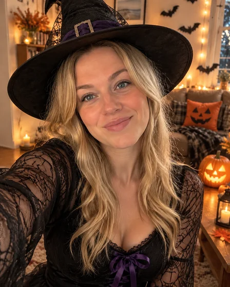
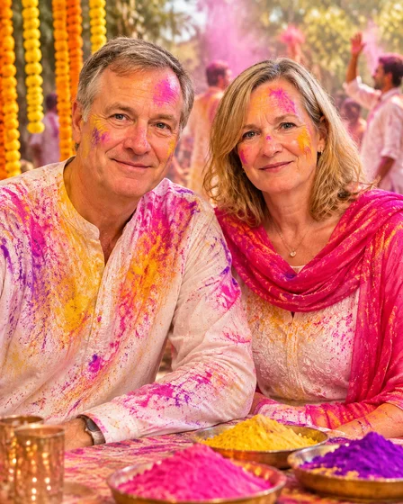
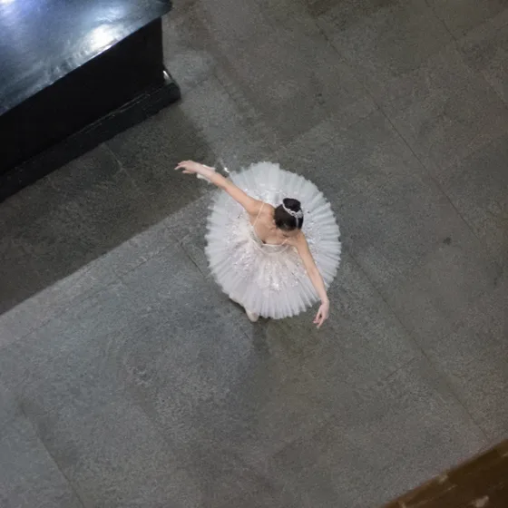
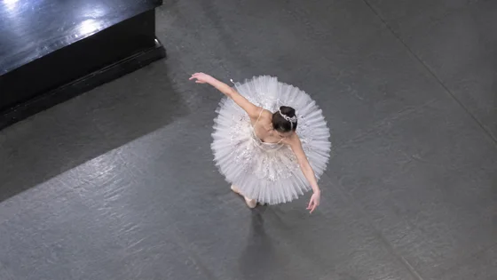

# 社交娱乐与虚拟身份

[中文](../../README.md) · [English](../../README.en.md) · [Português](../../README.pt.md) · [Español](../../README.es.md) · [Français](../../README.fr.md) · [Deutsch](../../README.de.md) · [عربي](../../README.ar.md) · [русский](../../README.ru.md) · [日本語](../../README.ja.md) · [हिंदी](../../README.hi.md)

精选目录之外的 11 个案例。这里不公开提示词，只展示现有参考素材、结果方向与最少素材要求。

[返回更多案例目录](./index.md) · [返回仓库首页](../../README.md)

> 参考素材和结果图仅作视觉指引；不保证使用相同素材能复现相同效果。

## I049 · 生成3D玩偶或黏土风角色

<table>
<thead><tr><th width="50%">参考素材</th><th width="50%">结果示例</th></tr></thead>
<tbody><tr><td valign="top">
<strong>人物照片</strong> 
</td><td valign="top"></td></tr></tbody>
</table>

- **输入类型：** 含参考素材预览与结果示例
- **素材要求：** 0或1张人物照片＋1组原创角色描述
- **说明：** 每次只生成一张图片。

[在 dearsketch 查看具体要求并制作](https://dearsketch.com/intent/i049-create-a-3d-toy-or-clay-style-character.html?utm_source=github&utm_medium=gallery&utm_campaign=dearsketch-public-cases&utm_content=i049_cta)

---

## I051 · 把自己变成骑士、法师或幻想角色

<table>
<thead><tr><th width="50%">参考素材</th><th width="50%">结果示例</th></tr></thead>
<tbody><tr><td valign="top">
<strong>本人清楚原照</strong> 
</td><td valign="top"></td></tr></tbody>
</table>

- **输入类型：** 含参考素材预览与结果示例
- **素材要求：** 1张本人清楚原照
- **说明：** 每次只生成一张图片。

[在 dearsketch 查看具体要求并制作](https://dearsketch.com/intent/i051-turn-yourself-into-a-knight-mage-or-fantasy-character.html?utm_source=github&utm_medium=gallery&utm_campaign=dearsketch-public-cases&utm_content=i051_cta)

---

## I053 · 生成Instagram、WhatsApp或Facebook头像

<table>
<thead><tr><th width="50%">参考素材</th><th width="50%">结果示例</th></tr></thead>
<tbody><tr><td valign="top">
<strong>本人清楚头部照片</strong> 
</td><td valign="top"></td></tr></tbody>
</table>

- **输入类型：** 含参考素材预览与结果示例
- **素材要求：** 0或1张本人清楚头部照片＋1组原创抽象或角色描述
- **说明：** 每次只生成一张图片。

[在 dearsketch 查看具体要求并制作](https://dearsketch.com/intent/i053-create-a-profile-picture-for-instagram-whatsapp-or-facebook.html?utm_source=github&utm_medium=gallery&utm_campaign=dearsketch-public-cases&utm_content=i053_cta)

---

## I054 · 生成YouTube频道或直播头像

<table>
<thead><tr><th width="50%">参考素材</th><th width="50%">结果示例</th></tr></thead>
<tbody><tr><td valign="top">
<strong>人物照片或既有角色图</strong> 
</td><td valign="top"></td></tr></tbody>
</table>

- **输入类型：** 含参考素材预览与结果示例
- **素材要求：** 0或1张人物照片或既有角色图＋1项频道主题
- **说明：** 每次只生成一张图片。

[在 dearsketch 查看具体要求并制作](https://dearsketch.com/intent/i054-create-a-profile-picture-for-youtube-or-streaming.html?utm_source=github&utm_medium=gallery&utm_campaign=dearsketch-public-cases&utm_content=i054_cta)

---

## I055 · 为交友应用生成自然吸引人的头像

<table>
<thead><tr><th width="50%">参考素材</th><th width="50%">结果示例</th></tr></thead>
<tbody><tr><td valign="top">
<strong>本人近期清楚原照</strong> 
</td><td valign="top"></td></tr></tbody>
</table>

- **输入类型：** 含参考素材预览与结果示例
- **素材要求：** 1张本人近期清楚原照
- **说明：** 每次只生成一张图片。

[在 dearsketch 查看具体要求并制作](https://dearsketch.com/intent/i055-create-a-natural-appealing-dating-profile-photo.html?utm_source=github&utm_medium=gallery&utm_campaign=dearsketch-public-cases&utm_content=i055_cta)

---

## I057 · 根据文字生成自定义Emoji

<strong>结果示例</strong>

本例为文字输入，未附图片参考。

- **输入类型：** 文字输入；本例仅展示结果示例
- **素材要求：** 1项情绪或含义＋1组主体或象征物描述
- **说明：** 每次只生成一张图片。

[在 dearsketch 查看具体要求并制作](https://dearsketch.com/intent/i057-create-a-custom-emoji-from-text.html?utm_source=github&utm_medium=gallery&utm_campaign=dearsketch-public-cases&utm_content=i057_cta)

---

## I058 · 把自拍转换为万圣节或圣诞主题照片

<table>
<thead><tr><th width="50%">参考素材</th><th width="50%">结果示例</th></tr></thead>
<tbody><tr><td valign="top">
<strong>本人清楚原照</strong> 
</td><td valign="top"></td></tr></tbody>
</table>

- **输入类型：** 含参考素材预览与结果示例
- **素材要求：** 1张本人清楚原照＋1项节日主题
- **说明：** 每次只生成一张图片。

[在 dearsketch 查看具体要求并制作](https://dearsketch.com/intent/i058-turn-a-selfie-into-a-halloween-or-christmas-themed-photo.html?utm_source=github&utm_medium=gallery&utm_campaign=dearsketch-public-cases&utm_content=i058_cta)

---

## I059 · 生成Holi、Eid、Navratri等文化节庆写真

<table>
<thead><tr><th width="50%">参考素材</th><th width="50%">结果示例</th></tr></thead>
<tbody><tr><td valign="top">
<strong>个人或双人照片</strong> 
</td><td valign="top"></td></tr></tbody>
</table>

- **输入类型：** 含参考素材预览与结果示例
- **素材要求：** 1张个人或双人照片＋1项具体节庆＋1项地区或家庭文化语境
- **说明：** 每次只生成一张图片。

[在 dearsketch 查看具体要求并制作](https://dearsketch.com/intent/i059-create-a-holi-eid-navratri-or-cultural-festival-portrait.html?utm_source=github&utm_medium=gallery&utm_campaign=dearsketch-public-cases&utm_content=i059_cta)

---

## I060 · 在未到访的城市生成旅行写真

<table>
<thead><tr><th width="50%">参考素材</th><th width="50%">结果示例</th></tr></thead>
<tbody><tr><td valign="top">
<strong>本人清楚原照</strong> 

<strong>目标目的地环境图</strong> 
</td><td valign="top"></td></tr></tbody>
</table>

- **输入类型：** 含参考素材预览与结果示例
- **素材要求：** 1张本人清楚原照＋1张目标目的地环境图
- **说明：** 每次只生成一张图片。

[在 dearsketch 查看具体要求并制作](https://dearsketch.com/intent/i060-create-a-travel-portrait-in-a-city-you-have-not-visited.html?utm_source=github&utm_medium=gallery&utm_campaign=dearsketch-public-cases&utm_content=i060_cta)

---

## I061 · 修复演出远距离或模糊照片

<table>
<thead><tr><th width="50%">参考素材</th><th width="50%">结果示例</th></tr></thead>
<tbody><tr><td valign="top">
<strong>远距离或模糊的演出照片</strong> 
</td><td valign="top"></td></tr></tbody>
</table>

- **输入类型：** 含参考素材预览与结果示例
- **素材要求：** 1张远距离或模糊的演出照片
- **说明：** 每次只生成一张图片。

[在 dearsketch 查看具体要求并制作](https://dearsketch.com/intent/i061-enhance-a-distant-or-blurry-concert-photo.html?utm_source=github&utm_medium=gallery&utm_campaign=dearsketch-public-cases&utm_content=i061_cta)

---

## I064 · 生成配套情侣头像或情侣艺术照

<table>
<thead><tr><th width="50%">参考素材</th><th width="50%">结果示例</th></tr></thead>
<tbody><tr><td valign="top">
<strong>双人照片</strong> 
</td><td valign="top"></td></tr></tbody>
</table>

- **输入类型：** 含参考素材预览与结果示例
- **素材要求：** 1张或分别提供两人照片双人照片＋1项本次单张类型
- **说明：** 每次只生成当前选定的一张；系列中的其他图片分别执行。

[在 dearsketch 查看具体要求并制作](https://dearsketch.com/intent/i064-create-matching-couple-avatars-or-couple-artwork.html?utm_source=github&utm_medium=gallery&utm_campaign=dearsketch-public-cases&utm_content=i064_cta)
