# 时尚、服装与虚拟试穿

[中文](../../README.md) · [English](../../README.en.md) · [Português](../../README.pt.md) · [Español](../../README.es.md) · [Français](../../README.fr.md) · [Deutsch](../../README.de.md) · [عربي](../../README.ar.md) · [русский](../../README.ru.md) · [日本語](../../README.ja.md) · [हिंदी](../../README.hi.md)

精选目录之外的 14 个案例。这里不公开提示词，只展示现有参考素材、结果方向与最少素材要求。

[返回更多案例目录](./index.md) · [返回仓库首页](../../README.md)

> 参考素材和结果图仅作视觉指引；不保证使用相同素材能复现相同效果。

## I090 · 把商品服装试穿到用户本人照片

<table>
<thead><tr><th width="50%">参考素材</th><th width="50%">结果示例</th></tr></thead>
<tbody><tr><td valign="top">
<strong>用户全身照</strong> 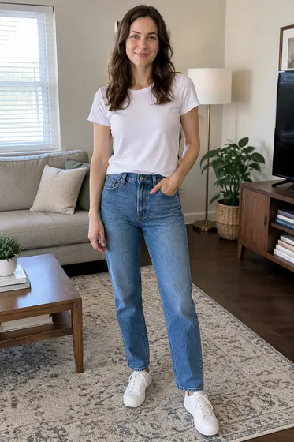

<strong>服装商品图</strong> 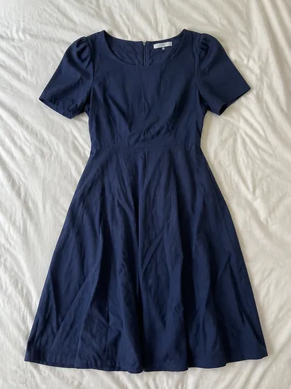
</td><td valign="top"><a href="https://dearsketch.com/intent/i090-virtually-try-product-clothing-on-your-own-photo.html?utm_source=github&amp;utm_medium=gallery&amp;utm_campaign=dearsketch-public-cases&amp;utm_content=i090_image">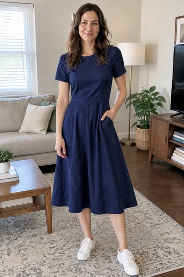</a></td></tr></tbody>
</table>

- **输入类型：** 含参考素材预览与结果示例
- **素材要求：** 1张用户全身照＋1张服装商品图
- **说明：** 每次只生成一张图片。

[在 dearsketch 查看具体要求并制作](https://dearsketch.com/intent/i090-virtually-try-product-clothing-on-your-own-photo.html?utm_source=github&utm_medium=gallery&utm_campaign=dearsketch-public-cases&utm_content=i090_cta)

---

## I091 · 为同一服装生成不同体型和肤色的模特

<table>
<thead><tr><th width="50%">参考素材</th><th width="50%">结果示例</th></tr></thead>
<tbody><tr><td valign="top">
<strong>服装商品图</strong> 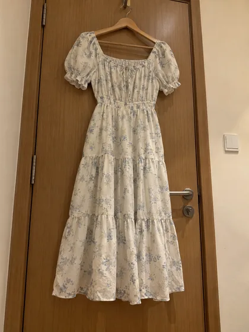
</td><td valign="top"><a href="https://dearsketch.com/intent/i091-show-the-same-garment-on-models-with-different-body-types-and-skin-tones.html?utm_source=github&amp;utm_medium=gallery&amp;utm_campaign=dearsketch-public-cases&amp;utm_content=i091_image">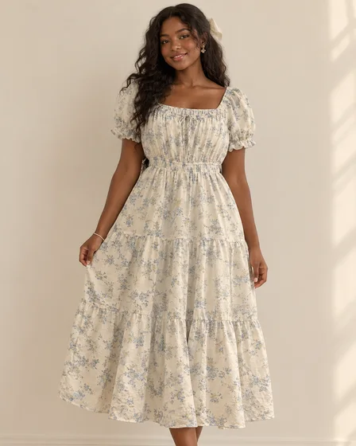</a></td></tr></tbody>
</table>

- **输入类型：** 含参考素材预览与结果示例
- **素材要求：** 至少1张服装商品图＋1组本次模特体型、肤色或人群特征
- **说明：** 每次只生成当前选定的一张；系列中的其他图片分别执行。

[在 dearsketch 查看具体要求并制作](https://dearsketch.com/intent/i091-show-the-same-garment-on-models-with-different-body-types-and-skin-tones.html?utm_source=github&utm_medium=gallery&utm_campaign=dearsketch-public-cases&utm_content=i091_cta)

---

## I092 · 把真人服装照转成无头鬼模图

<table>
<thead><tr><th width="50%">参考素材</th><th width="50%">结果示例</th></tr></thead>
<tbody><tr><td valign="top">
<strong>真人穿着照片</strong> 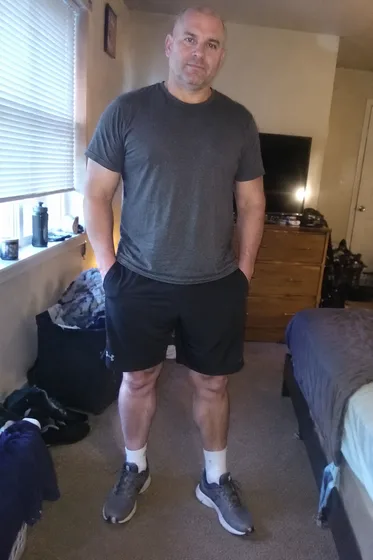
</td><td valign="top"><a href="https://dearsketch.com/intent/i092-turn-an-on-model-clothing-photo-into-a-ghost-mannequin-image.html?utm_source=github&amp;utm_medium=gallery&amp;utm_campaign=dearsketch-public-cases&amp;utm_content=i092_image">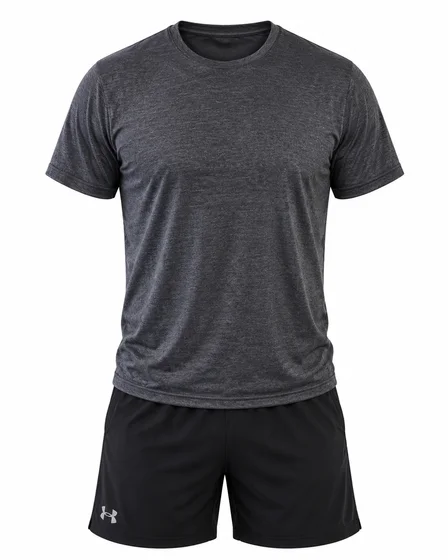</a></td></tr></tbody>
</table>

- **输入类型：** 含参考素材预览与结果示例
- **素材要求：** 1张真人穿着照片
- **说明：** 每次只生成一张图片。

[在 dearsketch 查看具体要求并制作](https://dearsketch.com/intent/i092-turn-an-on-model-clothing-photo-into-a-ghost-mannequin-image.html?utm_source=github&utm_medium=gallery&utm_campaign=dearsketch-public-cases&utm_content=i092_cta)

---

## I093 · 把服装照片生成规范俯拍平铺图

<table>
<thead><tr><th width="50%">参考素材</th><th width="50%">结果示例</th></tr></thead>
<tbody><tr><td valign="top">
<strong>人物穿着目标服装的原始照片</strong> 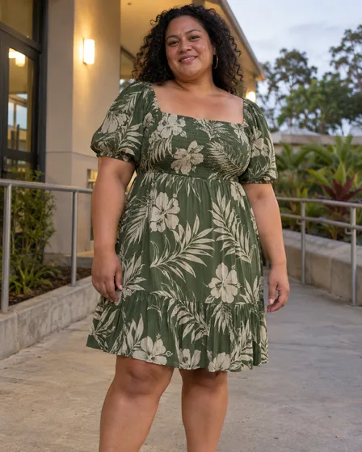
</td><td valign="top"><a href="https://dearsketch.com/intent/i093-turn-a-clothing-photo-into-a-standardized-flat-lay.html?utm_source=github&amp;utm_medium=gallery&amp;utm_campaign=dearsketch-public-cases&amp;utm_content=i093_image">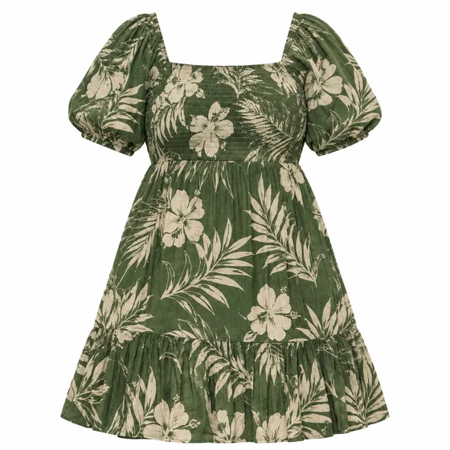</a></td></tr></tbody>
</table>

- **输入类型：** 含参考素材预览与结果示例
- **素材要求：** 1张人物穿着目标服装的原始照片
- **说明：** 每次只生成一张图片。

[在 dearsketch 查看具体要求并制作](https://dearsketch.com/intent/i093-turn-a-clothing-photo-into-a-standardized-flat-lay.html?utm_source=github&utm_medium=gallery&utm_campaign=dearsketch-public-cases&utm_content=i093_cta)

---

## I094 · 自动去除服装褶皱并保持面料

<table>
<thead><tr><th width="50%">参考素材</th><th width="50%">结果示例</th></tr></thead>
<tbody><tr><td valign="top">
<strong>服装照片</strong> 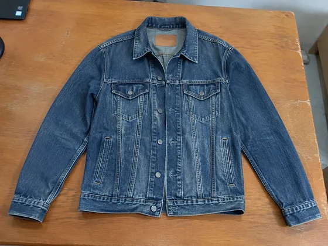
</td><td valign="top"><a href="https://dearsketch.com/intent/i094-remove-clothing-wrinkles-while-preserving-fabric-texture.html?utm_source=github&amp;utm_medium=gallery&amp;utm_campaign=dearsketch-public-cases&amp;utm_content=i094_image">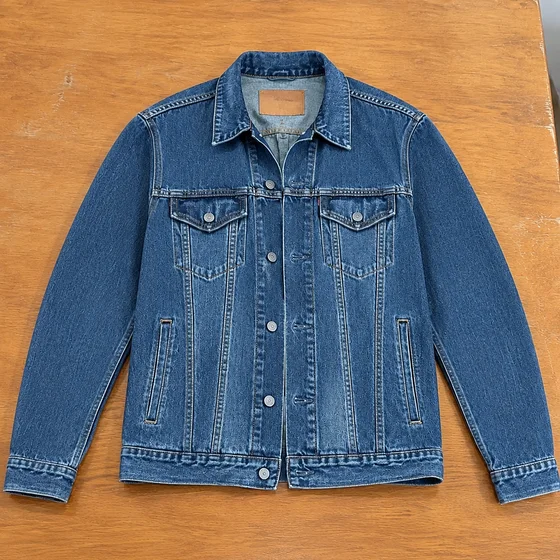</a></td></tr></tbody>
</table>

- **输入类型：** 含参考素材预览与结果示例
- **素材要求：** 1张服装照片
- **说明：** 每次只生成一张图片。

[在 dearsketch 查看具体要求并制作](https://dearsketch.com/intent/i094-remove-clothing-wrinkles-while-preserving-fabric-texture.html?utm_source=github&utm_medium=gallery&utm_campaign=dearsketch-public-cases&utm_content=i094_cta)

---

## I095 · 生成服装不同颜色的SKU展示

<table>
<thead><tr><th width="50%">参考素材</th><th width="50%">结果示例</th></tr></thead>
<tbody><tr><td valign="top">
<strong>服装母图</strong> 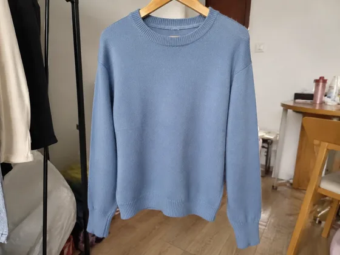
</td><td valign="top"><a href="https://dearsketch.com/intent/i095-create-color-variants-for-a-clothing-sku.html?utm_source=github&amp;utm_medium=gallery&amp;utm_campaign=dearsketch-public-cases&amp;utm_content=i095_image">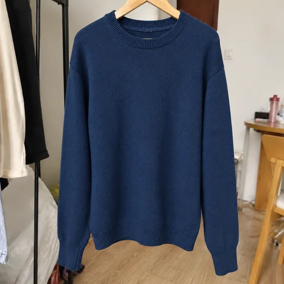</a></td></tr></tbody>
</table>

- **输入类型：** 含参考素材预览与结果示例
- **素材要求：** 1张服装母图＋1个本次单个目标颜色或色值（必填）
- **说明：** 每次只生成当前选定的一张；系列中的其他图片分别执行。

[在 dearsketch 查看具体要求并制作](https://dearsketch.com/intent/i095-create-color-variants-for-a-clothing-sku.html?utm_source=github&utm_medium=gallery&utm_campaign=dearsketch-public-cases&utm_content=i095_cta)

---

## I096 · 把鞋或帽子展示在虚拟模特上

<table>
<thead><tr><th width="50%">参考素材</th><th width="50%">结果示例</th></tr></thead>
<tbody><tr><td valign="top">
<strong>鞋帽商品图</strong> 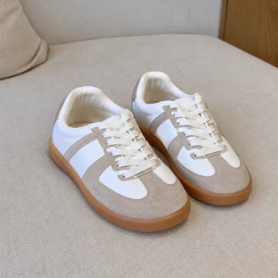
</td><td valign="top"><a href="https://dearsketch.com/intent/i096-show-shoes-or-hats-on-a-virtual-model.html?utm_source=github&amp;utm_medium=gallery&amp;utm_campaign=dearsketch-public-cases&amp;utm_content=i096_image">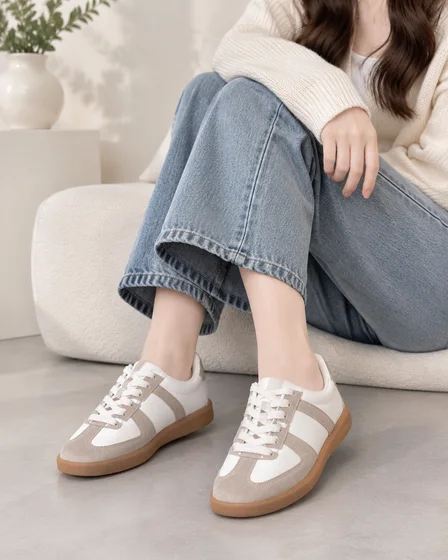</a></td></tr></tbody>
</table>

- **输入类型：** 含参考素材预览与结果示例
- **素材要求：** 1张鞋帽商品图
- **说明：** 每次只生成一张图片。

[在 dearsketch 查看具体要求并制作](https://dearsketch.com/intent/i096-show-shoes-or-hats-on-a-virtual-model.html?utm_source=github&utm_medium=gallery&utm_campaign=dearsketch-public-cases&utm_content=i096_cta)

---

## I097 · 把戒指、手链或首饰展示在虚拟模特上

<table>
<thead><tr><th width="50%">参考素材</th><th width="50%">结果示例</th></tr></thead>
<tbody><tr><td valign="top">
<strong>首饰商品图</strong> 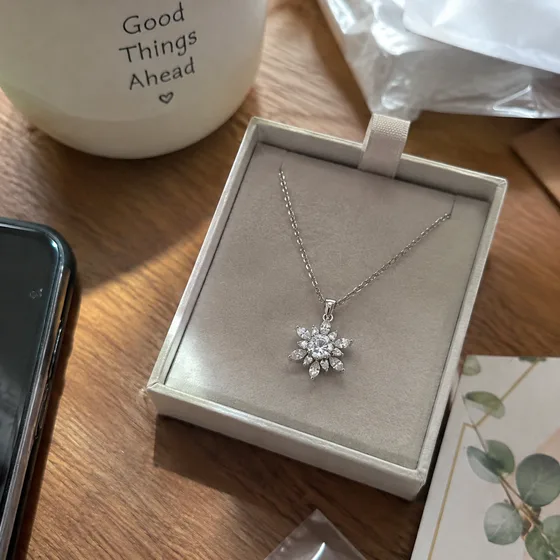
</td><td valign="top"><a href="https://dearsketch.com/intent/i097-show-rings-bracelets-or-jewelry-on-a-virtual-model.html?utm_source=github&amp;utm_medium=gallery&amp;utm_campaign=dearsketch-public-cases&amp;utm_content=i097_image">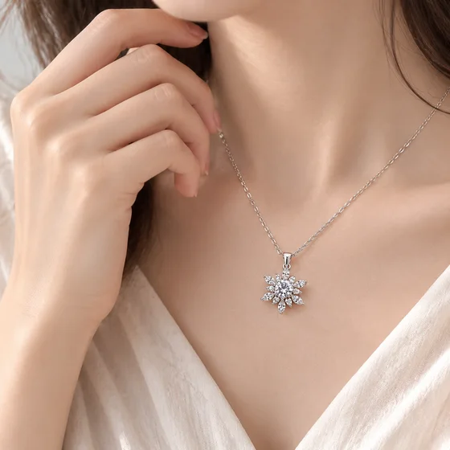</a></td></tr></tbody>
</table>

- **输入类型：** 含参考素材预览与结果示例
- **素材要求：** 1张首饰商品图＋1项佩戴部位
- **说明：** 每次只生成一张图片。

[在 dearsketch 查看具体要求并制作](https://dearsketch.com/intent/i097-show-rings-bracelets-or-jewelry-on-a-virtual-model.html?utm_source=github&utm_medium=gallery&utm_campaign=dearsketch-public-cases&utm_content=i097_cta)

---

## I098 · 从普通服装照生成时尚杂志风大片

<table>
<thead><tr><th width="50%">参考素材</th><th width="50%">结果示例</th></tr></thead>
<tbody><tr><td valign="top">
<strong>模特或服装照片</strong> 
</td><td valign="top"><a href="https://dearsketch.com/intent/i098-turn-an-ordinary-clothing-photo-into-a-fashion-editorial.html?utm_source=github&amp;utm_medium=gallery&amp;utm_campaign=dearsketch-public-cases&amp;utm_content=i098_image">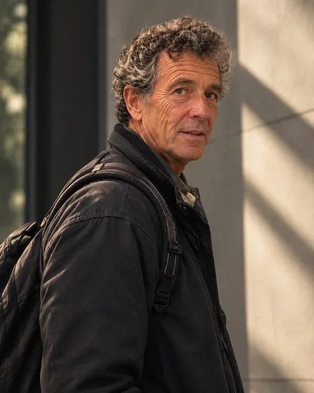</a></td></tr></tbody>
</table>

- **输入类型：** 含参考素材预览与结果示例
- **素材要求：** 1张模特或服装照片
- **说明：** 每次只生成一张图片。

[在 dearsketch 查看具体要求并制作](https://dearsketch.com/intent/i098-turn-an-ordinary-clothing-photo-into-a-fashion-editorial.html?utm_source=github&utm_medium=gallery&utm_campaign=dearsketch-public-cases&utm_content=i098_cta)

---

## I099 · 生成一件服装的1套搭配方案

<table>
<thead><tr><th width="50%">参考素材</th><th width="50%">结果示例</th></tr></thead>
<tbody><tr><td valign="top">
<strong>单品照片</strong> 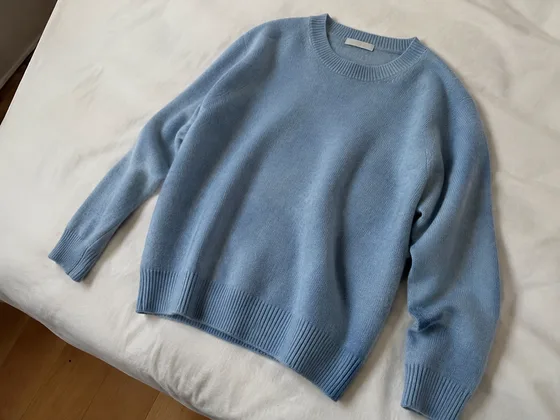
</td><td valign="top"><a href="https://dearsketch.com/intent/i099-create-one-outfit-idea-around-a-garment.html?utm_source=github&amp;utm_medium=gallery&amp;utm_campaign=dearsketch-public-cases&amp;utm_content=i099_image">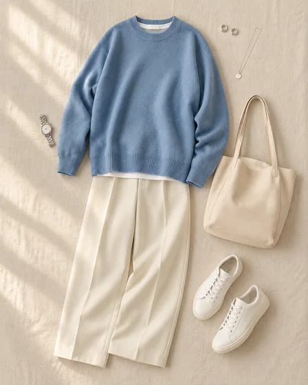</a></td></tr></tbody>
</table>

- **输入类型：** 含参考素材预览与结果示例
- **素材要求：** 1张单品照片
- **说明：** 每次只生成一张图片。

[在 dearsketch 查看具体要求并制作](https://dearsketch.com/intent/i099-create-one-outfit-idea-around-a-garment.html?utm_source=github&utm_medium=gallery&utm_campaign=dearsketch-public-cases&utm_content=i099_cta)

---

## I100 · 为服装生成无缝印花和面料图案

<strong>结果示例</strong>

<a href="https://dearsketch.com/intent/i100-create-seamless-prints-and-fabric-patterns-for-clothing.html?utm_source=github&amp;utm_medium=gallery&amp;utm_campaign=dearsketch-public-cases&amp;utm_content=i100_image">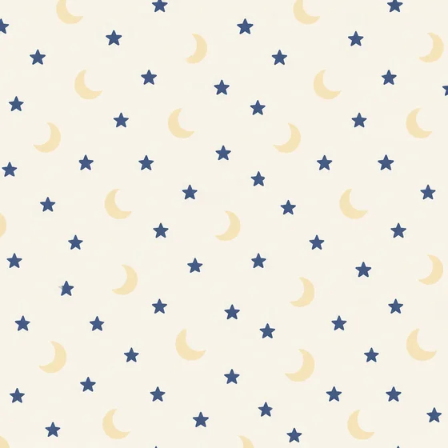</a>

本例未附图片参考，输入预览待补；素材要求见下方。

- **输入类型：** 本例仅展示结果示例；图片输入预览待补
- **素材要求：** 1组主题元素＋0或1张风格参考
- **说明：** 本次生成单张视觉预览。数据计算、精确排版、矢量或生产文件仍需对应工具校验。

[在 dearsketch 查看具体要求并制作](https://dearsketch.com/intent/i100-create-seamless-prints-and-fabric-patterns-for-clothing.html?utm_source=github&utm_medium=gallery&utm_campaign=dearsketch-public-cases&utm_content=i100_cta)

---

## I101 · 把平面图案放到T恤、卫衣或童装样机

<table>
<thead><tr><th width="50%">参考素材</th><th width="50%">结果示例</th></tr></thead>
<tbody><tr><td valign="top">
<strong>图案文件</strong> 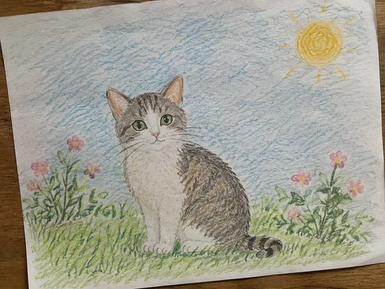
</td><td valign="top"><a href="https://dearsketch.com/intent/i101-apply-artwork-to-a-t-shirt-hoodie-or-children-s-clothing-mockup.html?utm_source=github&amp;utm_medium=gallery&amp;utm_campaign=dearsketch-public-cases&amp;utm_content=i101_image">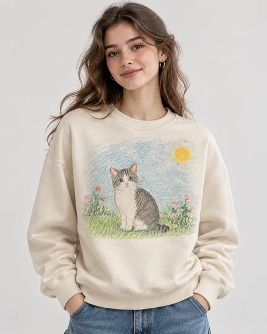</a></td></tr></tbody>
</table>

- **输入类型：** 含参考素材预览与结果示例
- **素材要求：** 图案文件＋目标服装类型 → 生成真实穿着或平铺Mockup → 当前单张服装样机
- **说明：** 每次只生成一张图片。

[在 dearsketch 查看具体要求并制作](https://dearsketch.com/intent/i101-apply-artwork-to-a-t-shirt-hoodie-or-children-s-clothing-mockup.html?utm_source=github&utm_medium=gallery&utm_campaign=dearsketch-public-cases&utm_content=i101_cta)

---

## I102 · 改变服装模特的姿势和镜头角度

<table>
<thead><tr><th width="50%">参考素材</th><th width="50%">结果示例</th></tr></thead>
<tbody><tr><td valign="top">
<strong>现有模特图</strong> 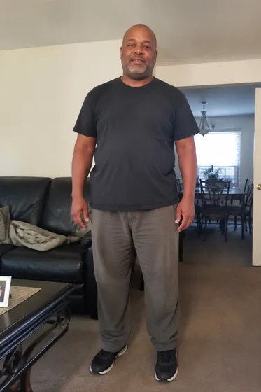
</td><td valign="top"><a href="https://dearsketch.com/intent/i102-change-a-fashion-model-s-pose-and-camera-angle.html?utm_source=github&amp;utm_medium=gallery&amp;utm_campaign=dearsketch-public-cases&amp;utm_content=i102_image">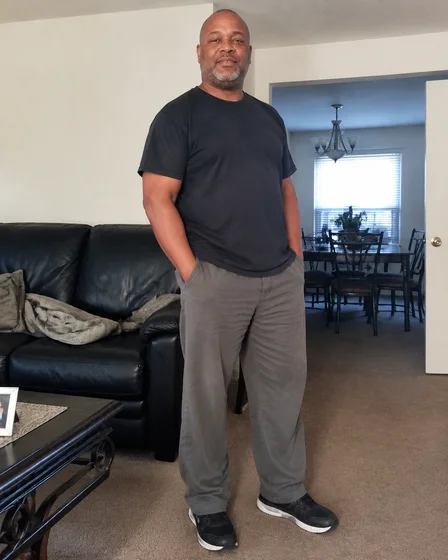</a></td></tr></tbody>
</table>

- **输入类型：** 含参考素材预览与结果示例
- **素材要求：** 现有模特图 → 保持服装和人物并调整姿态 → 当前单张多姿势模特图
- **说明：** 每次只生成一张图片。

[在 dearsketch 查看具体要求并制作](https://dearsketch.com/intent/i102-change-a-fashion-model-s-pose-and-camera-angle.html?utm_source=github&utm_medium=gallery&utm_campaign=dearsketch-public-cases&utm_content=i102_cta)

---

## I103 · 为服装模特生成不同拍摄背景

<table>
<thead><tr><th width="50%">参考素材</th><th width="50%">结果示例</th></tr></thead>
<tbody><tr><td valign="top">
<strong>模特照片</strong> 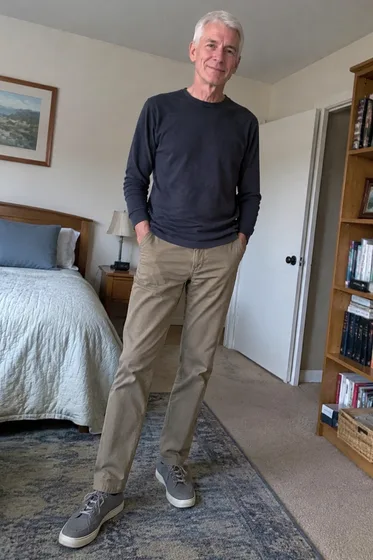
</td><td valign="top"><a href="https://dearsketch.com/intent/i103-create-different-photoshoot-backgrounds-for-a-fashion-model.html?utm_source=github&amp;utm_medium=gallery&amp;utm_campaign=dearsketch-public-cases&amp;utm_content=i103_image">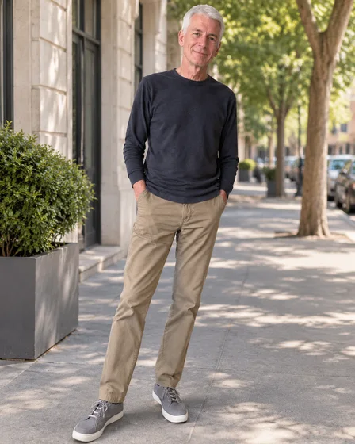</a></td></tr></tbody>
</table>

- **输入类型：** 含参考素材预览与结果示例
- **素材要求：** 模特照片 → 生成街拍、影棚或旅行背景 → 当前单张多场景时尚图
- **说明：** 每次只生成一张图片。

[在 dearsketch 查看具体要求并制作](https://dearsketch.com/intent/i103-create-different-photoshoot-backgrounds-for-a-fashion-model.html?utm_source=github&utm_medium=gallery&utm_campaign=dearsketch-public-cases&utm_content=i103_cta)
