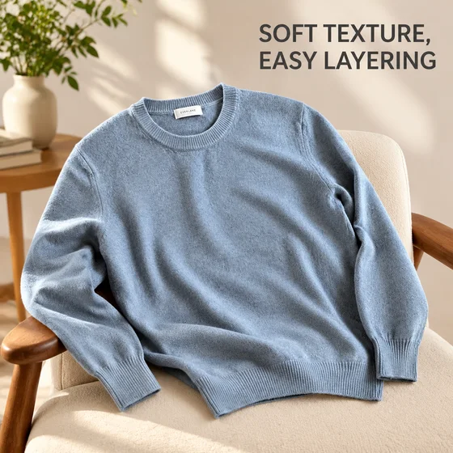
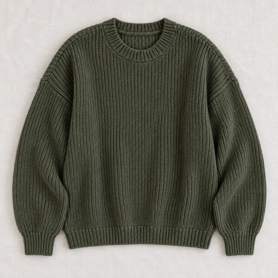

# 营销、广告与社媒内容

[中文](../../README.md) · [English](../../README.en.md) · [Português](../../README.pt.md) · [Español](../../README.es.md) · [Français](../../README.fr.md) · [Deutsch](../../README.de.md) · [عربي](../../README.ar.md) · [русский](../../README.ru.md) · [日本語](../../README.ja.md) · [हिंदी](../../README.hi.md)

精选目录之外的 6 个案例。这里不公开提示词，只展示现有参考素材、结果方向与最少素材要求。

[返回更多案例目录](./index.md) · [返回仓库首页](../../README.md)

> 参考素材和结果图仅作视觉指引；不保证使用相同素材能复现相同效果。

## I110 · 从商品图生成效果广告素材

<table>
<thead><tr><th width="50%">参考素材</th><th width="50%">结果示例</th></tr></thead>
<tbody><tr><td valign="top">
<strong>商品图、卖点和受众</strong> 
</td><td valign="top"></td></tr></tbody>
</table>

- **输入类型：** 含参考素材预览与结果示例
- **素材要求：** 商品图、卖点和受众＋商品卖点、目标受众 → 组合场景、文案和品牌元素 → 当前单张广告创意图
- **说明：** 每次只生成一张图片。

[在 dearsketch 查看具体要求并制作](https://dearsketch.com/intent/i110-create-performance-ad-creative-from-a-product-image.html?utm_source=github&utm_medium=gallery&utm_campaign=dearsketch-public-cases&utm_content=i110_cta)

---

## I125 · 把同一广告视觉改为不同语言和文化版本

<table>
<thead><tr><th width="50%">参考素材</th><th width="50%">结果示例</th></tr></thead>
<tbody><tr><td valign="top">
<strong>完整原广告</strong> 
</td><td valign="top"></td></tr></tbody>
</table>

- **输入类型：** 含参考素材预览与结果示例
- **素材要求：** 1张完整原广告＋目标国家或地区（可补充指定语言、文化偏好或审校译文）
- **说明：** 每次只生成一张图片。

[在 dearsketch 查看具体要求并制作](https://dearsketch.com/intent/i125-adapt-one-ad-visual-for-different-languages-and-cultures.html?utm_source=github&utm_medium=gallery&utm_campaign=dearsketch-public-cases&utm_content=i125_cta)

---

## I260 · 把服装系列制作成Lookbook或时尚型录

<table>
<thead><tr><th width="50%">参考素材</th><th width="50%">结果示例</th></tr></thead>
<tbody><tr><td valign="top">
<strong>L02模特穿着图</strong> 

<strong>L02完整正面商品图</strong> 
</td><td valign="top"></td></tr></tbody>
</table>

- **输入类型：** 含参考素材预览与结果示例
- **素材要求：** 必需模特图与商品图(完整系列多张)＋必需系列主题、款号、顺序与页数(1份)
- **说明：** 本次生成单张视觉预览。数据计算、精确排版、矢量或生产文件仍需对应工具校验。

[在 dearsketch 查看具体要求并制作](https://dearsketch.com/intent/i260-turn-a-clothing-collection-into-a-lookbook-or-fashion-catalog.html?utm_source=github&utm_medium=gallery&utm_campaign=dearsketch-public-cases&utm_content=i260_cta)

---

## I261 · 制作播客封面艺术

<table>
<thead><tr><th width="50%">参考素材</th><th width="50%">结果示例</th></tr></thead>
<tbody><tr><td valign="top">
<strong>主持人肖像</strong> 
</td><td valign="top"></td></tr></tbody>
</table>

- **输入类型：** 含参考素材预览与结果示例
- **素材要求：** 可选主持人肖像(0或1张)＋必需节目名、主题与目标平台(1份)＋必需节目名与必要副标题(1组)
- **说明：** 每次只生成一张图片。

[在 dearsketch 查看具体要求并制作](https://dearsketch.com/intent/i261-create-podcast-cover-art.html?utm_source=github&utm_medium=gallery&utm_campaign=dearsketch-public-cases&utm_content=i261_cta)

---

## I262 · 为年度报告白皮书或案例研究生成配图

<strong>结果示例</strong>

本例未附图片参考，输入预览待补；素材要求见下方。

- **输入类型：** 本例仅展示结果示例；图片输入预览待补
- **素材要求：** 可选品牌规范或现有报告插图锚点(0至多张)＋必需章节清单与每章摘要(1份)＋条件已核实数据(1份)＋可选品牌规范(0或1份)
- **说明：** 每次只生成当前选定的一张；系列中的其他图片分别执行。

[在 dearsketch 查看具体要求并制作](https://dearsketch.com/intent/i262-create-illustrations-for-an-annual-report-white-paper-or-case-study.html?utm_source=github&utm_medium=gallery&utm_campaign=dearsketch-public-cases&utm_content=i262_cta)

---

## I263 · 为Pitch Deck生成统一的概念插图和图解

<strong>结果示例</strong>

本例未附图片参考，输入预览待补；素材要求见下方。

- **输入类型：** 本例仅展示结果示例；图片输入预览待补
- **素材要求：** 可选品牌或路演视觉锚点(0或1张)＋必需页面清单与每页核心信息(1份)＋必需商业模式或用户流程(1份)＋可选品牌规范(0或1份)
- **说明：** 每次只生成当前选定的一张；系列中的其他图片分别执行。

[在 dearsketch 查看具体要求并制作](https://dearsketch.com/intent/i263-create-consistent-illustrations-and-diagrams-for-a-pitch-deck.html?utm_source=github&utm_medium=gallery&utm_campaign=dearsketch-public-cases&utm_content=i263_cta)
