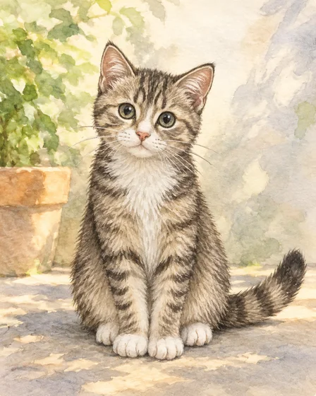

# 插画、出版与故事

[中文](../../README.md) · [English](../../README.en.md) · [Português](../../README.pt.md) · [Español](../../README.es.md) · [Français](../../README.fr.md) · [Deutsch](../../README.de.md) · [عربي](../../README.ar.md) · [русский](../../README.ru.md) · [日本語](../../README.ja.md) · [हिंदी](../../README.hi.md)

精选目录之外的 6 个案例。这里不公开提示词，只展示现有参考素材、结果方向与最少素材要求。

[返回更多案例目录](./index.md) · [返回仓库首页](../../README.md)

> 参考素材和结果图仅作视觉指引；不保证使用相同素材能复现相同效果。

## I141 · 把故事文本生成一致角色的儿童绘本

<strong>结果示例</strong>

本例未附图片参考，输入预览待补；素材要求见下方。

- **输入类型：** 本例仅展示结果示例；图片输入预览待补
- **素材要求：** 完整故事与分页规则＋绘本角色设定原稿板＋绘本插画风格样板＋当前页码或跨页 → 拆页并生成一致人物插图 → 当前单张完整儿童绘本
- **说明：** 每次只生成当前选定的一张；系列中的其他图片分别执行。

[在 dearsketch 查看具体要求并制作](https://dearsketch.com/intent/i141-create-a-children-s-picture-book-with-consistent-characters-from-a-story.html?utm_source=github&utm_medium=gallery&utm_campaign=dearsketch-public-cases&utm_content=i141_cta)

---

## I144 · 生成保持角色一致的漫画分镜或面板

<strong>结果示例</strong>

本例未附图片参考，输入预览待补；素材要求见下方。

- **输入类型：** 本例仅展示结果示例；图片输入预览待补
- **素材要求：** 分镜脚本与对白＋角色与场景设定板＋当前漫画页 → 生成连续场景和构图 → 当前单张漫画面板
- **说明：** 本次生成单张视觉预览。数据计算、精确排版、矢量或生产文件仍需对应工具校验。

[在 dearsketch 查看具体要求并制作](https://dearsketch.com/intent/i144-create-comic-panels-with-consistent-characters.html?utm_source=github&utm_medium=gallery&utm_campaign=dearsketch-public-cases&utm_content=i144_cta)

---

## I145 · 把脚本或创意生成影视故事板

<strong>结果示例</strong>

本例未附图片参考，输入预览待补；素材要求见下方。

- **输入类型：** 本例仅展示结果示例；图片输入预览待补
- **素材要求：** 脚本或镜头清单＋角色与场景设定原稿板＋当前故事板页 → 生成连续镜头草图 → 当前单张Storyboard
- **说明：** 本次生成单张视觉预览。数据计算、精确排版、矢量或生产文件仍需对应工具校验。

[在 dearsketch 查看具体要求并制作](https://dearsketch.com/intent/i145-turn-a-script-or-idea-into-a-film-storyboard.html?utm_source=github&utm_medium=gallery&utm_campaign=dearsketch-public-cases&utm_content=i145_cta)

---

## I148 · 把粗略草图转换为完成度较高的插画

<table>
<thead><tr><th width="50%">参考素材</th><th width="50%">结果示例</th></tr></thead>
<tbody><tr><td valign="top">
<strong>手绘或数字草图</strong> 
</td><td valign="top"></td></tr></tbody>
</table>

- **输入类型：** 含参考素材预览与结果示例
- **素材要求：** 手绘或数字草图＋允许修改范围 → 保留构图并补充颜色和细节 → 当前单张完成插画
- **说明：** 每次只生成一张图片。

[在 dearsketch 查看具体要求并制作](https://dearsketch.com/intent/i148-turn-a-rough-sketch-into-a-polished-illustration.html?utm_source=github&utm_medium=gallery&utm_campaign=dearsketch-public-cases&utm_content=i148_cta)

---

## I149 · 从照片或文字生成儿童涂色页

<table>
<thead><tr><th width="50%">参考素材</th><th width="50%">结果示例</th></tr></thead>
<tbody><tr><td valign="top">
<strong>待转换照片原图</strong> 
</td><td valign="top"></td></tr></tbody>
</table>

- **输入类型：** 含参考素材预览与结果示例
- **素材要求：** 待转换照片原图 → 简化为清晰黑白线稿 → 当前单张儿童涂色页
- **说明：** 每次只生成一张图片。

[在 dearsketch 查看具体要求并制作](https://dearsketch.com/intent/i149-create-a-children-s-coloring-page-from-a-photo-or-text.html?utm_source=github&utm_medium=gallery&utm_campaign=dearsketch-public-cases&utm_content=i149_cta)

---

## I153 · 生成塔罗、桌游或收藏卡牌插画

<strong>结果示例</strong>

本例未附图片参考，输入预览待补；素材要求见下方。

- **输入类型：** 本例仅展示结果示例；图片输入预览待补
- **素材要求：** 卡牌数据表＋卡牌世界观与边框规范样板＋当前卡牌 → 生成统一边框和插图系列 → 当前单张卡牌插画
- **说明：** 每次只生成当前选定的一张；系列中的其他图片分别执行。

[在 dearsketch 查看具体要求并制作](https://dearsketch.com/intent/i153-create-artwork-for-tarot-board-game-or-collectible-cards.html?utm_source=github&utm_medium=gallery&utm_campaign=dearsketch-public-cases&utm_content=i153_cta)
