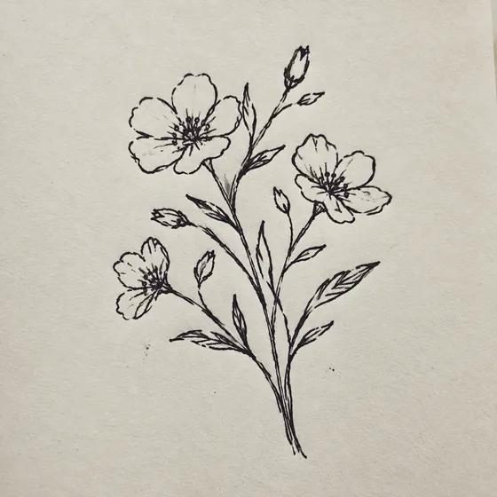
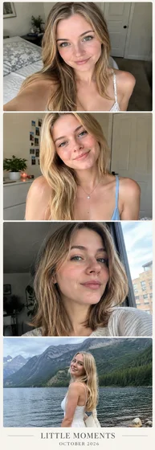

# POD与个性化商品

[中文](../../README.md) · [English](../../README.en.md) · [Português](../../README.pt.md) · [Español](../../README.es.md) · [Français](../../README.fr.md) · [Deutsch](../../README.de.md) · [عربي](../../README.ar.md) · [русский](../../README.ru.md) · [日本語](../../README.ja.md) · [हिंदी](../../README.hi.md)

精选目录之外的 6 个案例。这里不公开提示词，只展示现有参考素材、结果方向与最少素材要求。

[返回更多案例目录](./index.md) · [返回仓库首页](../../README.md)

> 参考素材和结果图仅作视觉指引；不保证使用相同素材能复现相同效果。

## I264 · 把Logo或插画转换为刺绣机针迹文件

<table>
<thead><tr><th width="50%">参考素材</th><th width="50%">结果示例</th></tr></thead>
<tbody><tr><td valign="top">
<strong>待刺绣数字化的透明Logo或插画</strong> 
</td><td valign="top"></td></tr></tbody>
</table>

- **输入类型：** 含参考素材预览与结果示例
- **素材要求：** 必需待刺绣数字化的透明Logo或插画(1个)＋必需刺绣生产规格(1份)
- **说明：** 本次生成单张视觉预览。数据计算、精确排版、矢量或生产文件仍需对应工具校验。

[在 dearsketch 查看具体要求并制作](https://dearsketch.com/intent/i264-convert-a-logo-or-illustration-into-an-embroidery-stitch-file.html?utm_source=github&utm_medium=gallery&utm_campaign=dearsketch-public-cases&utm_content=i264_cta)

---

## I268 · 把图片或文字整理成激光雕刻切割矢量文件

<table>
<thead><tr><th width="50%">参考素材</th><th width="50%">结果示例</th></tr></thead>
<tbody><tr><td valign="top">
<strong>待雕刻/切割的图片或Logo</strong> 
</td><td valign="top"></td></tr></tbody>
</table>

- **输入类型：** 含参考素材预览与结果示例
- **素材要求：** 可选待雕刻/切割的图片或Logo(0或1个)＋必需加工方式、材料与机器约束(1份)＋条件需加工文字与字形(1份)
- **说明：** 本次生成单张视觉预览。数据计算、精确排版、矢量或生产文件仍需对应工具校验。

[在 dearsketch 查看具体要求并制作](https://dearsketch.com/intent/i268-prepare-an-image-or-text-as-a-vector-file-for-laser-engraving-or-cutting.html?utm_source=github&utm_medium=gallery&utm_campaign=dearsketch-public-cases&utm_content=i268_cta)

---

## I271 · 把照片转换为数字油画图纸

<table>
<thead><tr><th width="50%">参考素材</th><th width="50%">结果示例</th></tr></thead>
<tbody><tr><td valign="top">
<strong>待转数字油画的主体照片</strong> 
</td><td valign="top"></td></tr></tbody>
</table>

- **输入类型：** 含参考素材预览与结果示例
- **素材要求：** 必需待转数字油画的主体照片(1张)＋必需成品范围与颜料颜色数(1组)
- **说明：** 本次生成单张视觉预览。数据计算、精确排版、矢量或生产文件仍需对应工具校验。

[在 dearsketch 查看具体要求并制作](https://dearsketch.com/intent/i271-turn-a-photo-into-a-paint-by-numbers-pattern.html?utm_source=github&utm_medium=gallery&utm_campaign=dearsketch-public-cases&utm_content=i271_cta)

---

## I273 · 把照片转换为可切割或喷绘的模板图

<table>
<thead><tr><th width="50%">参考素材</th><th width="50%">结果示例</th></tr></thead>
<tbody><tr><td valign="top">
<strong>待转模板的高对比照片或Logo</strong> 
</td><td valign="top"></td></tr></tbody>
</table>

- **输入类型：** 含参考素材预览与结果示例
- **素材要求：** 必需待转模板的高对比照片或Logo(1张)＋必需模板用途、材料与最小连接(1份)
- **说明：** 本次生成单张视觉预览。数据计算、精确排版、矢量或生产文件仍需对应工具校验。

[在 dearsketch 查看具体要求并制作](https://dearsketch.com/intent/i273-turn-a-photo-into-a-cuttable-or-paintable-stencil.html?utm_source=github&utm_medium=gallery&utm_campaign=dearsketch-public-cases&utm_content=i273_cta)

---

## I284 · 用人物照片和醒目文字制作应援扇或姓名板

<table>
<thead><tr><th width="50%">参考素材</th><th width="50%">结果示例</th></tr></thead>
<tbody><tr><td valign="top">
<strong>有权使用的人物照片</strong> 
</td><td valign="top"></td></tr></tbody>
</table>

- **输入类型：** 含参考素材预览与结果示例
- **素材要求：** 必需有权使用的人物照片(1张)＋必需姓名或应援短句(1组)＋必需成品类型与代表色(1组)
- **说明：** 每次只生成一张图片。

[在 dearsketch 查看具体要求并制作](https://dearsketch.com/intent/i284-create-a-fan-support-uchiwa-or-name-board-from-a-portrait.html?utm_source=github&utm_medium=gallery&utm_campaign=dearsketch-public-cases&utm_content=i284_cta)

---

## I287 · 把多张自拍制作成四格照片条和主题边框

<table>
<thead><tr><th width="50%">参考素材</th><th width="50%">结果示例</th></tr></thead>
<tbody><tr><td valign="top">
<strong>历史参考/变换前输入</strong> 

<strong>历史参考/变换前输入</strong> 

<strong>历史参考/变换前输入</strong> 

<strong>历史参考/变换前输入</strong> 
</td><td valign="top"></td></tr></tbody>
</table>

- **输入类型：** 含参考素材预览与结果示例
- **素材要求：** 必需连拍/自拍照片(2至4张)＋必需照片条上下帧顺序(1份)＋可选日期、短句、Logo与主题色(0或1组)
- **说明：** 每次只生成一张图片。

[在 dearsketch 查看具体要求并制作](https://dearsketch.com/intent/i287-turn-selfies-into-a-four-cut-photo-strip-with-a-themed-frame.html?utm_source=github&utm_medium=gallery&utm_campaign=dearsketch-public-cases&utm_content=i287_cta)
