# POD与个性化商品

精选目录之外的 18 个案例。这里不公开提示词，只展示现有参考素材、结果方向与最少素材要求。

[返回更多案例目录](index.md) · [返回仓库首页](../../README.md)

> 参考素材和结果图仅作视觉指引；不保证使用相同素材能复现相同效果。

## I156 · 生成可印刷T恤图案

<strong>结果示例</strong>

本例未附图片参考，输入预览待补；素材要求见下方。

- **输入类型：** 本例仅展示结果示例；图片输入预览待补
- **素材要求：** 既有角色或品牌标志原稿＋主题或口号、印花位置、目标服装颜色 → 生成独立构图和高分辨率图案 → 当前单张T恤印花
- **说明：** 每次只生成一张图片。

[在 dearsketch 查看具体要求并制作](https://dearsketch.com/intent/i156-create-a-print-ready-t-shirt-design.html?utm_source=github&utm_medium=gallery&utm_campaign=dearsketch-public-cases&utm_content=i156_cta)

---

## I157 · 生成主题贴纸套装

<strong>结果示例</strong>

<a href="https://dearsketch.com/intent/i157-create-a-themed-sticker-set.html?utm_source=github&amp;utm_medium=gallery&amp;utm_campaign=dearsketch-public-cases&amp;utm_content=i157_image">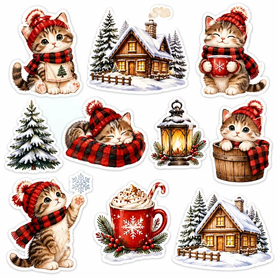</a>

本例未附图片参考，输入预览待补；素材要求见下方。

- **输入类型：** 本例仅展示结果示例；图片输入预览待补
- **素材要求：** 既有角色设定原稿＋贴纸主题 → 生成白边、统一风格的贴纸系列 → 当前单张贴纸包
- **说明：** 每次只生成当前选定的一张；系列中的其他图片分别执行。

[在 dearsketch 查看具体要求并制作](https://dearsketch.com/intent/i157-create-a-themed-sticker-set.html?utm_source=github&utm_medium=gallery&utm_campaign=dearsketch-public-cases&utm_content=i157_cta)

---

## I158 · 生成可打印墙画和装饰艺术

<strong>结果示例</strong>

<a href="https://dearsketch.com/intent/i158-create-printable-wall-art-and-decorative-artwork.html?utm_source=github&amp;utm_medium=gallery&amp;utm_campaign=dearsketch-public-cases&amp;utm_content=i158_image">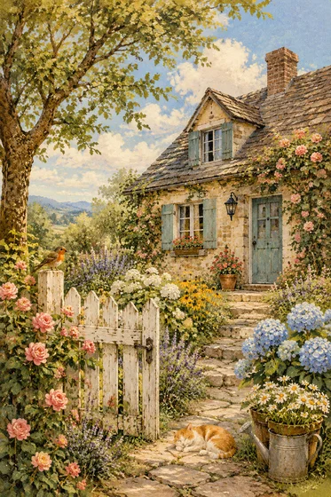</a>

本例未附图片参考，输入预览待补；素材要求见下方。

- **输入类型：** 本例仅展示结果示例；图片输入预览待补
- **素材要求：** 私人照片或纪念地点原图＋主题、展示空间气质 → 生成高分辨率艺术图 → 当前单张Wall Art
- **说明：** 每次只生成一张图片。

[在 dearsketch 查看具体要求并制作](https://dearsketch.com/intent/i158-create-printable-wall-art-and-decorative-artwork.html?utm_source=github&utm_medium=gallery&utm_campaign=dearsketch-public-cases&utm_content=i158_cta)

---

## I159 · 生成手机或桌面个性化壁纸

<strong>结果示例</strong>

本例未附图片参考，输入预览待补；素材要求见下方。

- **输入类型：** 本例仅展示结果示例；图片输入预览待补
- **素材要求：** 壁纸人物、宠物或物件原图＋设备类型、主题 → 生成指定比例背景图 → 当前单张壁纸
- **说明：** 每次只生成一张图片。

[在 dearsketch 查看具体要求并制作](https://dearsketch.com/intent/i159-create-a-personalized-phone-or-desktop-wallpaper.html?utm_source=github&utm_medium=gallery&utm_campaign=dearsketch-public-cases&utm_content=i159_cta)

---

## I160 · 把文字或图片转换为刺绣图案方向

<table>
<thead><tr><th width="50%">参考素材</th><th width="50%">结果示例</th></tr></thead>
<tbody><tr><td valign="top">
<strong>照片或 Logo 原图</strong> 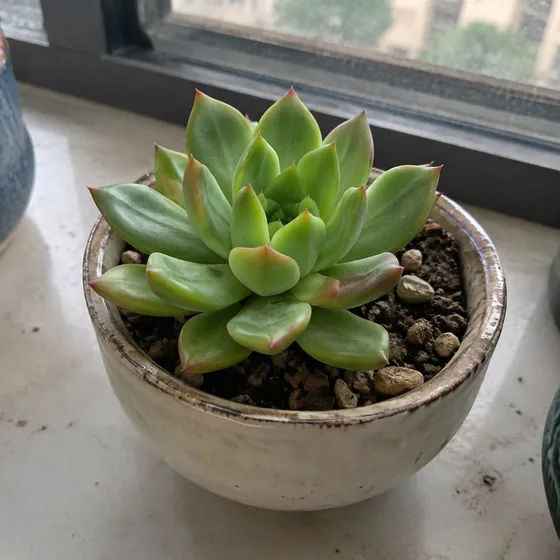
</td><td valign="top"><a href="https://dearsketch.com/intent/i160-turn-text-or-an-image-into-an-embroidery-design-direction.html?utm_source=github&amp;utm_medium=gallery&amp;utm_campaign=dearsketch-public-cases&amp;utm_content=i160_image">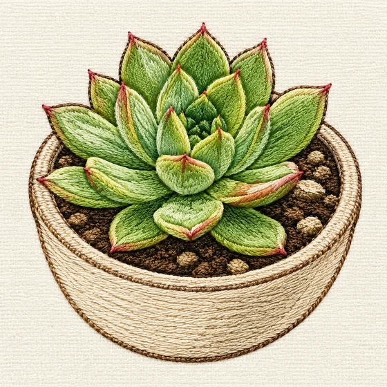</a></td></tr></tbody>
</table>

- **输入类型：** 含参考素材预览与结果示例
- **素材要求：** 照片或 Logo 原图＋纯文字主题＋刺绣用途与成品位置 → 简化颜色和轮廓并生成刺绣风图案 → 当前单张刺绣设计
- **说明：** 每次只生成一张图片。

[在 dearsketch 查看具体要求并制作](https://dearsketch.com/intent/i160-turn-text-or-an-image-into-an-embroidery-design-direction.html?utm_source=github&utm_medium=gallery&utm_campaign=dearsketch-public-cases&utm_content=i160_cta)

---

## I161 · 根据主题生成定制纹身草图

<strong>结果示例</strong>

<a href="https://dearsketch.com/intent/i161-create-a-custom-tattoo-sketch-from-a-theme.html?utm_source=github&amp;utm_medium=gallery&amp;utm_campaign=dearsketch-public-cases&amp;utm_content=i161_image">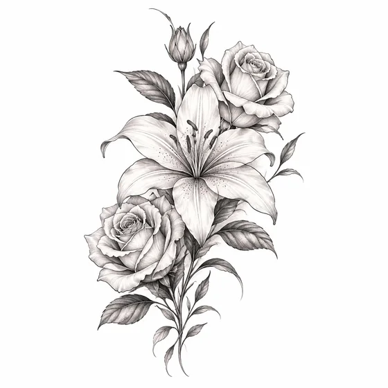</a>

本例未附图片参考，输入预览待补；素材要求见下方。

- **输入类型：** 本例仅展示结果示例；图片输入预览待补
- **素材要求：** 纪念符号或既有图案原稿＋主题、身体位置 → 生成多种线稿方向 → 当前单张纹身设计稿
- **说明：** 每次只生成一张图片。

[在 dearsketch 查看具体要求并制作](https://dearsketch.com/intent/i161-create-a-custom-tattoo-sketch-from-a-theme.html?utm_source=github&utm_medium=gallery&utm_campaign=dearsketch-public-cases&utm_content=i161_cta)

---

## I163 · 生成手提袋或手机壳个性化图案

<strong>结果示例</strong>

<a href="https://dearsketch.com/intent/i163-create-personalized-artwork-for-a-tote-bag-or-phone-case.html?utm_source=github&amp;utm_medium=gallery&amp;utm_campaign=dearsketch-public-cases&amp;utm_content=i163_image">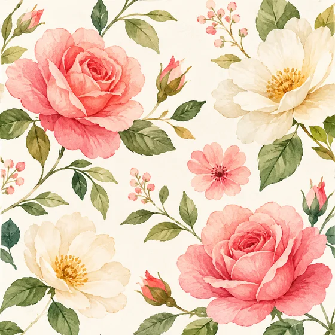</a>

本例未附图片参考，输入预览待补；素材要求见下方。

- **输入类型：** 本例仅展示结果示例；图片输入预览待补
- **素材要求：** 商品个性化照片或标志原稿＋商品类型与型号、主题 → 适配商品安全区和比例 → 当前单张商品图案
- **说明：** 每次只生成一张图片。

[在 dearsketch 查看具体要求并制作](https://dearsketch.com/intent/i163-create-personalized-artwork-for-a-tote-bag-or-phone-case.html?utm_source=github&utm_medium=gallery&utm_campaign=dearsketch-public-cases&utm_content=i163_cta)

---

## I164 · 生成可销售的节日贺卡套装

<strong>结果示例</strong>

本例未附图片参考，输入预览待补；素材要求见下方。

- **输入类型：** 本例仅展示结果示例；图片输入预览待补
- **素材要求：** 节日贺卡系列风格样板＋节日主题、卡片数量 → 生成统一风格系列 → 当前单张可打印贺卡
- **说明：** 每次只生成当前选定的一张；系列中的其他图片分别执行。

[在 dearsketch 查看具体要求并制作](https://dearsketch.com/intent/i164-create-a-sellable-set-of-holiday-greeting-cards.html?utm_source=github&utm_medium=gallery&utm_campaign=dearsketch-public-cases&utm_content=i164_cta)

---

## I165 · 生成用于布料、包装纸和壁纸的无缝纹样

<strong>结果示例</strong>

<a href="https://dearsketch.com/intent/i165-create-seamless-patterns-for-fabric-wrapping-paper-or-wallpaper.html?utm_source=github&amp;utm_medium=gallery&amp;utm_campaign=dearsketch-public-cases&amp;utm_content=i165_image">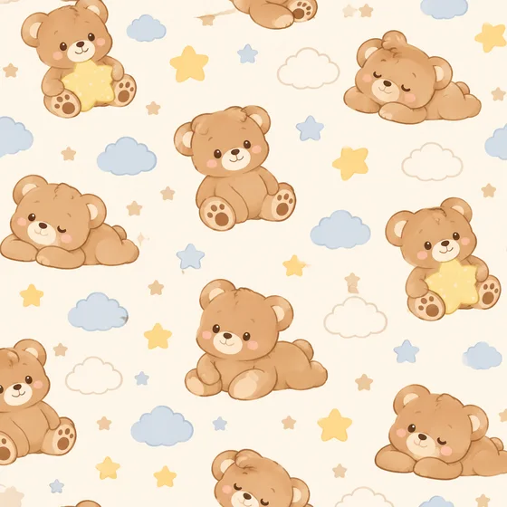</a>

本例未附图片参考，输入预览待补；素材要求见下方。

- **输入类型：** 本例仅展示结果示例；图片输入预览待补
- **素材要求：** 品牌图形或指定物种原稿＋应用材质、主题 → 生成可平铺图案 → 当前单张Seamless Pattern
- **说明：** 每次只生成一张图片。

[在 dearsketch 查看具体要求并制作](https://dearsketch.com/intent/i165-create-seamless-patterns-for-fabric-wrapping-paper-or-wallpaper.html?utm_source=github&utm_medium=gallery&utm_campaign=dearsketch-public-cases&utm_content=i165_cta)

---

## I166 · 生成适合Cricut或激光切割的矢量线稿

<table>
<thead><tr><th width="50%">参考素材</th><th width="50%">结果示例</th></tr></thead>
<tbody><tr><td valign="top">
<strong>待转换图片原稿</strong> 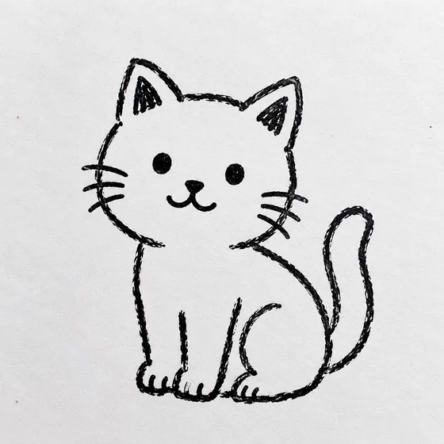
</td><td valign="top"><a href="https://dearsketch.com/intent/i166-create-vector-line-art-for-cricut-or-laser-cutting.html?utm_source=github&amp;utm_medium=gallery&amp;utm_campaign=dearsketch-public-cases&amp;utm_content=i166_image">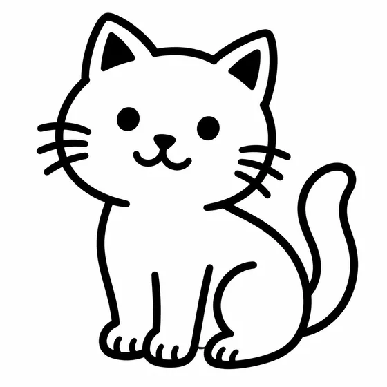</a></td></tr></tbody>
</table>

- **输入类型：** 含参考素材预览与结果示例
- **素材要求：** 待转换图片原稿＋加工方式、材料、主题或图片 → 简化为封闭路径和分层轮廓 → 当前单张SVG切割文件
- **说明：** 本次生成单张视觉预览。数据计算、精确排版、矢量或生产文件仍需对应工具校验。

[在 dearsketch 查看具体要求并制作](https://dearsketch.com/intent/i166-create-vector-line-art-for-cricut-or-laser-cutting.html?utm_source=github&utm_medium=gallery&utm_campaign=dearsketch-public-cases&utm_content=i166_cta)

---

## I167 · 生成KDP涂色书的整套页面和封面

<strong>结果示例</strong>

<a href="https://dearsketch.com/intent/i167-create-a-complete-kdp-coloring-book-with-pages-and-a-cover.html?utm_source=github&amp;utm_medium=gallery&amp;utm_campaign=dearsketch-public-cases&amp;utm_content=i167_image">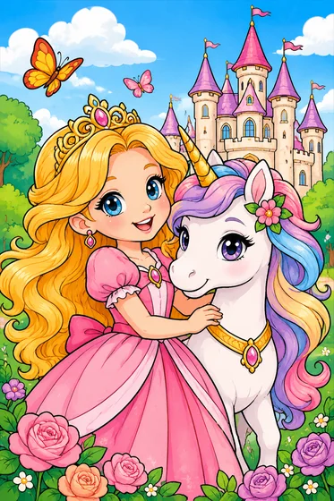</a>

本例为文字输入，未附图片参考。

- **输入类型：** 文字输入；本例仅展示结果示例
- **素材要求：** 主题、目标年龄、内页数量 → 生成统一线稿、封面和印刷尺寸 → 当前单张KDP涂色书
- **说明：** 每次只生成当前选定的一张；系列中的其他图片分别执行。

[在 dearsketch 查看具体要求并制作](https://dearsketch.com/intent/i167-create-a-complete-kdp-coloring-book-with-pages-and-a-cover.html?utm_source=github&utm_medium=gallery&utm_campaign=dearsketch-public-cases&utm_content=i167_cta)

---

## I168 · 生成高分辨率可打印海报

<strong>结果示例</strong>

本例未附图片参考，输入预览待补；素材要求见下方。

- **输入类型：** 本例仅展示结果示例；图片输入预览待补
- **素材要求：** 海报人物、作品或品牌标志原稿＋海报主题 → 生成适合大尺寸输出的视觉 → 当前单张Print-ready Poster
- **说明：** 本次生成单张视觉预览。数据计算、精确排版、矢量或生产文件仍需对应工具校验。

[在 dearsketch 查看具体要求并制作](https://dearsketch.com/intent/i168-create-a-high-resolution-printable-poster.html?utm_source=github&utm_medium=gallery&utm_campaign=dearsketch-public-cases&utm_content=i168_cta)

---

## I264 · 把Logo或插画转换为刺绣机针迹文件

<table>
<thead><tr><th width="50%">参考素材</th><th width="50%">结果示例</th></tr></thead>
<tbody><tr><td valign="top">
<strong>待刺绣数字化的透明Logo或插画</strong> 
</td><td valign="top"><a href="https://dearsketch.com/intent/i264-convert-a-logo-or-illustration-into-an-embroidery-stitch-file.html?utm_source=github&amp;utm_medium=gallery&amp;utm_campaign=dearsketch-public-cases&amp;utm_content=i264_image">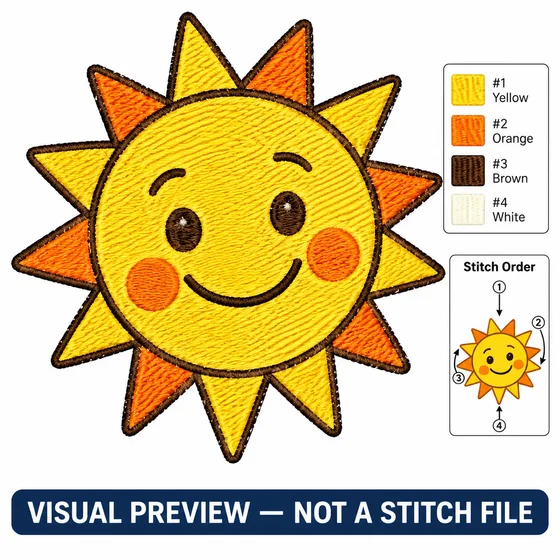</a></td></tr></tbody>
</table>

- **输入类型：** 含参考素材预览与结果示例
- **素材要求：** 必需待刺绣数字化的透明Logo或插画(1个)＋必需刺绣生产规格(1份)
- **说明：** 本次生成单张视觉预览。数据计算、精确排版、矢量或生产文件仍需对应工具校验。

[在 dearsketch 查看具体要求并制作](https://dearsketch.com/intent/i264-convert-a-logo-or-illustration-into-an-embroidery-stitch-file.html?utm_source=github&utm_medium=gallery&utm_campaign=dearsketch-public-cases&utm_content=i264_cta)

---

## I268 · 把图片或文字整理成激光雕刻切割矢量文件

<table>
<thead><tr><th width="50%">参考素材</th><th width="50%">结果示例</th></tr></thead>
<tbody><tr><td valign="top">
<strong>待雕刻/切割的图片或Logo</strong> 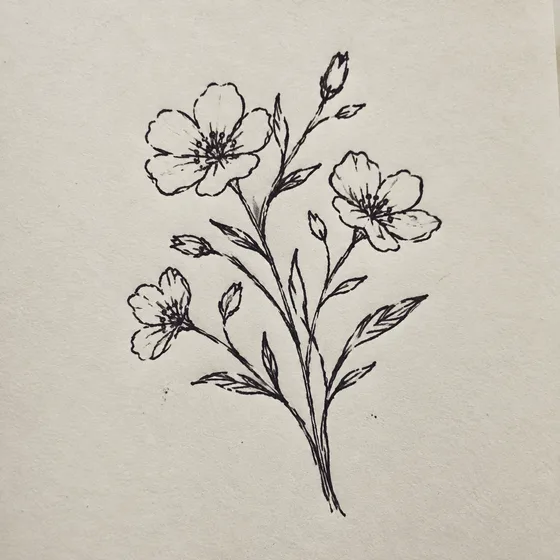
</td><td valign="top"><a href="https://dearsketch.com/intent/i268-prepare-an-image-or-text-as-a-vector-file-for-laser-engraving-or-cutting.html?utm_source=github&amp;utm_medium=gallery&amp;utm_campaign=dearsketch-public-cases&amp;utm_content=i268_image">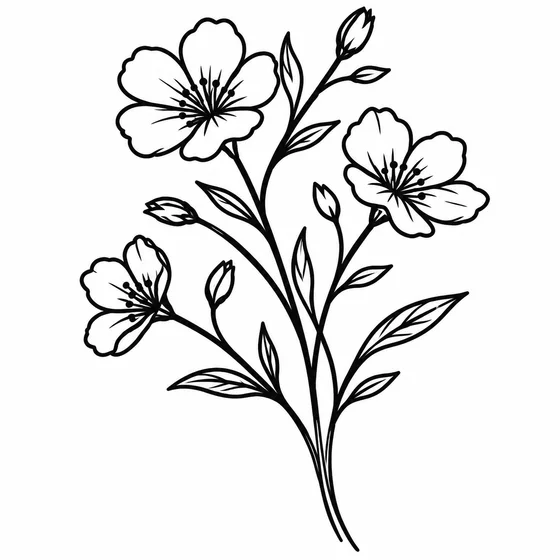</a></td></tr></tbody>
</table>

- **输入类型：** 含参考素材预览与结果示例
- **素材要求：** 可选待雕刻/切割的图片或Logo(0或1个)＋必需加工方式、材料与机器约束(1份)＋条件需加工文字与字形(1份)
- **说明：** 本次生成单张视觉预览。数据计算、精确排版、矢量或生产文件仍需对应工具校验。

[在 dearsketch 查看具体要求并制作](https://dearsketch.com/intent/i268-prepare-an-image-or-text-as-a-vector-file-for-laser-engraving-or-cutting.html?utm_source=github&utm_medium=gallery&utm_campaign=dearsketch-public-cases&utm_content=i268_cta)

---

## I271 · 把照片转换为数字油画图纸

<table>
<thead><tr><th width="50%">参考素材</th><th width="50%">结果示例</th></tr></thead>
<tbody><tr><td valign="top">
<strong>待转数字油画的主体照片</strong> 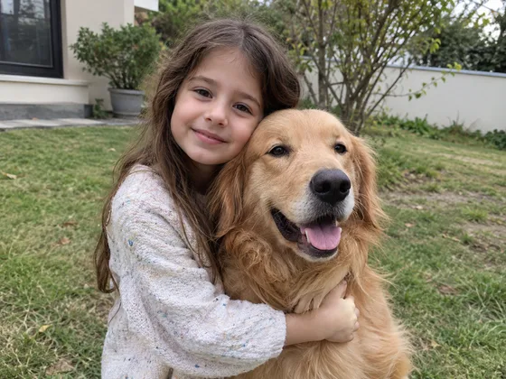
</td><td valign="top"><a href="https://dearsketch.com/intent/i271-turn-a-photo-into-a-paint-by-numbers-pattern.html?utm_source=github&amp;utm_medium=gallery&amp;utm_campaign=dearsketch-public-cases&amp;utm_content=i271_image">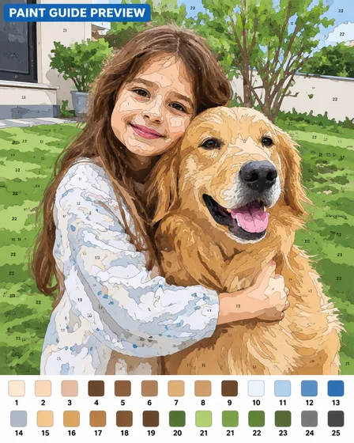</a></td></tr></tbody>
</table>

- **输入类型：** 含参考素材预览与结果示例
- **素材要求：** 必需待转数字油画的主体照片(1张)＋必需成品范围与颜料颜色数(1组)
- **说明：** 本次生成单张视觉预览。数据计算、精确排版、矢量或生产文件仍需对应工具校验。

[在 dearsketch 查看具体要求并制作](https://dearsketch.com/intent/i271-turn-a-photo-into-a-paint-by-numbers-pattern.html?utm_source=github&utm_medium=gallery&utm_campaign=dearsketch-public-cases&utm_content=i271_cta)

---

## I273 · 把照片转换为可切割或喷绘的模板图

<table>
<thead><tr><th width="50%">参考素材</th><th width="50%">结果示例</th></tr></thead>
<tbody><tr><td valign="top">
<strong>待转模板的高对比照片或Logo</strong> 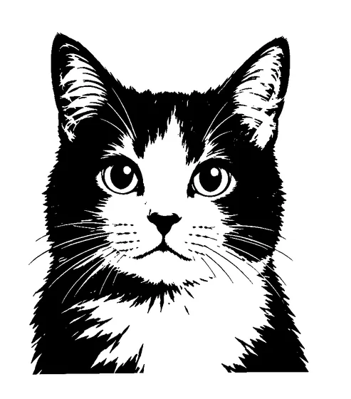
</td><td valign="top"><a href="https://dearsketch.com/intent/i273-turn-a-photo-into-a-cuttable-or-paintable-stencil.html?utm_source=github&amp;utm_medium=gallery&amp;utm_campaign=dearsketch-public-cases&amp;utm_content=i273_image">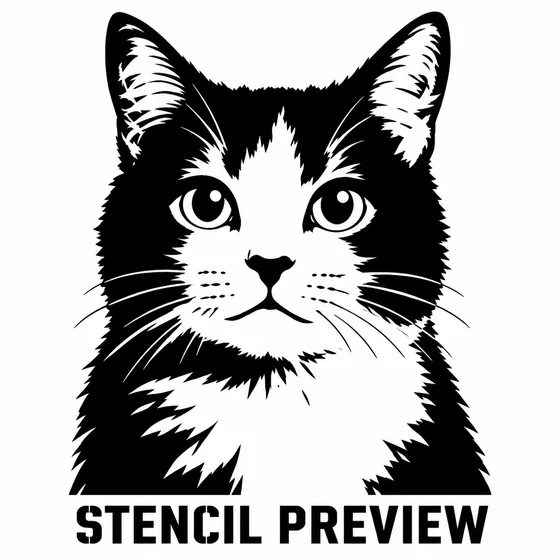</a></td></tr></tbody>
</table>

- **输入类型：** 含参考素材预览与结果示例
- **素材要求：** 必需待转模板的高对比照片或Logo(1张)＋必需模板用途、材料与最小连接(1份)
- **说明：** 本次生成单张视觉预览。数据计算、精确排版、矢量或生产文件仍需对应工具校验。

[在 dearsketch 查看具体要求并制作](https://dearsketch.com/intent/i273-turn-a-photo-into-a-cuttable-or-paintable-stencil.html?utm_source=github&utm_medium=gallery&utm_campaign=dearsketch-public-cases&utm_content=i273_cta)

---

## I284 · 用人物照片和醒目文字制作应援扇或姓名板

<table>
<thead><tr><th width="50%">参考素材</th><th width="50%">结果示例</th></tr></thead>
<tbody><tr><td valign="top">
<strong>有权使用的人物照片</strong> 
</td><td valign="top"></td></tr></tbody>
</table>

- **输入类型：** 含参考素材预览与结果示例
- **素材要求：** 必需有权使用的人物照片(1张)＋必需姓名或应援短句(1组)＋必需成品类型与代表色(1组)
- **说明：** 每次只生成一张图片。

[在 dearsketch 查看具体要求并制作](https://dearsketch.com/intent/i284-create-a-fan-support-uchiwa-or-name-board-from-a-portrait.html?utm_source=github&utm_medium=gallery&utm_campaign=dearsketch-public-cases&utm_content=i284_cta)

---

## I287 · 把多张自拍制作成四格照片条和主题边框

<table>
<thead><tr><th width="50%">参考素材</th><th width="50%">结果示例</th></tr></thead>
<tbody><tr><td valign="top">
<strong>历史参考/变换前输入</strong> 

<strong>历史参考/变换前输入</strong> 

<strong>历史参考/变换前输入</strong> 

<strong>历史参考/变换前输入</strong> 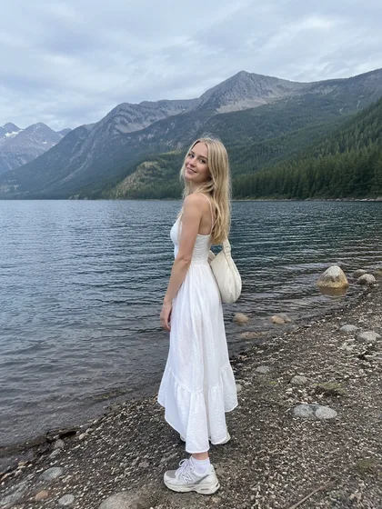
</td><td valign="top"><a href="https://dearsketch.com/intent/i287-turn-selfies-into-a-four-cut-photo-strip-with-a-themed-frame.html?utm_source=github&amp;utm_medium=gallery&amp;utm_campaign=dearsketch-public-cases&amp;utm_content=i287_image">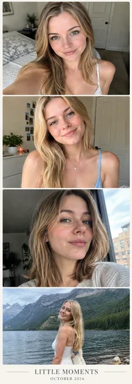</a></td></tr></tbody>
</table>

- **输入类型：** 含参考素材预览与结果示例
- **素材要求：** 必需连拍/自拍照片(2至4张)＋必需照片条上下帧顺序(1份)＋可选日期、短句、Logo与主题色(0或1组)
- **说明：** 每次只生成一张图片。

[在 dearsketch 查看具体要求并制作](https://dearsketch.com/intent/i287-turn-selfies-into-a-four-cut-photo-strip-with-a-themed-frame.html?utm_source=github&utm_medium=gallery&utm_campaign=dearsketch-public-cases&utm_content=i287_cta)
