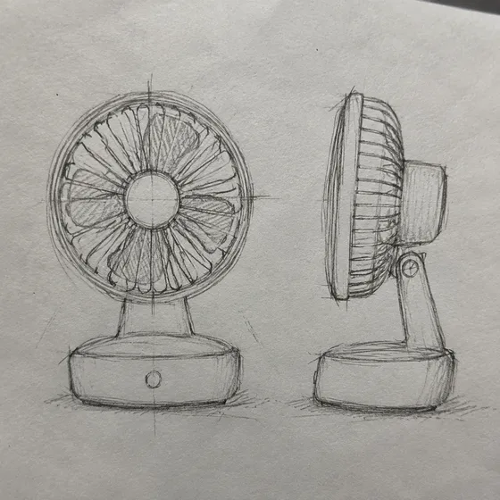

# 产品概念与工业设计

[中文](../../README.md) · [English](../../README.en.md) · [Português](../../README.pt.md) · [Español](../../README.es.md) · [Français](../../README.fr.md) · [Deutsch](../../README.de.md) · [عربي](../../README.ar.md) · [русский](../../README.ru.md) · [日本語](../../README.ja.md) · [हिंदी](../../README.hi.md)

精选目录之外的 4 个案例。这里不公开提示词，只展示现有参考素材、结果方向与最少素材要求。

[返回更多案例目录](./index.md) · [返回仓库首页](../../README.md)

> 参考素材和结果图仅作视觉指引；不保证使用相同素材能复现相同效果。

## I184 · 把产品草图转换为写实产品渲染

<table>
<thead><tr><th width="50%">参考素材</th><th width="50%">结果示例</th></tr></thead>
<tbody><tr><td valign="top">
<strong>手绘产品草图</strong> 
</td><td valign="top"></td></tr></tbody>
</table>

- **输入类型：** 含参考素材预览与结果示例
- **素材要求：** 手绘产品草图＋产品用途、草图中不可变特征 → 保留形态并生成材质、光影和背景 → 当前单张产品渲染图
- **说明：** 每次只生成一张图片。

[在 dearsketch 查看具体要求并制作](https://dearsketch.com/intent/i184-turn-a-product-sketch-into-a-realistic-product-render.html?utm_source=github&utm_medium=gallery&utm_campaign=dearsketch-public-cases&utm_content=i184_cta)

---

## I186 · 预览产品不同颜色、材质和表面处理

<table>
<thead><tr><th width="50%">参考素材</th><th width="50%">结果示例</th></tr></thead>
<tbody><tr><td valign="top">
<strong>产品图或3D渲染</strong> 
</td><td valign="top"></td></tr></tbody>
</table>

- **输入类型：** 含参考素材预览与结果示例
- **素材要求：** 产品图或3D渲染＋目标颜色或材料 → 替换颜色、材质和纹理 → 当前单张CMF方案图
- **说明：** 每次只生成一张图片。

[在 dearsketch 查看具体要求并制作](https://dearsketch.com/intent/i186-preview-product-colors-materials-and-finishes.html?utm_source=github&utm_medium=gallery&utm_campaign=dearsketch-public-cases&utm_content=i186_cta)

---

## I188 · 从草图生成家具产品效果图

<table>
<thead><tr><th width="50%">参考素材</th><th width="50%">结果示例</th></tr></thead>
<tbody><tr><td valign="top">
<strong>家具草图</strong> 
</td><td valign="top"></td></tr></tbody>
</table>

- **输入类型：** 含参考素材预览与结果示例
- **素材要求：** 家具草图＋家具用途、必须保留的结构 → 生成木材、织物和使用场景 → 当前单张家具产品渲染
- **说明：** 每次只生成一张图片。

[在 dearsketch 查看具体要求并制作](https://dearsketch.com/intent/i188-turn-a-furniture-sketch-into-a-product-render.html?utm_source=github&utm_medium=gallery&utm_campaign=dearsketch-public-cases&utm_content=i188_cta)

---

## I192 · 把界面草图转换为完成度更高的UI Mockup

<table>
<thead><tr><th width="50%">参考素材</th><th width="50%">结果示例</th></tr></thead>
<tbody><tr><td valign="top">
<strong>线框图或现有界面截图</strong> 
</td><td valign="top"></td></tr></tbody>
</table>

- **输入类型：** 含参考素材预览与结果示例
- **素材要求：** 线框图或现有界面截图＋产品类型与不可改信息架构 → 补充视觉风格、组件和设备场景 → 当前单张UI概念图
- **说明：** 每次只生成一张图片。

[在 dearsketch 查看具体要求并制作](https://dearsketch.com/intent/i192-turn-a-ui-sketch-into-a-polished-interface-mockup.html?utm_source=github&utm_medium=gallery&utm_campaign=dearsketch-public-cases&utm_content=i192_cta)
