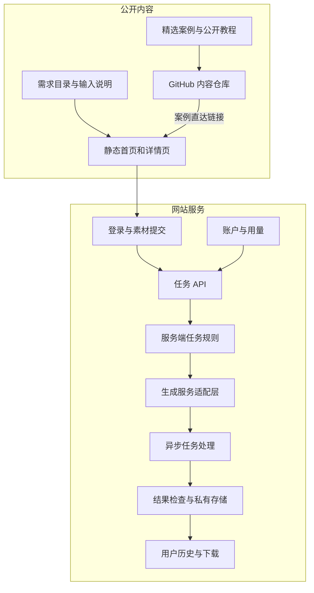

# dearsketch उत्पाद वास्तुकला

[中文](../../README.md) · [English](../../README.en.md) · [Português](../../README.pt.md) · [Español](../../README.es.md) · [Français](../../README.fr.md) · [Deutsch](../../README.de.md) · [عربي](../../README.ar.md) · [русский](../../README.ru.md) · [日本語](../../README.ja.md) · [हिंदी](../../README.hi.md)


dearsketch आवश्यकताओं की एक ब्राउज़ करने योग्य निर्देशिका में "मैं कौन सी तस्वीरें पूरी करना चाहता हूं" को व्यवस्थित करता है। प्रत्येक आवश्यकता में एक स्वतंत्र पृष्ठ होता है जो उद्देश्य, आवश्यक सामग्री और परिणाम आवश्यकताओं को समझाता है; उपयोगकर्ता संबंधित पृष्ठ से उत्पादन प्रक्रिया में प्रवेश करते हैं।

यह विवरण मॉड्यूल जिम्मेदारियों और डेटा प्रवाह का वर्णन करता है। सार्वजनिक सामग्री लाइब्रेरी, वेबसाइट सेवाएँ और जेनरेट किए गए मॉडल प्रत्येक अलग-अलग कार्य करते हैं; यह वेयरहाउस सार्वजनिक मामले, 50 नए संपादित टेम्पलेट और Agent Skill प्रदान करता है, और वेबसाइट पर ऑनलाइन उत्पादन किया जाता है।

## उपयोगकर्ता पथ


अलग-अलग असाइनमेंट के लिए फ़ोटो, निर्दिष्ट डिज़ाइन पांडुलिपियाँ, सटीक कॉपी राइटिंग, या एकाधिक चरित्र संपत्तियों की आवश्यकता हो सकती है। श्रृंखला चित्र और एकाधिक योजनाएँ एक ही आधार पर अलग-अलग तैयार की जाती हैं; जब सटीक पाठ, वैक्टर या उत्पादन फ़ाइलों की आवश्यकता होती है, तो दृश्य पूर्वावलोकन के बाद संबंधित टूल की आवश्यकता होती है।

## सामग्री और पीढ़ी स्तरीकरण



स्थैतिक सामग्री पृष्ठ खोज, व्याख्या और खोज समावेशन के लिए जिम्मेदार हैं। कार्य API उपयोगकर्ता इनपुट को सत्यापित करने और कार्य बनाने के लिए जिम्मेदार है। सर्वर-साइड नियम और पीढ़ी अनुकूलन परत चयनित आवश्यकताओं को निष्पादित करने के लिए जिम्मेदार है। इतिहास और भंडारण परत संबंधित उपयोगकर्ताओं को परिणाम लौटाने के लिए जिम्मेदार है।

चित्र में मॉड्यूल वर्तमान स्रोत कोड में जिम्मेदारियों के विभाजन को दर्शाते हैं, और सभी ऑनलाइन कार्यों, भुगतान स्थिति या सेवा स्तरों के प्रति प्रतिबद्धता नहीं हैं; उनका उपयोग करते समय, वेबसाइट द्वारा प्रदान किया गया वास्तविक प्रवेश और निर्देश मान्य होंगे।

## मॉड्यूल जिम्मेदारियाँ

| मॉड्यूल | समस्या हल हो गई |
| --- | --- |
| आवश्यकताएँ सूची | उद्देश्यों, इनपुट, आउटपुट और परिदृश्यों के साथ चित्र कार्यों को व्यवस्थित करें |
| पृष्ठ निर्माण | अपनी आवश्यकताओं के लिए स्थिर पते, पृष्ठ सामग्री और खोज मेटाडेटा उत्पन्न करें |
| अनुबंध दर्ज करें | बताएं कि कौन सी सामग्री आवश्यक है, कौन सी वैकल्पिक है, और सामग्रियों के बीच क्या संबंध हैं। |
| खाते और कार्य API | पहचान, इनपुट अखंडता सत्यापित करें और दोहराव का अनुरोध करें |
| सर्वर कार्य नियम | आवश्यकताओं और वर्तमान इनपुट के आधार पर निष्पादन सामग्री व्यवस्थित करें |
| अनुकूलन परत उत्पन्न करें | बाहरी निर्माण सेवाओं से कनेक्ट करें और अतुल्यकालिक कार्यों को संभालें |
| परिणाम और इतिहास | परिणाम जांचें, संसाधन बचाएं, और उपयुक्त उपयोगकर्ताओं तक पहुंच प्रदान करें |
| खाता और उपयोग | उपयोग योग्यताएं, अंक और ऑर्डर-संबंधित स्थिति को संभालें |

## कार्यान्वयन विधि

| परत | वर्तमान स्रोत कोड में विधि |
| --- | --- |
| सामग्री निर्माण | Node.js स्क्रिप्ट संरचित आवश्यकताओं से HTML, विवरण पृष्ठ और खोज मेटाडेटा उत्पन्न करती है |
| ब्राउज़र इंटरैक्शन | जावास्क्रिप्ट फ़िल्टरिंग, सामग्री इनपुट और कार्य स्थिति को संभालता है; कुछ इंटरैक्शन रिएक्ट का उपयोग करते हैं और Vite द्वारा पैक किए जाते हैं |
| सर्वर | Node.js मॉड्यूल प्रमाणीकरण, अपलोड, निर्माण कार्य, इतिहास और उपयोग को संभालते हैं |
| डेटा | रिलेशनल डेटाबेस खातों, संसाधन स्वामित्व और कार्य की स्थिति को रिकॉर्ड करता है |
| दस्तावेज़ | निजी वस्तु भंडारण को व्यावसायिक डेटा से अलग किया जाता है, नियंत्रित पतों के माध्यम से पहुँचा जाता है |
| उत्पन्न | सर्वर बाहरी रूप से उत्पन्न सेवाओं को अपनाता है और अतुल्यकालिक कार्यों और परिणामों को संसाधित करता है। |

ये तकनीकी विकल्प बता सकते हैं कि सिस्टम उत्पादन खाता संख्या, प्रोजेक्ट आईडी, बकेट नाम या पर्यावरण चर मानों को उजागर किए बिना काम को कैसे विभाजित करता है।

## सार्वजनिक डेटा उदाहरण

```json
{
  "id": "I026",
  "title": "宠物定制肖像",
  "input": "1张宠物照片",
  "output": "宠物肖像图片",
  "roles": [
    { "kind": "image", "label": "宠物照片", "requirement": "required", "quantity": "1张" }
  ]
}
```

ये फ़ील्ड उपयोगकर्ता के कार्यों की व्याख्या करते हैं और इनमें पूर्ण सर्वर-साइड जेनरेशन निर्देश शामिल नहीं होते हैं। चयनित केस डेटा के लिए [cases.json](../../data/cases.json) देखें, अन्य परिणाम उदाहरणों के लिए [gallery.json](../../data/gallery.json) देखें, और नए सार्वजनिक टेम्पलेट के लिए [public-prompts.json](../../data/public-prompts.json) देखें। सार्वजनिक कौशल केवल इनपुट सूचियाँ और शीघ्र शब्द तैयार करने के लिए जिम्मेदार हैं, और आंतरिक पीढ़ी के नियमों तक उनकी पहुंच नहीं है।

## पहुंच और सामग्री सीमाएँ

सार्वजनिक मामले के चित्र और उपयोगकर्ता द्वारा अपलोड किए गए संसाधन दो प्रकार की सामग्री हैं। दृश्य दिशा को दर्शाने के लिए मामलों का उपयोग किया जाता है; मूल उपयोगकर्ता छवियाँ, कार्य परिणाम और खाता रिकॉर्ड सार्वजनिक केस लाइब्रेरी से संबंधित नहीं हैं। पीढ़ी सेवा को सामग्री प्रकार, आकार और स्वामित्व को सत्यापित करने की आवश्यकता है, और उपयोगकर्ता इनपुट सर्वर की निष्पादन बाधाओं को ओवरराइड नहीं कर सकता है।

मॉड्यूल आरेख, जिम्मेदारियां, अमूर्त डेटा संरचनाएं, इनपुट विनिर्देश और सामान्य विश्वसनीयता सिद्धांत उजागर किए जा सकते हैं। सर्वर-साइड कार्यान्वयन का एक टुकड़ा या डेटाबेस संरचनाओं का एक सेट उजागर करना खुले स्रोत का एक क्षेत्र है जिसे स्वतंत्र रूप से तय किया जा सकता है; वे स्वचालित रूप से केवल इसलिए गुप्त नहीं हैं क्योंकि वे सर्वर साइड पर हैं।

इस गोदाम का दायरा मामले, बुनियादी ट्यूटोरियल और उत्पाद वास्तुकला विवरण है, और इसमें उत्पादन सेवा स्रोत कोड, आंतरिक पूर्ण कौशल या तैनाती संसाधन शामिल नहीं हैं। क्रेडेंशियल, सत्र, वास्तविक उपयोगकर्ता रिकॉर्ड और निजी संसाधन पते सार्वजनिक सामग्री नहीं हैं।

## GitHub को वेबसाइट से कैसे कनेक्ट करें

प्रत्येक चित्रित छवि और "समान बनाएं" लिंक संबंधित मांग पृष्ठ पर ले जाता है। लिंक रीडमी, केस विवरण और ट्यूटोरियल प्रविष्टियों को अलग करने के लिए स्रोत पैरामीटर का उपयोग करते हैं; ये पैरामीटर केवल स्रोत को व्यक्त करते हैं और अकेले यह साबित नहीं कर सकते कि एक सांख्यिकीय प्रणाली तैनात की गई है।

वेबसाइट में आगंतुकों के लिए कोई त्वरित शब्द इनपुट बॉक्स नहीं है। उपयोगकर्ताओं के लिए उनकी पसंद के टूल आज़माने के लिए बुनियादी ट्यूटोरियल सार्वजनिक किए जाते हैं; वेबसाइट चयनित आवश्यकताओं के आधार पर संबंधित सामग्री प्रवेश प्रदान करती है।
