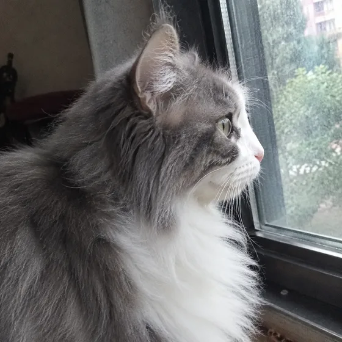
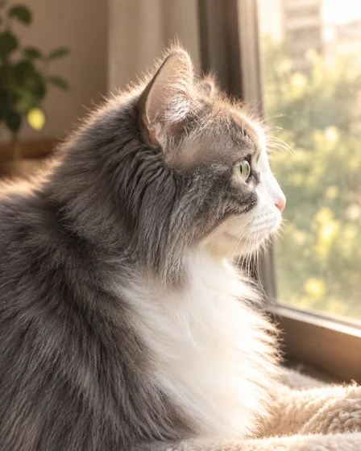

# पालतू स्मारक पोर्ट्रेट·पालतू स्मारक पेंटिंग

[中文](../../../README.md) · [English](../../../README.en.md) · [Português](../../../README.pt.md) · [Español](../../../README.es.md) · [Français](../../../README.fr.md) · [Deutsch](../../../README.de.md) · [عربي](../../../README.ar.md) · [русский](../../../README.ru.md) · [日本語](../../../README.ja.md) · [हिंदी](../../../README.hi.md)


एक पालतू जानवर की तस्वीर और पुष्ट स्मरण विवरण से एक शांत स्मारक छवि बनाएं।

अपने पालतू जानवर की मृत्यु के लिए एक स्मारक पेंटिंग बनाएं। स्मारक और स्मारक उपहारों के लिए.

[कॉपी प्रॉम्प्ट](#public-prompt) · [ dearsketch द्वारा निर्मित है / ऑनलाइन प्रयास करें](https://dearsketch.com/hi/intent/i027-create-a-pet-memorial-portrait.html?utm_source=github&utm_medium=case&utm_campaign=dearsketch-public-cases&utm_content=i027_cta) · [विषय पर लौटें / संग्रह](../guides/pets-family.md)

## संदर्भ सामग्री एवं परिणाम दिशा

<table>
<thead><tr><th width="50%">संदर्भ सामग्री</th><th width="50%">परिणामों का उदाहरण</th></tr></thead>
<tbody><tr><td valign="top"><p><strong>पालतू जानवरों की तस्वीरें</strong><br></p></td><td valign="top"><a href="https://dearsketch.com/hi/intent/i027-create-a-pet-memorial-portrait.html?utm_source=github&amp;utm_medium=case&amp;utm_campaign=dearsketch-public-cases&amp;utm_content=i027_image"></a></td></tr></tbody>
</table>

दृश्य दिशा को स्पष्ट करने के लिए संदर्भ सामग्री और परिणामों का उपयोग किया जाता है। सार्वजनिक टेम्प्लेट संलग्न छवियों के लिए मूल पीढ़ी निर्देश नहीं है, और समान परिणामों को पुन: प्रस्तुत करने की गारंटी नहीं है।

## क्या तैयारी करनी है/इनपुट

| सामग्री | प्रकार/प्रकार | मात्रा/मात्रा | शर्त/आवश्यकता |
| --- | --- | --- | --- |
| पालतू जानवरों की तस्वीरें | चित्र/छवि | 1 टुकड़ा | आवश्यक/आवश्यक |

एक समय में केवल एक ही छवि उत्पन्न होती है।

## संक्षिप्त बनाए रखें और बदलें/संपादन करें

- **संरक्षित करें / संदेश:** पालतू जानवर की पहचान और दिए गए सभी नाम और तारीखें सटीक रखें।
- **परिवर्तन / परिवर्तन:** पृष्ठभूमि, प्रकाश, पुष्प विवरण और स्मारक मनोदशा बदलें।

## Public prompt

** नव संपादित सार्वजनिक टेम्पलेट · ​​नव लिखित · पीढ़ी-परीक्षण नहीं किया गया। ** वर्गाकार ब्रैकेट पैरामीटर बदलें और छवि संपादन का समर्थन करने वाले टूल में आवश्यक सामग्री संलग्न करें; उपरोक्त तालिका के अनुसार वैकल्पिक और सशर्त इनपुट तैयार किए जाते हैं। इस पृष्ठ पर उदाहरण उत्पन्न करने के लिए इस टेम्पलेट का उपयोग नहीं किया गया था।

```text
Create one respectful memorial portrait from [PET PHOTO].
Preserve the pet’s exact facial identity, markings, eye color, ears, and natural proportions.
Use a calm [BACKGROUND], [COLOR PALETTE], and gentle [LIGHTING MOOD].
Optionally include [CONFIRMED SYMBOLS OR FLOWERS] without obscuring the pet.
If supplied, place the exact inscription “[EXACT MEMORIAL TEXT]” with [PET NAME] and [CONFIRMED DATES].
Do not infer a name, date, cause of death, religious symbol, or relationship.
If no confirmed wording is supplied, keep the image free of text.
Avoid sensational, frightening, or overly literal imagery.
Keep the final composition dignified and suitable for [FRAME / CARD / DIGITAL MEMORIAL].
Deliver one finished memorial image only, and flag all rendered text for proofreading.
```

[इसे अपनी सामग्री से ऑनलाइन बनाएं / इसे ऑनलाइन बनाएं](https://dearsketch.com/hi/intent/i027-create-a-pet-memorial-portrait.html?utm_source=github&utm_medium=case&utm_campaign=dearsketch-public-cases&utm_content=i027_after-prompt) · [एजेंट को इसे व्यवस्थित करने में मदद करने दें / कौशल का उपयोग करें](../quickstart.md#agent-skill)

## मुख्य बिंदुओं की जाँच करें/समीक्षा करें

नाम, दिनांक या शिलालेखों के लिए केवल पुष्टि की गई जानकारी का उपयोग करें; जब टेक्स्ट की आवश्यकता न हो तो स्क्रीन को साफ रखें।

प्रत्येक नाम, दिनांक और शिलालेख को सत्यापित करें; जब किसी की भी पुष्टि न हो तो पाठ को छोड़ दें।

इस दिशा में परिणाम: पालतू स्मारक चित्र। जब सटीक पाठ, पारदर्शी फ़ाइलें, वैक्टर या प्रिंट डिलीवरी की आवश्यकता हो, तो वास्तविक फ़ाइल की जाँच करें; उपलब्ध सुविधाएँ और शुल्क वेबसाइट विवरण के अधीन हैं।

## संबंधित मामले/संबंधित कार्य

- [एक पालतू जानवर की तस्वीर को एक कस्टम पोर्ट्रेट में बदलें · पालतू जानवर का कस्टम पोर्ट्रेट ](./i026-turn-a-pet-photo-into-a-custom-portrait.md#public-prompt)
- [एक पालतू जानवर को शाही या ऐतिहासिक चित्र में बदलें · पालतू शाही चित्र](./i028-turn-a-pet-into-a-royal-or-historical-portrait.md#public-prompt)
- [किसी पालतू जानवर को चंचल बाथरूम या रसोई के दृश्य में रखें · पालतू जानवर की दिलचस्प दृश्य पेंटिंग ](./i029-place-a-pet-in-a-playful-bathroom-or-kitchen-scene.md#public-prompt)

## आवश्यकताएँ पृष्ठभूमि संदर्भ

- [Etsy AI पालतू चित्र](https://www.etsy.com/market/ai_pet_portrait)

ये लिंक केवल उद्देश्य को समझने में सहायता के लिए हैं और इस पृष्ठ पर छवियों के स्रोत या प्राधिकरण का प्रमाण नहीं हैं।

चित्रों और सामग्रियों के उपयोग के दायरे के लिए, [ सामग्री विवरण ](../content-policy.md) देखें। [सभी 50 टेम्पलेट देखें ](../prompts.md).
