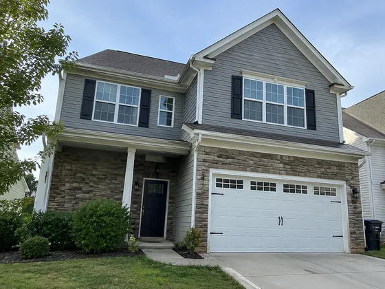
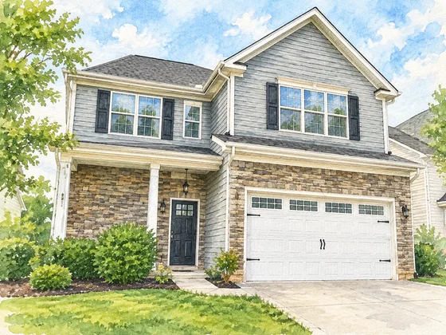

# हाउस वॉटरकलर उपहार · हाउस वॉटरकलर मेमोरियल पेंटिंग

[中文](../../../README.md) · [English](../../../README.en.md) · [Português](../../../README.pt.md) · [Español](../../../README.es.md) · [Français](../../../README.fr.md) · [Deutsch](../../../README.de.md) · [عربي](../../../README.ar.md) · [русский](../../../README.ru.md) · [日本語](../../../README.ja.md) · [हिंदी](../../../README.hi.md)


घर की तस्वीर को जलरंग या रेखा-कला स्मृतिचिह्न में बदलें।

आवासीय तस्वीरों को जल रंग या रेखाचित्र स्मारक चित्रों में परिवर्तित करें। घर के स्थानांतरण और घर की बिक्री का जश्न मनाने के लिए उपयोग किया जाता है।

[कॉपी प्रॉम्प्ट](#public-prompt) · [ dearsketch द्वारा निर्मित है / ऑनलाइन प्रयास करें](https://dearsketch.com/hi/intent/i030-turn-a-house-photo-into-a-watercolor-or-line-art-keepsake.html?utm_source=github&utm_medium=case&utm_campaign=dearsketch-public-cases&utm_content=i030_cta) · [विषय पर लौटें / संग्रह](../guides/spaces.md)

## संदर्भ सामग्री एवं परिणाम दिशा

<table>
<thead><tr><th width="50%">संदर्भ सामग्री</th><th width="50%">परिणामों का उदाहरण</th></tr></thead>
<tbody><tr><td valign="top"><p><strong>घर की तस्वीरें</strong><br></p></td><td valign="top"><a href="https://dearsketch.com/hi/intent/i030-turn-a-house-photo-into-a-watercolor-or-line-art-keepsake.html?utm_source=github&amp;utm_medium=case&amp;utm_campaign=dearsketch-public-cases&amp;utm_content=i030_image"></a></td></tr></tbody>
</table>

दृश्य दिशा को स्पष्ट करने के लिए संदर्भ सामग्री और परिणामों का उपयोग किया जाता है। सार्वजनिक टेम्प्लेट संलग्न छवियों के लिए मूल पीढ़ी निर्देश नहीं है, और समान परिणामों को पुन: प्रस्तुत करने की गारंटी नहीं है।

## क्या तैयारी करनी है/इनपुट

| सामग्री | प्रकार/प्रकार | मात्रा/मात्रा | शर्त/आवश्यकता |
| --- | --- | --- | --- |
| घर की तस्वीरें | चित्र/छवि | 1 टुकड़ा | आवश्यक/आवश्यक |

एक समय में केवल एक ही छवि उत्पन्न होती है।

## संक्षिप्त बनाए रखें और बदलें/संपादन करें

- **संरक्षित / संरक्षित करें:** छत, दरवाजे, खिड़कियां, मुखौटे के अनुपात और विशिष्ट साइट विशेषताओं को रखें।
- **परिवर्तन / परिवर्तन:** माध्यम बदलें, पृष्ठभूमि सरलीकरण, भूदृश्य पर जोर और पैलेट।

## Public prompt

** नव संपादित सार्वजनिक टेम्पलेट · ​​नव लिखित · पीढ़ी-परीक्षण नहीं किया गया। ** वर्गाकार ब्रैकेट पैरामीटर बदलें और छवि संपादन का समर्थन करने वाले टूल में आवश्यक सामग्री संलग्न करें; उपरोक्त तालिका के अनुसार वैकल्पिक और सशर्त इनपुट तैयार किए जाते हैं। इस पृष्ठ पर उदाहरण उत्पन्न करने के लिए इस टेम्पलेट का उपयोग नहीं किया गया था।

```text
Create one house keepsake artwork from [HOUSE PHOTO].
Preserve the exact roofline, facade proportions, doors, windows, porch, chimney, and distinctive architectural features.
Render the building in [WATERCOLOR / INK LINE / MIXED MEDIA] with [PALETTE].
Simplify distracting cars, bins, or background clutter only as requested in [REMOVAL LIST].
Retain meaningful landscaping and site features listed in [KEEP LIST].
Keep perspective, number of stories, and placement of openings faithful to the reference.
Use a clean [PAPER / MINIMAL BACKGROUND] suitable for [PRINT OR GIFT].
Do not invent extensions, alter the property design, or present this as a measured drawing.
Add an address or caption only when [EXACT TEXT] is supplied and proofread it.
Deliver one finished keepsake image only.
```

[इसे अपनी सामग्री से ऑनलाइन बनाएं / इसे ऑनलाइन बनाएं](https://dearsketch.com/hi/intent/i030-turn-a-house-photo-into-a-watercolor-or-line-art-keepsake.html?utm_source=github&utm_medium=case&utm_campaign=dearsketch-public-cases&utm_content=i030_after-prompt) · [एजेंट को इसे व्यवस्थित करने में मदद करने दें / कौशल का उपयोग करें](../quickstart.md#agent-skill)

## मुख्य बिंदुओं की जाँच करें/समीक्षा करें

छत, दरवाजे, खिड़कियाँ और इमारत की रूपरेखा बनाए रखें, और घर को किसी अन्य इमारत की तरह पेंट न करें।

इमारत के आकार और खुलेपन की तुलना करें ताकि यह एक अलग घर न बन जाए।

परिणाम दिशा: गृह चित्र. जब सटीक पाठ, पारदर्शी फ़ाइलें, वैक्टर या प्रिंट डिलीवरी की आवश्यकता हो, तो वास्तविक फ़ाइल की जाँच करें; उपलब्ध सुविधाएँ और शुल्क वेबसाइट विवरण के अधीन हैं।

## संबंधित मामले/संबंधित कार्य

- [एक कमरे के फोटो में विभिन्न आंतरिक शैलियों का पूर्वावलोकन करें · कमरे की सजावट शैली का पूर्वावलोकन](./i169-preview-different-interior-styles-in-a-room-photo.md#public-prompt)
- [एक यार्ड फोटो से एक लैंडस्केप मेकओवर अवधारणा बनाएं · यार्ड लैंडस्केप नवीनीकरण ](./i178-create-a-landscape-makeover-concept-from-a-yard-photo.md#public-prompt)
- [दीवार पेंट, फर्श और वॉलपेपर का पूर्वावलोकन करें · दीवार पेंट और फर्श सामग्री चयन पूर्वावलोकन ](./i171-preview-wall-paint-flooring-and-wallpaper.md#public-prompt)

## आवश्यकताएँ पृष्ठभूमि संदर्भ

- [Etsy पारिवारिक पोर्ट्रेट](https://www.etsy.com/market/ai_family_portrait)
- [OpenArt छवि ](https://openart.ai/generator/sketch/) का स्केच

ये लिंक केवल उद्देश्य को समझने में सहायता के लिए हैं और इस पृष्ठ पर छवियों के स्रोत या प्राधिकरण का प्रमाण नहीं हैं।

चित्रों और सामग्रियों के उपयोग के दायरे के लिए, [ सामग्री विवरण ](../content-policy.md) देखें। [सभी 50 टेम्पलेट देखें ](../prompts.md).
