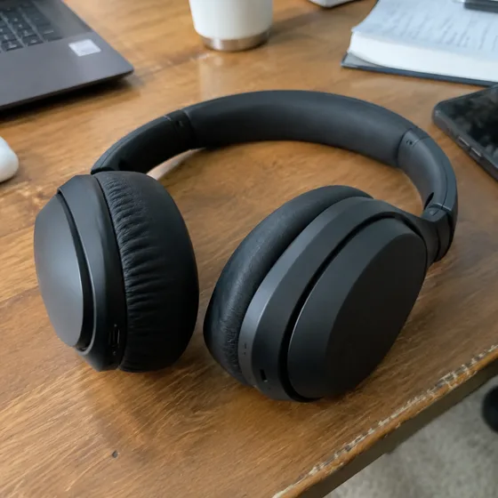

# स्टूडियो उत्पाद फ़ोटो · उत्पाद स्टूडियो फ़ोटो

[中文](../../../README.md) · [English](../../../README.en.md) · [Português](../../../README.pt.md) · [Español](../../../README.es.md) · [Français](../../../README.fr.md) · [Deutsch](../../../README.de.md) · [عربي](../../../README.ar.md) · [русский](../../../README.ru.md) · [日本語](../../../README.ja.md) · [हिंदी](../../../README.hi.md)


उत्पाद के तथ्यों को बरकरार रखते हुए पेशेवर स्टूडियो लाइटिंग के साथ उत्पाद की तस्वीर को पुनर्स्थापित करें।

साधारण फ़ोटो को पेशेवर स्टूडियो उत्पाद फ़ोटो में बदलें। उत्पाद कैटलॉग और ब्रांड आधिकारिक वेबसाइटों के लिए उपयोग किया जाता है।

[कॉपी प्रॉम्प्ट](#public-prompt) · [ dearsketch द्वारा निर्मित है / ऑनलाइन प्रयास करें](https://dearsketch.com/hi/intent/i068-turn-an-ordinary-photo-into-a-professional-studio-product-shot.html?utm_source=github&utm_medium=case&utm_campaign=dearsketch-public-cases&utm_content=i068_cta) · [विषय पर लौटें / संग्रह](../guides/products.md)

## संदर्भ सामग्री एवं परिणाम दिशा

<table>
<thead><tr><th width="50%">संदर्भ सामग्री</th><th width="50%">परिणामों का उदाहरण</th></tr></thead>
<tbody><tr><td valign="top"><p><strong>उत्पाद तस्वीरें</strong><br></p></td><td valign="top"><a href="https://dearsketch.com/hi/intent/i068-turn-an-ordinary-photo-into-a-professional-studio-product-shot.html?utm_source=github&amp;utm_medium=case&amp;utm_campaign=dearsketch-public-cases&amp;utm_content=i068_image"></a></td></tr></tbody>
</table>

दृश्य दिशा को स्पष्ट करने के लिए संदर्भ सामग्री और परिणामों का उपयोग किया जाता है। सार्वजनिक टेम्प्लेट संलग्न छवियों के लिए मूल पीढ़ी निर्देश नहीं है, और समान परिणामों को पुन: प्रस्तुत करने की गारंटी नहीं है।

## क्या तैयारी करनी है/इनपुट

| सामग्री | प्रकार/प्रकार | मात्रा/मात्रा | शर्त/आवश्यकता |
| --- | --- | --- | --- |
| उत्पाद तस्वीरें | चित्र/छवि | 1 टुकड़ा | आवश्यक/आवश्यक |

एक समय में केवल एक ही छवि उत्पन्न होती है।

## संक्षिप्त बनाए रखें और बदलें/संपादन करें

- **संरक्षित / संरक्षित करें:** ज्यामिति, लेबल, रंग, सामग्री, बनावट और शामिल घटकों को रखें।
- **बदलें / बदलाव:** पृष्ठभूमि, प्रकाश व्यवस्था, कैमरा पॉलिश और छाया उपचार बदलें।

## Public prompt

** नव संपादित सार्वजनिक टेम्पलेट · ​​नव लिखित · पीढ़ी-परीक्षण नहीं किया गया। ** वर्गाकार ब्रैकेट पैरामीटर बदलें और छवि संपादन का समर्थन करने वाले टूल में आवश्यक सामग्री संलग्न करें; उपरोक्त तालिका के अनुसार वैकल्पिक और सशर्त इनपुट तैयार किए जाते हैं। इस पृष्ठ पर उदाहरण उत्पन्न करने के लिए इस टेम्पलेट का उपयोग नहीं किया गया था।

```text
Create one polished studio product image from [PRODUCT PHOTO].
Preserve the product’s exact geometry, proportions, colors, labels, material appearance, controls, openings, and included parts.
Use [STUDIO BACKDROP], [KEY LIGHT], [FILL], and [RIM OR ACCENT LIGHT] to clarify form.
Choose [CAMERA ANGLE] and [CROP] appropriate for [CATALOG OR BRAND USE].
Render contact shadow, reflections, translucency, and highlights consistently with the actual material.
Remove unrelated dust or capture distractions only when listed in [CLEANUP REQUEST].
Do not redesign packaging, sharpen unreadable text into invented words, or add features.
Avoid excessive gloss, fake texture, floating products, and impossible reflections.
Keep the result credible as a presentation of the supplied item.
Deliver one studio product image only.
```

[इसे अपनी सामग्री से ऑनलाइन बनाएं / इसे ऑनलाइन बनाएं](https://dearsketch.com/hi/intent/i068-turn-an-ordinary-photo-into-a-professional-studio-product-shot.html?utm_source=github&utm_medium=case&utm_campaign=dearsketch-public-cases&utm_content=i068_after-prompt) · [एजेंट को इसे व्यवस्थित करने में मदद करने दें / कौशल का उपयोग करें](../quickstart.md#agent-skill)

## मुख्य बिंदुओं की जाँच करें/समीक्षा करें

लेबल, संरचना और सामग्री को तथ्यात्मक रखें और जांचें कि प्रतिबिंब प्राकृतिक हैं।

प्रतिबिंबों का निरीक्षण करें और सुनिश्चित करें कि कोई उत्पाद विवरण या सामग्री दावा नहीं बदला गया है।

परिणाम दिशा: स्टूडियो-गुणवत्ता वाले उत्पाद चित्र। जब सटीक पाठ, पारदर्शी फ़ाइलें, वैक्टर या प्रिंट डिलीवरी की आवश्यकता हो, तो वास्तविक फ़ाइल की जाँच करें; उपलब्ध सुविधाएँ और शुल्क वेबसाइट विवरण के अधीन हैं।

## संबंधित मामले/संबंधित कार्य

- [एक साधारण उत्पाद फोटो को सफेद पृष्ठभूमि सूची छवि में बदलें · उत्पाद सफेद पृष्ठभूमि वाली मुख्य छवि ](./i065-turn-an-ordinary-product-photo-into-a-white-background-listing-image.md#public-prompt)
- [एक पारदर्शी पृष्ठभूमि के साथ पुन: प्रयोज्य उत्पाद PNG बनाएं · पारदर्शी निचली उत्पाद सामग्री ](./i066-create-a-reusable-product-png-with-a-transparent-background.md#public-prompt)
- [किसी उत्पाद को यथार्थवादी जीवनशैली दृश्य में रखें · उत्पाद जीवनशैली दृश्य](./i067-place-a-product-in-a-realistic-lifestyle-scene.md#public-prompt)

## आवश्यकताएँ पृष्ठभूमि संदर्भ

- [फोटोरूम AI टूल](https://help.photoroom.com/en/articles/11495331-introduction-to-ai-tools-in-photoroom)
- [Pixelcut उत्पाद स्टूडियो](https://www.pixelcut.ai/ai-product-photography)

ये लिंक केवल उद्देश्य को समझने में सहायता के लिए हैं और इस पृष्ठ पर छवियों के स्रोत या प्राधिकरण का प्रमाण नहीं हैं।

चित्रों और सामग्रियों के उपयोग के दायरे के लिए, [ सामग्री विवरण ](../content-policy.md) देखें। [सभी 50 टेम्पलेट देखें ](../prompts.md).
