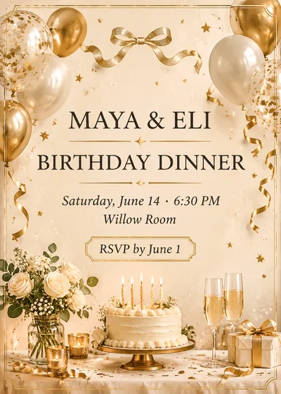

# इवेंट आमंत्रण · टेक्स्ट आमंत्रण

[中文](../../../README.md) · [English](../../../README.en.md) · [Português](../../../README.pt.md) · [Español](../../../README.es.md) · [Français](../../../README.fr.md) · [Deutsch](../../../README.de.md) · [عربي](../../../README.ar.md) · [русский](../../../README.ru.md) · [日本語](../../../README.ja.md) · [हिंदी](../../../README.hi.md)


अकेले पाठ से अपने निर्दिष्ट संक्षिप्त विवरण के लिए एक सचित्र निमंत्रण बनाएं।

शादी, जन्मदिन या पार्टी के निमंत्रण तैयार करें। शादियों, जन्मदिनों, पार्टियों के लिए उपयोग करें।

[कॉपी प्रॉम्प्ट](#public-prompt) · [ dearsketch द्वारा निर्मित है / ऑनलाइन प्रयास करें](https://dearsketch.com/hi/intent/i113-create-a-wedding-birthday-or-party-invitation.html?utm_source=github&utm_medium=case&utm_campaign=dearsketch-public-cases&utm_content=i113_cta) · [विषय पर लौटें / संग्रह](../guides/text-only.md)

## संदर्भ सामग्री एवं परिणाम दिशा

<p><strong>परिणामों का उदाहरण</strong></p>
<p><a href="https://dearsketch.com/hi/intent/i113-create-a-wedding-birthday-or-party-invitation.html?utm_source=github&amp;utm_medium=case&amp;utm_campaign=dearsketch-public-cases&amp;utm_content=i113_image"></a></p>
<p>यह उदाहरण टेक्स्ट इनपुट है, कोई चित्र संदर्भ संलग्न नहीं है।</p>

दृश्य दिशा को स्पष्ट करने के लिए संदर्भ सामग्री और परिणामों का उपयोग किया जाता है। सार्वजनिक टेम्प्लेट संलग्न छवियों के लिए मूल पीढ़ी निर्देश नहीं है, और समान परिणामों को पुन: प्रस्तुत करने की गारंटी नहीं है।

## क्या तैयारी करनी है/इनपुट

| सामग्री | प्रकार/प्रकार | मात्रा/मात्रा | शर्त/आवश्यकता |
| --- | --- | --- | --- |
| पाठ निर्माण संक्षिप्त: शीघ्र शब्दों में विषय, उद्देश्य और तथ्यात्मक पैरामीटर भरें | चरित्र/पाठ | 1 सर्विंग | आवश्यक/आवश्यक |

**शुद्ध पाठ निर्माण / केवल पाठ: कोई छवि, लोगो, स्केच या अन्य अनुलग्नक की आवश्यकता नहीं है।** नई अवधारणाएँ बनाने के लिए केवल नीचे दिए गए संक्षिप्त पाठ का उपयोग करें।

एक समय में केवल एक छवि उत्पन्न होती है, छवियों को अपलोड करने की कोई आवश्यकता नहीं है।

## संक्षिप्त बनाए रखें और बदलें/संपादन करें

- **संरक्षित करें / संदेश:** आपूर्ति किए गए लिखित तथ्यों, सटीक शब्दों और बाधाओं का सम्मान करें।
- **बदलें / परिवर्तन:** [ILLUSTRATION THEME], [PALETTE] और [FORMAT] का उपयोग करें। “[EVENT NAME]”, “[CONFIRMED DATE AND TIME]”, “[LOCATION OR JOIN INSTRUCTIONS]” और “[RSVP]” को उसी क्रम में व्यवस्थित करें।

## Public prompt

**नया संकलित सार्वजनिक टेम्पलेट · ​​नवलिखित · पीढ़ी-परीक्षणित नहीं।** बस वर्गाकार ब्रैकेट पैरामीटर बदलें, संदर्भ चित्र अपलोड करने की कोई आवश्यकता नहीं है। इस पृष्ठ पर उदाहरण उत्पन्न करने के लिए इस टेम्पलेट का उपयोग नहीं किया गया था।

```text
Create one illustrated invitation for [EVENT TYPE] from the following written brief only. No reference image or other attachment is needed.
Use [ILLUSTRATION THEME], [PALETTE] and [FORMAT]. Arrange “[EVENT NAME]”, “[CONFIRMED DATE AND TIME]”, “[LOCATION OR JOIN INSTRUCTIONS]” and “[RSVP]” in that order.
Omit any unspecified personal detail; proofread all event information before sending.
Use an original design. Do not imply fidelity to any existing person, product, property or artwork that has not been supplied.
Return one finished image only. Replace every bracketed field with your own details before generating.
```

[इसे अपनी सामग्री से ऑनलाइन बनाएं / इसे ऑनलाइन बनाएं](https://dearsketch.com/hi/intent/i113-create-a-wedding-birthday-or-party-invitation.html?utm_source=github&utm_medium=case&utm_campaign=dearsketch-public-cases&utm_content=i113_after-prompt) · [एजेंट को इसे व्यवस्थित करने में मदद करने दें / कौशल का उपयोग करें](../quickstart.md#agent-skill)

## मुख्य बिंदुओं की जाँच करें/समीक्षा करें

किसी भी अनिर्दिष्ट व्यक्तिगत विवरण को छोड़ दें; भेजने से पहले सभी घटना जानकारी को प्रूफ़रीड करें।

किसी भी अनिर्दिष्ट व्यक्तिगत विवरण को छोड़ दें; भेजने से पहले सभी घटना जानकारी को प्रूफ़रीड करें।

परिणाम दिशा: निमंत्रण. जब सटीक पाठ, पारदर्शी फ़ाइलें, वैक्टर या प्रिंट डिलीवरी की आवश्यकता हो, तो वास्तविक फ़ाइल की जाँच करें; उपलब्ध सुविधाएँ और शुल्क वेबसाइट विवरण के अधीन हैं।

## संबंधित मामले/संबंधित कार्य

- [YouTube या स्ट्रीमिंग के लिए एक प्रोफ़ाइल चित्र बनाएं · टेक्स्ट-जनरेटेड चैनल अवतार ](./i054-create-a-profile-picture-for-youtube-or-streaming.md#public-prompt)
- [टेक्स्ट से एक कस्टम इमोजी बनाएं · कस्टम इमोजी](./i057-create-a-custom-emoji-from-text.md#public-prompt)
- [कपड़ों के लिए निर्बाध प्रिंट और फैब्रिक पैटर्न बनाएं · ](./i100-create-seamless-prints-and-fabric-patterns-for-clothing.md#public-prompt)

## आवश्यकताएँ पृष्ठभूमि संदर्भ

- [फ़ोटर फ़ंक्शन सेंटर](https://www.fotor.com/features/)

ये लिंक केवल उद्देश्य को समझने में सहायता के लिए हैं और इस पृष्ठ पर छवियों के स्रोत या प्राधिकरण का प्रमाण नहीं हैं।

चित्रों और सामग्रियों के उपयोग के दायरे के लिए, [ सामग्री विवरण ](../content-policy.md) देखें। [सभी 100 टेम्पलेट देखें ](../prompts.md).
