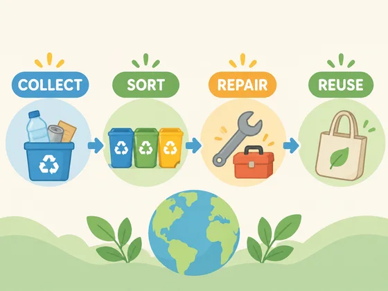

# संकल्पना इन्फोग्राफिक · संकल्पना इन्फोग्राफिक

[中文](../../../README.md) · [English](../../../README.en.md) · [Português](../../../README.pt.md) · [Español](../../../README.es.md) · [Français](../../../README.fr.md) · [Deutsch](../../../README.de.md) · [عربي](../../../README.ar.md) · [русский](../../../README.ru.md) · [日本語](../../../README.ja.md) · [हिंदी](../../../README.hi.md)


सत्यापित तथ्यों और संबंधों को एक स्पष्ट इन्फोग्राफिक दृश्य में बदलें।

जटिल अवधारणाओं को इन्फोग्राफिक के मुख्य दृश्य में बदलें। रिपोर्टिंग, सोशल मीडिया, शिक्षा के लिए।

[कॉपी प्रॉम्प्ट](#public-prompt) · [ dearsketch द्वारा निर्मित है / ऑनलाइन प्रयास करें](https://dearsketch.com/hi/intent/i118-turn-a-complex-concept-into-an-infographic-visual.html?utm_source=github&utm_medium=case&utm_campaign=dearsketch-public-cases&utm_content=i118_cta) · [विषय पर लौटें / संग्रह](../guides/design.md)

## संदर्भ सामग्री एवं परिणाम दिशा

<p><strong>परिणामों का उदाहरण</strong></p>
<p><a href="https://dearsketch.com/hi/intent/i118-turn-a-complex-concept-into-an-infographic-visual.html?utm_source=github&amp;utm_medium=case&amp;utm_campaign=dearsketch-public-cases&amp;utm_content=i118_image"></a></p>
<p>इस उदाहरण में चित्र संदर्भ शामिल नहीं है, और इनपुट पूर्वावलोकन पूरा किया जाना है; सामग्री संबंधी आवश्यकताएँ नीचे देखें।</p>

दृश्य दिशा को स्पष्ट करने के लिए संदर्भ सामग्री और परिणामों का उपयोग किया जाता है। सार्वजनिक टेम्प्लेट संलग्न छवियों के लिए मूल पीढ़ी निर्देश नहीं है, और समान परिणामों को पुन: प्रस्तुत करने की गारंटी नहीं है।

## क्या तैयारी करनी है/इनपुट

| सामग्री | प्रकार/प्रकार | मात्रा/मात्रा | शर्त/आवश्यकता |
| --- | --- | --- | --- |
| सूचना संरचना का एक स्केच पहले से ही मौजूद है | चित्र/छवि | 0-1; कई सामग्रियों को एक लेबल वाले संदर्भ बोर्ड में जोड़ा जा सकता है | वैकल्पिक/वैकल्पिक: जब उपयोगकर्ता के पास पहले से ही एक प्रक्रिया, पदानुक्रम या संबंध रेखाचित्र हो |
| तथ्यात्मक सामग्री, सूचना संरचना या संबंध | चरित्र/पाठ | 1 सर्विंग | आवश्यक/आवश्यक |

इस बार एकल दृश्य पूर्वावलोकन तैयार किया गया है. डेटा गणना, सटीक टाइपसेटिंग, वेक्टर या उत्पादन फ़ाइलों को अभी भी संबंधित टूल द्वारा सत्यापित करने की आवश्यकता है।

## संक्षिप्त बनाए रखें और बदलें/संपादन करें

- **संरक्षित करें / संदेश:** सभी तथ्यों, संख्याओं, क्रम, पदानुक्रम और संबंधों को बिल्कुल आपूर्ति के अनुसार रखें।
- **बदलें / परिवर्तन:** आइकनोग्राफी, लेआउट, रंग कोडिंग, विज़ुअल ग्रुपिंग और जोर बदलें।

## Public prompt

** नव संपादित सार्वजनिक टेम्पलेट · ​​नव लिखित · पीढ़ी-परीक्षण नहीं किया गया। ** वर्गाकार ब्रैकेट पैरामीटर बदलें और छवि संपादन का समर्थन करने वाले टूल में आवश्यक सामग्री संलग्न करें; उपरोक्त तालिका के अनुसार वैकल्पिक और सशर्त इनपुट तैयार किए जाते हैं। इस पृष्ठ पर उदाहरण उत्पन्न करने के लिए इस टेम्पलेट का उपयोग नहीं किया गया था।

```text
Create one infographic from [VERIFIED FACTS, STRUCTURE, AND RELATIONSHIPS] and [OPTIONAL STRUCTURE SKETCH].
Preserve every supplied fact, number, unit, sequence, category, and relationship exactly.
Use [FLOW / HIERARCHY / COMPARISON / TIMELINE] as the primary information structure.
Design a clear visual hierarchy with [PALETTE], consistent icons, labels, and generous spacing.
Connect elements only according to the supplied relationships; do not infer missing links.
Do not invent statistics, causes, conclusions, citations, or categories.
Keep text concise but do not paraphrase terms whose exact wording matters.
Treat generated lettering, charts, and symbols as a draft requiring factual and typographic review.
Rebuild precise charts, vectors, and accessible text in an appropriate production tool.
Deliver one infographic preview image only.
```

[इसे अपनी सामग्री से ऑनलाइन बनाएं / इसे ऑनलाइन बनाएं](https://dearsketch.com/hi/intent/i118-turn-a-complex-concept-into-an-infographic-visual.html?utm_source=github&utm_medium=case&utm_campaign=dearsketch-public-cases&utm_content=i118_after-prompt) · [एजेंट को इसे व्यवस्थित करने में मदद करने दें / कौशल का उपयोग करें](../quickstart.md#agent-skill)

## मुख्य बिंदुओं की जाँच करें/समीक्षा करें

संबंध, क्रम और संख्याएँ प्रदान की गई जानकारी से हैं। दृश्य तार्किकता का मतलब यह नहीं है कि तथ्य सही हैं।

जानकारी को स्वतंत्र रूप से मान्य करें; दृश्य सुसंगतता तथ्यात्मक प्रमाण नहीं है।

परिणाम दिशा: इन्फोग्राफिक. जब सटीक पाठ, पारदर्शी फ़ाइलें, वैक्टर या प्रिंट डिलीवरी की आवश्यकता हो, तो वास्तविक फ़ाइल की जाँच करें; उपलब्ध सुविधाएँ और शुल्क वेबसाइट विवरण के अधीन हैं।

## संबंधित मामले/संबंधित कार्य

- [एक YouTube वीडियो थंबनेल बनाएं · YouTube वीडियो थंबनेल ](./i106-create-a-youtube-video-thumbnail.md#public-prompt)
- [किसी विषय से एक प्रचार पोस्टर बनाएं और कॉपी करें · थीम प्रचार पोस्टर ](./i107-create-a-promotional-poster-from-a-topic-and-copy.md#public-prompt)
- [एक मदर्स डे, ब्लैक फ्राइडे, या हॉलिडे सेल पोस्टर बनाएं · हॉलिडे सेल पोस्टर](./i112-create-a-mother-s-day-black-friday-or-holiday-sale-poster.md#public-prompt)

## आवश्यकताएँ पृष्ठभूमि संदर्भ

- [Freepik AI](https://www.freepik.com/ai)

ये लिंक केवल उद्देश्य को समझने में सहायता के लिए हैं और इस पृष्ठ पर छवियों के स्रोत या प्राधिकरण का प्रमाण नहीं हैं।

चित्रों और सामग्रियों के उपयोग के दायरे के लिए, [ सामग्री विवरण ](../content-policy.md) देखें। [सभी 50 टेम्पलेट देखें ](../prompts.md).
