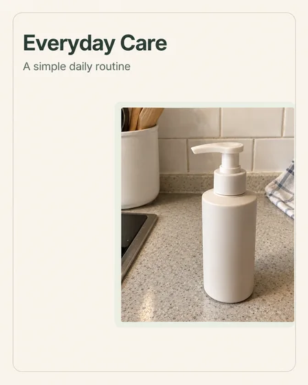

# मार्केटिंग, विज्ञापन और सोशल मीडिया सामग्री

[中文](../../../README.md) · [English](../../../README.en.md) · [Português](../../../README.pt.md) · [Español](../../../README.es.md) · [Français](../../../README.fr.md) · [Deutsch](../../../README.de.md) · [عربي](../../../README.ar.md) · [русский](../../../README.ru.md) · [日本語](../../../README.ja.md) · [हिंदी](../../../README.hi.md)

फ़ीचर्ड कैटलॉग के बाहर 6 मामले। यहां शीघ्र शब्दों का खुलासा नहीं किया गया है, केवल मौजूदा संदर्भ सामग्री, परिणाम निर्देश और न्यूनतम सामग्री आवश्यकताएं प्रदर्शित की गई हैं।

[अधिक केस कैटलॉग पर लौटें](./index.md) · [वेयरहाउस होमपेज पर लौटें](../../../README.hi.md)

> संदर्भ सामग्री और परिणाम छवियां केवल दृश्य मार्गदर्शन के लिए हैं; इस बात की कोई गारंटी नहीं है कि समान सामग्रियों का उपयोग करके समान प्रभाव को पुन: उत्पन्न किया जा सकता है।

## I110 · उत्पाद छवियों से प्रदर्शन क्रिएटिव उत्पन्न करें

<table>
<thead><tr><th width="50%">संदर्भ सामग्री</th><th width="50%">परिणामों का उदाहरण</th></tr></thead>
<tbody><tr><td valign="top">
<strong>उत्पाद छवियाँ, विक्रय बिंदु और दर्शक</strong> 
</td><td valign="top"></td></tr></tbody>
</table>

- **इनपुट प्रकार:** इसमें संदर्भ सामग्री पूर्वावलोकन और परिणाम उदाहरण शामिल हैं
- **सामग्री आवश्यकताएँ:** उत्पाद चित्र, विक्रय बिंदु और दर्शक + उत्पाद विक्रय बिंदु, लक्षित दर्शक → दृश्यों, कॉपी राइटिंग और ब्रांड तत्वों का संयोजन → वर्तमान एकल विज्ञापन रचनात्मक चित्र
- **विवरण:** एक समय में केवल एक ही चित्र उत्पन्न होता है।

[ dearsketch में विशिष्ट आवश्यकताओं की जाँच करें और ](https://dearsketch.com/hi/intent/i110-create-performance-ad-creative-from-a-product-image.html?utm_source=github&utm_medium=gallery&utm_campaign=dearsketch-public-cases&utm_content=i110_cta) बनाएं

---

## I125 · एक ही विज्ञापन दृश्य को विभिन्न भाषा और सांस्कृतिक संस्करणों में बदलें

<table>
<thead><tr><th width="50%">संदर्भ सामग्री</th><th width="50%">परिणामों का उदाहरण</th></tr></thead>
<tbody><tr><td valign="top">
<strong>पूर्ण मूल विज्ञापन</strong> 
</td><td valign="top"></td></tr></tbody>
</table>

- **इनपुट प्रकार:** इसमें संदर्भ सामग्री पूर्वावलोकन और परिणाम उदाहरण शामिल हैं
- **सामग्री आवश्यकताएँ:** 1 पूर्ण मूल विज्ञापन + लक्षित देश या क्षेत्र (निर्दिष्ट भाषा, सांस्कृतिक प्राथमिकता या संशोधित अनुवाद जोड़ा जा सकता है)
- **विवरण:** एक समय में केवल एक ही चित्र उत्पन्न होता है।

[ dearsketch में विशिष्ट आवश्यकताओं की जाँच करें और ](https://dearsketch.com/hi/intent/i125-adapt-one-ad-visual-for-different-languages-and-cultures.html?utm_source=github&utm_medium=gallery&utm_campaign=dearsketch-public-cases&utm_content=i125_cta) बनाएं

---

## I260 · अपने कपड़ों के संग्रह को लुकबुक या फैशन कैटलॉग में बदलें

<table>
<thead><tr><th width="50%">संदर्भ सामग्री</th><th width="50%">परिणामों का उदाहरण</th></tr></thead>
<tbody><tr><td valign="top">
<strong>L02 मॉडल पहने हुए चित्र</strong> 

<strong>L02 पूर्ण सामने उत्पाद चित्र</strong> 
</td><td valign="top"></td></tr></tbody>
</table>

- **इनपुट प्रकार:** इसमें संदर्भ सामग्री पूर्वावलोकन और परिणाम उदाहरण शामिल हैं
- **सामग्री आवश्यकताएँ:** आवश्यक मॉडल चित्र और उत्पाद चित्र (पूरी श्रृंखला के कई चित्र) + आवश्यक श्रृंखला विषय, शैली संख्या, क्रम और पृष्ठों की संख्या (1 प्रति)
- **विवरण:** इस बार एकल दृश्य पूर्वावलोकन तैयार किया गया है। डेटा गणना, सटीक टाइपसेटिंग, वेक्टर या उत्पादन फ़ाइलों को अभी भी संबंधित टूल द्वारा सत्यापित करने की आवश्यकता है।

[ dearsketch में विशिष्ट आवश्यकताओं की जाँच करें और ](https://dearsketch.com/hi/intent/i260-turn-a-clothing-collection-into-a-lookbook-or-fashion-catalog.html?utm_source=github&utm_medium=gallery&utm_campaign=dearsketch-public-cases&utm_content=i260_cta) बनाएं

---

## I261 · पॉडकास्ट कवर आर्ट बनाएं

<table>
<thead><tr><th width="50%">संदर्भ सामग्री</th><th width="50%">परिणामों का उदाहरण</th></tr></thead>
<tbody><tr><td valign="top">
<strong>मेजबान चित्र</strong> 
</td><td valign="top"></td></tr></tbody>
</table>

- **इनपुट प्रकार:** इसमें संदर्भ सामग्री पूर्वावलोकन और परिणाम उदाहरण शामिल हैं
- **सामग्री आवश्यकताएँ:** वैकल्पिक होस्ट पोर्ट्रेट (0 या 1) + आवश्यक प्रोग्राम नाम, थीम और लक्ष्य प्लेटफ़ॉर्म (1 प्रति) + आवश्यक प्रोग्राम नाम और आवश्यक उपशीर्षक (1 सेट)
- **विवरण:** एक समय में केवल एक ही चित्र उत्पन्न होता है।

[ dearsketch में विशिष्ट आवश्यकताओं की जाँच करें और ](https://dearsketch.com/hi/intent/i261-create-podcast-cover-art.html?utm_source=github&utm_medium=gallery&utm_campaign=dearsketch-public-cases&utm_content=i261_cta) बनाएं

---

## I262 · वार्षिक रिपोर्ट श्वेत पत्र या केस अध्ययन के लिए चित्र बनाएं

<strong>परिणामों का उदाहरण</strong>

इस उदाहरण में चित्र संदर्भ शामिल नहीं है, और इनपुट पूर्वावलोकन पूरा किया जाना है; सामग्री संबंधी आवश्यकताएँ नीचे देखें।

- **इनपुट प्रकार:** यह उदाहरण केवल परिणाम उदाहरण दिखाता है; छवि इनपुट पूर्वावलोकन जोड़ा जाना है
- **सामग्री आवश्यकताएँ:** वैकल्पिक ब्रांड विनिर्देश या मौजूदा रिपोर्ट चित्रण एंकर (0 से एकाधिक) + आवश्यक अध्याय सूची और प्रत्येक अध्याय का सारांश (1 प्रति) + स्थिति सत्यापित डेटा (1 प्रति) + वैकल्पिक ब्रांड विनिर्देश (0 या 1 प्रति)
- **विवरण:** एक समय में केवल वर्तमान में चयनित एक ही उत्पन्न होता है; श्रृंखला के अन्य चित्र अलग से निष्पादित किए गए हैं।

[ dearsketch में विशिष्ट आवश्यकताओं की जाँच करें और ](https://dearsketch.com/hi/intent/i262-create-illustrations-for-an-annual-report-white-paper-or-case-study.html?utm_source=github&utm_medium=gallery&utm_campaign=dearsketch-public-cases&utm_content=i262_cta) बनाएं

---

## I263 · पिच डेक के लिए एकीकृत अवधारणा चित्र और आरेख तैयार करें

<strong>परिणामों का उदाहरण</strong>

इस उदाहरण में चित्र संदर्भ शामिल नहीं है, और इनपुट पूर्वावलोकन पूरा किया जाना है; सामग्री संबंधी आवश्यकताएँ नीचे देखें।

- **इनपुट प्रकार:** यह उदाहरण केवल परिणाम उदाहरण दिखाता है; छवि इनपुट पूर्वावलोकन जोड़ा जाना है
- **सामग्री संबंधी आवश्यकताएँ:** वैकल्पिक ब्रांड या रोड शो दृश्य एंकर (0 या 1 फोटो) + आवश्यक पृष्ठ सूची और प्रत्येक पृष्ठ की मुख्य जानकारी (1 प्रति) + आवश्यक व्यवसाय मॉडल या उपयोगकर्ता प्रक्रिया (1 प्रति) + वैकल्पिक ब्रांड विनिर्देश (0 या 1 प्रति)
- **विवरण:** एक समय में केवल वर्तमान में चयनित एक ही उत्पन्न होता है; श्रृंखला के अन्य चित्र अलग से निष्पादित किए गए हैं।

[ dearsketch में विशिष्ट आवश्यकताओं की जाँच करें और ](https://dearsketch.com/hi/intent/i263-create-consistent-illustrations-and-diagrams-for-a-pitch-deck.html?utm_source=github&utm_medium=gallery&utm_campaign=dearsketch-public-cases&utm_content=i263_cta) बनाएं
